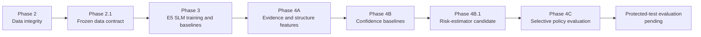
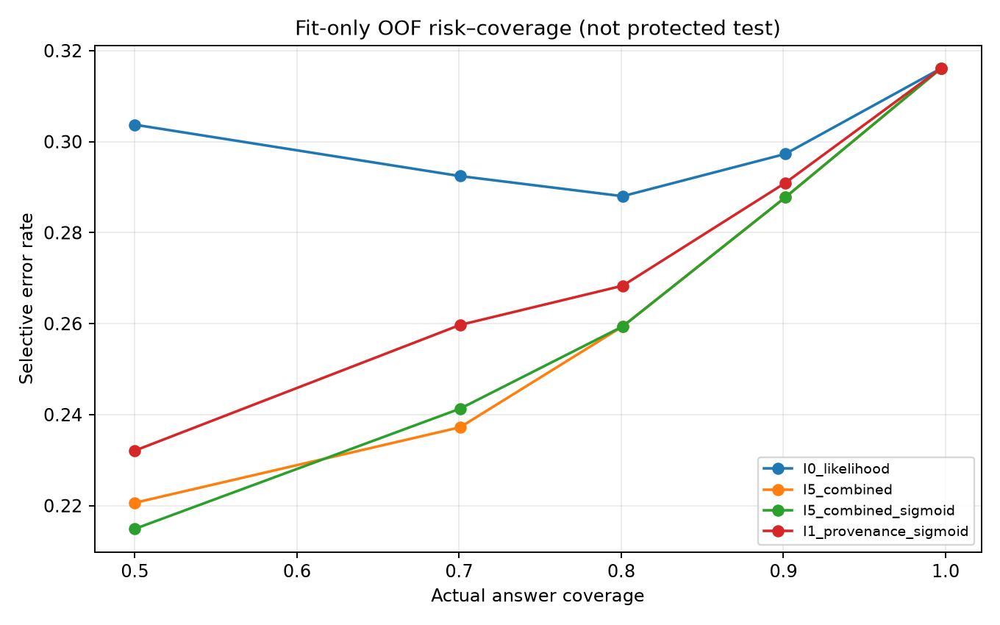
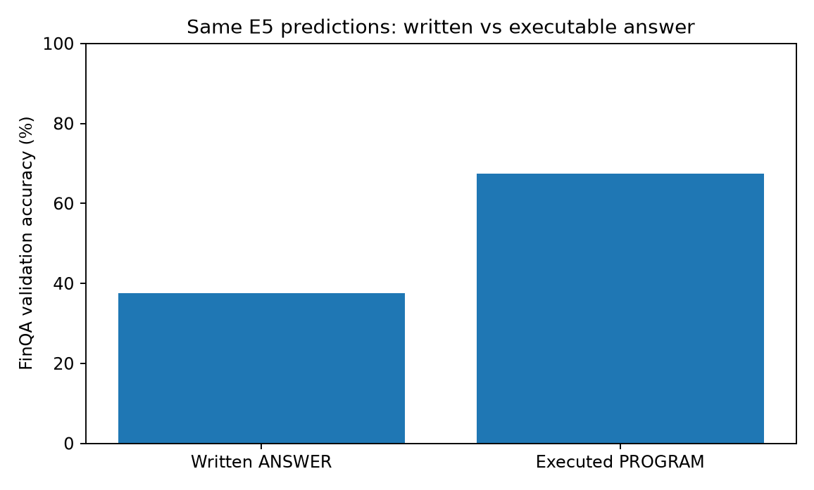
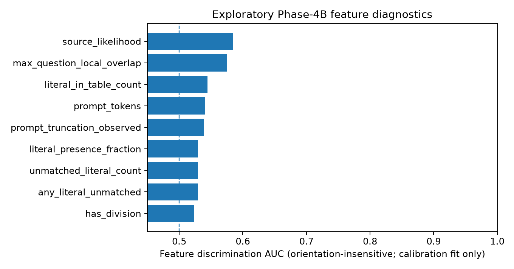
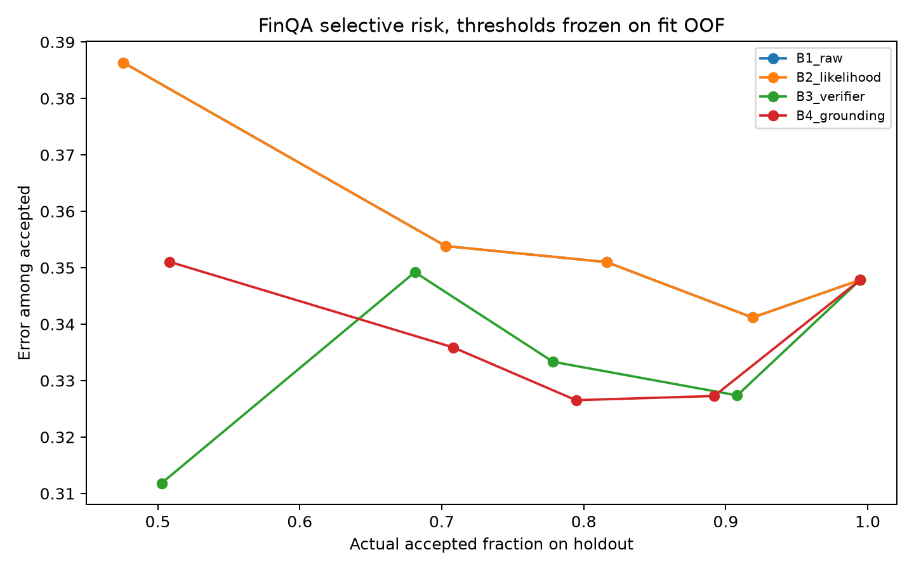
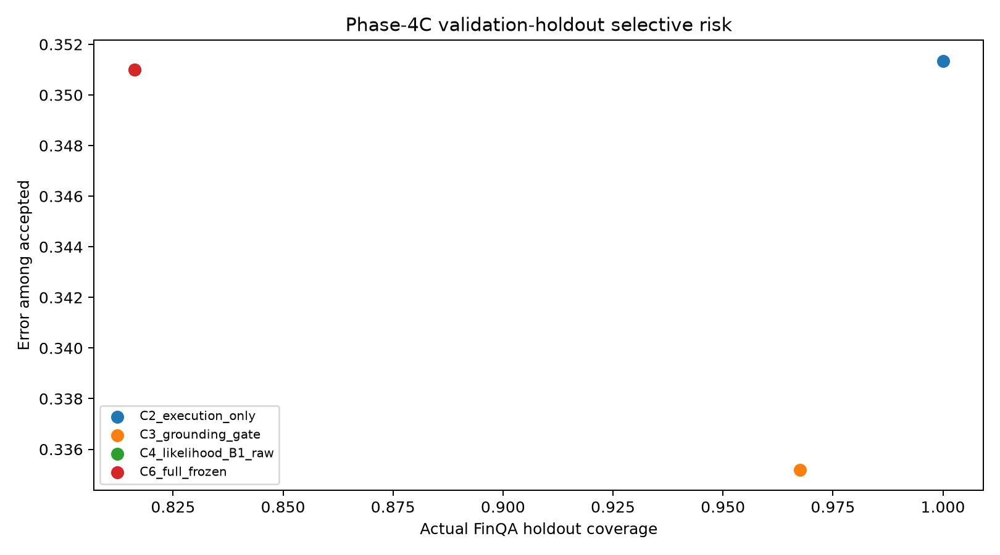
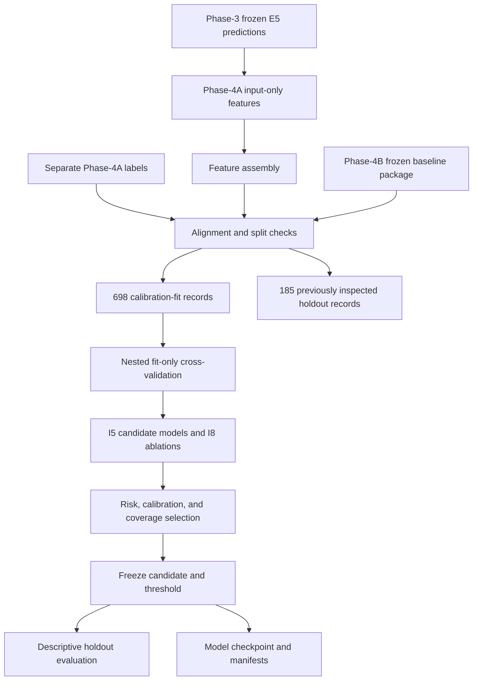

# TrustFin-SLM

**Trustworthy Small Language Models for Financial Tasks**

TrustFin-SLM is a reproducible research repository for training, evaluating, and auditing
small language models on financial reasoning and trustworthiness tasks. The project combines:

- FinQA numerical reasoning with executable financial programs
- FiQA sentiment regression
- FinBen-FOMC evaluation
- FinTrust multi-dimensional trust evaluation
- Program execution and structural validation
- Confidence calibration and selective prediction
- Evidence-grounded risk estimation
- Frozen data contracts, artifact hashes, and offline regression tests

The current frozen Phase-3 backbone is **E5: Qwen/Qwen3-1.7B with balanced joint FinQA + FiQA
QLoRA**. The latest Phase-4B.1 development experiment is a lightweight, inference-available
risk estimator that predicts when an executable financial program is likely to be wrong.

> **Research status:** Phase-4B.1 passed its research-audit gates and produced a candidate for
> protected-test evaluation. The protected test has not yet been evaluated, so the repository
> does not claim final unseen-test superiority.

---

## Contents

- [Project status](#project-status)
- [Research pipeline](#research-pipeline)
- [Current results](#current-results)
- [Repository layout](#repository-layout)
- [Datasets and split policy](#datasets-and-split-policy)
- [Environment setup](#environment-setup)
- [Run the tests](#run-the-tests)
- [Run the notebooks](#run-the-notebooks)
- [Phase-4B.1 architecture](#phase-4b1-architecture)
- [Artifacts and reproducibility](#artifacts-and-reproducibility)
- [Research and reporting rules](#research-and-reporting-rules)
- [Documentation index](#documentation-index)
- [Known limitations and next steps](#known-limitations-and-next-steps)

---

## Project status

| Phase | Purpose | Current status | Main evidence |
|---|---|---|---|
| Phase 2 | Data integrity and unified pipeline | Complete | [`artifacts/phase2/`](artifacts/phase2/) |
| Phase 2.1 | Research validation and data contract | **PASS**; 68 gates, 0 failures | [`artifacts/phase2_1/`](artifacts/phase2_1/) |
| Phase 3 | SLM baselines and failure analysis | **FROZEN** | [`artifacts/phase3/`](artifacts/phase3/) |
| Phase 3.1 | Student and reproducibility audit | PASS; research readiness conditional | [`artifacts/phase3_1/`](artifacts/phase3_1/) |
| Phase 4A | Input-only evidence and program-structure features | Complete | [`artifacts/phase4a/`](artifacts/phase4a/) |
| Phase 4B | Baseline confidence calibration and selective prediction | Frozen validation workflow | [`artifacts/phase4b_full/`](artifacts/phase4b_full/) |
| Phase 4B.1 | Evidence-grounded verifier-aware risk improvement | **PASS_RESEARCH_AUDIT** | [`artifacts/phase4b_1/`](artifacts/phase4b_1/) |
| Phase 4C | Ablations, statistical evaluation, and methodology freeze | Complete validation workflow | [`artifacts/phase4c_full/`](artifacts/phase4c_full/) |

### Frozen Phase-3 backbone

Phase 3 selected E5 using validation-only model selection:

| Property | Frozen value |
|---|---|
| Model | `Qwen/Qwen3-1.7B` |
| Experiment | E5 |
| Sampling | Balanced joint FinQA + FiQA |
| FinQA written-answer accuracy | 37.60% |
| FinQA program accuracy | 61.16% |
| FinQA execution accuracy | 67.50% |
| FiQA MAE | 0.130 |
| FiQA R² | 0.730 |
| Selection score | 0.7446 |

The authoritative freeze is [`phase3_freeze.json`](artifacts/phase3/manifests/phase3_freeze.json).

---

## Research pipeline



### Phase responsibilities

1. **Phase 2 and Phase 2.1** establish the data registry, splits, validation rules, and
   artifact fingerprints.
2. **Phase 3** trains and compares SLM configurations and freezes the E5 backbone.
3. **Phase 4A** derives input-only numerical provenance and program-structure features.
4. **Phase 4B** compares raw likelihood, verifier-aware, and grounding-aware risk baselines.
5. **Phase 4B.1** expands the feature investigation with provenance, relevance, operation,
   truncation, calibration, ablation, and risk-coverage analysis.
6. **Phase 4C** evaluates selective answering and methodology-freeze behavior using previously
   inspected validation holdout data.
7. **Protected-test evaluation** remains the required final generalization step.

---

## Current results

### Phase-4B.1 full run

The executed notebook is:

[`notebooks/TrustFin_Phase4B1_ReadyToRun_New.ipynb`](notebooks/TrustFin_Phase4B1_ReadyToRun_New.ipynb)

The run used Python 3.12.3 and scikit-learn 1.9.1 with the canonical repository packages.

| Field | Verified value |
|---|---|
| Run mode | `full` |
| Status | `PASS_RESEARCH_AUDIT` |
| Calibration-fit records | 698 |
| Previously inspected holdout records | 185 |
| Selected candidate | `I5_combined_sigmoid` |
| Selected before holdout inspection | Yes |
| Protected test evaluated | No |
| Research conclusion | `CANDIDATE_FOR_PROTECTED_TEST` |

### Fit-only comparison at approximately 80% coverage

| Metric | Raw likelihood (`I0`) | Selected candidate |
|---|---:|---:|
| Valid fit records | 696 | 696 |
| ROC-AUC | 0.5845 | 0.6733 |
| Brier score | 0.2646 | 0.2002 |
| AURC | 0.2390 | 0.2170 |
| Selective risk at 80% | 0.2880 | 0.2594 |
| Realized coverage | 0.8009 | 0.8009 |
| Accepted records | 559 | 559 |

The fit-only baseline-minus-candidate selective-risk difference is 0.0286, with a bootstrap
95% interval of approximately `[0.0072, 0.0537]`. These are development and validation
results, not protected-test results.

### Phase-4B.1 risk-coverage plot



### Phase-3 answer/execution gap

The execution-based result is substantially higher than written-answer accuracy because the
generated financial program can sometimes be executed correctly even when the rendered answer
is incorrect.



### Phase-4A feature diagnostics



### Earlier Phase-4B baseline risk-coverage



### Phase-4C selective-risk comparison



---

## Repository layout

```text
.
├── README.md
├── AGENTS.md
├── Makefile
├── Dockerfile
├── data/
│   ├── finqa_train.json
│   ├── finqa_dev.json
│   ├── finqa_test.json
│   └── raw/
├── notebooks/
│   ├── Phase2_TrustFin_Data_Integrity_and_Unified_Pipeline.ipynb
│   ├── Phase2_1_TrustFin_Research_Validation_and_Data_Contract.ipynb
│   ├── Phase3_TrustFin_SLM_Baselines_and_Failure_Analysis.ipynb
│   ├── TrustFin_Phase4B1_ReadyToRun_New.ipynb
│   └── ...
├── artifacts/
│   ├── phase2/
│   ├── phase2_1/
│   ├── phase3/
│   ├── phase3_1/
│   ├── phase4a/
│   ├── phase4b_full/
│   ├── phase4b_1/
│   └── phase4c_full/
├── deliverables/
│   └── shareable ZIP and archive bundles
├── docs/
│   ├── exp_1.md through exp_4B(1).md
│   ├── related_work.md
│   ├── literature_reading_matrix.md
│   └── trustfin_references.bib
├── paper/
│   └── TrustFin_Conference_Paper.tex and markdown mirror
├── phases/
│   └── phase-wise execution logs and run archives
├── tools/
│   ├── phase3_shard.py
│   └── phase3_supervisor.sh
└── trust_fin_extra_phase/
    ├── requirements.txt
    ├── requirements-test.txt
    ├── requirements.lock.txt
    ├── tests/
    └── tools/
```

The repository also contains compressed deliverables and historical run archives. Frozen
artifacts should be treated as evidence and should not be overwritten.

---

## Datasets and split policy

| Dataset | Role | Usage |
|---|---|---|
| FinQA | Numerical financial reasoning | Train, validation, protected test |
| FiQA Sentiment | Financial sentiment regression | Train, validation, protected test |
| FinBen-FOMC | FOMC stance classification | Evaluation only |
| FinTrust | Seven-dimension trust benchmark | Evaluation only |

### Data policy

- FinQA and FiQA are used for SLM training and validation.
- FinQA and FiQA validation splits are used for calibration and threshold selection.
- FinBen-FOMC and FinTrust do not enter SFT, calibration, or threshold tuning.
- Protected test sets remain untouched until methodology and evaluator protocols are frozen.
- Phase-4B.1 uses 698 `calibration_fit` records for selection and 185 previously inspected
  `calibration_holdout` records for descriptive secondary evaluation.
- The 185-record holdout must not be described as a newly untouched test set.
- Gold labels, gold answers, and correctness fields are not used as Phase-4B.1 predictors.

The Phase-2.1 data contract and registry are in [`artifacts/phase2_1/`](artifacts/phase2_1/).

---

## Environment setup

### Recommended Python environment

The pinned research environment is documented in:

- [`trust_fin_extra_phase/requirements.txt`](trust_fin_extra_phase/requirements.txt)
- [`trust_fin_extra_phase/requirements.lock.txt`](trust_fin_extra_phase/requirements.lock.txt)
- [`trust_fin_extra_phase/requirements-test.txt`](trust_fin_extra_phase/requirements-test.txt)

The recorded Phase-3/4 environment uses Python 3.12.3. The full requirements include the
GPU/training stack:

```bash
python3 -m venv .venv
source .venv/bin/activate
python -m pip install --upgrade pip
python -m pip install -r trust_fin_extra_phase/requirements.txt
```

For only the offline test suite:

```bash
python -m pip install -r trust_fin_extra_phase/requirements-test.txt
```

Check the resolved interpreter and key packages:

```bash
make env
```

> The requirements file documents a historical discrepancy in frozen environment metadata.
> The lock file is the authoritative reproducible environment for the executed Phase-3/4
> workflows; frozen evidence manifests are not edited retroactively.

---

## Run the tests

Run the repository's offline regression suite:

```bash
make test
```

The suite covers:

- Response schemas
- Answer rendering
- Abstention behavior
- Safety regressions
- Redaction
- Frozen artifact hashes
- Protected-test access
- Absolute-path hygiene

Expected current result:

```text
37 passed
```

Additional validation commands:

```bash
make verify-hashes
make verify-phase4
make docker-test
```

`docker-test` requires Docker. It builds and runs the CPU-only validation container.

---

## Run the notebooks

### Phase-2.1 validation

```bash
jupyter nbconvert --to notebook --execute \
  --ExecutePreprocessor.timeout=3600 \
  --output Phase2_1_TrustFin_Research_Validation_and_Data_Contract_run.ipynb \
  --output-dir notebooks \
  notebooks/Phase2_1_TrustFin_Research_Validation_and_Data_Contract.ipynb
```

### Phase-3 full workflow

Phase 3 is sharded because training and evaluation can be long-running:

```bash
bash tools/phase3_supervisor.sh
```

See [`phases/phase3/README.md`](phases/phase3/README.md) and [`docs/exp_3(b).md`](docs/exp_3%28b%29.md)
for the run protocol.

### Phase-4B.1 smoke run

Run the source notebook in place. The smoke run validates the pipeline but is not a research
result:

```bash
TRUSTFIN_B1_MODE=smoke \
jupyter nbconvert --to notebook --execute --inplace \
  notebooks/TrustFin_Phase4B1_ReadyToRun_New.ipynb
```

### Phase-4B.1 full run

The full run writes a new `artifacts/phase4b_1/` output tree:

```bash
TRUSTFIN_B1_MODE=full \
jupyter nbconvert --to notebook --execute --inplace \
  notebooks/TrustFin_Phase4B1_ReadyToRun_New.ipynb
```

The notebook automatically searches canonical repository directories. Explicit paths can be
provided when running from another location:

```bash
export TRUSTFIN_INPUT_DIR="/path/to/Research Papers"
export TRUSTFIN_PHASE4A_ZIP="/path/to/Phase4A_Review_Package.zip"
export TRUSTFIN_PHASE4B_ZIP="/path/to/Phase4B_Review_Package.zip"
export TRUSTFIN_PHASE3_ZIP="/path/to/Phase3_TrustFin_Deliverable.zip"
export TRUSTFIN_PHASE2_VALIDATION_JSONL="/path/to/validation.jsonl"
export TRUSTFIN_PHASE4B1_OUTPUT="/path/to/artifacts/phase4b_1"

TRUSTFIN_B1_MODE=full \
jupyter nbconvert --to notebook --execute --inplace \
  notebooks/TrustFin_Phase4B1_ReadyToRun_New.ipynb
```

Important Phase-4B.1 outputs:

```text
artifacts/phase4b_1/
├── manifests/
│   ├── phase4b1_readiness.json
│   ├── phase4b1_fit_only_freeze.json
│   ├── source_fingerprints.json
│   └── feature_contract.json
├── tables/
│   ├── I5_I8_fit_oof_comparison.csv
│   ├── I6_calibration_comparison.csv
│   ├── I7_risk_coverage_fit.csv
│   ├── I8_feature_ablation.csv
│   └── I9_secondary_holdout_comparison.csv
├── predictions/
├── models/
│   └── I9_fit_only_selected.joblib
├── plots/
│   └── I7_risk_coverage_fit.png
└── Phase4B_1_Review_Package.zip
```

---

## Phase-4B.1 architecture

The Phase-4B.1 notebook is a lightweight post-hoc risk-estimation pipeline. It does not
fine-tune Qwen3. It reads frozen model outputs and learns a small logistic risk estimator.



### Feature groups

- **I1 provenance:** operand-source counts, unmatched literals, table/narrative/question
  literal ratios, and source overlap.
- **I2 relevance:** lexical question/evidence overlap heuristics.
- **I3 operations:** addition, subtraction, multiplication, division, comparison, table
  operations, program steps, and references.
- **I4 truncation:** prompt length, truncation indicators, and generated-token counts.
- **I5 models:** low-capacity logistic risk estimators with nested fit-only validation.
- **I6 calibration:** probability calibration and Brier/log-loss diagnostics.
- **I7 selective prediction:** risk-coverage curves and approximately 80% target coverage.
- **I8 ablations:** removal of provenance, relevance, operation, and truncation groups.
- **I9 freeze and statistics:** bootstrap uncertainty, threshold freeze, checkpoint hashing,
  and descriptive holdout evaluation.

### Selection safeguards

- Candidate selection occurs only on the 698-record calibration-fit partition.
- Thresholds are fitted from fit-only out-of-fold predictions.
- The previously inspected 185-record holdout is not used for selection.
- Protected test files are not evaluated.
- The notebook records source fingerprints and model-checkpoint hashes.
- A `PASS_RESEARCH_AUDIT` status does not mean publication success or protected-test success.

The full architecture explanation is [`docs/exp_4B(1).md`](docs/exp_4B%281%29.md).

---

## Artifacts and reproducibility

Important frozen and generated artifact areas:

| Location | Purpose |
|---|---|
| [`artifacts/phase2_1/`](artifacts/phase2_1/) | Data registry, validation contract, and split manifests |
| [`artifacts/phase3/`](artifacts/phase3/) | Frozen E5 results, metrics, predictions, and model evidence |
| [`artifacts/phase4a/`](artifacts/phase4a/) | Evidence and program-structure feature package |
| [`artifacts/phase4b_full/`](artifacts/phase4b_full/) | Original Phase-4B baselines and freeze |
| [`artifacts/phase4b_1/`](artifacts/phase4b_1/) | Current Phase-4B.1 outputs |
| [`artifacts/phase4c_full/`](artifacts/phase4c_full/) | Phase-4C selective-policy evaluation |
| [`deliverables/`](deliverables/) | Shareable archives and student deliverables |

Use the hash checks before relying on frozen evidence:

```bash
make verify-hashes
```

Do not overwrite frozen phase artifacts. New experiments should write to a new output
directory and should record their input hashes, environment, split, and selection rule.

---

## Research and reporting rules

The following rules are required for valid TrustFin-SLM reporting:

1. Do not use protected-test examples for model selection, threshold tuning, or feature design.
2. Do not describe the Phase-4B.1 185-record validation holdout as a new independent test.
3. Separate written-answer accuracy from execution accuracy.
4. Treat lexical relevance and numerical provenance as risk indicators, not semantic proof.
5. Report negative or inconclusive results if the protected-test evaluation does not confirm the
   fit-only improvement.
6. Keep frozen Phase-2.1, Phase-3, Phase-4A, and prior Phase-4B evidence unchanged.
7. Record the Python and dependency versions for executed notebooks.
8. Use the generated manifests and CSV tables as the numerical source of truth for papers.

The student research guides and experiment write-ups are in [`docs/`](docs/).

---

## Documentation index

| Document | Description |
|---|---|
| [`docs/exp_1.md`](docs/exp_1.md) | Phase-2 data pipeline |
| [`docs/exp_2.md`](docs/exp_2.md) | Phase-2.1 validation and contract |
| [`docs/exp_3(a).md`](docs/exp_3%28a%29.md) | Phase-3 smoke workflow |
| [`docs/exp_3(b).md`](docs/exp_3%28b%29.md) | Phase-3 full baselines and failure analysis |
| [`docs/exp_4(a).md`](docs/exp_4%28a%29.md) | Phase-4 proposed method |
| [`docs/exp_4(b).md`](docs/exp_4%28b%29.md) | Original Phase-4B calibration and selective prediction |
| [`docs/exp_4(c).md`](docs/exp_4%28c%29.md) | Phase-4C ablation and methodology freeze |
| [`docs/exp_4B(1).md`](docs/exp_4B%281%29.md) | Full Phase-4B.1 architecture and experiment explanation |
| [`docs/related_work.md`](docs/related_work.md) | Related-work taxonomy and research gap |
| [`docs/literature_reading_matrix.md`](docs/literature_reading_matrix.md) | Literature-reading matrix |
| [`docs/trustfin_references.bib`](docs/trustfin_references.bib) | BibTeX references |
| [`paper/TrustFin_Conference_Paper.tex`](paper/TrustFin_Conference_Paper.tex) | Conference paper source |

---

## Known limitations and next steps

### Current limitations

- Phase-4B.1 has not evaluated the protected FinQA test.
- The selected risk estimator is validated on a relatively small calibration-fit partition.
- The secondary holdout was already inspected in prior phases.
- Question-operation features are lexical heuristics, not semantic financial verification.
- Full FinTrust seven-dimension evaluator validation is still pending.
- A fit-only improvement does not establish causal benefit or deployment reliability.
- GPU training workflows require the pinned training environment and sufficient hardware.

### Required next steps

1. Approve the frozen feature list and threshold independently.
2. Evaluate the frozen Phase-4B.1 candidate once on the protected FinQA test.
3. Compare it with the frozen raw-likelihood baseline at matched coverage.
4. Report confidence intervals and any negative or inconclusive result.
5. Complete the separate FinTrust evaluation protocol.
6. Update the paper only after protected-test evidence is available.

---

## License and research use

This repository is a research workspace. Check the dataset and model licenses before
redistributing raw data, model checkpoints, or derived packages. Do not commit credentials,
tokens, private datasets, or local environment files.
