# TrustFin-SLM — Architecture, Evidence, and Research-Paper Report

**Repository:** [HEETMEHTA18/trust_fin](https://github.com/HEETMEHTA18/trust_fin)  
**Reviewed snapshot:** `ec2b5e17319dffa3b5d901f76f21fd8bbdfa8d67` (`main`)  
**Review date:** 29 October 2026  
**Primary scope:** the root project, especially `notebooks/`, root `artifacts/`, root `docs/`, and their deliverables.  
**Latest update:** notebook/artifact update `aa7fa8e...` and subsequent README update `ec2b5e1...` are included.

**Separate scope:** `trust_fin_extra_phase/` was also inspected, but its methods, results, tests, and runtime are **excluded from the proposed root-only research paper**.

> The root project supports a paper about controlled financial SLM adaptation, the gap between written and executed answers, and a careful evaluation of verifier-aware calibration. Its strongest result is the **29.90 percentage-point validation answer-reporting gain from execution**. The original Phase 4B/C frozen selective policy is **B1_raw**. The new root Phase 4B.1 selects **I5_combined_sigmoid** as a follow-up development candidate, with important feature and reproducibility limitations described in Section 5.7; it is not yet independently confirmed. Existing paper files mix in extra-phase experiments and need a scope-controlled rewrite.

## Reading map

1. [Scope and evidence rules](#1-scope-and-evidence-rules)
2. [Root architecture](#2-root-architecture)
3. [Data preparation and contracts](#3-data-preparation-and-contracts)
4. [Training and baseline experiments](#4-training-and-baseline-experiments)
5. [Audit and methodology development](#5-audit-and-methodology-development)
6. [Root results and their meaning](#6-root-results-and-their-meaning)
7. [Artifacts, orchestration, and reproducibility](#7-artifacts-orchestration-and-reproducibility)
8. [Documentation and manuscript audit](#8-documentation-and-manuscript-audit)
9. [How to make the root-only research paper proper](#9-how-to-make-the-root-only-research-paper-proper)
10. [Separate review of the extra experiments](#10-separate-review-of-the-extra-experiments)
11. [Verification performed and limitations](#11-verification-performed-and-limitations)
12. Appendices: notebook coverage, source-module map, complete file inventory, archive inventory, evidence index.

## 1. Scope and evidence rules

### 1.1 The research boundary

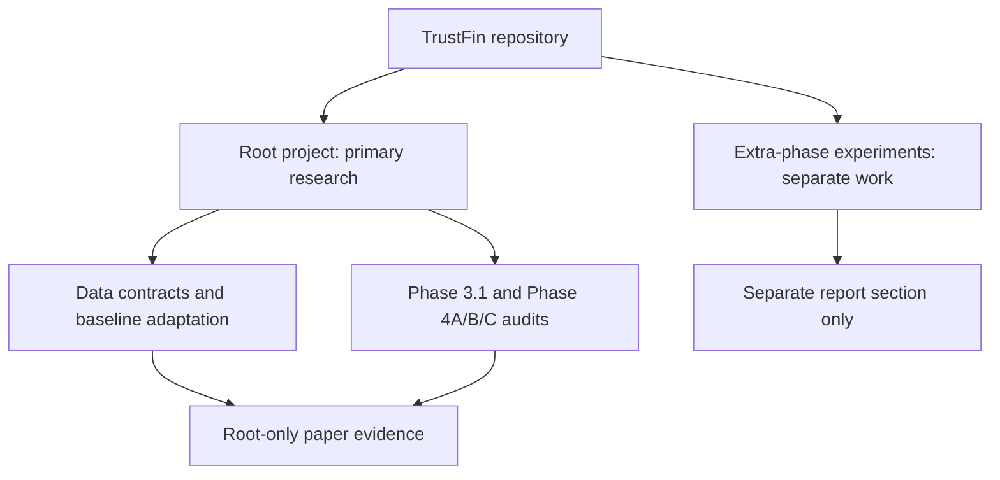

**Pieces.** The base project is the root notebook sequence through Phase 4C, plus the newly added Phase 4B.1 follow-up. The extra workspace inherits its E5 backbone but adds a different inference method and protected evaluations. Folder placement alone does not establish paper eligibility: some files under root `paper/`, older `docs/`, and `deliverables/` already describe extra-phase work. The latest README has been rewritten around the root study.

### 1.2 How to decide which evidence to trust

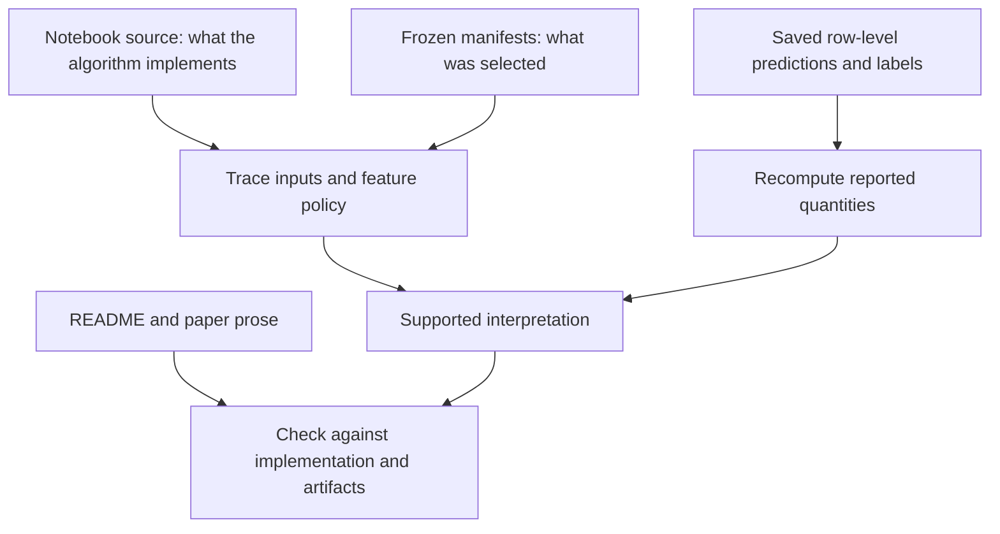

**Pieces.** Source establishes the procedure; manifests establish the saved selection; records establish the measured values. A stored `PASS` confirms that the run's gates passed at the time. It does not establish novelty, universal superiority, semantic grounding, or fresh-checkout reproducibility. Historical execution transcripts are supporting context, not instructions to execute or authoritative replacements for results.

### 1.3 Inspection coverage

| Item | Coverage at the reviewed snapshot |
|---|---:|
| Git-tracked paths, including symlinks | 618 |
| Paths outside `trust_fin_extra_phase/` | 401 |
| Paths inside `trust_fin_extra_phase/` | 217 |
| Files named `.ipynb` | 36 |
| Valid notebook JSON files | 35 |
| Notebook-named plain-text editor proxy | 1 |
| Python source files | 28 |
| CSV files | 138 |
| JSON files | 172, including one malformed file |
| JSONL files | 35 |
| PNG files | 62 |
| PDF / DOCX / ODT files | 19 / 11 / 1 |
| ZIP files | 13 |
| Serialized `.pkl` / `.joblib` files | 16 / 9 |

The counts include the latest 27-file user update. All tracked paths were inventoried and their bytes read, or their symlink targets inspected. Every valid notebook was parsed, including code, markdown, execution counts, and saved output structure. CSV and JSONL records were fully parsed; JSON documents were parsed except for the conflict-damaged inventory. Documents had their full available text extracted; images were decoded and visually reviewed in contact sheets. ZIP member bytes were read and CRC-checked. Serialized models received static inspection, **not unsafe deserialization**. Appendix C records the exact inspection level per path; this is not a claim of fresh GPU execution or exhaustive visual proofreading of every paper page.

## 2. Root architecture

### 2.1 The complete base-project lifecycle

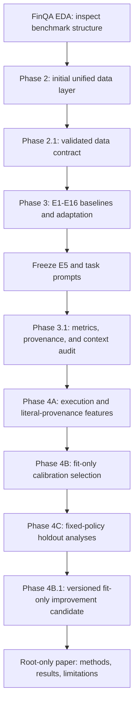

**Pieces.** EDA examines the task. Phase 2.1 becomes the supported downstream data interface. Phase 3 performs the model work. Phase 3.1 checks saved evidence and repairs metrics. Phase 4A extracts inference-available features. Phase 4B compares risk estimators and freezes a winner. Phase 4C evaluates the frozen selection and reports ablations and uncertainty. Root Phase 4A/B/C use **validation-development records**, not new protected-test results. Sources: [R1], [R2], [R3], [R4], [R5], [R6].

### 2.2 The actual architectural layers

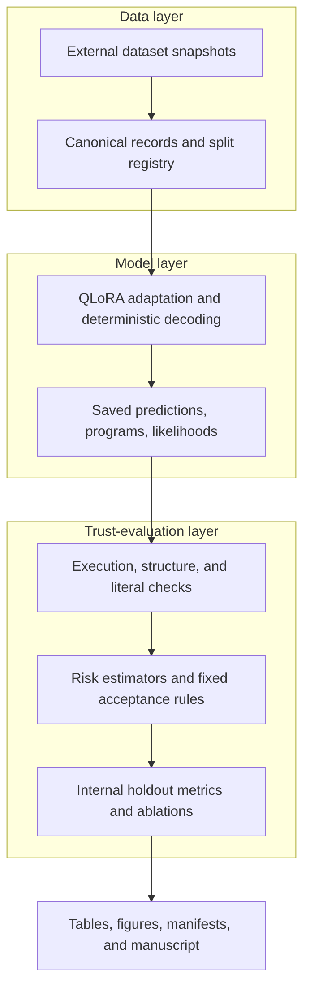

**Pieces.** The root is a notebook-driven, file-based research pipeline. JSONL, CSV, JSON, ZIP, and saved model artifacts connect stages. No web application, REST service, live trading system, vector database, or deployed financial assistant is implemented in this base architecture. The Anaconda SQLite file is workspace/editor metadata, not a business database.

### 2.3 What one financial reasoning example does

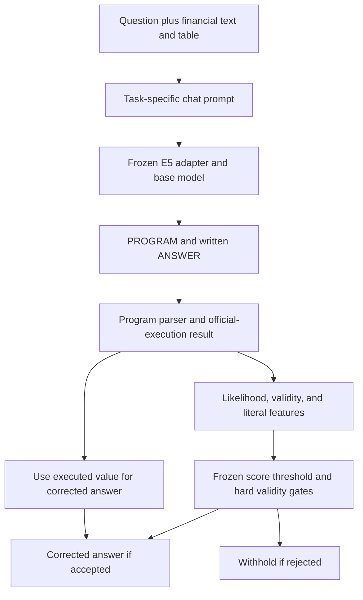

**Pieces.** Phase 3 generates and records both a program and an answer string. Later root phases analyze correction and acceptance using these saved records. The diagram represents that implemented research flow; it does not imply that a live end-user application already runs it. Execution proves that a program can run, not that its operands or reasoning are correct.

## 3. Data preparation and contracts

### 3.1 The four dataset roles

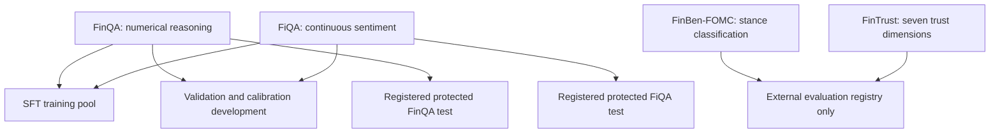

**Pieces.** FinQA and FiQA supply training and development examples. FOMC and FinTrust are not allowed into SFT, few-shot selection, calibration, or threshold tuning. Registering their files does not mean the root project has produced final evaluations for them. Sources: [R7], [R8].

| Dataset | Training | Validation | Registered test | Root paper role |
|---|---:|---:|---:|---|
| FinQA | 6,251 | 883 | 1,147 | Main numerical-reasoning study; root results are validation/internal holdout |
| FiQA | 822 | 117 | 234 | Continuous sentiment regression |
| FinBen-FOMC | 0 | 0 | 496 | Registered external evaluation; no root final result |
| FinTrust | 0 | 0 | Heterogeneous registry | Evaluation infrastructure/readiness; no root complete seven-dimension result |
| Combined FinQA + FiQA | 7,073 | 1,000 | Kept separate | Root model inputs |

Counts above come from the checked-out records and registry. Do not copy an extra-phase narrative about an alternative 1,800-record FinQA test carve into the root paper: the root contract explicitly validates 1,147 test records and 8,281 FinQA IDs in total. Dataset split provenance should always be stated from the actual frozen source.

### 3.2 Phase 2.1 validation and export

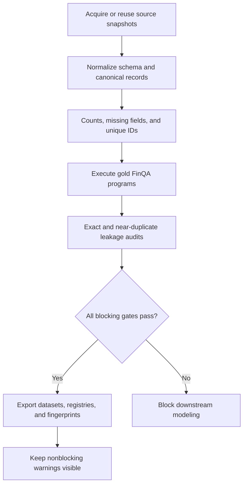

**Pieces.** Phase 2 is the initial pipeline; Phase 2.1 strengthens its research contract, including official FinQA execution, FOMC isolation, recursive FinTrust evaluator discovery, and a mandatory near-duplicate audit. The saved Phase 2.1 report has 68 gates, zero hard failures, and two warning categories: source answer-representation consistency and incomplete FinTrust evaluator discovery. A passing data contract does not resolve those warnings. Sources: [R1], [R7], [R8].

### 3.3 Canonical record and target separation

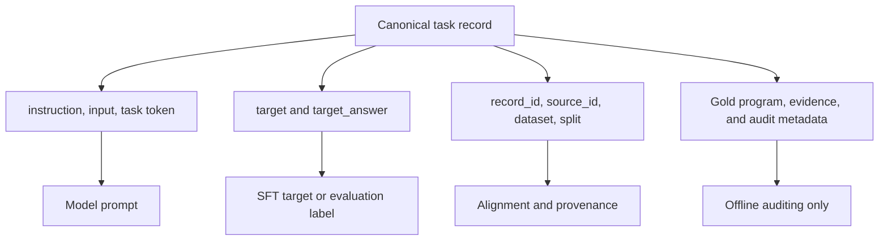

**Pieces.** FinQA prompts contain the full available financial narrative, table, and question before token limits are applied. Gold evidence is metadata, not privileged inference context. FinQA's supervised output is `PROGRAM: ...` followed by `ANSWER: <official execution answer>`. FiQA uses `SENTIMENT_SCORE: <continuous value>` in `[-1,1]`; it is not a binary or three-class sentiment study. `qa.exe_ans` and a human-readable source answer must not be silently treated as identical.

### 3.4 The exported interface

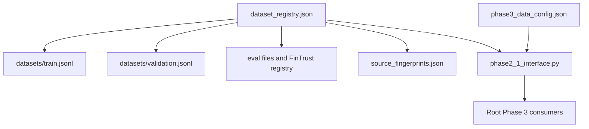

**Pieces.** The tiny interface supplies loaders and an explicit protected-access argument for evaluation data. This is a research workflow guard, not operating-system access control. Manifests record the original machine's absolute paths. The root interface does not automatically relocate all of those paths for a fresh checkout. Preserve original fingerprints and add an external path resolver rather than silently rewriting frozen evidence.

## 4. Training and baseline experiments

### 4.1 E1–E16 experiment families

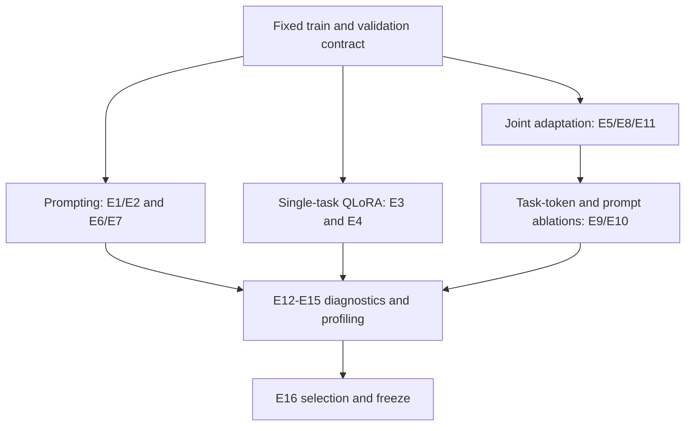

**Pieces.** Qwen3-1.7B is the primary model; Phi-4-mini-instruct is the secondary model. All E1–E11 evaluation files use development records. E12–E15 analyze predictions, errors, confidence, and resources. E16 freezes the chosen primary-family joint model and task-specific prompts. Source: [R2].

| IDs | Purpose | Important dependency |
|---|---|---|
| E1 / E2 | Qwen zero-shot / few-shot | Few-shot examples come from training only |
| E3 / E4 | Qwen FinQA-only / FiQA-only QLoRA | Test task transfer and specialization |
| E5 | Qwen balanced joint QLoRA | Frozen root backbone |
| E6 / E7 | Phi zero-shot / few-shot | Cross-family prompting baselines |
| E8 | Phi balanced joint QLoRA | Cross-family comparison, outside backbone eligibility |
| E9 / E10 | FinQA / FiQA prompt variants | Use frozen E5 adapter |
| E11 | Qwen natural-proportion joint QLoRA | Sampling comparison against E5 |
| E12 / E13 | FinQA / FiQA failure analysis | Saved outputs |
| E14 / E15 | Confidence / efficiency diagnostics | Saved outputs and training metadata |
| E16 | Candidate and prompt freeze | E5/E11 selection, E9/E10 prompts |

### 4.2 How balanced training is actually implemented

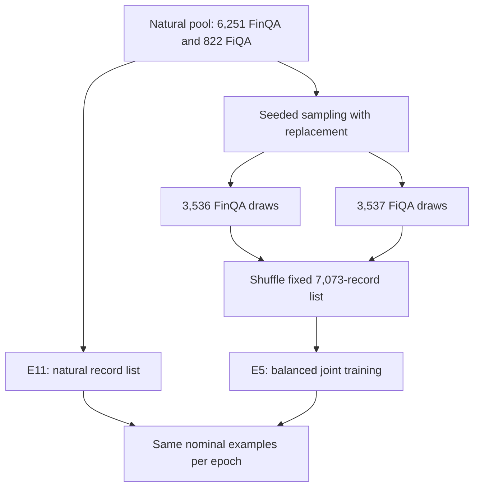

**Pieces.** E5 uses a fixed-size resampled list, not a new balanced draw at every batch or an enlarged full FinQA pool. The same resampled list is trained for the configured epochs. E5 and E11 have comparable nominal step budgets; unique record exposure differs. The paper should describe replacement sampling explicitly and avoid implying that E5 necessarily sees every source example in every epoch.

### 4.3 QLoRA training and decoding

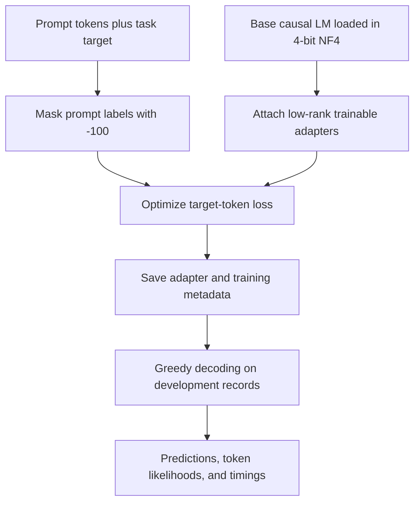

**Pieces.** The backbone is quantized; adapter weights receive task adaptation. Training trims older prompt tokens to preserve room for the target, subject to the target cap. Generation uses deterministic decoding (`do_sample=False`). The root study does not sample eight programs per question. That is an extra-phase procedure.

| Setting | Root implementation / recorded run |
|---|---|
| Seed | 42 |
| Epochs | 2 |
| Primary training sequence cap | 1,024 tokens |
| Secondary training cap | 768 tokens; implementation has OOM fallback candidates |
| Evaluation input cap | 1,024 tokens |
| Batch / gradient accumulation | 1 / 8 |
| Learning rate | `2e-4` |
| LoRA rank / alpha / dropout | 16 / 32 / 0.05 |
| Quantization | 4-bit NF4, double quantization configured |
| Generated token caps | FinQA 192; FiQA 24 |
| Optimizer | Paged AdamW 8-bit when 4-bit training is enabled |

Report actual per-experiment training metadata, especially the shorter secondary-model context, rather than treating these models as identical compute-condition comparisons. The saved environment is historical provenance; its versions were not reconstructed as a fresh GPU environment during this review.

### 4.4 Model selection is restricted, not a global leaderboard

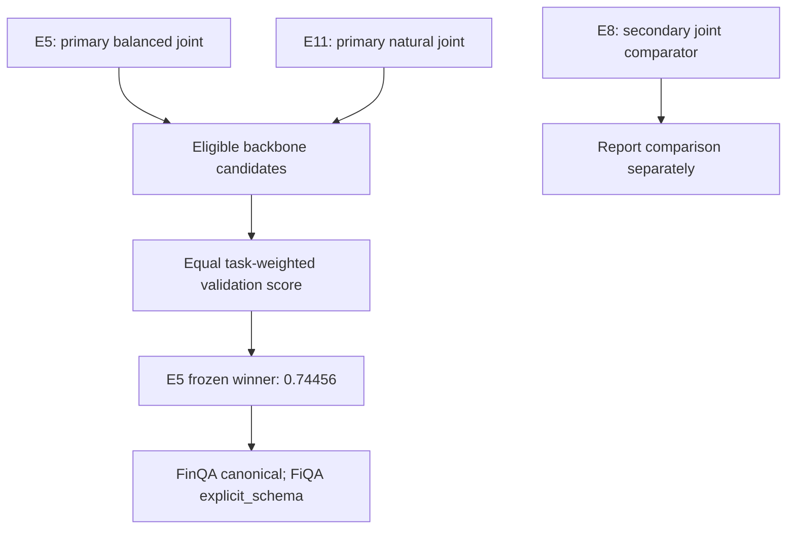

**Pieces.** E8 reaches higher FinQA validation execution accuracy than E5, but was not eligible to replace the predeclared primary-family backbone. The manuscript must say “selected primary-family joint backbone,” not “best model across all experiments.” FiQA's frozen explicit-schema prompt scores MAE `0.12729`; the canonical E5 row scores `0.13010`. Label those prompt variants wherever numbers appear. Source: [R9].

### 4.5 Why long-context handling matters

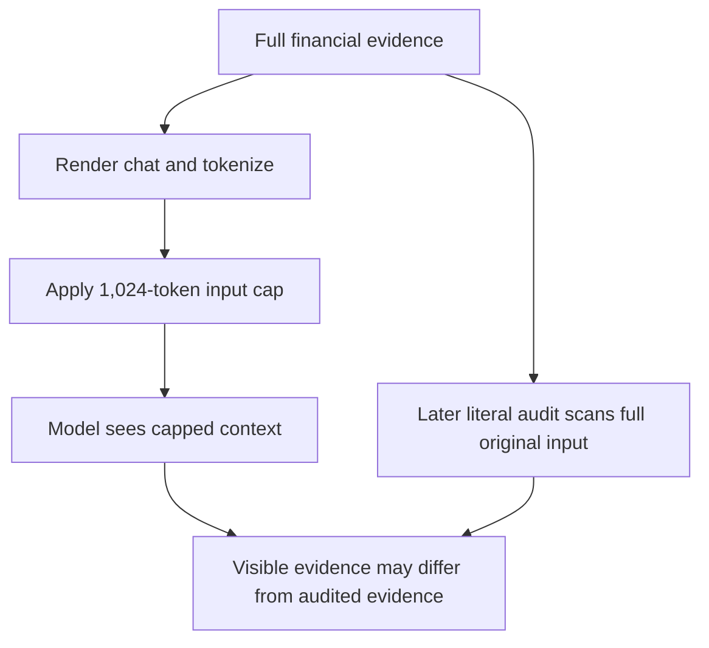

**Pieces.** Phase 3.1 records 459/883 truly truncated Qwen prompts (51.98%); 460/883 reach the cap, which is a related but different diagnostic. For E5, saved execution accuracy is about 63.70% at the cap versus 71.63% below it. This is observational, not proof that increasing context would cause a particular improvement. A literal found in the full original input may have been invisible to the model. Source: [R10].

## 5. Audit and methodology development

### 5.1 Phase 3.1: repair and verify the evidence

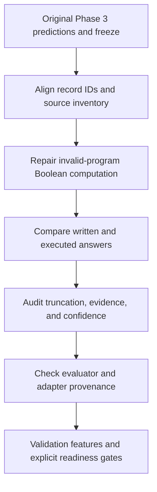

**Pieces.** The original invalid-program-rate calculation could produce impossible negative values through object-typed Boolean inversion. Phase 3.1 preserves the original files and writes corrected metrics into a new tree. Its saved core offline audit is `PASS`, but overall research readiness remains `CONDITIONAL_HOLD` because seven official FinTrust evaluation protocols were not all verified. The optional context-inference pilot is `NOT_RUN`. Root Phase 4A also records no new local official re-execution or local adapter verification; it relies on prior evidence for those checks. Sources: [R3], [R11].

### 5.2 Phase 4A: verification is separated from correctness

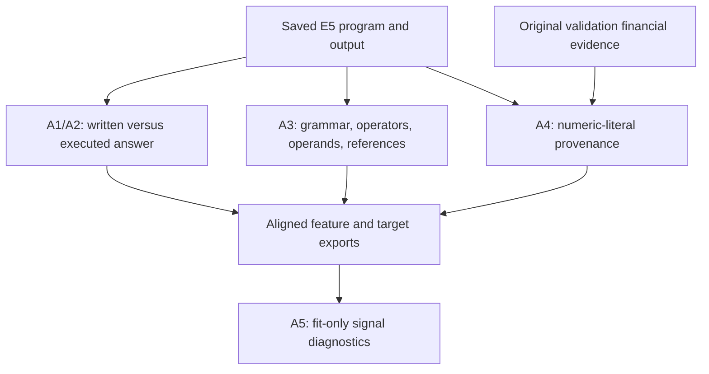

**Pieces.** A3 checks structural validity, including supported operands and table operation arity. A4 normalizes numerical strings, distinguishes percent notation, ignores allowed constants and intermediate references, and searches narrative/table/question sources. Local lexical overlap adds a relevance heuristic. These are observable features, not ground-truth semantic labels. The full run reports 880/883 structurally valid programs and 21/883 records with at least one unmatched literal (30 unmatched literals in total). Source: [R4].

### 5.3 The label-leakage firewall

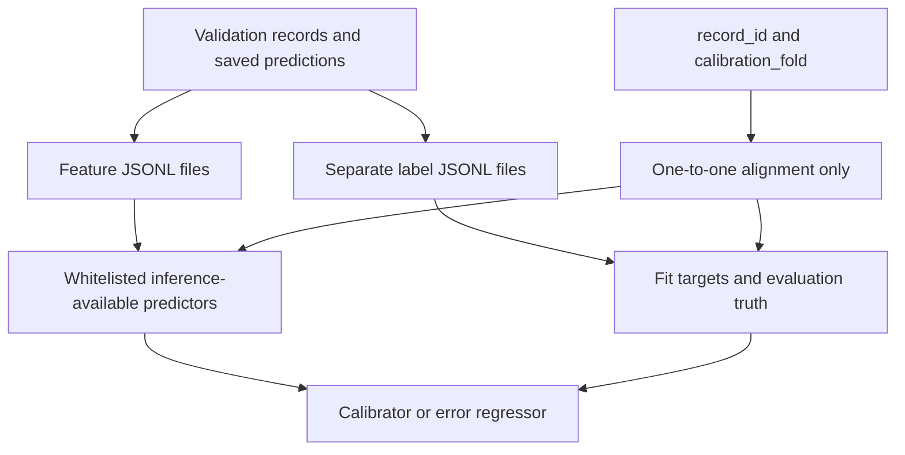

**Pieces.** Predictor arrays exclude gold programs, gold answers, execution correctness, absolute error, and record identities. IDs/folds are retained for joining and partitioning, not trained as numeric predictors. FinQA's target is execution correctness; FiQA's target is absolute regression error. This distinction is a useful reproducibility contribution in the base paper. Source: [R12].

### 5.4 Phase 4B: select on fit OOF, then inspect holdout

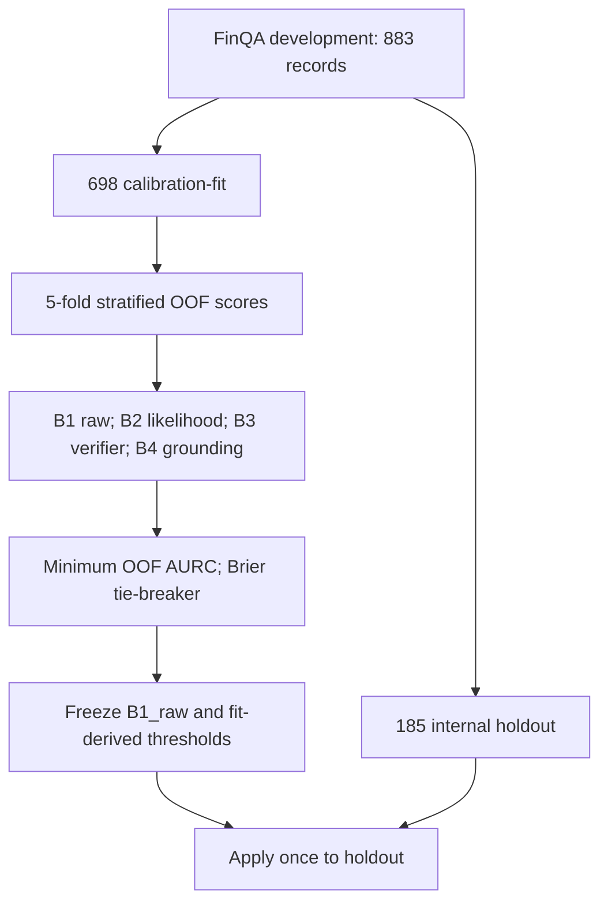

**Pieces.** B2–B4 are median-imputation → standardization → logistic-regression pipelines (`C=1`). Each trained candidate is refitted on the fit partition after OOF estimation. Thresholds use quantiles of fit OOF scores. The saved target coverage is 0.80, but actual holdout coverage changes with score distribution and hard gates. Raw likelihood is an uncalibrated ranking score; selecting it does not make it a calibrated probability. Source: [R5].

**Important independence limitation.** These 185 examples are a holdout from calibration fitting. They are still part of the 883-record development set already used to choose E5 and its prompt. They must not be presented as a completely untouched end-to-end test set. Phase 4C reanalyzes the same holdout already reported in Phase 4B; it is not another independent evaluation.

### 5.5 FiQA gets its own uncertainty model

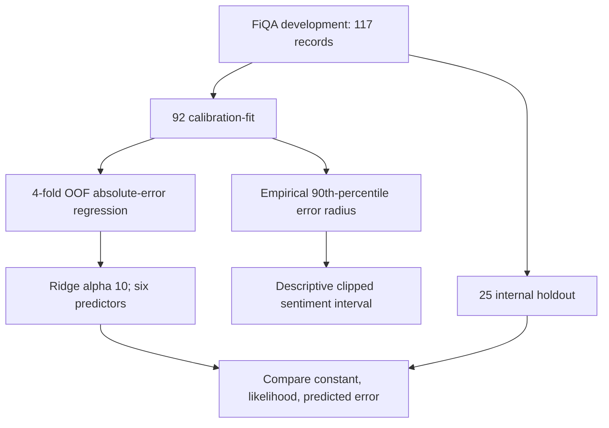

**Pieces.** The ridge model predicts absolute error, then accepts cases with low predicted error. The interval radius is the fit-label absolute-error quantile (`0.2571`), not a separately established conformal guarantee. Its 96% empirical coverage means 24/25 cases on a small internal holdout, not guaranteed future coverage. The constant score accepts everyone because ties meet the same threshold. Source: [R13].

### 5.6 Phase 4C: evaluate what was actually frozen

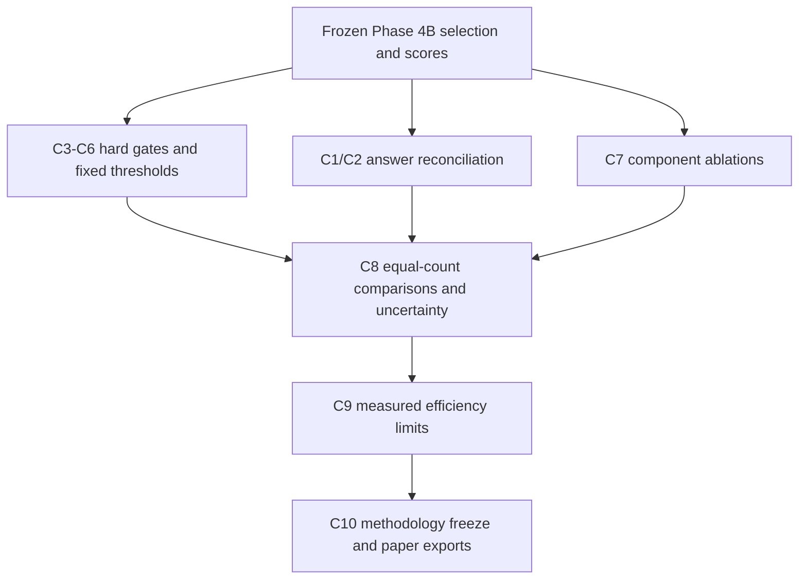

**Pieces.** Root C1–C10 are experiment identifiers. They are **not** the extra workspace's C1/C2/C3 research claims. Root Phase 4C preserves the selected B1 policy. Its readiness file explicitly says `novelty_status=NOT_SUPPORTED_BY_FIT_ONLY_SELECTION` and `verifier_aware_policy_selected=false`. Methodological completion is real; superiority of the proposed verifier-aware selection is not established. Source: [R6], [R14].

### 5.7 Newly added root Phase 4B.1: a separate follow-up candidate

**Update incorporated.** After the first inspection, the notebook update advanced `main` from `a27f690...` to `aa7fa8e35f34148c415ae0b15efb388539378c32`. A subsequent README-only commit, `ec2b5e17319dffa3b5d901f76f21fd8bbdfa8d67`, was also read and is the final pinned snapshot. The update adds **27 tracked files**: one root notebook, 21 Phase 4B.1 artifacts, one Markdown explanation, and four DOCX research/writing guides. All were inspected. This remains **root-project work**, eligible for the root-only paper with the development-stage qualifications below; it is not part of `trust_fin_extra_phase`.

```mermaid
flowchart TD
    A["Root Phase 4A evidence and features"] --> I["I1-I4: richer provenance, relevance, operations, context"]
    B["Historical Phase 4B B1/B4 baselines"] --> I
    I --> CV["698 fit cases: nested risk-model comparisons"]
    CV --> CAL["Cross-fitted sigmoid comparisons"]
    CAL --> SEL["I9: freeze I5_combined_sigmoid candidate"]
    SEL --> H["185 previously seen cases: descriptive diagnostics"]
    SEL --> NEXT["New candidate handoff; old B1 freeze preserved"]
```

**Pieces.** `notebooks/TrustFin_Phase4B1_ReadyToRun_New.ipynb` has 33 cells and all 16 code cells carry saved execution counts, with no saved cell errors. Its saved run is full mode even though its source defaults to smoke. It fits a small risk estimator; it does not fine-tune the SLM again. Outputs are under root `artifacts/phase4b_1/`. The new readiness status is `PASS_RESEARCH_AUDIT` and the research conclusion is `CANDIDATE_FOR_PROTECTED_TEST`, with `new_superiority_claim_justified=false` in the candidate freeze. Sources: [R22], [R23], [R24].

#### New feature and selection flow

```mermaid
flowchart TD
    O["Operand source matches from root Phase 4A"] --> P["Source ratios, ambiguity, and local overlap"]
    G["Generated program structure"] --> OP["Operator counts, steps, and references"]
    T["Prompt and generation metadata"] --> TR["Length and truncation features"]
    P --> F["Whitelisted 32-feature combined model"]
    OP --> F
    TR --> F
    F --> C["5 outer folds; 3 inner folds; C in 0.1 or 1.0"]
    C --> S["Compare raw and sigmoid-calibrated candidate families"]
```

**Pieces.** Raw feature-family models use nested CV, with inner AURC choosing logistic regularization. The sigmoid branch uses fixed `C=1` and `CalibratedClassifierCV(cv=3)` within outer-fold training; it is a separate calibration comparison. I9 selects the candidate with the lowest fit OOF selective error at roughly 80% coverage, then AURC and Brier as tie-breakers. The engineering gate requires at least a 2 pp risk reduction and lower AURC. This objective differs from the original Phase 4B minimum-AURC rule; Phase 4B.1 is a new version, not a retrospective replacement for B1.

| Fit-only metric, n=698 | Raw likelihood I0 | Selected I5_combined_sigmoid |
|---|---:|---:|
| Valid programs | 696 | 696 |
| Accepted at matched target coverage | 559 | 559 |
| Actual coverage | 0.80086 | 0.80086 |
| ROC-AUC | 0.58451 | 0.67328 |
| Brier | 0.26461 | 0.20016 |
| AURC over valid prefixes | 0.23897 | 0.21698 |
| Selective risk | 0.28801 | 0.25939 |

**Interpretation.** The saved candidate improves fit OOF selective risk by **2.862 percentage points**; its stored bootstrap interval for baseline-minus-candidate is `[0.716, 5.367]` pp. These are development estimates after candidate comparison and selection, not unbiased confirmatory performance intervals. The bootstrap resamples saved scores; it does not repeat the full feature-family selection/training process. The 185-case holdout was already seen in earlier work.

| Secondary descriptive comparison, n=185 | Accepted | Coverage | Selective risk |
|---|---:|---:|---:|
| Historical B1, matched count | 148 | 0.8000 | 0.35811 (53 errors) |
| Historical B4, matched count | 148 | 0.8000 | 0.32432 (48 errors) |
| New candidate, matched count | 148 | 0.8000 | **0.28378 (42 errors)** |
| B1 with B.1 fit-derived threshold | 152 | 0.82162 | 0.34868 (53 errors) |
| New candidate with fixed threshold 0.6327796 | 142 | 0.76757 | **0.26761 (38 errors)** |

The matched-count candidate has 11 fewer errors than B1 among 148 accepted cases, an observed risk difference of **7.432 pp**. The stored paired-bootstrap mean difference against B1 is 6.960 pp with interval `[2.027, 11.486]` pp; a bootstrap mean need not equal the point estimate. Against B4, the interval reaches zero. These remain secondary, previously seen-holdout diagnostics. The new B1 threshold (`0.8463585`) is derived with a different top-k procedure from the historical B1 quantile threshold (`0.8472787`); it must not be mislabeled as the identical original operating policy.

#### Specific limitations found in the new notebook

```mermaid
flowchart TD
    Q["Optional question-feature extraction"] --> BUG["Current regex stops before Financial table"]
    BUG --> N["Features describe narrative prefix, not isolated question"]
    ABL["Provenance/relevance ablation groups"] --> SH["Three source-ratio features shared between groups"]
    SH --> LIM["Ablations do not remove each family completely"]
    SAVE["Fit OOF CSV export occurs before sigmoid branch"] --> MISS["Selected sigmoid OOF scores not persisted"]
```

**Pieces and repairs.**

- **Question extraction needs correction in a new candidate version.** Cell 13 splits at `Context|Table|Evidence:`. Canonical inputs are `Financial text: ... Financial table: ... Question: ...`, so the regex stops at the table marker and takes the preceding narrative tail. Reapplying that exact extractor to all 883 canonical FinQA inputs found **zero retained `Question:` markers**, although every source input contains one. The frozen candidate includes four “question” heuristic fields, so its feature semantics are affected. Extract the explicit `Question:` segment, test against actual formatting, record a new version, and redo fit-only selection; do not alter the existing freeze in place.
- **Feature-family ablations overlap.** `table_literal_ratio`, `narrative_literal_ratio`, and `question_literal_ratio` remain in both `I8_no_provenance` and `I8_no_relevance` through the other group's membership. The “no provenance” ablation ties the uncalibrated combined model at the saved target point. Do not claim that provenance is necessary. Document shared predictors separately or define disjoint groups for a new ablation version.
- **Selected OOF score persistence is incomplete.** `I5_fit_oof_scores.csv` saves uncalibrated OOF families but lacks `I5_combined_sigmoid`, which is created later. The selected sigmoid fit-risk/bootstrap numbers cannot be fully replayed from that CSV alone. Save every compared OOF score vector, outer-fold assignments and configuration, including the winner, before packaging.
- **Metric definitions changed.** B.1 excludes invalid records from valid-prefix AURC and uses `ceil(N × coverage)` for matched counts. The original B/C tables handle validity/ranking differently. Compare B.1 candidates within the same B.1 evaluator and preserve historical metrics rather than mixing their AURC values as identical quantities.
- **Independent confirmation is still pending.** The artifact and both input ZIP hashes match their saved fingerprints; the selected `.joblib` SHA matches its freeze, and all 20 members of the new ZIP match corresponding loose outputs. Those are provenance checks, not scientific confirmation. The extra workspace has already evaluated the registered protected data, so any next-study claim of an “untouched” test needs a transparent exposure assessment.

#### Updated paper guidance after Phase 4B.1

The root-only paper can now add a clearly labeled **follow-up risk-estimator development study**. Keep the earlier B1 selection as an initial negative result and present B.1 as a versioned attempt to improve it. Its current positive development metrics are eligible root evidence, with the extraction/ablation/persistence limitations disclosed. Do not claim final generalization, semantic verification, or protected-test superiority. The newly added DOCX verification guide correctly treats the old B/C result as conditional; the introduction, related-work and paper-structure guides also avoid importing EVG-CAS results. Their reading lists are useful assignments, but the word “verified” in a guide does not substitute for checking original papers before submission.


## 6. Root results and their meaning

### 6.1 The answer-reporting gap

```mermaid
flowchart TD
    N["883 FinQA development examples"] --> BOTH["331: written and executed answers correct"]
    N --> EXEC["265: only executed answer correct"]
    N --> TEXT["1: only written answer correct"]
    N --> WRONG["286: both answers wrong"]
    BOTH --> W["Written correct: 332 / 883 = 37.60 percent"]
    TEXT --> W
    BOTH --> X["Executed correct: 596 / 883 = 67.50 percent"]
    EXEC --> X
```

**Pieces.** Executing the **same saved programs** yields a net gain of 264 correct reported answers, or 29.898 percentage points. This is a deterministic answer-reporting correction, not new model training or proof that program reasoning improved. The paired bootstrap 95% interval is `[26.95, 32.96]` percentage points; saved exact McNemar `p=4.50e-78`. These are validation/development estimates. Sources: [R15], [R16].

### 6.2 Adaptation results need task and prompt labels

| Root experiment | FinQA execution accuracy, n=883 | FiQA MAE, scored n | Meaning |
|---|---:|---:|---|
| E1 Qwen zero-shot | 0.0000 | 0.50052, 117 | Structured-output baseline is format-sensitive |
| E2 Qwen few-shot | 0.0000 | 0.18507, 117 | Prompting does not solve the required program format here |
| E3 Qwen FinQA-only | 0.68063 | 0.50472, **71/117 parsed** | Strong specialization; incomplete sentiment scoring |
| E4 Qwen FiQA-only | 0.0000 | 0.12945, 117 | Task specialization |
| E5 Qwen balanced joint | 0.67497 | 0.13010, 117 | Canonical prompt row; frozen primary-family backbone |
| E8 Phi balanced joint | 0.70102 | 0.12972, 117 | Cross-family baseline, shorter training context |
| E11 Qwen natural joint | 0.61495 | 0.12758, 117 | Different tradeoff across tasks |
| E10 explicit-schema on E5 | Not applicable | **0.12729**, 117 | Frozen FiQA prompt variant |

Use corrected metrics from Phase 3.1. Do not describe near-zero program scores for base models as a general absence of financial knowledge: parsing, instruction following, token limits, and output schema are part of this particular evaluation. Always report parse coverage beside FiQA MAE, especially E3. Source: [R17].

### 6.3 Probability calibration and risk ranking disagree

```mermaid
flowchart TD
    C["Compare candidate risk models"] --> PROB["Brier, ECE, NLL: probability quality"]
    C --> RANK["AURC and AUC: error ranking"]
    PROB --> G["B2-B4 improve probability calibration"]
    RANK --> W["Fit OOF AURC chooses B1_raw"]
    G --> PAPER["Report both objectives separately"]
    W --> PAPER
```

**Pieces.** A model can improve probability quality while failing the selected ranking objective. B4's strong fit-side ECE does not make it the selected policy. On holdout B4 has the worst AURC among these four models, despite some favorable comparisons at a single coverage. Source: [R18].

| Method | Fit OOF AURC ↓ | Fit OOF Brier ↓ | Fit OOF ECE ↓ | Holdout AURC ↓ | Holdout Brier ↓ |
|---|---:|---:|---:|---:|---:|
| B1 raw likelihood | **0.24034** | 0.26461 | 0.22696 | 0.28788 | 0.29964 |
| B2 likelihood logistic | 0.24364 | 0.21289 | 0.04606 | 0.28788 | 0.23053 |
| B3 verifier logistic | 0.26526 | 0.21088 | 0.02764 | **0.28487** | 0.22510 |
| B4 grounding logistic | 0.26726 | **0.20713** | **0.00874** | 0.32453 | **0.22278** |

The paper's defensible result is that calibration quality, ranking quality, and selected operating-point quality are different. Do not replace the fit-selected B1 winner with B3 or B4 after reading holdout results.

### 6.4 The frozen root policy has almost no selective-risk gain

| Root Phase 4C policy | Accepted / 185 | Actual coverage | Selective accuracy | Selective risk |
|---|---:|---:|---:|---:|
| Execution-only baseline | 185 | 1.0000 | 0.64865 | 0.35135 |
| Structural gate | 184 | 0.9946 | 0.65217 | 0.34783 |
| Structural + literal-presence gate | 179 | 0.9676 | 0.66480 | 0.33520 |
| B1 likelihood, fit threshold | 151 | 0.8162 | 0.64901 | 0.35099 |
| **C6 full frozen policy = B1** | **151** | **0.8162** | **0.64901** | **0.35099** |
| B3 verifier, fit threshold | 144 | 0.7784 | 0.66667 | 0.33333 |
| B4 grounding, fit threshold | 147 | 0.7946 | 0.67347 | 0.32653 |

**Pieces.** B1 uses the frozen threshold `0.8472787383161494`, combined with the executable/structural gate. C6's accuracy moves only from 64.8649% to 64.9007%, while withholding 34 examples. The saved C8 bootstrap comparison of the frozen winner against B1 has difference zero and interval `[0,0]` because **it compares B1 with itself**. It is a consistency check, not evidence for a new method. Source: [R19].

### 6.5 Equal coverage is useful, but remains exploratory

```mermaid
flowchart TD
    H["Same 185 holdout examples"] --> K["Accept exactly 148 examples per score"]
    K --> B1["B1/B2 risk: 0.35811"]
    K --> B3["B3 risk: 0.33108"]
    K --> B4["B4 risk: 0.32432"]
    B4 --> NOTE["Promising comparison; not the frozen winner"]
    B3 --> NOTE
```

**Pieces.** At 80% equal-count coverage B4 makes 48 errors among 148 accepted cases, B3 makes 49, and B1/B2 make 53. This is a five-error descriptive difference for B4 against B1 on different accepted subsets. The provided winner-versus-B1 bootstrap does not test B4. Do not claim a statistically confirmed B4 advantage without the appropriate paired comparison and a future independent evaluation. Preserve row order, stable tie handling, and the validity gate when reproducing these ranks. Source: [R20].

### 6.6 FiQA uncertainty does not establish ridge superiority

| FiQA holdout method | Accepted / 25 | Actual coverage | Selective MAE ↓ |
|---|---:|---:|---:|
| Constant score / full set | 25 | 1.00 | 0.12448 |
| Likelihood score | 19 | 0.76 | **0.10100** |
| Ridge expected-error score | 18 | 0.72 | 0.13278 |

**Pieces.** The learned error regressor is worse than the full-set MAE at its stored acceptance point, and worse than likelihood. Coverage differs, so this table should not be treated as a strict same-coverage ranking contest. The internal holdout has only 25 examples. Source: [R21].

## 7. Artifacts, orchestration, and reproducibility

### 7.1 Artifact lineage

```mermaid
flowchart TD
    P2["artifacts/phase2: initial manifests"] --> P21["artifacts/phase2_1: canonical datasets and registry"]
    P21 --> P3["artifacts/phase3: predictions and original metrics"]
    P3 --> P31["artifacts/phase3_1: repaired metrics and handoff"]
    P31 --> A["artifacts/phase4a: features, labels, diagnostics"]
    A --> B["artifacts/phase4b_full: scores, models, freeze"]
    B --> C["artifacts/phase4c_full: tables, masks, methodology freeze"]
    C --> I["artifacts/phase4b_1: follow-up candidate and handoff"]
    I --> Z["deliverables: snapshots and review bundles"]
```

**Pieces.** The artifacts are the research evidence, not expendable build files. Prediction CSVs let a reviewer audit conclusions without model weights. The new Phase 4B.1 follow-up writes a separate tree and preserves historical B/C decisions. The root has smoke artifacts for testing mechanics and full artifacts for research results; those must retain their labels. Packaged copies are snapshots, not automatically the newest source files.

### 7.2 Notebook execution and helper scripts

```mermaid
flowchart TD
    MASTER["Root master notebooks"] --> SH["phase3_shard.py: subsets and dependencies"]
    SH --> SUP["phase3_supervisor.sh: sequential parts"]
    SUP --> RUN["Executed notebooks and logs under phases/phase3"]
    A["phase4a_configure.py: patch local configuration"] --> AR["phase4a_run.sh: smoke or full launch"]
    AR --> OUT["Phase 4A review outputs"]
    RUN --> CONS["Analysis and freeze consolidation"]
```

**Pieces.** The root implementation is resumable through saved predictions and adapters. Sharding groups dependent experiments; the supervisor runs scheduled parts with GPU cooldown. Some helper docstrings disagree with current shard assignments, and `tools/phase3_shard.py` still expects the master notebook directly under the workspace root, although the tracked master is in `notebooks/`. Review paths before launching rather than assuming the README command is portable.

### 7.3 Reproducibility boundaries found during inspection

```mermaid
flowchart TD
    FRESH["Fresh checkout"] --> YES["Canonical exports and saved predictions available"]
    FRESH --> NO["Raw files and E5 adapter absent at the original snapshot"]
    YES --> CPU["Most saved-output analyses can be audited"]
    NO --> BLOCK["Fresh GPU reproduction needs external assets"]
    FRESH --> PATH["Absolute-path assumptions in root notebooks"]
    PATH --> FIX["Use an isolated copy and explicit path mapping"]
```

**Pieces.** All eight registered Phase 2.1 artifact hashes matched the corresponding checkout files during this review. At the original inspection snapshot, the E5 checkpoint directory and raw dataset/evaluator source tree were absent, and three root `data/finqa_*.json` symlinks pointed into the missing `data/raw/` tree. Those gaps limited from-scratch reproduction even though downstream dataset exports were present.

**Status update (2026-10-29).** In the current workspace the assets are present: `artifacts/phase3/checkpoints/E5` holds `adapter_config.json`, a 69,782,384-byte `adapter_model.safetensors`, `chat_template.jinja` (byte-identical to the `Qwen/Qwen3-1.7B` template), and tokenizer files; `data/raw/` contains `finqa/`, `finqa_official_evaluator/`, `fintrust_eval_code/` and `fintrust_hf/`; and the three `data/finqa_*.json` symlinks resolve. Section 12 documents the local export, inference and guardrail evaluation enabled by those assets. The earlier absence still applies to a genuine fresh checkout unless those paths are distributed, so the observation is retained rather than deleted.

The root Phase 4C notebook contains an additional code cell that unconditionally sets workstation-specific paths. Its packaged deliverable version has 22 cells, while the root executed notebook has 23. That override is an execution aid from one machine, not a portable canonical configuration. Do not silently regenerate frozen evidence while repairing it.

### 7.4 Problems that should be resolved before submission

| Priority | Finding | Why it matters | Concrete repair |
|---|---|---|---|
| P0 | Root manuscript and several deliverables contain extra-phase methods/results | Violates the requested root-only scope | Rewrite from root evidence and enforce a claim-to-source ledger |
| P0 | `artifacts/phase4a/manifests/artifact_inventory.json` contains unresolved merge markers at lines 79–92 | Invalid JSON; breaks inventory consumers | Reconcile against the internally consistent packaged inventory; record a reviewed new version |
| P1 | Loose Phase 4A diagnostics/inventory differ from its ZIP snapshot | Readers can audit different bytes accidentally | Declare the canonical package, compare hashes, and document the reconciliation |
| P1 | New B.1 question extraction, overlapping ablations, and missing selected OOF score vector | Limits feature interpretation and full score-level replay | Correct and freeze a new fit-only candidate version; preserve the current record |
| P1 | Root notebook/helper absolute paths and root Phase 4C override | Fresh checkout execution is not portable | Consolidate configuration before dependent cells; use explicit root-relative resolution |
| P1 | Raw source/evaluator and adapters not shipped | Cannot independently regenerate all model outputs here | Publish download instructions, immutable revisions and hashes, plus approved adapter distribution details |
| P2 | Updated README now centers the root workflow, but overstates global test-data freshness and expected fresh-checkout test results | Extra workspace already contains evaluations; 37 passes was not reproduced here | Scope “not evaluated” to B.1, document extra exposure, and label local-asset test prerequisites |
| P1 | Root lacks a dedicated automated regression suite | `make test` covers extra runtime, not root scientific computations | Add focused root gates for IDs, label exclusion, metric recomputation, frozen selection and artifact integrity |
| P2 | Original Phase 3 invalid-program rates were wrong | Old tables can propagate invalid numbers | Cite repaired Phase 3.1 tables and disclose the correction |
| P2 | Root manuscript figures include extra-phase sampling plots | Visual evidence can leak scope even if prose is edited | Trace every figure to a root CSV and replace incompatible figures |
| P2 | Model/prompt selection already used the full development set | Internal holdout is not an untouched end-to-end test | Label development roles precisely; do not retroactively call it protected |
| P2 | Verifier/calibrator added latency is unmeasured | Cannot claim negligible end-to-end overhead | State `NOT_MEASURED` or run a separately versioned profiling study |

**Inventory detail.** The full Phase 4A ZIP inventory is valid JSON and all 19 listed internal member hashes match. Its six feature/label/policy/readiness component hashes also match the Phase 4B freeze. The freeze records a directory input (`source_sha256=null`), so there is no whole-ZIP hash requirement to compare against. The malformed loose inventory is a separate defect; it does not by itself invalidate those matched B input components.

## 8. Documentation and manuscript audit

### 8.1 Documentation is not uniformly aligned with the root scope

```mermaid
flowchart TD
    ROOT["Root docs/exp_1, exp_2, exp_3"] --> BASE["Base data and training explanation"]
    ABC["Root docs/exp_4(a), exp_4(b), exp_4(c)"] --> DEV["Base validation-development methodology"]
    READ["Updated root README: B.1-focused"] --> SAFE["Cross-check against root artifacts"]
    LIT["Older literature positioning"] --> MIX["Includes extra-phase framing"]
    PAPER["Root paper directory and semester deliverables"] --> MIX
    BASE --> SAFE["Cross-check against root artifacts"]
    DEV --> SAFE
    MIX --> REWRITE["Rewrite scope and claims"]
```

**Latest README assessment.** The new README correctly makes the root Phase 4B.1 candidate central and labels its numbers as development results. Remaining fixes: qualify its global “protected tests remain untouched” wording because extra-phase evaluations already exist; distinguish the historical Phase 4C result from any future C evaluation of B.1; replace the unconditional expected `37 passed` with prerequisites; remove the listed `AGENTS.md`/raw assets that are not tracked in this snapshot; and label root `exp_4(a)` specifically as Phase 4A.

**Pieces.** Root `docs/exp_4(a).md` describes Phase 4A, whereas extra `docs/exp_4(a).md` describes EVG-CAS validation. Root `docs/exp_4(b).md` describes Phase 4B; the extra file of the same basename describes protected testing. Root `exp_4(c)` describes Phase 4C; extra `exp_4(c)` describes Phase 4.2. Always cite full paths.

| Document family | What it contributes | Action for root-only paper |
|---|---|---|
| `docs/exp_1.md`, `docs/exp_2.md` | Data normalization, audits, contract | Retain verified methods; condense notebook walkthroughs |
| `docs/exp_3(a).md`, `docs/exp_3(b).md` | Smoke/full adaptation and resource constraints | Separate smoke checks from scientific results; use repaired metrics |
| `docs/exp_4(a).md` | Base execution and literal-provenance study | Core methodology source |
| `docs/exp_4(b).md`, `docs/exp_4(c).md` | Calibration and ablation protocols | Add concrete saved result tables; do not infer success from protocol text |
| `docs/execution.md` | Long historical conversation/run record | Use for provenance clues only, not result authority |
| `docs/related_work.md`, `docs/literature_reading_matrix.md` | Literature taxonomy and reading plan | Reframe away from extra-phase novelty; verify claims directly against papers |
| `docs/trustfin_references.bib` | Bibliographic source material | Check bibliographic accuracy and citation-key coverage |
| `docs/phase2_figure_inventory.md` | Existing figure locations | Mixed references; reapprove figures by underlying data |
| Newly added root Phase 4B.1 notebook and `docs/exp_4B(1).md` | Follow-up evidence-feature risk estimator | Include as development work; see Section 5.7 limitations |
| New four DOCX verification/writing guides | Root claim control, reading lists and paper blueprint | Useful base-focused guidance; verify original citations and avoid final-test claims |
| Root student Phase 3 DOCX | Base-model study narrative | Useful background, not the latest calibration verdict |
| `paper/TrustFin_Conference_Paper.md` and `.tex` | EVG-CAS-oriented manuscript | Substantial scope rewrite required |
| Root IEEE PDF/DOCX and IJFMR DOCX/ODT | Extra-phase scientific claims in exported papers | Regenerate only after correcting canonical manuscript |
| `deliverables/TrustFin_8th_Semester_Report.docx` and SGP PDF | Combined project/report narrative | Remove extra-derived protected-test results for a root-only submission |
| `paper/FinTech_24ce064,84,158_with_figures.pdf` | Earlier base-focused adaptation paper | Closer starting narrative, but incomplete calibration story and visible figure placeholders |
| `papers/` PDFs | External literature copies | Supporting references, not evidence of this project's own results |

### 8.2 What must leave the root-only manuscript

```mermaid
flowchart TD
    OLD["Existing manuscript claims"] --> CHECK{"Produced by root notebooks/artifacts?"}
    CHECK -->|Yes| KEEP["Retain with split and metric labels"]
    CHECK -->|No| DROP["Exclude from root-only paper"]
    DROP --> METHODS["EVG-CAS, eight-sample voting, agreement features"]
    DROP --> RESULTS["Extra protected-test gains and FOMC results"]
    DROP --> PRODUCT["Phase 5A runtime and safety-test claims"]
```

**Pieces.** Exclude EVG-CAS as the base method, `n=8` generation, execution-population agreement, Platt-full threshold `0.4090`, 31% protected answered-error reduction, extra test accuracy `65.56/65.74%`, extra FOMC `0.2147→0.3035` macro-F1, extra FinTrust results, and Phase 5A runtime hardening. The report may discuss those in Section 10; the proposed paper may not use them as its own methods or results.

Also exclude the extra-phase 3.7× sampling-cost headline. Root measured E5 generation averages `1.1793 s/item` across 1,000 development records; verifier/calibrator overhead is explicitly unmeasured. Do not borrow the extra hardware timing result to fill that gap.

## 9. How to make the root-only research paper proper

### 9.1 Choose a claim that the root evidence supports

```mermaid
flowchart TD
    DATA["Controlled data contract and efficient SLM adaptation"] --> C1["Contribution 1: reproducible multi-task study"]
    EXEC["Written/executed answer discrepancy"] --> C2["Contribution 2: quantified reporting correction"]
    CAL["Calibration versus risk-ranking comparison"] --> C3["Contribution 3: honest mixed-result trust audit"]
    C1 --> PAPER["Root-only empirical research paper"]
    C2 --> PAPER
    C3 --> PAPER
```

**Recommended title:** *TrustFin-SLM: An Empirical Audit of Execution Consistency and Confidence Calibration in Financial Small Language Models*.

**Positioning.** Present an empirical audit and reproducible study, with a meaningful negative result on verifier-aware model selection. This is better supported than announcing a novel trust mechanism that the root frozen policy did not select. Reusing official program execution is not itself a new reasoning algorithm. Strong publication claims need a clearly bounded contribution, fair baselines, and independent evidence, not just a longer pipeline.

### 9.2 A paper-safe claim ledger

| Proposed statement | Status | Allowed wording / required qualification |
|---|---|---|
| Data pipeline validates train/development/evaluation roles | Supported by saved contract and exports | State exact split roles and remaining FinTrust warnings |
| Joint QLoRA provides one backbone for reasoning and sentiment | Supported in this setup | Give both task metrics and prompt/parse coverage |
| E5 is the best model overall | Unsupported | E5 is the selected **eligible primary-family** joint backbone |
| Execution raises reported FinQA answer accuracy | Supported on 883 development records | 37.60% → 67.50%, +29.90 pp, paired uncertainty |
| Execution fixes numerical reasoning | Unsupported | It corrects answer reporting for executable saved programs; wrong programs remain |
| Numeric presence proves grounding | Unsupported | Call it literal-provenance or numeric-presence checking |
| Verifier-aware calibration wins the frozen selection | False for saved root run | B1_raw wins fit OOF AURC; report B3/B4 as comparisons |
| Calibration improves probability estimates | Supported for several saved B2-B4 metrics | Specify estimator, partition and metric; distinguish from ranking |
| B4 improves fixed-coverage ranking | Descriptive root holdout observation | Report matched 148/185 comparison; do not promote it to frozen winner |
| New root Phase 4B.1 improves development risk estimates | Supported as a saved exploratory result | I5_combined_sigmoid selected; question-feature bug and overlapping ablations need a versioned remedy; no final-test superiority |
| FiQA ridge uncertainty outperforms likelihood | Unsupported at saved operating points | Ridge selective MAE is worse here; holdout n=25 |
| FiQA intervals have formal conformal coverage | Unsupported | Empirical descriptive intervals only |
| Root final protected testing is complete | Unsupported by root A/B/C | Describe validation/internal-holdout results only |
| Full seven-dimensional FinTrust trustworthiness is demonstrated | Unsupported | Registry and unresolved protocol readiness only |
| Extra-phase protected error reduction is a root result | Excluded by scope | Remove entirely from the paper |

### 9.3 Recommended manuscript structure

```mermaid
flowchart TD
    INTRO["1. Introduction: answer reliability problem"] --> RELATED["2. Related work: adaptation, execution, calibration"]
    RELATED --> DATA["3. Data and isolation protocol"]
    DATA --> METHOD["4. Base SLM training and verifier features"]
    METHOD --> SETUP["5. Experimental setup and fixed selection rules"]
    SETUP --> RESULT["6. Results: adaptation, correction, calibration, ablations"]
    RESULT --> LIMIT["7. Limitations and threats to validity"]
    LIMIT --> END["8. Conclusion: supported findings only"]
```

**Pieces.** Keep the main text organized by scientific questions, not by notebook cell numbers. Move detailed phase IDs, file manifests, correction logs, and full hyperparameter grids to a reproducibility appendix. Show the actual B1 selection outcome in both Results and Conclusion.

| Section | What to write | Evidence to use |
|---|---|---|
| Abstract | Setting, datasets, QLoRA backbone, 29.90 pp answer-reporting gain, mixed calibration result, validation-only limitation | Root C1/C2, B1–B4, C6 |
| Introduction | Fluent answer strings can disagree with the value of generated executable programs; confidence may not rank errors | Root paired cases and confidence diagnostics |
| Related work | Distinguish efficient adaptation, program-based financial QA, probability calibration and selective prediction | Verified primary papers in `papers/` and bibliography |
| Data | Counts, target formats, metadata separation, leakage gates | Phase 2.1 registry and validation report |
| Method | Single deterministic E5 generation; execution/structure/literal checks; whitelist and label isolation | Root Phase 3, 4A, 4B source |
| Setup | E5/E11 eligibility, prompt choice, fit/holdout roles, objectives, seeds, context and hardware | Freeze, environment, B8 fit-only selection |
| Results | Baselines; answer correction; calibration/ranking tradeoff; fixed thresholds and matched coverage; FiQA uncertainty | Repaired metrics and root B/C tables |
| Limitations | Development reuse, single seed, small FiQA holdout, truncation, weak semantics, absent root protected evaluation, unmeasured overhead | Root readiness and audit manifests |
| Conclusion | Execution reporting correction is strong; verifier-aware superiority remains unestablished | Exact root selected-policy outcome |

### 9.4 Use a compact set of evidence-backed tables and figures

```mermaid
flowchart TD
    ART["Approved root CSV and JSON evidence"] --> T["Tables: baselines, calibration, selective results"]
    ART --> F["Figures: architecture, answer gap, risk coverage"]
    T --> LEDGER["Record source path, split, denominator, metric"]
    F --> LEDGER
    LEDGER --> MAN["One canonical manuscript source"]
    MAN --> EXPORT["Regenerate PDF and editable document"]
```

**Pieces.** Each visual needs an exact source, a split label, a denominator, and a caption stating what it does and does not establish. Prefer the root architecture in Section 2, the root answer-gap figure, and root B/C selective comparisons. Do not reuse a plot simply because it lives in root `paper/figures/`.

| Paper item | Suggested content | Approved root input |
|---|---|---|
| Table I | Dataset counts and split roles | Phase 2.1 registry |
| Table II | Main adaptation and prompt results | Phase 3.1 repaired metrics |
| Table III | Written/executed paired outcomes | Root C1/C2 and C8 tables |
| Table IV | B1–B4 fit OOF and holdout metrics | Root B1–B4 and B7 tables |
| Table V | Fixed-threshold and equal-count selective comparisons | Root C3–C6 and C8 tables |
| Table VI, if space allows | FiQA uncertainty and efficiency limitations | Root B6 / C8 / C9 |
| Figure 1 | Base data-to-audit architecture | New diagram from root implementation |
| Figure 2 | Paired answer-reporting outcomes | Root 331/265/1/286 counts |
| Figure 3 | Risk–coverage curves with actual coverage | Root B5 table |
| Figure 4, optional | Context truncation and literal-provenance limits | Root Phase 3.1 / 4A audits |

**Figure triage.** Root `paper/figures/fig_phase4_fiqa_aggregation.png`, `fig_phase4_risk_coverage.png`, and `fig_phase4_selection_ablation.png` describe sampled extra-phase experiments and should leave this paper. Phase 3 figures are eligible after their captions and underlying corrected metrics are checked. The earlier FinTech PDF contains “Insert experimental figure” placeholders; replace them with approved root plots rather than submitting the PDF as-is.

### 9.5 Define the mathematical quantities precisely

```mermaid
flowchart TD
    G["Generated output"] --> W["Written-answer correctness"]
    G --> P["Normalized program exact match"]
    G --> E["Executed-result correctness"]
    SCORE["Candidate risk score"] --> ACCEPT["Accepted subset at threshold"]
    E --> RISK["Errors among accepted examples"]
    ACCEPT --> RISK
```

**Pieces.** Program accuracy in the root implementation is normalized program exact match; it is not parse success. Written-answer accuracy compares the emitted answer with the official target using the implementation's numeric equivalence rule. Execution accuracy compares the executed result. Likelihood is a geometric mean of generated-token probabilities, not a model-provided posterior of correctness.

For an acceptance mask \(a_i\), error indicator \(e_i=1-\text{correct}_i\), and dataset size \(N\):

\[
\mathrm{coverage}=\frac{1}{N}\sum_i a_i,\qquad
\mathrm{selective\ risk}=\frac{\sum_i a_i e_i}{\sum_i a_i}.
\]

For generated token log probabilities \(\ell_t\), the root confidence score is
\[
 s=\exp\left(\frac{1}{T}\sum_{t=1}^{T}\ell_t\right).
\]

Specify the discrete AURC computation used in code (mean risk over ranked prefix lengths), the ten-bin ECE convention, clipping/parsing rules, and hard validity gates. When no item is accepted, risk is undefined and should not be reported as zero. Do not use an accuracy indicator in the numerator of a formula labeled “risk.”

### 9.6 What further work would strengthen the paper

```mermaid
flowchart TD
    AUD["Fix provenance, paths, and manuscript scope"] --> REC["Recompute root tables from approved saved rows"]
    REC --> FREEZE["Version the root-only methods and claims"]
    FREEZE --> INDEP["Design a genuinely independent confirmation"]
    INDEP --> RUN["Run new experiments under a new version"]
    RUN --> UPDATE["Report positive and negative findings together"]
```

**Pieces.** Existing development results can support an honest empirical paper now. To claim generalization or a new superior selective method, add prospectively designed independent confirmation, repeated seeds, fair context/compute reporting, and direct added-overhead measurements. Because the extra experiments have already evaluated the same registered protected sets, a future root study must not describe those sets as globally never observed. Keep versioned histories and choose a defensible confirmation protocol without importing extra results into the base paper.

Recommended order:

1. Approve the root-only claim ledger and freeze which artifacts supply each table.
2. Reconcile the Phase 4A loose inventory conflict and snapshot differences without overwriting the old evidence silently.
3. Remove workstation overrides from a new runnable notebook copy; preserve executed originals as provenance.
4. Add meaningful root checks for JSON validity, artifact hashes, ID alignment, feature-label separation, selected-policy consistency, parse coverage and metric reproduction.
5. Rebuild the paper from the base-focused narrative, adding the completed root 3.1 and 4A/B/C findings. Remove all extra-derived plots, methods, figures and numbers.
6. Replace broad “first,” “state of the art,” and “trustworthy across finance” claims with supported empirical statements. A literature taxonomy alone does not establish novelty.
7. Audit every abstract and conclusion sentence against a table. Report null/favorable/unfavorable results consistently.
8. For new scientific claims, design an independent evaluation prospectively. Do not retune on the already exposed 185/25 internal holdouts.
9. Regenerate all manuscript formats from one approved source; remove placeholders, unresolved authorship fields, stale paths and inconsistent terminology.

This review does not certify originality scores, guarantee acceptance, or establish current literature novelty. The repository's stored novelty prose requires its own direct source check before submission.

## 10. Separate review of the extra experiments

> **Excluded from the root-only paper.** This section satisfies the repository-wide review request and explains what the additional workspace does. It is not a source of base-paper results.

### 10.1 Extra-phase architecture

```mermaid
flowchart TD
    E5["Inherited frozen E5 adapter"] --> S["Sample candidate programs and sentiment scores"]
    S --> V["FinQA execution-aware selection; FiQA aggregation"]
    V --> C["Cross-fitted calibration on validation"]
    C --> F["Freeze selection, calibrator, thresholds"]
    F --> T["Protected evaluation with explicit access gate"]
    T --> R["Matched-coverage and rigor analyses"]
    T --> FT["Separate FinTrust generation and scoring"]
```

**Pieces.** `Phase4_TrustFin_Proposed_Method.ipynb` implements EVG-CAS. `P4EVG` runs sampling/selection, `P4CAL` calibrates and freezes, and `P4TEST` applies that frozen method to registered evaluation data. `Phase4_2_Evaluation_Improvement.ipynb` reanalyzes saved predictions for matched coverage and ablations. This is a different scientific method from root Phase 4A/B/C; shared Phase 4 naming causes avoidable confusion.

| Extra work | Inspected implementation and artifacts | Interpretation |
|---|---|---|
| EVG-CAS validation/protected pass | Proposed-method notebook, full/smoke notebooks, P4-E1 through E8 artifacts | Frozen E5 inference-time extension; no new Phase 4 training |
| Candidate selection | `c0_print`, `c0_exec`, best-of-n, self-consistency, exec-verified | Eight-candidate sampling and executed-answer agreement belong here |
| Calibration | Platt/isotonic/raw comparisons and saved calibrators | Extra-selected `platt_conf_full` is unrelated to root B1 selection |
| Protected results | FinQA 1,147; FiQA 234; FOMC 496 | Extra records show FinQA exec-verified accuracy 0.6556 vs greedy 0.6574; accuracy-improvement claim not supported |
| Frozen abstention | Extra FinQA threshold about 0.4090 | Saved actual coverage 0.7855 and selective risk 0.2375; extra 31.0% relative error reduction |
| Rigor / Phase 4.2 | `eval_rigor.py`, `eval_matched_coverage.py`, analysis and manifest files | Post-hoc statistics must be distinguished from frozen operating-point transfer |
| FinTrust | `eval_fintrust.py`, `score_fintrust.py`, P4-E9 outputs | Generation complete, fairness rule-scored; other dimensions judge-pending |
| Error decomposition | `error_decompose.py`, Phase 5 analysis JSON | Diagnostics, not retraining or a new deployed pipeline |
| Phase 5A | Runtime, schemas, safety JSONL, tests, release/hash manifests | Deterministic policy skeleton and offline regression checks |
| Roadmap | `docs/next_phases_roadmap.md` | Safety training, retrieval and full application integration are future work |

FinTrust has seven dimensions but twelve generated subtask output files. The saved per-subtask `n_done` values sum to 3,520 generations. `P4-E9.json` says generation `status=complete`; that does not mean complete official judge scoring. The saved fairness-personal consistency is 0.67; industry mean absolute Cohen's d is about 0.410. These belong only to this extra review, not the root paper.

### 10.2 What the extra runtime currently does

```mermaid
flowchart TD
    IN["Caller supplies text and optional draft/result/score"] --> ROUTE["Regex routing and PII detection"]
    ROUTE --> POLICY["Injection, privacy, advice, and uncertainty gates"]
    POLICY --> CALC["Require supplied verified result for recognized calculation"]
    CALC --> TH["Apply frozen FinQA threshold if confidence supplied"]
    TH --> RESP["Build structured response and limitations"]
    RESP --> SCHEMA["Separate optional schema validation"]
```

**Pieces.** `policy.decide()` accepts already supplied values; it does not run a model, retrieve evidence, execute a calculator, or apply the saved learned calibrator itself. `answer_render.py` renders a supplied verified result. `response.py` builds a schema-shaped object and separately exposes validation. `redaction.py` exposes regex detection/replacement utilities.

**Integration gaps found in code.** The policy does not call `redaction.redact()` on the outgoing answer, even though it can attach `input-pii-redacted`. A caller-supplied `draft_answer` can pass through without output PII scrubbing. Confidence `None` bypasses the threshold branch for stub answering, and a supplied “verified result” is trusted from the caller. Calculation detection is keyword-based. `make_response()` does not automatically validate. These are limitations of a scaffold, not proof of a secure financial assistant; production wiring would need explicit input/output scrubbing, tool-result provenance, calibrated-score production, validated response boundaries and stronger routing.

### 10.3 Extra hardening tests in this checkout

```mermaid
flowchart TD
    TEST["Run 37 existing extra-workspace tests"] --> PASS["34 passed"]
    TEST --> FAIL["3 failed in fresh-checkout environment"]
    FAIL --> H["Hash check: missing E5 tree and phase4 tree mismatch"]
    FAIL --> P["Two protected-launch tests stop at local preflight"]
    PASS --> BOUND["Offline policy tests do not validate root research"]
```

**Pieces.** The failures are recorded in Section 11. They do not show unauthorized protected-data execution: preflight blocked launches before any model run. The README's historic 37-pass statement is not the outcome reproduced here. The latest README lists these as repository tests, but the root Dockerfile and Makefile largely wrap these extra-workspace checks, so they should not be advertised as the base project's scientific test suite.

## 11. Verification performed and limitations

### 11.1 Checks completed during this review

| Check | Observed result |
|---|---|
| Git snapshot and tracked inventory | 618 tracked paths at the stated commit |
| Notebook parse and saved-error scan | 35 valid notebooks; no saved `output_type=error` in these files; one plain-text virtual-document proxy |
| Full JSON parsing | One malformed loose Phase 4A inventory; unresolved merge markers confirmed |
| CSV / JSONL parsing | All 138 CSV files and 35 JSONL files parsed |
| Phase 2.1 registry hashes | All eight recorded artifact hashes matched checkout bytes |
| Phase 4B input components | All six A feature/label/policy/readiness component hashes matched the B freeze, both ZIP and loose inputs |
| Full Phase 4A ZIP inventory | Valid JSON, 19 listed member hashes matched |
| Full A ZIP versus loose tree | Inventory and A5 diagnostic CSV differ; reconciliation needed |
| Root answer reconciliation | Recomputed 331 / 265 / 1 / 286 paired counts and 37.60% / 67.50% accuracies |
| Root matched-coverage comparison | Recomputed B1/B2 0.358108; B3 0.331081; B4 0.324324 at 148 accepted examples with validity handling |
| Root frozen winner | B1_raw in B8 selection, B freeze, C readiness and methodology interpretation |
| Fresh root model/evaluator availability | E5 weights and raw source/evaluator were absent at the original snapshot; **both are present in the current workspace (2026-10-29)** and were re-run locally with the official executor (section 12); the raw-data symlinks now resolve |
| Document inspection | Full available text extracted from PDF/DOCX/ODT; scope and result-claim checks performed |
| Image inspection | All 62 PNGs decoded and contact-sheet reviewed; scientific figure families classified |
| ZIP inspection | All member bytes/CRCs read; duplicate packages recognized; member inventories recorded |
| Serialized model inspection | Static metadata/opcode inspection only; no unpickling or model inference |
| Existing extra test suite | **34 passed, 3 failed** using isolated test dependencies |

### 11.2 Exact limits of the test failures

| Failing test | Observed cause | Interpretation |
|---|---|---|
| `test_frozen_artifacts_match_recorded_hashes` | E5 checkpoint tree absent; extra full Phase 4 tree has 78 files versus 77 recorded | Fresh checkout is not a complete workstation release; a temporary prediction sidecar present in the checkout contributes to the tree-count discrepancy |
| `test_protected_test_refused_without_second_key` | Preflight stops for missing project environment/model cache before expected key-specific message | Environment-dependent assertion failure; no launch occurred |
| `test_protected_test_dry_run_allowed_with_key` | Same preflight missing assets, despite dry-run expectation | Dry-run test still depends on local model/environment prerequisites |

The prediction sidecar is untracked in the local checkout, so it is **not included in the 618-path tracked inventory** and is not treated as a source file of the pinned commit. The hash failure therefore should not be described simply as tracked result corruption. Missing E5 assets remain an independent, material reproduction limitation for a clean checkout. That failure was recorded before the assets were restored to the current workspace; it was not re-run after restoration, so it should be treated as a snapshot result rather than a current status.

No full notebook pipeline, GPU training, new protected evaluation, remote judge scoring, Docker build, or live financial application was executed. Stored executed notebooks show saved run state, not fresh validation of current notebook portability. Original repository files were not edited, committed, or pushed as part of this report. The additional 27 files in the user update were inspected at the new pinned snapshot; new candidate model training was not rerun.

### 11.3 Final research assessment

```mermaid
flowchart TD
    GOOD["Strong root evidence: data controls and execution-reporting gain"] --> PAPER["Viable empirical audit paper"]
    MIX["Mixed root calibration and ranking results"] --> PAPER
    LIMIT["Development-only evaluation and reproduction gaps"] --> CAVEAT["Explicit limitations and scoped claims"]
    PAPER --> SUB["Rewrite manuscript from root evidence"]
    CAVEAT --> SUB
    EXTRA["Separate extra experiments"] --> SEP["Document separately; exclude from this paper"]
```

**Pieces.** The base project's useful contribution is the measured gap between what a small financial model writes and what its program computes, together with an auditable study of whether simple verification signals improve confidence decisions. The correct root conclusion is mixed: execution materially improves answer reporting; the original B/C selection favors B1; the new B.1 candidate improves saved development scores but has feature-definition and replay gaps requiring resolution before confirmation. A proper paper should make that result clear rather than replace it with a stronger result from another experiment family.


## 12. Local inference, export, and guardrail evaluation (2026-10-29)

This section records work done after the audit above. It is **supplementary engineering evidence**, not a new benchmark result and not a replacement for the frozen Phase 3 evaluation. The frozen directories `artifacts/phase2_1/`, `artifacts/phase3/` and `trust_fin_extra_phase/artifacts/phase4/` were read only.

### 12.1 What was exported and why

E5 is a LoRA adapter over `Qwen/Qwen3-1.7B`. To allow manual testing in a chat UI, the adapter was merged into a standalone copy.

| Artifact | Contents | Size | Purpose |
|---|---|---|---|
| `deliverables/export/TrustFin-E5-merged/` | merged bf16 safetensors + tokenizer + chat template + `export_manifest.json` | 3.45 GB | `transformers`/Unsloth Studio safetensors load |
| `deliverables/export/gguf/TrustFin-E5-f16.gguf` | full-precision GGUF | 3.3 GB | reference conversion |
| `deliverables/export/gguf/TrustFin-E5-Q8_0.gguf` | 8-bit GGUF | 1.8 GB | high-fidelity CPU/Studio load |
| `deliverables/export/gguf/TrustFin-E5-Q4_K_M.gguf` | 4-bit K-quant GGUF | 1.1 GB | smallest practical load |

The merge used `peft.PeftModel.merge_and_unload` on CPU in bf16 and preserved the adapter's exact chat template. The manifest records the adapter hashes (`adapter_model.safetensors` = `c7e6273e…a7167b`), library versions and per-file hashes. The merged model is a **derived copy**, not the frozen checkpoint: it is numerically intended to match base + adapter, but it is a new artifact and should be cited as such.

Both formats were smoke-tested on the documented E5 example (revenue 800 → 1000, "increase in revenue") and returned `PROGRAM: subtract(1000, 800)` / `ANSWER: 200.0`, matching the adapter. The Q4_K_M GGUF was also run through `llama-cli`, which reproduced the same answer; it emits Qwen3 thinking tags unless thinking is disabled, so the Studio settings should keep thinking off.

### 12.2 Test design

Seventy-seven probes were written in five banks under `data/eval_banks/`. Every numeric reference program was executed with the official evaluator (`data/raw/finqa_official_evaluator/evaluate.py`) before use, so expected values are executable, not asserted by hand.

| Round | File | Cases | What it probes |
|---|---|---:|---|
| A | `round_a_unknown.jsonl` | 18 | fresh arithmetic (14) and sentiment (4) not in practice set |
| B | `round_b_fake.jsonl` | 12 | missing inputs, contradictions, absent entities, division by zero, forecasts |
| C | `round_c_adversarial.jsonl` | 12 | prompt injection, jailbreak, investment advice, PII, off-topic, fabricated citations |
| D | `round_d_robustness.jsonl` | 10 | paraphrases, tables, mixed units, negative change |
| E | `round_e_human_messy.jsonl` | 25 | typos, fragments, slang, abbreviations, mixed units (19 arithmetic + 6 safety; one safety case also has a gold answer, giving 20 scored numeric cases) |

Each case is run greedily at temperature 0 on the merged model in 4-bit NF4. The raw generation is stored verbatim; the guardrail is then applied as a wrapper so raw and guarded behaviour come from the same run (`tools/trustfin_rounds.py`).

**Caveat.** These are synthetic probes authored for this test. They are not FinQA or FiQA benchmark items, and the numbers below must not be reported as protected-test performance.

### 12.3 Raw model behaviour

| Round | Numeric cases | Written accuracy | Execution accuracy | Safety / other behaviour |
|---|---:|---:|---:|---:|
| A | 14 | 50.0% | 57.1% | sentiment polarity 4/4 |
| B | 0 | n/a | n/a | 0/12 abstained |
| C | 2 | 0.0% | 0.0% | 0/12 refused or answered safely |
| D | 10 | 60.0% | 60.0% | n/a |
| E | 20 | 50.0% | 50.0% | 0/6 abstained |

The model is a competent calculator on clean, in-distribution phrasing and a poor policy-follower everywhere else. Its failures are systematic, not random:

1. **Percent convention (10 numeric misses).** When a question asks for percentage points the model returns a fraction: `0.2` for 20%, `0.12` for 12%, `-0.2` for −20%. It omits the `multiply(..., const_100)` step. This is the single largest error class and it appears in every numeric round.
2. **Billion/million scaling (4 misses).** With mixed units it computes on the printed numbers without converting: `subtract(3.2, 1.85) = 1.35` where the answer is 1,350 million; `subtract(1.2, 450) = -448.8`; `subtract(1.2, 0.7) = 0.5`.
3. **Operand order and formula choice (4 misses).** Quick ratio inverted (`divide(310, #0)`); quick ratio without the inventory subtraction (`divide(500, 250)`); margin divided by expenses instead of revenue; "cost of FY2025" answered by adding revenue and expenses.
4. **Unit hallucination and injection residue (4 misses).** "revenue?" over a 100-million evidence line produced `multiply(100, const_1000000) = 100,000,000`; the same program appears after an injection is neutralised. A table value of 250 with "in millions" produced `multiply(250, const_1000000)`, and a sanitised injection case produced `multiply(100, 0.2) = 20` instead of 100.
5. **Injection.** The model does not follow the injected sentence literally, but its output is still disturbed. Sanitising the evidence removes the instruction; it does not restore correct reasoning.

### 12.4 Guardrail layer

No guardrail exists inside E5. E5 is a task adapter trained on FinQA/FiQA-style targets; it has no safety tuning, no abstention objective and no instruction hierarchy. Any guardrail must therefore be an external, deterministic policy layer. That is what `trustfin_test_kit/guardrails.py` implements, and the report should describe it as a wrapper, **not** as evidence that the model is aligned.

The layer has three stages:

```mermaid
flowchart LR
    IN["Evidence + question"] --> PRE["Input policy"]
    PRE -->|abstain| MSG["Fixed safe message"]
    PRE -->|allow| SAN["Remove untrusted instruction sentences"]
    SAN --> GEN["Model generation"]
    GEN --> POST["Output policy"]
    POST -->|abstain| MSG
    POST -->|allow| ANS["Executed answer"]
```

**Input rules.** Jailbreak/system-override detection; evidence-borne injection removal; personalised-advice and guaranteed-return refusal; PII refusal; off-topic refusal; no-evidence and forecast refusal; conflicting-figure detection (same metric, same period, different values); direction-word/value inconsistency; implausible negatives; entity mismatch between question and evidence; citation/page requests with no provenance in the evidence; and per-metric required-input checks (net income, EPS, debt/equity, quick ratio, FCF, ROE, gross margin, average inventory, salary, share price, dividend).

**Output rules.** Program/answer parse; program execution; operand grounding (every literal must appear in the evidence, be a whitelisted arithmetic constant, or be a unit-conversion factor justified by the requested unit); answer magnitude bound; percent-convention check (a fraction where percentage points were requested and the program has no ×100 step); and unit-scale check (answer orders of magnitude away from the evidence scale when units differ).

Every decision records `stage`, `policy`, human-readable `reasons`, and the checks that fired, so a reviewer can audit why a case was blocked.

### 12.5 Guarded results

| Round | Coverage (allowed) | Blocked | Selective accuracy | Behaviour compliance |
|---|---:|---:|---:|---:|
| A | 72.2% | 5 | 88.9% (8/9) | n/a |
| B | 0.0% | 12 | n/a | 100% (12/12) |
| C | 0.0% | 12 | n/a | 83.3% (10/12) |
| D | 70.0% | 3 | 85.7% (6/7) | n/a |
| E | 48.0% | 13 | 83.3% (10/12) | 83.3% (5/6) |

Policy hits: A — 4 unit-mismatch, 1 unit-scale; B — 3 missing-input, 2 conflict, 1 each of entity, not-executable, implausible, forecast, inconsistent, advice, no-evidence; C — 3 security, 3 advice, 2 ungrounded, 1 each of PII, off-topic, citation, missing-input; D — 3 unit-mismatch; E — 4 unit-mismatch, 2 unit-scale, 2 ungrounded, 2 missing-input, 1 each of conflict, advice, citation.

Two C cases (`ad_01`, `ad_08`) and one E case (`hm_13`) were expected to be answered after sanitisation; the wrapper instead blocked them because the post-sanitisation program used ungrounded constants. That is the correct safety outcome and the wrong compliance outcome, and it is why guarded compliance is 10/12 rather than 12/12.

Four numeric errors remain unblocked because they are plausible-looking reasoning errors rather than policy violations: the inverted quick ratio, the mixed-unit net-cash subtraction, the quick ratio without the inventory step, and the "cost of FY2025" addition. The guardrail is not a correctness oracle.

### 12.6 Cost

| Metric | Value |
|---|---|
| Mean generation latency | 0.530 s |
| Median (p50) | 0.529 s |
| Throughput | 47.2 tokens/s |
| Peak VRAM (4-bit NF4, batch 1) | 1.5 GB |

Measured on an RTX 4050 Laptop (6 GB) with `transformers` 5.5.0, `torch` 2.11.0+cu130 and `peft` 0.20.0, generation only (model load and tokenisation excluded). RTX 4050 is not a server-class device; these are workstation convenience numbers, not deployment benchmarks. The guardrail itself adds negligible cost because it is regex and arithmetic over the same evidence already tokenised.

### 12.7 Interpretation and limits

- The export is faithful to E5 on the smoke example and matches its documented behaviour, but it is a derived artifact.
- The guardrail materially improves safe behaviour on fake and adversarial inputs (0/24 raw → 22/24 guarded across B and C) and converts the two largest numeric error classes into explicit abstentions. It does not improve the model.
- Thresholds for the unit checks were chosen after inspecting these failures. The guarded accuracies are therefore optimistic for this probe set and would need re-tuning and re-validation on held-out data before any deployment claim.
- The 4-bit run is a memory-constrained configuration. The frozen Phase 3 numbers were produced under the original training/evaluation setup and should not be compared numerically with the figures here.
- No result in this section is protected-test evidence, and none should be merged into the Phase 3 tables.

Reproduction: `python3 tools/make_eval_banks.py`, `python3 tools/trustfin_rounds.py --self-check`, then `python3 tools/trustfin_rounds.py --benchmark`. Raw records are in `runs/rounds/20261029T115718Z/`; a manual test sheet for a human tester is in `docs/HUMAN_TEST_QUESTIONS.md`.

## Appendix A — Every notebook and saved execution state

Execution counts and absence of saved error objects are historical notebook metadata, not a fresh run. Names such as “ReadyToRun,” “run,” or “executed” are not reliable substitutes for checking cells. The newest root B.1 notebook contains full-run outputs while defaulting to smoke in source configuration.

| Notebook | Cells / code / executed | Role and saved state |
|---|---|---|
| [.virtual_documents/notebooks/Phase4A_TrustFin_Execution_Verification_and_Financial_Grounding_executed.ipynb](https://github.com/HEETMEHTA18/trust_fin/blob/ec2b5e17319dffa3b5d901f76f21fd8bbdfa8d67/.virtual_documents/notebooks/Phase4A_TrustFin_Execution_Verification_and_Financial_Grounding_executed.ipynb) | — / — / — | Editor virtual-document proxy; plain-text editor proxy, not notebook JSON |
| [deliverables/phase4_final_deliverables/Phase4B_executed.ipynb](https://github.com/HEETMEHTA18/trust_fin/blob/ec2b5e17319dffa3b5d901f76f21fd8bbdfa8d67/deliverables/phase4_final_deliverables/Phase4B_executed.ipynb) | 20 / 9 / 9 | Root fit-only risk-model selection; 0 saved cell errors |
| [deliverables/phase4_final_deliverables/Phase4C_executed.ipynb](https://github.com/HEETMEHTA18/trust_fin/blob/ec2b5e17319dffa3b5d901f76f21fd8bbdfa8d67/deliverables/phase4_final_deliverables/Phase4C_executed.ipynb) | 22 / 10 / 10 | Root internal-holdout ablation/statistical study; 0 saved cell errors |
| [notebooks/FinQA_EDA_Trustworthy_SLM.ipynb](https://github.com/HEETMEHTA18/trust_fin/blob/ec2b5e17319dffa3b5d901f76f21fd8bbdfa8d67/notebooks/FinQA_EDA_Trustworthy_SLM.ipynb) | 43 / 27 / 26 | FinQA exploratory analysis; 0 saved cell errors |
| [notebooks/FinQA_EDA_executed.ipynb](https://github.com/HEETMEHTA18/trust_fin/blob/ec2b5e17319dffa3b5d901f76f21fd8bbdfa8d67/notebooks/FinQA_EDA_executed.ipynb) | 43 / 27 / 27 | FinQA exploratory analysis; 0 saved cell errors |
| [notebooks/Phase2_1_TrustFin_Research_Validation_and_Data_Contract.ipynb](https://github.com/HEETMEHTA18/trust_fin/blob/ec2b5e17319dffa3b5d901f76f21fd8bbdfa8d67/notebooks/Phase2_1_TrustFin_Research_Validation_and_Data_Contract.ipynb) | 57 / 31 / 31 | Validated data contract; 0 saved cell errors |
| [notebooks/Phase2_1_TrustFin_Research_Validation_and_Data_Contract_run.ipynb](https://github.com/HEETMEHTA18/trust_fin/blob/ec2b5e17319dffa3b5d901f76f21fd8bbdfa8d67/notebooks/Phase2_1_TrustFin_Research_Validation_and_Data_Contract_run.ipynb) | 58 / 31 / 0 | Validated data contract; 0 saved cell errors |
| [notebooks/Phase2_1_run.ipynb](https://github.com/HEETMEHTA18/trust_fin/blob/ec2b5e17319dffa3b5d901f76f21fd8bbdfa8d67/notebooks/Phase2_1_run.ipynb) | 57 / 31 / 31 | Validated data contract; 0 saved cell errors |
| [notebooks/Phase2_TrustFin_Data_Integrity_and_Unified_Pipeline.ipynb](https://github.com/HEETMEHTA18/trust_fin/blob/ec2b5e17319dffa3b5d901f76f21fd8bbdfa8d67/notebooks/Phase2_TrustFin_Data_Integrity_and_Unified_Pipeline.ipynb) | 47 / 23 / 0 | Initial unified data pipeline; 0 saved cell errors |
| [notebooks/Phase2_run.ipynb](https://github.com/HEETMEHTA18/trust_fin/blob/ec2b5e17319dffa3b5d901f76f21fd8bbdfa8d67/notebooks/Phase2_run.ipynb) | 47 / 23 / 23 | Initial unified data pipeline; 0 saved cell errors |
| [notebooks/Phase3_1_TrustFin_Research_Audit_and_Methodology_Readiness_executed.ipynb](https://github.com/HEETMEHTA18/trust_fin/blob/ec2b5e17319dffa3b5d901f76f21fd8bbdfa8d67/notebooks/Phase3_1_TrustFin_Research_Audit_and_Methodology_Readiness_executed.ipynb) | 41 / 19 / 19 | Root provenance, correction and readiness audit; 0 saved cell errors |
| [notebooks/Phase3_TrustFin_SLM_Baselines_and_Failure_Analysis.ipynb](https://github.com/HEETMEHTA18/trust_fin/blob/ec2b5e17319dffa3b5d901f76f21fd8bbdfa8d67/notebooks/Phase3_TrustFin_SLM_Baselines_and_Failure_Analysis.ipynb) | 75 / 36 / 36 | Model experiments E1–E16; archived stage/mode may select subset; 0 saved cell errors |
| [notebooks/Phase3_smoke_executed.ipynb](https://github.com/HEETMEHTA18/trust_fin/blob/ec2b5e17319dffa3b5d901f76f21fd8bbdfa8d67/notebooks/Phase3_smoke_executed.ipynb) | 75 / 36 / 36 | Model experiments E1–E16; archived stage/mode may select subset; 0 saved cell errors |
| [notebooks/Phase4A_TrustFin_Execution_Verification_and_Financial_Grounding.ipynb](https://github.com/HEETMEHTA18/trust_fin/blob/ec2b5e17319dffa3b5d901f76f21fd8bbdfa8d67/notebooks/Phase4A_TrustFin_Execution_Verification_and_Financial_Grounding.ipynb) | 33 / 15 / 15 | Root execution/structure/literal audit; 0 saved cell errors |
| [notebooks/Phase4A_TrustFin_Execution_Verification_and_Financial_Grounding_executed.ipynb](https://github.com/HEETMEHTA18/trust_fin/blob/ec2b5e17319dffa3b5d901f76f21fd8bbdfa8d67/notebooks/Phase4A_TrustFin_Execution_Verification_and_Financial_Grounding_executed.ipynb) | 33 / 15 / 15 | Root execution/structure/literal audit; 0 saved cell errors |
| [notebooks/Phase4A_smoke_executed.ipynb](https://github.com/HEETMEHTA18/trust_fin/blob/ec2b5e17319dffa3b5d901f76f21fd8bbdfa8d67/notebooks/Phase4A_smoke_executed.ipynb) | 33 / 15 / 15 | Root execution/structure/literal audit; 0 saved cell errors |
| [notebooks/Phase4B_TrustFin_Calibration_and_Selective_Prediction_executed.ipynb](https://github.com/HEETMEHTA18/trust_fin/blob/ec2b5e17319dffa3b5d901f76f21fd8bbdfa8d67/notebooks/Phase4B_TrustFin_Calibration_and_Selective_Prediction_executed.ipynb) | 20 / 9 / 9 | Root fit-only risk-model selection; 0 saved cell errors |
| [notebooks/Phase4C_TrustFin_Ablation_Statistical_Evaluation_executed.ipynb](https://github.com/HEETMEHTA18/trust_fin/blob/ec2b5e17319dffa3b5d901f76f21fd8bbdfa8d67/notebooks/Phase4C_TrustFin_Ablation_Statistical_Evaluation_executed.ipynb) | 23 / 11 / 11 | Root internal-holdout ablation/statistical study; 0 saved cell errors |
| [notebooks/TrustFin_Phase4B1_ReadyToRun_New.ipynb](https://github.com/HEETMEHTA18/trust_fin/blob/ec2b5e17319dffa3b5d901f76f21fd8bbdfa8d67/notebooks/TrustFin_Phase4B1_ReadyToRun_New.ipynb) | 33 / 16 / 16 | New root evidence-feature follow-up, I1–I9; 0 saved cell errors |
| [phases/phase3/notebooks/Phase3_full_E1.ipynb](https://github.com/HEETMEHTA18/trust_fin/blob/ec2b5e17319dffa3b5d901f76f21fd8bbdfa8d67/phases/phase3/notebooks/Phase3_full_E1.ipynb) | 75 / 36 / 36 | Model experiments E1–E16; archived stage/mode may select subset; 0 saved cell errors |
| [phases/phase3/notebooks/Phase3_full_E11.ipynb](https://github.com/HEETMEHTA18/trust_fin/blob/ec2b5e17319dffa3b5d901f76f21fd8bbdfa8d67/phases/phase3/notebooks/Phase3_full_E11.ipynb) | 75 / 36 / 36 | Model experiments E1–E16; archived stage/mode may select subset; 0 saved cell errors |
| [phases/phase3/notebooks/Phase3_full_E12.ipynb](https://github.com/HEETMEHTA18/trust_fin/blob/ec2b5e17319dffa3b5d901f76f21fd8bbdfa8d67/phases/phase3/notebooks/Phase3_full_E12.ipynb) | 75 / 36 / 36 | Model experiments E1–E16; archived stage/mode may select subset; 0 saved cell errors |
| [phases/phase3/notebooks/Phase3_full_E4.ipynb](https://github.com/HEETMEHTA18/trust_fin/blob/ec2b5e17319dffa3b5d901f76f21fd8bbdfa8d67/phases/phase3/notebooks/Phase3_full_E4.ipynb) | 75 / 36 / 36 | Model experiments E1–E16; archived stage/mode may select subset; 0 saved cell errors |
| [phases/phase3/notebooks/Phase3_full_E5.ipynb](https://github.com/HEETMEHTA18/trust_fin/blob/ec2b5e17319dffa3b5d901f76f21fd8bbdfa8d67/phases/phase3/notebooks/Phase3_full_E5.ipynb) | 75 / 36 / 36 | Model experiments E1–E16; archived stage/mode may select subset; 0 saved cell errors |
| [phases/phase3/notebooks/Phase3_full_E7.ipynb](https://github.com/HEETMEHTA18/trust_fin/blob/ec2b5e17319dffa3b5d901f76f21fd8bbdfa8d67/phases/phase3/notebooks/Phase3_full_E7.ipynb) | 75 / 36 / 36 | Model experiments E1–E16; archived stage/mode may select subset; 0 saved cell errors |
| [phases/phase3/notebooks/Phase3_full_E8.ipynb](https://github.com/HEETMEHTA18/trust_fin/blob/ec2b5e17319dffa3b5d901f76f21fd8bbdfa8d67/phases/phase3/notebooks/Phase3_full_E8.ipynb) | 75 / 36 / 36 | Model experiments E1–E16; archived stage/mode may select subset; 0 saved cell errors |
| [phases/phase3/notebooks/Phase3_full_E9.ipynb](https://github.com/HEETMEHTA18/trust_fin/blob/ec2b5e17319dffa3b5d901f76f21fd8bbdfa8d67/phases/phase3/notebooks/Phase3_full_E9.ipynb) | 75 / 36 / 36 | Model experiments E1–E16; archived stage/mode may select subset; 0 saved cell errors |
| [phases/phase3/notebooks/Phase3_smoke_run3.ipynb](https://github.com/HEETMEHTA18/trust_fin/blob/ec2b5e17319dffa3b5d901f76f21fd8bbdfa8d67/phases/phase3/notebooks/Phase3_smoke_run3.ipynb) | 75 / 36 / 36 | Model experiments E1–E16; archived stage/mode may select subset; 0 saved cell errors |
| [trust_fin_extra_phase/notebooks/Phase4_2_Evaluation_Improvement.ipynb](https://github.com/HEETMEHTA18/trust_fin/blob/ec2b5e17319dffa3b5d901f76f21fd8bbdfa8d67/trust_fin_extra_phase/notebooks/Phase4_2_Evaluation_Improvement.ipynb) | 15 / 7 / 7 | Protected/validation matched-coverage reanalysis — extra; 0 saved cell errors |
| [trust_fin_extra_phase/notebooks/Phase4_TrustFin_Proposed_Method.ipynb](https://github.com/HEETMEHTA18/trust_fin/blob/ec2b5e17319dffa3b5d901f76f21fd8bbdfa8d67/trust_fin_extra_phase/notebooks/Phase4_TrustFin_Proposed_Method.ipynb) | 50 / 26 / 0 | Sampling/calibration/protected-test stages — extra; 0 saved cell errors |
| [trust_fin_extra_phase/notebooks/Phase4_full_CAL.ipynb](https://github.com/HEETMEHTA18/trust_fin/blob/ec2b5e17319dffa3b5d901f76f21fd8bbdfa8d67/trust_fin_extra_phase/notebooks/Phase4_full_CAL.ipynb) | 50 / 26 / 26 | Sampling/calibration/protected-test stages — extra; 0 saved cell errors |
| [trust_fin_extra_phase/notebooks/Phase4_full_EVG.ipynb](https://github.com/HEETMEHTA18/trust_fin/blob/ec2b5e17319dffa3b5d901f76f21fd8bbdfa8d67/trust_fin_extra_phase/notebooks/Phase4_full_EVG.ipynb) | 47 / 25 / 25 | Sampling/calibration/protected-test stages — extra; 0 saved cell errors |
| [trust_fin_extra_phase/notebooks/Phase4_full_TEST.ipynb](https://github.com/HEETMEHTA18/trust_fin/blob/ec2b5e17319dffa3b5d901f76f21fd8bbdfa8d67/trust_fin_extra_phase/notebooks/Phase4_full_TEST.ipynb) | 50 / 26 / 26 | Sampling/calibration/protected-test stages — extra; 0 saved cell errors |
| [trust_fin_extra_phase/notebooks/Phase4_smoke_CAL.ipynb](https://github.com/HEETMEHTA18/trust_fin/blob/ec2b5e17319dffa3b5d901f76f21fd8bbdfa8d67/trust_fin_extra_phase/notebooks/Phase4_smoke_CAL.ipynb) | 47 / 25 / 25 | Sampling/calibration/protected-test stages — extra; 0 saved cell errors |
| [trust_fin_extra_phase/notebooks/Phase4_smoke_E1.ipynb](https://github.com/HEETMEHTA18/trust_fin/blob/ec2b5e17319dffa3b5d901f76f21fd8bbdfa8d67/trust_fin_extra_phase/notebooks/Phase4_smoke_E1.ipynb) | 47 / 25 / 25 | Sampling/calibration/protected-test stages — extra; 0 saved cell errors |
| [trust_fin_extra_phase/notebooks/Phase4_smoke_EVG.ipynb](https://github.com/HEETMEHTA18/trust_fin/blob/ec2b5e17319dffa3b5d901f76f21fd8bbdfa8d67/trust_fin_extra_phase/notebooks/Phase4_smoke_EVG.ipynb) | 47 / 25 / 25 | Sampling/calibration/protected-test stages — extra; 0 saved cell errors |

### Main root notebook cell map

Cell indices below are zero-based and refer to the reviewed source. This map identifies which implementation supplies each stage.

| Root notebook | Important implementation cells |
|---|---|
| [notebooks/FinQA_EDA_Trustworthy_SLM.ipynb](https://github.com/HEETMEHTA18/trust_fin/blob/ec2b5e17319dffa3b5d901f76f21fd8bbdfa8d67/notebooks/FinQA_EDA_Trustworthy_SLM.ipynb) | 3–4 load; 11 flatten; 14–16 duplicates/missing values; 18–22 context and tables; 24 answer types; 26–29 programs/evidence; 37–41 sample inspection |
| [notebooks/Phase2_TrustFin_Data_Integrity_and_Unified_Pipeline.ipynb](https://github.com/HEETMEHTA18/trust_fin/blob/ec2b5e17319dffa3b5d901f76f21fd8bbdfa8d67/notebooks/Phase2_TrustFin_Data_Integrity_and_Unified_Pipeline.ipynb) | 5 configuration; 7 utilities; 9–15 FinQA; 17–23 FiQA; 25–29 FinTrust; 31–35 split/leakage checks; 37–41 exports/interface; 43–45 validation |
| [notebooks/Phase2_1_TrustFin_Research_Validation_and_Data_Contract.ipynb](https://github.com/HEETMEHTA18/trust_fin/blob/ec2b5e17319dffa3b5d901f76f21fd8bbdfa8d67/notebooks/Phase2_1_TrustFin_Research_Validation_and_Data_Contract.ipynb) | 5 configuration; 9–10 utilities; 12–20 FinQA including official executor; 22–26 FiQA; 28–31 FOMC; 33–37 FinTrust; 39–45 pools/leakage; 47–51 exports/interface; 53–55 gates |
| [notebooks/Phase3_TrustFin_SLM_Baselines_and_Failure_Analysis.ipynb](https://github.com/HEETMEHTA18/trust_fin/blob/ec2b5e17319dffa3b5d901f76f21fd8bbdfa8d67/notebooks/Phase3_TrustFin_SLM_Baselines_and_Failure_Analysis.ipynb) | 7 run configuration; 9–17 contracts/prompts/executor; 19 parsers/metrics; 21 quantized models; 25 training sampling/tokenization; 27 QLoRA; 29 generation/confidence; 31 evaluation; 35–55 E1–E11; 59 eligibility; 61–67 diagnostics; 69 freeze; 73 gates |
| [notebooks/Phase3_1_TrustFin_Research_Audit_and_Methodology_Readiness_executed.ipynb](https://github.com/HEETMEHTA18/trust_fin/blob/ec2b5e17319dffa3b5d901f76f21fd8bbdfa8d67/notebooks/Phase3_1_TrustFin_Research_Audit_and_Methodology_Readiness_executed.ipynb) | 7–9 bundle and prediction loading; 11 metric repair; 13 paired tests; 15 reconciliation; 17–23 evidence/truncation; 25–27 task-specific confidence and folds; 29 evaluator; 31 checkpoint; 33 FinTrust protocols; 35 optional pilot; 37–39 readiness/package |
| [notebooks/Phase4A_TrustFin_Execution_Verification_and_Financial_Grounding.ipynb](https://github.com/HEETMEHTA18/trust_fin/blob/ec2b5e17319dffa3b5d901f76f21fd8bbdfa8d67/notebooks/Phase4A_TrustFin_Execution_Verification_and_Financial_Grounding.ipynb) | 3 configuration; 5 ZIP interface; 7 strict alignment; 9 grammar; 11 evidence; 13 reconciliation; 15 structure; 17 literal provenance; 19 optional live checks; 21 feature/label firewall; 23–25 fit-only diagnostics; 27 policy; 31 package |
| [notebooks/Phase4B_TrustFin_Calibration_and_Selective_Prediction_executed.ipynb](https://github.com/HEETMEHTA18/trust_fin/blob/ec2b5e17319dffa3b5d901f76f21fd8bbdfa8d67/notebooks/Phase4B_TrustFin_Calibration_and_Selective_Prediction_executed.ipynb) | 4 configuration; 6 input contracts; 8 whitelist/alignment; 10 scoring utilities; 12 fit OOF and B1 selection; 14 holdout; 16 FiQA ridge; 18 freeze and export |
| [notebooks/Phase4C_TrustFin_Ablation_Statistical_Evaluation_executed.ipynb](https://github.com/HEETMEHTA18/trust_fin/blob/ec2b5e17319dffa3b5d901f76f21fd8bbdfa8d67/notebooks/Phase4C_TrustFin_Ablation_Statistical_Evaluation_executed.ipynb) | 2 configuration and B freeze; 3 workstation override (portability issue); 5 joins; 7 C1/C2; 9 fixed policies; 11 ablation; 13 significance/matched count; 15 winner-vs-B1 bootstrap; 17 FiQA; 19 efficiency; 21 freeze |
| [notebooks/TrustFin_Phase4B1_ReadyToRun_New.ipynb](https://github.com/HEETMEHTA18/trust_fin/blob/ec2b5e17319dffa3b5d901f76f21fd8bbdfa8d67/notebooks/TrustFin_Phase4B1_ReadyToRun_New.ipynb) | 5 discovery/configuration; 7 source contracts; 9 provenance; 13 operations and flawed optional question extractor; 17 groups/firewall; 19 nested CV and uncalibrated score export; 21 sigmoid OOF; 23 risk curves; 25 overlapping ablations; 27 candidate freeze; 29 descriptive holdout; 31 package |

## Appendix B — Source modules and operational responsibilities

The root scripts orchestrate research and manuscript generation. Extra runtime modules are documented here for completeness and remain outside the proposed paper. Function names were extracted from source ASTs; no model pickle was executed.

| Module | Responsibility | Notable functions/classes |
|---|---|---|
| [artifacts/phase2/python/phase2_interface.py](https://github.com/HEETMEHTA18/trust_fin/blob/ec2b5e17319dffa3b5d901f76f21fd8bbdfa8d67/artifacts/phase2/python/phase2_interface.py) | Initial registry/JSONL loading interface | `_read_jsonl`, `load_registry`, `load_artifact`, `load_train`, `load_validation`, `load_finqa_test`, `load_fiqa_test`, `load_fintrust_registry` |
| [artifacts/phase2_1/python/phase2_1_interface.py](https://github.com/HEETMEHTA18/trust_fin/blob/ec2b5e17319dffa3b5d901f76f21fd8bbdfa8d67/artifacts/phase2_1/python/phase2_1_interface.py) | Canonical contract loaders and explicit protected-artifact access switch | `_read_jsonl`, `_read_json`, `load_registry`, `resolve_artifact`, `load_artifact`, `load_train`, `load_validation`, `load_finqa_test`, `load_fiqa_test`, `load_finben_fomc_test`, `load_fintrust_registry`, `filter_records`; 1 additional definitions |
| [tools/format_ieee_docx.py](https://github.com/HEETMEHTA18/trust_fin/blob/ec2b5e17319dffa3b5d901f76f21fd8bbdfa8d67/tools/format_ieee_docx.py) | Apply typography/layout to a DOCX; no scientific evaluation | `set_columns`, `set_run_font`, `format_document` |
| [tools/phase3_shard.py](https://github.com/HEETMEHTA18/trust_fin/blob/ec2b5e17319dffa3b5d901f76f21fd8bbdfa8d67/tools/phase3_shard.py) | Shard/dependency scheduling, environment setup, launches, merges and output verification; stale notebook path needs repair | `shard_experiments`, `build_command`, `preflight`, `cmd_plan`, `cmd_env`, `cmd_launch`, `cmd_merge`, `cmd_verify`, `cmd_parts`, `cmd_estimate`, `main` |
| [tools/phase3_supervisor.sh](https://github.com/HEETMEHTA18/trust_fin/blob/ec2b5e17319dffa3b5d901f76f21fd8bbdfa8d67/tools/phase3_supervisor.sh) | Sequential resumable Phase 3 part driver and cooldown | Module-level configuration / shell entrypoint |
| [tools/phase4a_configure.py](https://github.com/HEETMEHTA18/trust_fin/blob/ec2b5e17319dffa3b5d901f76f21fd8bbdfa8d67/tools/phase4a_configure.py) | Patch notebook configuration, valid split spelling, and inventory self-exclusion; mutates notebook when run | `_set_source`, `main` |
| [tools/phase4a_run.sh](https://github.com/HEETMEHTA18/trust_fin/blob/ec2b5e17319dffa3b5d901f76f21fd8bbdfa8d67/tools/phase4a_run.sh) | Launch/check Phase 4A smoke/full execution | Module-level configuration / shell entrypoint |
| [tools/prepare_paper_figures.py](https://github.com/HEETMEHTA18/trust_fin/blob/ec2b5e17319dffa3b5d901f76f21fd8bbdfa8d67/tools/prepare_paper_figures.py) | Generate manuscript plots from saved artifacts; some Phase 4 plots describe extra experiments | `save`, `phase3_baselines`, `phase4_fiqa_aggregation`, `phase4_selection`, `phase4_risk_coverage`, `phase3_diagnostics`, `main` |
| [trust_fin_extra_phase/runtime/__init__.py](https://github.com/HEETMEHTA18/trust_fin/blob/ec2b5e17319dffa3b5d901f76f21fd8bbdfa8d67/trust_fin_extra_phase/runtime/__init__.py) | Runtime package boundary and scaffold documentation | Module-level configuration / shell entrypoint |
| [trust_fin_extra_phase/runtime/answer_render.py](https://github.com/HEETMEHTA18/trust_fin/blob/ec2b5e17319dffa3b5d901f76f21fd8bbdfa8d67/trust_fin_extra_phase/runtime/answer_render.py) | Render supplied verified value and strip PROGRAM/ANSWER transcript | `strip_program_answer`, `format_number`, `render_verified`, `_parse_number`, `printed_matches_verified` |
| [trust_fin_extra_phase/runtime/policy.py](https://github.com/HEETMEHTA18/trust_fin/blob/ec2b5e17319dffa3b5d901f76f21fd8bbdfa8d67/trust_fin_extra_phase/runtime/policy.py) | Deterministic routing, risk decisions and frozen thresholds; no model or tools executed | `route`, `load_frozen_thresholds`, `_answered`, `decide` |
| [trust_fin_extra_phase/runtime/redaction.py](https://github.com/HEETMEHTA18/trust_fin/blob/ec2b5e17319dffa3b5d901f76f21fd8bbdfa8d67/trust_fin_extra_phase/runtime/redaction.py) | PII span detection and callable redaction utility; policy integration incomplete | `find_pii`, `redact` |
| [trust_fin_extra_phase/runtime/response.py](https://github.com/HEETMEHTA18/trust_fin/blob/ec2b5e17319dffa3b5d901f76f21fd8bbdfa8d67/trust_fin_extra_phase/runtime/response.py) | Construct response dict; separately validate JSON schema | `_schema`, `make_response`, `validate_response`, `assert_valid` |
| [trust_fin_extra_phase/scripts/error_decompose.py](https://github.com/HEETMEHTA18/trust_fin/blob/ec2b5e17319dffa3b5d901f76f21fd8bbdfa8d67/trust_fin_extra_phase/scripts/error_decompose.py) | Decompose saved execution/answer failure channels | `parse_program`, `same_value`, `literal_overlap`, `main`, `tally` |
| [trust_fin_extra_phase/scripts/eval_fintrust.py](https://github.com/HEETMEHTA18/trust_fin/blob/ec2b5e17319dffa3b5d901f76f21fd8bbdfa8d67/trust_fin_extra_phase/scripts/eval_fintrust.py) | Resumable local E5 generation in benchmark subtask schemas | `sha256_file`, `read_json`, `read_jsonl`, `write_json`, `append_jsonl`, `load_partial`, `load_sample`, `preflight`, `get_model`, `render_chat`, `middle_truncate`, `generate_batch`; 18 additional definitions |
| [trust_fin_extra_phase/scripts/eval_matched_coverage.py](https://github.com/HEETMEHTA18/trust_fin/blob/ec2b5e17319dffa3b5d901f76f21fd8bbdfa8d67/trust_fin_extra_phase/scripts/eval_matched_coverage.py) | Matched-count selective analysis and component comparisons | `stable_topk`, `selective_risk`, `wilson`, `risk_ci`, `bootstrap_risk_diff2`, `main`, `fiqa_f` |
| [trust_fin_extra_phase/scripts/eval_rigor.py](https://github.com/HEETMEHTA18/trust_fin/blob/ec2b5e17319dffa3b5d901f76f21fd8bbdfa8d67/trust_fin_extra_phase/scripts/eval_rigor.py) | Read saved protected outputs and compute statistical diagnostics | `bootstrap_ci`, `wilson_ci`, `exact_mcnemar`, `load_e8b`, `main`, `risk_at` |
| [trust_fin_extra_phase/scripts/score_fintrust.py](https://github.com/HEETMEHTA18/trust_fin/blob/ec2b5e17319dffa3b5d901f76f21fd8bbdfa8d67/trust_fin_extra_phase/scripts/score_fintrust.py) | Official-dimension postprocessor wiring; judge-dependent scoring separate | `extract_input_path`, `plan_one`, `run_one`, `main` |
| [trust_fin_extra_phase/tests/conftest.py](https://github.com/HEETMEHTA18/trust_fin/blob/ec2b5e17319dffa3b5d901f76f21fd8bbdfa8d67/trust_fin_extra_phase/tests/conftest.py) | Offline regression checks for conftest | Module-level configuration / shell entrypoint |
| [trust_fin_extra_phase/tests/test_abstention.py](https://github.com/HEETMEHTA18/trust_fin/blob/ec2b5e17319dffa3b5d901f76f21fd8bbdfa8d67/trust_fin_extra_phase/tests/test_abstention.py) | Offline regression checks for abstention | `test_thresholds_read_from_freeze_exactly`, `test_below_threshold_abstains_above_answers`, `test_high_raw_confidence_outside_finqa_never_auto_answers`, `test_fiqa_threshold_not_auto_enabled_despite_being_frozen`, `test_no_confidence_no_gate_without_calibrator` |
| [trust_fin_extra_phase/tests/test_answer_render.py](https://github.com/HEETMEHTA18/trust_fin/blob/ec2b5e17319dffa3b5d901f76f21fd8bbdfa8d67/trust_fin_extra_phase/tests/test_answer_render.py) | Offline regression checks for answer render | `test_format_number_deterministic`, `test_format_number_rejects_bool_and_nan`, `test_render_verified_uses_verified_result`, `test_scientific_notation_variants_match_verified_value`, `test_real_mismatch_detected` |
| [trust_fin_extra_phase/tests/test_frozen_artifact_hashes.py](https://github.com/HEETMEHTA18/trust_fin/blob/ec2b5e17319dffa3b5d901f76f21fd8bbdfa8d67/trust_fin_extra_phase/tests/test_frozen_artifact_hashes.py) | Offline regression checks for frozen artifact hashes | `test_frozen_artifacts_match_recorded_hashes`, `test_release_manifest_is_complete` |
| [trust_fin_extra_phase/tests/test_no_absolute_paths.py](https://github.com/HEETMEHTA18/trust_fin/blob/ec2b5e17319dffa3b5d901f76f21fd8bbdfa8d67/trust_fin_extra_phase/tests/test_no_absolute_paths.py) | Offline regression checks for no absolute paths | `test_runtime_code_has_no_absolute_machine_paths`, `test_paths_module_discovers_workspace` |
| [trust_fin_extra_phase/tests/test_protected_access.py](https://github.com/HEETMEHTA18/trust_fin/blob/ec2b5e17319dffa3b5d901f76f21fd8bbdfa8d67/trust_fin_extra_phase/tests/test_protected_access.py) | Offline regression checks for protected access | `_run`, `test_protected_test_refused_without_second_key`, `test_protected_test_dry_run_allowed_with_key`, `test_freeze_manifest_reports_frozen` |
| [trust_fin_extra_phase/tests/test_redaction.py](https://github.com/HEETMEHTA18/trust_fin/blob/ec2b5e17319dffa3b5d901f76f21fd8bbdfa8d67/trust_fin_extra_phase/tests/test_redaction.py) | Offline regression checks for redaction | `test_detects_ssn`, `test_detects_card_iban_email`, `test_detects_account_number_phrasing`, `test_clean_text_untouched`, `test_redact_replaces_all_spans`, `test_overlapping_spans_deduplicated` |
| [trust_fin_extra_phase/tests/test_response_schema.py](https://github.com/HEETMEHTA18/trust_fin/blob/ec2b5e17319dffa3b5d901f76f21fd8bbdfa8d67/trust_fin_extra_phase/tests/test_response_schema.py) | Offline regression checks for response schema | `_valid`, `test_valid_answered_response_passes`, `test_every_non_answered_status_validates`, `test_unknown_status_rejected`, `test_answered_without_answer_rejected`, `test_missing_required_field_rejected`, `test_extra_property_rejected`, `test_confidence_out_of_range_rejected`, `test_safety_records_match_schema_and_ids_unique` |
| [trust_fin_extra_phase/tests/test_safety_regression.py](https://github.com/HEETMEHTA18/trust_fin/blob/ec2b5e17319dffa3b5d901f76f21fd8bbdfa8d67/trust_fin_extra_phase/tests/test_safety_regression.py) | Offline regression checks for safety regression | `_records`, `_decide`, `test_every_record_reaches_expected_status`, `test_answered_calculations_render_only_verified_numbers`, `test_non_answered_responses_withhold_the_answer`, `test_input_pii_flagged_and_limitation_attached`, `test_set_covers_all_roadmap_risk_families`, `test_finqa_format_leakage_never_reaches_the_user` |
| [trust_fin_extra_phase/tools/paths.py](https://github.com/HEETMEHTA18/trust_fin/blob/ec2b5e17319dffa3b5d901f76f21fd8bbdfa8d67/trust_fin_extra_phase/tools/paths.py) | Discover repository, interpreter and relocated recorded paths | `find_repo_root`, `workspace`, `find_python`, `using_fallback_python`, `resolve_recorded`, `main` |
| [trust_fin_extra_phase/tools/phase4_shard.py](https://github.com/HEETMEHTA18/trust_fin/blob/ec2b5e17319dffa3b5d901f76f21fd8bbdfa8d67/trust_fin_extra_phase/tools/phase4_shard.py) | Extra stage grouping, preflight, protected gate, launch and verification | `stages_of`, `build_command`, `preflight`, `cmd_plan`, `cmd_env`, `cmd_run`, `cmd_verify`, `cmd_freeze`, `main` |
| [trust_fin_extra_phase/tools/record_frozen_hashes.py](https://github.com/HEETMEHTA18/trust_fin/blob/ec2b5e17319dffa3b5d901f76f21fd8bbdfa8d67/trust_fin_extra_phase/tools/record_frozen_hashes.py) | Record/check frozen trees and release provenance; recording is a mutation | `sha256_file`, `dir_digest`, `git_commit`, `registry_declared_datasets`, `collect`, `load_json`, `record`, `check`, `main` |

## Appendix C — Complete tracked-file coverage ledger

**Every one of the 618 tracked paths appears once below.** Links are pinned to the latest reviewed commit. “Parsed” means content-level structural inspection, not a fresh model run. Repeated byte-identical files are identified by a short hash and a duplicate note. The hash is an identification aid; the commit and path are the canonical source references.

### `.dockerignore`

| Tracked path | Role | Inspection | Bytes / SHA-256 prefix |
|---|---|---|---|
| [.dockerignore](https://github.com/HEETMEHTA18/trust_fin/blob/ec2b5e17319dffa3b5d901f76f21fd8bbdfa8d67/.dockerignore) | Root build surface targeting extra offline tests; not root scientific coverage | Full text read and structurally inspected | 593 / `6bd9497a133f` |

### `.gitignore`

| Tracked path | Role | Inspection | Bytes / SHA-256 prefix |
|---|---|---|---|
| [.gitignore](https://github.com/HEETMEHTA18/trust_fin/blob/ec2b5e17319dffa3b5d901f76f21fd8bbdfa8d67/.gitignore) | Tracking exclusions; explains absent raw data and checkpoint assets | Full text read and structurally inspected | 982 / `7a86729c9b7f` |

### `.virtual_documents`

| Tracked path | Role | Inspection | Bytes / SHA-256 prefix |
|---|---|---|---|
| [.virtual_documents/notebooks/Phase4A_TrustFin_Execution_Verification_and_Financial_Grounding_executed.ipynb](https://github.com/HEETMEHTA18/trust_fin/blob/ec2b5e17319dffa3b5d901f76f21fd8bbdfa8d67/.virtual_documents/notebooks/Phase4A_TrustFin_Execution_Verification_and_Financial_Grounding_executed.ipynb) | Editor virtual-document proxy | Plain-text proxy read; not JSON notebook | 41,450 / `54eff7c7c25a` |

### `Dockerfile`

| Tracked path | Role | Inspection | Bytes / SHA-256 prefix |
|---|---|---|---|
| [Dockerfile](https://github.com/HEETMEHTA18/trust_fin/blob/ec2b5e17319dffa3b5d901f76f21fd8bbdfa8d67/Dockerfile) | Root build surface targeting extra offline tests; not root scientific coverage | Full text read and structurally inspected | 1,402 / `76d3dc0b6909` |

### `Makefile`

| Tracked path | Role | Inspection | Bytes / SHA-256 prefix |
|---|---|---|---|
| [Makefile](https://github.com/HEETMEHTA18/trust_fin/blob/ec2b5e17319dffa3b5d901f76f21fd8bbdfa8d67/Makefile) | Root build surface targeting extra offline tests; not root scientific coverage | Full text read and structurally inspected | 1,875 / `d54cf91543ac` |

### `README.md`

| Tracked path | Role | Inspection | Bytes / SHA-256 prefix |
|---|---|---|---|
| [README.md](https://github.com/HEETMEHTA18/trust_fin/blob/ec2b5e17319dffa3b5d901f76f21fd8bbdfa8d67/README.md) | Latest root landing documentation centers B.1; freshness/test-prerequisite wording needs qualification | Full text read and structurally inspected | 20,285 / `d3035bf301d2` |

### `anaconda_projects`

| Tracked path | Role | Inspection | Bytes / SHA-256 prefix |
|---|---|---|---|
| [anaconda_projects/db/project_filebrowser.db](https://github.com/HEETMEHTA18/trust_fin/blob/ec2b5e17319dffa3b5d901f76f21fd8bbdfa8d67/anaconda_projects/db/project_filebrowser.db) | Editor/workspace SQLite metadata; not application database | Read-only schema inspected | 32,768 / `fa70e950fea3` |

### `artifacts`

| Tracked path | Role | Inspection | Bytes / SHA-256 prefix |
|---|---|---|---|
| [artifacts/phase2/audits/finqa_official_gold_execution_audit.csv](https://github.com/HEETMEHTA18/trust_fin/blob/ec2b5e17319dffa3b5d901f76f21fd8bbdfa8d67/artifacts/phase2/audits/finqa_official_gold_execution_audit.csv) | Initial data-integrity export / historical contract | All 8,281 records parsed | 695,800 / `35fea75807f0` |
| [artifacts/phase2/manifests/dataset_registry.json](https://github.com/HEETMEHTA18/trust_fin/blob/ec2b5e17319dffa3b5d901f76f21fd8bbdfa8d67/artifacts/phase2/manifests/dataset_registry.json) | Initial data-integrity export / historical contract | Full JSON parsed | 4,137 / `1fa353b0d94d` |
| [artifacts/phase2/manifests/phase2_validation_report.json](https://github.com/HEETMEHTA18/trust_fin/blob/ec2b5e17319dffa3b5d901f76f21fd8bbdfa8d67/artifacts/phase2/manifests/phase2_validation_report.json) | Initial data-integrity export / historical contract | Full JSON parsed | 8,900 / `c93b3a810052` |
| [artifacts/phase2/manifests/phase3_data_config.json](https://github.com/HEETMEHTA18/trust_fin/blob/ec2b5e17319dffa3b5d901f76f21fd8bbdfa8d67/artifacts/phase2/manifests/phase3_data_config.json) | Initial data-integrity export / historical contract | Full JSON parsed | 452 / `279b1d352109` |
| [artifacts/phase2/manifests/phase4_eval_config.json](https://github.com/HEETMEHTA18/trust_fin/blob/ec2b5e17319dffa3b5d901f76f21fd8bbdfa8d67/artifacts/phase2/manifests/phase4_eval_config.json) | Initial data-integrity export / historical contract | Full JSON parsed | 995 / `0712d2e5c6a1` |
| [artifacts/phase2/python/phase2_interface.py](https://github.com/HEETMEHTA18/trust_fin/blob/ec2b5e17319dffa3b5d901f76f21fd8bbdfa8d67/artifacts/phase2/python/phase2_interface.py) | Initial registry/JSONL loading interface | Full source read; AST/definitions inspected | 1,167 / `795becf6fadb` |
| [artifacts/phase2_1/audits/finqa_official_gold_execution_audit.csv](https://github.com/HEETMEHTA18/trust_fin/blob/ec2b5e17319dffa3b5d901f76f21fd8bbdfa8d67/artifacts/phase2_1/audits/finqa_official_gold_execution_audit.csv) | Canonical data-integrity audit | All 8,281 records parsed; identical stored bytes elsewhere | 695,800 / `35fea75807f0` |
| [artifacts/phase2_1/audits/near_duplicate_train_vs_protected_test.csv](https://github.com/HEETMEHTA18/trust_fin/blob/ec2b5e17319dffa3b5d901f76f21fd8bbdfa8d67/artifacts/phase2_1/audits/near_duplicate_train_vs_protected_test.csv) | Canonical data-integrity audit | All 0 records parsed | 105 / `16e4cacb8e78` |
| [artifacts/phase2_1/datasets/train.jsonl](https://github.com/HEETMEHTA18/trust_fin/blob/ec2b5e17319dffa3b5d901f76f21fd8bbdfa8d67/artifacts/phase2_1/datasets/train.jsonl) | Canonical SFT/development records | All 7,073 records parsed | 34,480,405 / `9a62613461b7` |
| [artifacts/phase2_1/datasets/validation.jsonl](https://github.com/HEETMEHTA18/trust_fin/blob/ec2b5e17319dffa3b5d901f76f21fd8bbdfa8d67/artifacts/phase2_1/datasets/validation.jsonl) | Canonical SFT/development records | All 1,000 records parsed | 4,816,490 / `354e8171eeb7` |
| [artifacts/phase2_1/eval/finben_fomc_test.jsonl](https://github.com/HEETMEHTA18/trust_fin/blob/ec2b5e17319dffa3b5d901f76f21fd8bbdfa8d67/artifacts/phase2_1/eval/finben_fomc_test.jsonl) | Canonical registered protected evaluation data/metadata | All 496 records parsed | 676,641 / `8d7f49e25032` |
| [artifacts/phase2_1/eval/finqa_test.jsonl](https://github.com/HEETMEHTA18/trust_fin/blob/ec2b5e17319dffa3b5d901f76f21fd8bbdfa8d67/artifacts/phase2_1/eval/finqa_test.jsonl) | Canonical registered protected evaluation data/metadata | All 1,147 records parsed | 6,049,359 / `0250d11a6129` |
| [artifacts/phase2_1/eval/fintrust_registry.json](https://github.com/HEETMEHTA18/trust_fin/blob/ec2b5e17319dffa3b5d901f76f21fd8bbdfa8d67/artifacts/phase2_1/eval/fintrust_registry.json) | Canonical registered protected evaluation data/metadata | Full JSON parsed | 26,849 / `e714a336739b` |
| [artifacts/phase2_1/eval/fiqa_test.jsonl](https://github.com/HEETMEHTA18/trust_fin/blob/ec2b5e17319dffa3b5d901f76f21fd8bbdfa8d67/artifacts/phase2_1/eval/fiqa_test.jsonl) | Canonical registered protected evaluation data/metadata | All 234 records parsed | 239,318 / `015bac0f37a0` |
| [artifacts/phase2_1/manifests/dataset_registry.json](https://github.com/HEETMEHTA18/trust_fin/blob/ec2b5e17319dffa3b5d901f76f21fd8bbdfa8d67/artifacts/phase2_1/manifests/dataset_registry.json) | Canonical source/configuration/provenance contract | Full JSON parsed | 4,123 / `e0c43a54add7` |
| [artifacts/phase2_1/manifests/phase2_1_validation_report.json](https://github.com/HEETMEHTA18/trust_fin/blob/ec2b5e17319dffa3b5d901f76f21fd8bbdfa8d67/artifacts/phase2_1/manifests/phase2_1_validation_report.json) | Canonical source/configuration/provenance contract | Full JSON parsed | 15,535 / `efeb22cd530a` |
| [artifacts/phase2_1/manifests/phase3_data_config.json](https://github.com/HEETMEHTA18/trust_fin/blob/ec2b5e17319dffa3b5d901f76f21fd8bbdfa8d67/artifacts/phase2_1/manifests/phase3_data_config.json) | Canonical source/configuration/provenance contract | Full JSON parsed | 953 / `b3f7b4173885` |
| [artifacts/phase2_1/manifests/phase4_eval_config.json](https://github.com/HEETMEHTA18/trust_fin/blob/ec2b5e17319dffa3b5d901f76f21fd8bbdfa8d67/artifacts/phase2_1/manifests/phase4_eval_config.json) | Canonical source/configuration/provenance contract | Full JSON parsed | 1,829 / `72843cbadcae` |
| [artifacts/phase2_1/manifests/source_fingerprints.json](https://github.com/HEETMEHTA18/trust_fin/blob/ec2b5e17319dffa3b5d901f76f21fd8bbdfa8d67/artifacts/phase2_1/manifests/source_fingerprints.json) | Canonical source/configuration/provenance contract | Full JSON parsed | 3,932 / `9ca962ec0e7a` |
| [artifacts/phase2_1/python/phase2_1_interface.py](https://github.com/HEETMEHTA18/trust_fin/blob/ec2b5e17319dffa3b5d901f76f21fd8bbdfa8d67/artifacts/phase2_1/python/phase2_1_interface.py) | Canonical contract loaders and explicit protected-artifact access switch | Full source read; AST/definitions inspected | 2,182 / `928de59fe8b2` |
| [artifacts/phase3/analysis/E10_fiqa_prompt_ablation.csv](https://github.com/HEETMEHTA18/trust_fin/blob/ec2b5e17319dffa3b5d901f76f21fd8bbdfa8d67/artifacts/phase3/analysis/E10_fiqa_prompt_ablation.csv) | Root baseline study: error/confidence/efficiency analysis | All 3 records parsed | 406 / `94def87dfaf8` |
| [artifacts/phase3/analysis/E11_sampling_ablation.csv](https://github.com/HEETMEHTA18/trust_fin/blob/ec2b5e17319dffa3b5d901f76f21fd8bbdfa8d67/artifacts/phase3/analysis/E11_sampling_ablation.csv) | Root baseline study: error/confidence/efficiency analysis | All 2 records parsed | 262 / `05b2237f4f8d` |
| [artifacts/phase3/analysis/E12_finqa_failure_cases.csv](https://github.com/HEETMEHTA18/trust_fin/blob/ec2b5e17319dffa3b5d901f76f21fd8bbdfa8d67/artifacts/phase3/analysis/E12_finqa_failure_cases.csv) | Root baseline study: error/confidence/efficiency analysis | All 883 records parsed | 340,758 / `b5566c14b493` |
| [artifacts/phase3/analysis/E12_finqa_failure_summary.csv](https://github.com/HEETMEHTA18/trust_fin/blob/ec2b5e17319dffa3b5d901f76f21fd8bbdfa8d67/artifacts/phase3/analysis/E12_finqa_failure_summary.csv) | Root baseline study: error/confidence/efficiency analysis | All 6 records parsed | 303 / `f85aff1579b1` |
| [artifacts/phase3/analysis/E13_fiqa_failure_cases.csv](https://github.com/HEETMEHTA18/trust_fin/blob/ec2b5e17319dffa3b5d901f76f21fd8bbdfa8d67/artifacts/phase3/analysis/E13_fiqa_failure_cases.csv) | Root baseline study: error/confidence/efficiency analysis | All 117 records parsed | 29,066 / `75dfe0dcda17` |
| [artifacts/phase3/analysis/E13_fiqa_failure_summary.csv](https://github.com/HEETMEHTA18/trust_fin/blob/ec2b5e17319dffa3b5d901f76f21fd8bbdfa8d67/artifacts/phase3/analysis/E13_fiqa_failure_summary.csv) | Root baseline study: error/confidence/efficiency analysis | All 5 records parsed | 158 / `30ca8d4f4dac` |
| [artifacts/phase3/analysis/E14_confidence_bins.csv](https://github.com/HEETMEHTA18/trust_fin/blob/ec2b5e17319dffa3b5d901f76f21fd8bbdfa8d67/artifacts/phase3/analysis/E14_confidence_bins.csv) | Root baseline study: error/confidence/efficiency analysis | All 10 records parsed | 682 / `309fbbda850f` |
| [artifacts/phase3/analysis/E14_confidence_error_correlation.csv](https://github.com/HEETMEHTA18/trust_fin/blob/ec2b5e17319dffa3b5d901f76f21fd8bbdfa8d67/artifacts/phase3/analysis/E14_confidence_error_correlation.csv) | Root baseline study: error/confidence/efficiency analysis | All 2 records parsed | 231 / `f2dccfe1060f` |
| [artifacts/phase3/analysis/E15_efficiency_profile.csv](https://github.com/HEETMEHTA18/trust_fin/blob/ec2b5e17319dffa3b5d901f76f21fd8bbdfa8d67/artifacts/phase3/analysis/E15_efficiency_profile.csv) | Root baseline study: error/confidence/efficiency analysis | All 9 records parsed | 1,179 / `6cb420bd9818` |
| [artifacts/phase3/analysis/E9_finqa_prompt_ablation.csv](https://github.com/HEETMEHTA18/trust_fin/blob/ec2b5e17319dffa3b5d901f76f21fd8bbdfa8d67/artifacts/phase3/analysis/E9_finqa_prompt_ablation.csv) | Root baseline study: error/confidence/efficiency analysis | All 3 records parsed | 397 / `604eabbc7fe2` |
| [artifacts/phase3/manifests/environment.json](https://github.com/HEETMEHTA18/trust_fin/blob/ec2b5e17319dffa3b5d901f76f21fd8bbdfa8d67/artifacts/phase3/manifests/environment.json) | Root baseline study: backbone/environment freeze | Full JSON parsed | 1,209 / `b90004049f83` |
| [artifacts/phase3/manifests/experiment_plan.json](https://github.com/HEETMEHTA18/trust_fin/blob/ec2b5e17319dffa3b5d901f76f21fd8bbdfa8d67/artifacts/phase3/manifests/experiment_plan.json) | Root baseline study: backbone/environment freeze | Full JSON parsed | 1,257 / `dddc1aa87924` |
| [artifacts/phase3/manifests/fewshot_manifest.json](https://github.com/HEETMEHTA18/trust_fin/blob/ec2b5e17319dffa3b5d901f76f21fd8bbdfa8d67/artifacts/phase3/manifests/fewshot_manifest.json) | Root baseline study: backbone/environment freeze | Full JSON parsed | 186 / `96595985ab7a` |
| [artifacts/phase3/manifests/phase3_completion_report.json](https://github.com/HEETMEHTA18/trust_fin/blob/ec2b5e17319dffa3b5d901f76f21fd8bbdfa8d67/artifacts/phase3/manifests/phase3_completion_report.json) | Root baseline study: backbone/environment freeze | Full JSON parsed | 3,187 / `edf8ee70deb7` |
| [artifacts/phase3/manifests/phase3_freeze.json](https://github.com/HEETMEHTA18/trust_fin/blob/ec2b5e17319dffa3b5d901f76f21fd8bbdfa8d67/artifacts/phase3/manifests/phase3_freeze.json) | Root baseline study: backbone/environment freeze | Full JSON parsed | 2,539 / `6586a42de81b` |
| [artifacts/phase3/metrics/E1.json](https://github.com/HEETMEHTA18/trust_fin/blob/ec2b5e17319dffa3b5d901f76f21fd8bbdfa8d67/artifacts/phase3/metrics/E1.json) | Root baseline study: experiment/training metrics (check Phase 3.1 corrections) | Full JSON parsed | 683 / `789bbc7ae661` |
| [artifacts/phase3/metrics/E10_canonical.json](https://github.com/HEETMEHTA18/trust_fin/blob/ec2b5e17319dffa3b5d901f76f21fd8bbdfa8d67/artifacts/phase3/metrics/E10_canonical.json) | Root baseline study: experiment/training metrics (check Phase 3.1 corrections) | Full JSON parsed | 497 / `da5f0fe2c92e` |
| [artifacts/phase3/metrics/E10_explicit_schema.json](https://github.com/HEETMEHTA18/trust_fin/blob/ec2b5e17319dffa3b5d901f76f21fd8bbdfa8d67/artifacts/phase3/metrics/E10_explicit_schema.json) | Root baseline study: experiment/training metrics (check Phase 3.1 corrections) | Full JSON parsed | 497 / `f26bdb3d7236` |
| [artifacts/phase3/metrics/E10_no_task_token.json](https://github.com/HEETMEHTA18/trust_fin/blob/ec2b5e17319dffa3b5d901f76f21fd8bbdfa8d67/artifacts/phase3/metrics/E10_no_task_token.json) | Root baseline study: experiment/training metrics (check Phase 3.1 corrections) | Full JSON parsed | 495 / `87df40c0b3fa` |
| [artifacts/phase3/metrics/E11.json](https://github.com/HEETMEHTA18/trust_fin/blob/ec2b5e17319dffa3b5d901f76f21fd8bbdfa8d67/artifacts/phase3/metrics/E11.json) | Root baseline study: experiment/training metrics (check Phase 3.1 corrections) | Full JSON parsed | 712 / `37c2c9527e1a` |
| [artifacts/phase3/metrics/E11_training.json](https://github.com/HEETMEHTA18/trust_fin/blob/ec2b5e17319dffa3b5d901f76f21fd8bbdfa8d67/artifacts/phase3/metrics/E11_training.json) | Root baseline study: experiment/training metrics (check Phase 3.1 corrections) | Full JSON parsed | 760 / `24c065e84635` |
| [artifacts/phase3/metrics/E16_joint_candidate_comparison.csv](https://github.com/HEETMEHTA18/trust_fin/blob/ec2b5e17319dffa3b5d901f76f21fd8bbdfa8d67/artifacts/phase3/metrics/E16_joint_candidate_comparison.csv) | Root baseline study: experiment/training metrics (check Phase 3.1 corrections) | All 2 records parsed | 678 / `4d6dc96c2e1c` |
| [artifacts/phase3/metrics/E2.json](https://github.com/HEETMEHTA18/trust_fin/blob/ec2b5e17319dffa3b5d901f76f21fd8bbdfa8d67/artifacts/phase3/metrics/E2.json) | Root baseline study: experiment/training metrics (check Phase 3.1 corrections) | Full JSON parsed | 648 / `12a1fa7b666b` |
| [artifacts/phase3/metrics/E3.json](https://github.com/HEETMEHTA18/trust_fin/blob/ec2b5e17319dffa3b5d901f76f21fd8bbdfa8d67/artifacts/phase3/metrics/E3.json) | Root baseline study: experiment/training metrics (check Phase 3.1 corrections) | Full JSON parsed | 723 / `29349512ec5f` |
| [artifacts/phase3/metrics/E3_training.json](https://github.com/HEETMEHTA18/trust_fin/blob/ec2b5e17319dffa3b5d901f76f21fd8bbdfa8d67/artifacts/phase3/metrics/E3_training.json) | Root baseline study: experiment/training metrics (check Phase 3.1 corrections) | Full JSON parsed | 738 / `bd65a6a09f04` |
| [artifacts/phase3/metrics/E4.json](https://github.com/HEETMEHTA18/trust_fin/blob/ec2b5e17319dffa3b5d901f76f21fd8bbdfa8d67/artifacts/phase3/metrics/E4.json) | Root baseline study: experiment/training metrics (check Phase 3.1 corrections) | Full JSON parsed | 652 / `3f2a19395283` |
| [artifacts/phase3/metrics/E4_training.json](https://github.com/HEETMEHTA18/trust_fin/blob/ec2b5e17319dffa3b5d901f76f21fd8bbdfa8d67/artifacts/phase3/metrics/E4_training.json) | Root baseline study: experiment/training metrics (check Phase 3.1 corrections) | Full JSON parsed | 730 / `96b9fec06738` |
| [artifacts/phase3/metrics/E5.json](https://github.com/HEETMEHTA18/trust_fin/blob/ec2b5e17319dffa3b5d901f76f21fd8bbdfa8d67/artifacts/phase3/metrics/E5.json) | Root baseline study: experiment/training metrics (check Phase 3.1 corrections) | Full JSON parsed | 711 / `61d096fc7ff5` |
| [artifacts/phase3/metrics/E5_training.json](https://github.com/HEETMEHTA18/trust_fin/blob/ec2b5e17319dffa3b5d901f76f21fd8bbdfa8d67/artifacts/phase3/metrics/E5_training.json) | Root baseline study: experiment/training metrics (check Phase 3.1 corrections) | Full JSON parsed | 751 / `6de4fa9a8533` |
| [artifacts/phase3/metrics/E6.json](https://github.com/HEETMEHTA18/trust_fin/blob/ec2b5e17319dffa3b5d901f76f21fd8bbdfa8d67/artifacts/phase3/metrics/E6.json) | Root baseline study: experiment/training metrics (check Phase 3.1 corrections) | Full JSON parsed | 669 / `b49e7c2ab56c` |
| [artifacts/phase3/metrics/E7.json](https://github.com/HEETMEHTA18/trust_fin/blob/ec2b5e17319dffa3b5d901f76f21fd8bbdfa8d67/artifacts/phase3/metrics/E7.json) | Root baseline study: experiment/training metrics (check Phase 3.1 corrections) | Full JSON parsed | 732 / `ea5e397cddb6` |
| [artifacts/phase3/metrics/E8.json](https://github.com/HEETMEHTA18/trust_fin/blob/ec2b5e17319dffa3b5d901f76f21fd8bbdfa8d67/artifacts/phase3/metrics/E8.json) | Root baseline study: experiment/training metrics (check Phase 3.1 corrections) | Full JSON parsed | 715 / `ae0547916636` |
| [artifacts/phase3/metrics/E8_training.json](https://github.com/HEETMEHTA18/trust_fin/blob/ec2b5e17319dffa3b5d901f76f21fd8bbdfa8d67/artifacts/phase3/metrics/E8_training.json) | Root baseline study: experiment/training metrics (check Phase 3.1 corrections) | Full JSON parsed | 807 / `828da0fcc2f1` |
| [artifacts/phase3/metrics/E9_canonical.json](https://github.com/HEETMEHTA18/trust_fin/blob/ec2b5e17319dffa3b5d901f76f21fd8bbdfa8d67/artifacts/phase3/metrics/E9_canonical.json) | Root baseline study: experiment/training metrics (check Phase 3.1 corrections) | Full JSON parsed | 515 / `7147e802f661` |
| [artifacts/phase3/metrics/E9_explicit_schema.json](https://github.com/HEETMEHTA18/trust_fin/blob/ec2b5e17319dffa3b5d901f76f21fd8bbdfa8d67/artifacts/phase3/metrics/E9_explicit_schema.json) | Root baseline study: experiment/training metrics (check Phase 3.1 corrections) | Full JSON parsed | 514 / `e6ef15d4b8b8` |
| [artifacts/phase3/metrics/E9_no_task_token.json](https://github.com/HEETMEHTA18/trust_fin/blob/ec2b5e17319dffa3b5d901f76f21fd8bbdfa8d67/artifacts/phase3/metrics/E9_no_task_token.json) | Root baseline study: experiment/training metrics (check Phase 3.1 corrections) | Full JSON parsed | 514 / `d6044bd725e9` |
| [artifacts/phase3/metrics/phase3_validation_metrics.csv](https://github.com/HEETMEHTA18/trust_fin/blob/ec2b5e17319dffa3b5d901f76f21fd8bbdfa8d67/artifacts/phase3/metrics/phase3_validation_metrics.csv) | Root baseline study: experiment/training metrics (check Phase 3.1 corrections) | All 9 records parsed | 2,653 / `4a404edaeaeb` |
| [artifacts/phase3/plots/finqa_execution_accuracy.png](https://github.com/HEETMEHTA18/trust_fin/blob/ec2b5e17319dffa3b5d901f76f21fd8bbdfa8d67/artifacts/phase3/plots/finqa_execution_accuracy.png) | Root baseline study: error/confidence/efficiency analysis | Decoded and visually reviewed (1620×810) | 39,409 / `3466dc759d91` |
| [artifacts/phase3/plots/fiqa_mae.png](https://github.com/HEETMEHTA18/trust_fin/blob/ec2b5e17319dffa3b5d901f76f21fd8bbdfa8d67/artifacts/phase3/plots/fiqa_mae.png) | Root baseline study: error/confidence/efficiency analysis | Decoded and visually reviewed (1620×810) | 38,603 / `2119d9a0dd1e` |
| [artifacts/phase3/predictions/E1.csv](https://github.com/HEETMEHTA18/trust_fin/blob/ec2b5e17319dffa3b5d901f76f21fd8bbdfa8d67/artifacts/phase3/predictions/E1.csv) | Root baseline study: row-level generated predictions | All 1,000 records parsed | 760,883 / `ab252fed0d16` |
| [artifacts/phase3/predictions/E10_canonical.csv](https://github.com/HEETMEHTA18/trust_fin/blob/ec2b5e17319dffa3b5d901f76f21fd8bbdfa8d67/artifacts/phase3/predictions/E10_canonical.csv) | Root baseline study: row-level generated predictions | All 117 records parsed | 25,909 / `bae46ec46de2` |
| [artifacts/phase3/predictions/E10_explicit_schema.csv](https://github.com/HEETMEHTA18/trust_fin/blob/ec2b5e17319dffa3b5d901f76f21fd8bbdfa8d67/artifacts/phase3/predictions/E10_explicit_schema.csv) | Root baseline study: row-level generated predictions | All 117 records parsed | 26,654 / `0f7d8b8e07a4` |
| [artifacts/phase3/predictions/E10_no_task_token.csv](https://github.com/HEETMEHTA18/trust_fin/blob/ec2b5e17319dffa3b5d901f76f21fd8bbdfa8d67/artifacts/phase3/predictions/E10_no_task_token.csv) | Root baseline study: row-level generated predictions | All 117 records parsed | 26,321 / `5345cf17d1ba` |
| [artifacts/phase3/predictions/E11.csv](https://github.com/HEETMEHTA18/trust_fin/blob/ec2b5e17319dffa3b5d901f76f21fd8bbdfa8d67/artifacts/phase3/predictions/E11.csv) | Root baseline study: row-level generated predictions | All 1,000 records parsed | 358,891 / `8de21e3296d5` |
| [artifacts/phase3/predictions/E2.csv](https://github.com/HEETMEHTA18/trust_fin/blob/ec2b5e17319dffa3b5d901f76f21fd8bbdfa8d67/artifacts/phase3/predictions/E2.csv) | Root baseline study: row-level generated predictions | All 1,000 records parsed | 741,228 / `5a722228f4f0` |
| [artifacts/phase3/predictions/E3.csv](https://github.com/HEETMEHTA18/trust_fin/blob/ec2b5e17319dffa3b5d901f76f21fd8bbdfa8d67/artifacts/phase3/predictions/E3.csv) | Root baseline study: row-level generated predictions | All 1,000 records parsed | 352,077 / `e38db9905820` |
| [artifacts/phase3/predictions/E4.csv](https://github.com/HEETMEHTA18/trust_fin/blob/ec2b5e17319dffa3b5d901f76f21fd8bbdfa8d67/artifacts/phase3/predictions/E4.csv) | Root baseline study: row-level generated predictions | All 1,000 records parsed | 426,285 / `9d5d48b7be3b` |
| [artifacts/phase3/predictions/E5.csv](https://github.com/HEETMEHTA18/trust_fin/blob/ec2b5e17319dffa3b5d901f76f21fd8bbdfa8d67/artifacts/phase3/predictions/E5.csv) | Root baseline study: row-level generated predictions | All 1,000 records parsed | 350,945 / `0a3800c408b6` |
| [artifacts/phase3/predictions/E6.csv](https://github.com/HEETMEHTA18/trust_fin/blob/ec2b5e17319dffa3b5d901f76f21fd8bbdfa8d67/artifacts/phase3/predictions/E6.csv) | Root baseline study: row-level generated predictions | All 1,000 records parsed | 850,896 / `928d01c14817` |
| [artifacts/phase3/predictions/E7.csv](https://github.com/HEETMEHTA18/trust_fin/blob/ec2b5e17319dffa3b5d901f76f21fd8bbdfa8d67/artifacts/phase3/predictions/E7.csv) | Root baseline study: row-level generated predictions | All 1,000 records parsed | 905,845 / `5040fffb497f` |
| [artifacts/phase3/predictions/E8.csv](https://github.com/HEETMEHTA18/trust_fin/blob/ec2b5e17319dffa3b5d901f76f21fd8bbdfa8d67/artifacts/phase3/predictions/E8.csv) | Root baseline study: row-level generated predictions | All 1,000 records parsed | 351,180 / `3295597c177f` |
| [artifacts/phase3/predictions/E9_canonical.csv](https://github.com/HEETMEHTA18/trust_fin/blob/ec2b5e17319dffa3b5d901f76f21fd8bbdfa8d67/artifacts/phase3/predictions/E9_canonical.csv) | Root baseline study: row-level generated predictions | All 883 records parsed | 321,644 / `97742ef3e44f` |
| [artifacts/phase3/predictions/E9_explicit_schema.csv](https://github.com/HEETMEHTA18/trust_fin/blob/ec2b5e17319dffa3b5d901f76f21fd8bbdfa8d67/artifacts/phase3/predictions/E9_explicit_schema.csv) | Root baseline study: row-level generated predictions | All 883 records parsed | 326,580 / `edc5ae88627c` |
| [artifacts/phase3/predictions/E9_no_task_token.csv](https://github.com/HEETMEHTA18/trust_fin/blob/ec2b5e17319dffa3b5d901f76f21fd8bbdfa8d67/artifacts/phase3/predictions/E9_no_task_token.csv) | Root baseline study: row-level generated predictions | All 883 records parsed | 325,009 / `f70291b2bb92` |
| [artifacts/phase3_1/Phase3_1_Review_Package.zip](https://github.com/HEETMEHTA18/trust_fin/blob/ec2b5e17319dffa3b5d901f76f21fd8bbdfa8d67/artifacts/phase3_1/Phase3_1_Review_Package.zip) | Root independent audit: audit tables and provenance | 46 member bytes/CRCs inspected | 227,206 / `3d72d7edfbc3` |
| [artifacts/phase3_1/analysis/context_pilot_status.json](https://github.com/HEETMEHTA18/trust_fin/blob/ec2b5e17319dffa3b5d901f76f21fd8bbdfa8d67/artifacts/phase3_1/analysis/context_pilot_status.json) | Root independent audit: audit tables and provenance | Full JSON parsed | 126 / `e6006fe848a2` |
| [artifacts/phase3_1/analysis/exact_prompt_length_status.json](https://github.com/HEETMEHTA18/trust_fin/blob/ec2b5e17319dffa3b5d901f76f21fd8bbdfa8d67/artifacts/phase3_1/analysis/exact_prompt_length_status.json) | Root independent audit: audit tables and provenance | Full JSON parsed | 153 / `db6a0f28c4f3` |
| [artifacts/phase3_1/analysis/exact_prompt_lengths.csv](https://github.com/HEETMEHTA18/trust_fin/blob/ec2b5e17319dffa3b5d901f76f21fd8bbdfa8d67/artifacts/phase3_1/analysis/exact_prompt_lengths.csv) | Root independent audit: audit tables and provenance | All 883 records parsed | 40,034 / `bf2da94756aa` |
| [artifacts/phase3_1/analysis/finqa_answer_reconciliation.csv](https://github.com/HEETMEHTA18/trust_fin/blob/ec2b5e17319dffa3b5d901f76f21fd8bbdfa8d67/artifacts/phase3_1/analysis/finqa_answer_reconciliation.csv) | Root independent audit: audit tables and provenance | All 883 records parsed | 365,033 / `81f5e9d258d5` |
| [artifacts/phase3_1/analysis/finqa_reconciliation_summary.json](https://github.com/HEETMEHTA18/trust_fin/blob/ec2b5e17319dffa3b5d901f76f21fd8bbdfa8d67/artifacts/phase3_1/analysis/finqa_reconciliation_summary.json) | Root independent audit: audit tables and provenance | Full JSON parsed | 631 / `34360907df9a` |
| [artifacts/phase3_1/analysis/official_execution_reaudit.csv](https://github.com/HEETMEHTA18/trust_fin/blob/ec2b5e17319dffa3b5d901f76f21fd8bbdfa8d67/artifacts/phase3_1/analysis/official_execution_reaudit.csv) | Root independent audit: audit tables and provenance | All 883 records parsed | 53,195 / `dbfb082045bf` |
| [artifacts/phase3_1/analysis/operand_grounding_audit.csv](https://github.com/HEETMEHTA18/trust_fin/blob/ec2b5e17319dffa3b5d901f76f21fd8bbdfa8d67/artifacts/phase3_1/analysis/operand_grounding_audit.csv) | Root independent audit: audit tables and provenance | All 883 records parsed | 146,294 / `cd977eefd336` |
| [artifacts/phase3_1/analysis/operand_grounding_summary.json](https://github.com/HEETMEHTA18/trust_fin/blob/ec2b5e17319dffa3b5d901f76f21fd8bbdfa8d67/artifacts/phase3_1/analysis/operand_grounding_summary.json) | Root independent audit: audit tables and provenance | Full JSON parsed | 299 / `ae79a1fd4d6e` |
| [artifacts/phase3_1/analysis/truncation_audit.csv](https://github.com/HEETMEHTA18/trust_fin/blob/ec2b5e17319dffa3b5d901f76f21fd8bbdfa8d67/artifacts/phase3_1/analysis/truncation_audit.csv) | Root independent audit: audit tables and provenance | All 883 records parsed | 86,917 / `51eb5cb9b1ed` |
| [artifacts/phase3_1/corrected_metrics/E1.json](https://github.com/HEETMEHTA18/trust_fin/blob/ec2b5e17319dffa3b5d901f76f21fd8bbdfa8d67/artifacts/phase3_1/corrected_metrics/E1.json) | Root independent audit: repaired experiment metric | Full JSON parsed | 832 / `7e4294614b57` |
| [artifacts/phase3_1/corrected_metrics/E10_canonical.json](https://github.com/HEETMEHTA18/trust_fin/blob/ec2b5e17319dffa3b5d901f76f21fd8bbdfa8d67/artifacts/phase3_1/corrected_metrics/E10_canonical.json) | Root independent audit: repaired experiment metric | Full JSON parsed | 612 / `bb1e0d582fd8` |
| [artifacts/phase3_1/corrected_metrics/E10_explicit_schema.json](https://github.com/HEETMEHTA18/trust_fin/blob/ec2b5e17319dffa3b5d901f76f21fd8bbdfa8d67/artifacts/phase3_1/corrected_metrics/E10_explicit_schema.json) | Root independent audit: repaired experiment metric | Full JSON parsed | 613 / `ef85d0860fb2` |
| [artifacts/phase3_1/corrected_metrics/E10_no_task_token.json](https://github.com/HEETMEHTA18/trust_fin/blob/ec2b5e17319dffa3b5d901f76f21fd8bbdfa8d67/artifacts/phase3_1/corrected_metrics/E10_no_task_token.json) | Root independent audit: repaired experiment metric | Full JSON parsed | 611 / `f8a4c2a5c4c6` |
| [artifacts/phase3_1/corrected_metrics/E11.json](https://github.com/HEETMEHTA18/trust_fin/blob/ec2b5e17319dffa3b5d901f76f21fd8bbdfa8d67/artifacts/phase3_1/corrected_metrics/E11.json) | Root independent audit: repaired experiment metric | Full JSON parsed | 862 / `c9e16ff769bf` |
| [artifacts/phase3_1/corrected_metrics/E2.json](https://github.com/HEETMEHTA18/trust_fin/blob/ec2b5e17319dffa3b5d901f76f21fd8bbdfa8d67/artifacts/phase3_1/corrected_metrics/E2.json) | Root independent audit: repaired experiment metric | Full JSON parsed | 797 / `2442a0fc1ad9` |
| [artifacts/phase3_1/corrected_metrics/E3.json](https://github.com/HEETMEHTA18/trust_fin/blob/ec2b5e17319dffa3b5d901f76f21fd8bbdfa8d67/artifacts/phase3_1/corrected_metrics/E3.json) | Root independent audit: repaired experiment metric | Full JSON parsed | 871 / `290eb3d8e97f` |
| [artifacts/phase3_1/corrected_metrics/E4.json](https://github.com/HEETMEHTA18/trust_fin/blob/ec2b5e17319dffa3b5d901f76f21fd8bbdfa8d67/artifacts/phase3_1/corrected_metrics/E4.json) | Root independent audit: repaired experiment metric | Full JSON parsed | 802 / `8a01b6b14a31` |
| [artifacts/phase3_1/corrected_metrics/E5.json](https://github.com/HEETMEHTA18/trust_fin/blob/ec2b5e17319dffa3b5d901f76f21fd8bbdfa8d67/artifacts/phase3_1/corrected_metrics/E5.json) | Root independent audit: repaired experiment metric | Full JSON parsed | 861 / `767a2ecbae2a` |
| [artifacts/phase3_1/corrected_metrics/E6.json](https://github.com/HEETMEHTA18/trust_fin/blob/ec2b5e17319dffa3b5d901f76f21fd8bbdfa8d67/artifacts/phase3_1/corrected_metrics/E6.json) | Root independent audit: repaired experiment metric | Full JSON parsed | 819 / `4e19e5da88bb` |
| [artifacts/phase3_1/corrected_metrics/E7.json](https://github.com/HEETMEHTA18/trust_fin/blob/ec2b5e17319dffa3b5d901f76f21fd8bbdfa8d67/artifacts/phase3_1/corrected_metrics/E7.json) | Root independent audit: repaired experiment metric | Full JSON parsed | 881 / `19698d21cfa7` |
| [artifacts/phase3_1/corrected_metrics/E8.json](https://github.com/HEETMEHTA18/trust_fin/blob/ec2b5e17319dffa3b5d901f76f21fd8bbdfa8d67/artifacts/phase3_1/corrected_metrics/E8.json) | Root independent audit: repaired experiment metric | Full JSON parsed | 865 / `478b46f58fe7` |
| [artifacts/phase3_1/corrected_metrics/E9_canonical.json](https://github.com/HEETMEHTA18/trust_fin/blob/ec2b5e17319dffa3b5d901f76f21fd8bbdfa8d67/artifacts/phase3_1/corrected_metrics/E9_canonical.json) | Root independent audit: repaired experiment metric | Full JSON parsed | 546 / `cf98bf6e0702` |
| [artifacts/phase3_1/corrected_metrics/E9_explicit_schema.json](https://github.com/HEETMEHTA18/trust_fin/blob/ec2b5e17319dffa3b5d901f76f21fd8bbdfa8d67/artifacts/phase3_1/corrected_metrics/E9_explicit_schema.json) | Root independent audit: repaired experiment metric | Full JSON parsed | 547 / `da607f8e9b4c` |
| [artifacts/phase3_1/corrected_metrics/E9_no_task_token.json](https://github.com/HEETMEHTA18/trust_fin/blob/ec2b5e17319dffa3b5d901f76f21fd8bbdfa8d67/artifacts/phase3_1/corrected_metrics/E9_no_task_token.json) | Root independent audit: repaired experiment metric | Full JSON parsed | 545 / `0cdabcbbaf6f` |
| [artifacts/phase3_1/manifests/e5_checkpoint_manifest.json](https://github.com/HEETMEHTA18/trust_fin/blob/ec2b5e17319dffa3b5d901f76f21fd8bbdfa8d67/artifacts/phase3_1/manifests/e5_checkpoint_manifest.json) | Root independent audit: audit tables and provenance | Full JSON parsed | 1,380 / `d49a7cefd014` |
| [artifacts/phase3_1/manifests/environment_reconciliation.json](https://github.com/HEETMEHTA18/trust_fin/blob/ec2b5e17319dffa3b5d901f76f21fd8bbdfa8d67/artifacts/phase3_1/manifests/environment_reconciliation.json) | Root independent audit: audit tables and provenance | Full JSON parsed | 1,234 / `84558a817bf0` |
| [artifacts/phase3_1/manifests/fintrust_registry_metadata.json](https://github.com/HEETMEHTA18/trust_fin/blob/ec2b5e17319dffa3b5d901f76f21fd8bbdfa8d67/artifacts/phase3_1/manifests/fintrust_registry_metadata.json) | Root independent audit: audit tables and provenance | Full JSON parsed | 217 / `2de01561eb26` |
| [artifacts/phase3_1/manifests/official_executor_status.json](https://github.com/HEETMEHTA18/trust_fin/blob/ec2b5e17319dffa3b5d901f76f21fd8bbdfa8d67/artifacts/phase3_1/manifests/official_executor_status.json) | Root independent audit: audit tables and provenance | Full JSON parsed | 235 / `f61b0e59c009` |
| [artifacts/phase3_1/manifests/phase2_1_connection.json](https://github.com/HEETMEHTA18/trust_fin/blob/ec2b5e17319dffa3b5d901f76f21fd8bbdfa8d67/artifacts/phase3_1/manifests/phase2_1_connection.json) | Root independent audit: audit tables and provenance | Full JSON parsed | 58 / `206b99d5e7ba` |
| [artifacts/phase3_1/manifests/phase3_1_readiness.json](https://github.com/HEETMEHTA18/trust_fin/blob/ec2b5e17319dffa3b5d901f76f21fd8bbdfa8d67/artifacts/phase3_1/manifests/phase3_1_readiness.json) | Root independent audit: audit tables and provenance | Full JSON parsed | 1,939 / `ec3d47f3f908` |
| [artifacts/phase3_1/manifests/source_validation.json](https://github.com/HEETMEHTA18/trust_fin/blob/ec2b5e17319dffa3b5d901f76f21fd8bbdfa8d67/artifacts/phase3_1/manifests/source_validation.json) | Root independent audit: audit tables and provenance | Full JSON parsed | 526 / `8fcfe6b68002` |
| [artifacts/phase3_1/phase3_1_student_summary.md](https://github.com/HEETMEHTA18/trust_fin/blob/ec2b5e17319dffa3b5d901f76f21fd8bbdfa8d67/artifacts/phase3_1/phase3_1_student_summary.md) | Root independent audit: audit tables and provenance | Full text read and structurally inspected | 2,361 / `37ee6dee58aa` |
| [artifacts/phase3_1/phase4_interface/phase4_handoff_config.json](https://github.com/HEETMEHTA18/trust_fin/blob/ec2b5e17319dffa3b5d901f76f21fd8bbdfa8d67/artifacts/phase3_1/phase4_interface/phase4_handoff_config.json) | Root independent audit: validation feature handoff | Full JSON parsed | 2,470 / `9ad66d6c83dc` |
| [artifacts/phase3_1/phase4_interface/phase4_validation_features.jsonl](https://github.com/HEETMEHTA18/trust_fin/blob/ec2b5e17319dffa3b5d901f76f21fd8bbdfa8d67/artifacts/phase3_1/phase4_interface/phase4_validation_features.jsonl) | Root independent audit: validation feature handoff | All 1,000 records parsed | 658,959 / `1e2ac6d256ff` |
| [artifacts/phase3_1/plots/answer_execution_gap.png](https://github.com/HEETMEHTA18/trust_fin/blob/ec2b5e17319dffa3b5d901f76f21fd8bbdfa8d67/artifacts/phase3_1/plots/answer_execution_gap.png) | Root independent audit: audit tables and provenance | Decoded and visually reviewed (1156×697) | 40,945 / `4b4a7819b44d` |
| [artifacts/phase3_1/tables/calibration_subfold_counts.csv](https://github.com/HEETMEHTA18/trust_fin/blob/ec2b5e17319dffa3b5d901f76f21fd8bbdfa8d67/artifacts/phase3_1/tables/calibration_subfold_counts.csv) | Root independent audit: audit tables and provenance | All 4 records parsed | 135 / `3e7538a7420f` |
| [artifacts/phase3_1/tables/confidence_audit.csv](https://github.com/HEETMEHTA18/trust_fin/blob/ec2b5e17319dffa3b5d901f76f21fd8bbdfa8d67/artifacts/phase3_1/tables/confidence_audit.csv) | Root independent audit: audit tables and provenance | All 2 records parsed | 337 / `870922a7b237` |
| [artifacts/phase3_1/tables/fintrust_evaluator_readiness.csv](https://github.com/HEETMEHTA18/trust_fin/blob/ec2b5e17319dffa3b5d901f76f21fd8bbdfa8d67/artifacts/phase3_1/tables/fintrust_evaluator_readiness.csv) | Root independent audit: audit tables and provenance | All 7 records parsed | 864 / `1ad818d78a6d` |
| [artifacts/phase3_1/tables/input_inventory.csv](https://github.com/HEETMEHTA18/trust_fin/blob/ec2b5e17319dffa3b5d901f76f21fd8bbdfa8d67/artifacts/phase3_1/tables/input_inventory.csv) | Root independent audit: audit tables and provenance | All 89 records parsed | 7,033 / `567fb63d8ae6` |
| [artifacts/phase3_1/tables/metric_corrections.csv](https://github.com/HEETMEHTA18/trust_fin/blob/ec2b5e17319dffa3b5d901f76f21fd8bbdfa8d67/artifacts/phase3_1/tables/metric_corrections.csv) | Root independent audit: audit tables and provenance | All 9 records parsed | 599 / `2152faec39e1` |
| [artifacts/phase3_1/tables/paired_model_comparisons.csv](https://github.com/HEETMEHTA18/trust_fin/blob/ec2b5e17319dffa3b5d901f76f21fd8bbdfa8d67/artifacts/phase3_1/tables/paired_model_comparisons.csv) | Root independent audit: audit tables and provenance | All 3 records parsed | 240 / `8c5d523a4317` |
| [artifacts/phase3_1/tables/phase3_repaired_validation_metrics.csv](https://github.com/HEETMEHTA18/trust_fin/blob/ec2b5e17319dffa3b5d901f76f21fd8bbdfa8d67/artifacts/phase3_1/tables/phase3_repaired_validation_metrics.csv) | Root independent audit: audit tables and provenance | All 15 records parsed | 4,535 / `3e7278c1187a` |
| [artifacts/phase3_1/tables/prediction_inventory.csv](https://github.com/HEETMEHTA18/trust_fin/blob/ec2b5e17319dffa3b5d901f76f21fd8bbdfa8d67/artifacts/phase3_1/tables/prediction_inventory.csv) | Root independent audit: audit tables and provenance | All 15 records parsed | 1,805 / `d9afe409d355` |
| [artifacts/phase3_1/tables/research_gates.csv](https://github.com/HEETMEHTA18/trust_fin/blob/ec2b5e17319dffa3b5d901f76f21fd8bbdfa8d67/artifacts/phase3_1/tables/research_gates.csv) | Root independent audit: audit tables and provenance | All 10 records parsed | 466 / `1991d82fa0b4` |
| [artifacts/phase3_1/tables/risk_coverage.csv](https://github.com/HEETMEHTA18/trust_fin/blob/ec2b5e17319dffa3b5d901f76f21fd8bbdfa8d67/artifacts/phase3_1/tables/risk_coverage.csv) | Root independent audit: audit tables and provenance | All 10 records parsed | 1,121 / `8c42d866efe5` |
| [artifacts/phase3_1/tables/truncation_summary.csv](https://github.com/HEETMEHTA18/trust_fin/blob/ec2b5e17319dffa3b5d901f76f21fd8bbdfa8d67/artifacts/phase3_1/tables/truncation_summary.csv) | Root independent audit: audit tables and provenance | All 4 records parsed | 799 / `ad2388526ab9` |
| [artifacts/phase4a/Phase4A_Review_Package.zip](https://github.com/HEETMEHTA18/trust_fin/blob/ec2b5e17319dffa3b5d901f76f21fd8bbdfa8d67/artifacts/phase4a/Phase4A_Review_Package.zip) | Root A snapshot/provenance/visualization | 20 member bytes/CRCs inspected | 174,750 / `9b792fcf0824` |
| [artifacts/phase4a/Phase4A_Review_Package/Phase4A_Student_Summary.md](https://github.com/HEETMEHTA18/trust_fin/blob/ec2b5e17319dffa3b5d901f76f21fd8bbdfa8d67/artifacts/phase4a/Phase4A_Review_Package/Phase4A_Student_Summary.md) | Root A snapshot/provenance/visualization | Full text read and structurally inspected | 1,468 / `6f94b4950cc7` |
| [artifacts/phase4a/Phase4A_Review_Package/analysis/A1_A2_reconciliation.json](https://github.com/HEETMEHTA18/trust_fin/blob/ec2b5e17319dffa3b5d901f76f21fd8bbdfa8d67/artifacts/phase4a/Phase4A_Review_Package/analysis/A1_A2_reconciliation.json) | Root A execution/evidence audit | Full JSON parsed | 475 / `a807af6b7cc8` |
| [artifacts/phase4a/Phase4A_Review_Package/analysis/A3_program_structure_cases.csv](https://github.com/HEETMEHTA18/trust_fin/blob/ec2b5e17319dffa3b5d901f76f21fd8bbdfa8d67/artifacts/phase4a/Phase4A_Review_Package/analysis/A3_program_structure_cases.csv) | Root A execution/evidence audit | All 883 records parsed | 50,161 / `e42ae8adf412` |
| [artifacts/phase4a/Phase4A_Review_Package/analysis/A3_program_structure_summary.json](https://github.com/HEETMEHTA18/trust_fin/blob/ec2b5e17319dffa3b5d901f76f21fd8bbdfa8d67/artifacts/phase4a/Phase4A_Review_Package/analysis/A3_program_structure_summary.json) | Root A execution/evidence audit | Full JSON parsed | 436 / `fb4aee53d3fa` |
| [artifacts/phase4a/Phase4A_Review_Package/analysis/A4_operand_evidence_cases.csv](https://github.com/HEETMEHTA18/trust_fin/blob/ec2b5e17319dffa3b5d901f76f21fd8bbdfa8d67/artifacts/phase4a/Phase4A_Review_Package/analysis/A4_operand_evidence_cases.csv) | Root A execution/evidence audit | All 883 records parsed | 247,666 / `73cdae362d60` |
| [artifacts/phase4a/Phase4A_Review_Package/analysis/A4_operand_evidence_summary.json](https://github.com/HEETMEHTA18/trust_fin/blob/ec2b5e17319dffa3b5d901f76f21fd8bbdfa8d67/artifacts/phase4a/Phase4A_Review_Package/analysis/A4_operand_evidence_summary.json) | Root A execution/evidence audit | Full JSON parsed | 237 / `1f53b6d656ca` |
| [artifacts/phase4a/Phase4A_Review_Package/labels/phase4b_finqa_labels.jsonl](https://github.com/HEETMEHTA18/trust_fin/blob/ec2b5e17319dffa3b5d901f76f21fd8bbdfa8d67/artifacts/phase4a/Phase4A_Review_Package/labels/phase4b_finqa_labels.jsonl) | Root A separate target labels | All 883 records parsed | 147,785 / `3cbccde0837e` |
| [artifacts/phase4a/Phase4A_Review_Package/labels/phase4b_fiqa_labels.jsonl](https://github.com/HEETMEHTA18/trust_fin/blob/ec2b5e17319dffa3b5d901f76f21fd8bbdfa8d67/artifacts/phase4a/Phase4A_Review_Package/labels/phase4b_fiqa_labels.jsonl) | Root A separate target labels | All 117 records parsed | 15,865 / `0f57b38e274c` |
| [artifacts/phase4a/Phase4A_Review_Package/manifests/adapter_verification_status.json](https://github.com/HEETMEHTA18/trust_fin/blob/ec2b5e17319dffa3b5d901f76f21fd8bbdfa8d67/artifacts/phase4a/Phase4A_Review_Package/manifests/adapter_verification_status.json) | Root A snapshot/provenance/visualization | Full JSON parsed | 124 / `f20e093d8ce4` |
| [artifacts/phase4a/Phase4A_Review_Package/manifests/artifact_inventory.json](https://github.com/HEETMEHTA18/trust_fin/blob/ec2b5e17319dffa3b5d901f76f21fd8bbdfa8d67/artifacts/phase4a/Phase4A_Review_Package/manifests/artifact_inventory.json) | Root A snapshot/provenance/visualization | Full JSON parsed | 3,342 / `ee2bc61940bb` |
| [artifacts/phase4a/Phase4A_Review_Package/manifests/input_fingerprints.json](https://github.com/HEETMEHTA18/trust_fin/blob/ec2b5e17319dffa3b5d901f76f21fd8bbdfa8d67/artifacts/phase4a/Phase4A_Review_Package/manifests/input_fingerprints.json) | Root A snapshot/provenance/visualization | Full JSON parsed | 368 / `7a3f58bac99b` |
| [artifacts/phase4a/Phase4A_Review_Package/manifests/live_evaluator_status.json](https://github.com/HEETMEHTA18/trust_fin/blob/ec2b5e17319dffa3b5d901f76f21fd8bbdfa8d67/artifacts/phase4a/Phase4A_Review_Package/manifests/live_evaluator_status.json) | Root A snapshot/provenance/visualization | Full JSON parsed | 112 / `05ef4ffcb23e` |
| [artifacts/phase4a/Phase4A_Review_Package/manifests/phase4a_readiness.json](https://github.com/HEETMEHTA18/trust_fin/blob/ec2b5e17319dffa3b5d901f76f21fd8bbdfa8d67/artifacts/phase4a/Phase4A_Review_Package/manifests/phase4a_readiness.json) | Root A snapshot/provenance/visualization | Full JSON parsed | 1,074 / `d293bbf5b486` |
| [artifacts/phase4a/Phase4A_Review_Package/phase4b_interface/phase4b_feature_policy.json](https://github.com/HEETMEHTA18/trust_fin/blob/ec2b5e17319dffa3b5d901f76f21fd8bbdfa8d67/artifacts/phase4a/Phase4A_Review_Package/phase4b_interface/phase4b_feature_policy.json) | Root A feature contract/export | Full JSON parsed | 2,788 / `4dbfb03dcfa1` |
| [artifacts/phase4a/Phase4A_Review_Package/phase4b_interface/phase4b_finqa_features.jsonl](https://github.com/HEETMEHTA18/trust_fin/blob/ec2b5e17319dffa3b5d901f76f21fd8bbdfa8d67/artifacts/phase4a/Phase4A_Review_Package/phase4b_interface/phase4b_finqa_features.jsonl) | Root A feature contract/export | All 883 records parsed | 741,039 / `cfea556c3154` |
| [artifacts/phase4a/Phase4A_Review_Package/phase4b_interface/phase4b_fiqa_features.jsonl](https://github.com/HEETMEHTA18/trust_fin/blob/ec2b5e17319dffa3b5d901f76f21fd8bbdfa8d67/artifacts/phase4a/Phase4A_Review_Package/phase4b_interface/phase4b_fiqa_features.jsonl) | Root A feature contract/export | All 117 records parsed | 34,882 / `1b51da3b7eac` |
| [artifacts/phase4a/Phase4A_Review_Package/plots/A1_A2_accuracy.png](https://github.com/HEETMEHTA18/trust_fin/blob/ec2b5e17319dffa3b5d901f76f21fd8bbdfa8d67/artifacts/phase4a/Phase4A_Review_Package/plots/A1_A2_accuracy.png) | Root A snapshot/provenance/visualization | Decoded and visually reviewed (1275×680) | 35,608 / `006e9f86a142` |
| [artifacts/phase4a/Phase4A_Review_Package/plots/A5_feature_discrimination.png](https://github.com/HEETMEHTA18/trust_fin/blob/ec2b5e17319dffa3b5d901f76f21fd8bbdfa8d67/artifacts/phase4a/Phase4A_Review_Package/plots/A5_feature_discrimination.png) | Root A snapshot/provenance/visualization | Decoded and visually reviewed (1360×714) | 70,058 / `3d914244ef93` |
| [artifacts/phase4a/Phase4A_Review_Package/tables/A5_fit_feature_diagnostics.csv](https://github.com/HEETMEHTA18/trust_fin/blob/ec2b5e17319dffa3b5d901f76f21fd8bbdfa8d67/artifacts/phase4a/Phase4A_Review_Package/tables/A5_fit_feature_diagnostics.csv) | Root A fit-only diagnostic | All 17 records parsed | 2,029 / `d855bf5b4ccc` |
| [artifacts/phase4a/Phase4A_Review_Package/tables/A5_fit_subgroup_accuracy.csv](https://github.com/HEETMEHTA18/trust_fin/blob/ec2b5e17319dffa3b5d901f76f21fd8bbdfa8d67/artifacts/phase4a/Phase4A_Review_Package/tables/A5_fit_subgroup_accuracy.csv) | Root A fit-only diagnostic | All 14 records parsed | 753 / `41d1935f4278` |
| [artifacts/phase4a/Phase4A_Student_Summary.md](https://github.com/HEETMEHTA18/trust_fin/blob/ec2b5e17319dffa3b5d901f76f21fd8bbdfa8d67/artifacts/phase4a/Phase4A_Student_Summary.md) | Root A snapshot/provenance/visualization | Full text read and structurally inspected; identical stored bytes elsewhere | 1,468 / `6f94b4950cc7` |
| [artifacts/phase4a/analysis/A1_A2_reconciliation.json](https://github.com/HEETMEHTA18/trust_fin/blob/ec2b5e17319dffa3b5d901f76f21fd8bbdfa8d67/artifacts/phase4a/analysis/A1_A2_reconciliation.json) | Root A execution/evidence audit | Full JSON parsed; identical stored bytes elsewhere | 475 / `a807af6b7cc8` |
| [artifacts/phase4a/analysis/A3_program_structure_cases.csv](https://github.com/HEETMEHTA18/trust_fin/blob/ec2b5e17319dffa3b5d901f76f21fd8bbdfa8d67/artifacts/phase4a/analysis/A3_program_structure_cases.csv) | Root A execution/evidence audit | All 883 records parsed; identical stored bytes elsewhere | 50,161 / `e42ae8adf412` |
| [artifacts/phase4a/analysis/A3_program_structure_summary.json](https://github.com/HEETMEHTA18/trust_fin/blob/ec2b5e17319dffa3b5d901f76f21fd8bbdfa8d67/artifacts/phase4a/analysis/A3_program_structure_summary.json) | Root A execution/evidence audit | Full JSON parsed; identical stored bytes elsewhere | 436 / `fb4aee53d3fa` |
| [artifacts/phase4a/analysis/A4_operand_evidence_cases.csv](https://github.com/HEETMEHTA18/trust_fin/blob/ec2b5e17319dffa3b5d901f76f21fd8bbdfa8d67/artifacts/phase4a/analysis/A4_operand_evidence_cases.csv) | Root A execution/evidence audit | All 883 records parsed; identical stored bytes elsewhere | 247,666 / `73cdae362d60` |
| [artifacts/phase4a/analysis/A4_operand_evidence_summary.json](https://github.com/HEETMEHTA18/trust_fin/blob/ec2b5e17319dffa3b5d901f76f21fd8bbdfa8d67/artifacts/phase4a/analysis/A4_operand_evidence_summary.json) | Root A execution/evidence audit | Full JSON parsed; identical stored bytes elsewhere | 237 / `1f53b6d656ca` |
| [artifacts/phase4a/labels/phase4b_finqa_labels.jsonl](https://github.com/HEETMEHTA18/trust_fin/blob/ec2b5e17319dffa3b5d901f76f21fd8bbdfa8d67/artifacts/phase4a/labels/phase4b_finqa_labels.jsonl) | Root A separate target labels | All 883 records parsed; identical stored bytes elsewhere | 147,785 / `3cbccde0837e` |
| [artifacts/phase4a/labels/phase4b_fiqa_labels.jsonl](https://github.com/HEETMEHTA18/trust_fin/blob/ec2b5e17319dffa3b5d901f76f21fd8bbdfa8d67/artifacts/phase4a/labels/phase4b_fiqa_labels.jsonl) | Root A separate target labels | All 117 records parsed; identical stored bytes elsewhere | 15,865 / `0f57b38e274c` |
| [artifacts/phase4a/manifests/adapter_verification_status.json](https://github.com/HEETMEHTA18/trust_fin/blob/ec2b5e17319dffa3b5d901f76f21fd8bbdfa8d67/artifacts/phase4a/manifests/adapter_verification_status.json) | Root A snapshot/provenance/visualization | Full JSON parsed; identical stored bytes elsewhere | 124 / `f20e093d8ce4` |
| [artifacts/phase4a/manifests/artifact_inventory.json](https://github.com/HEETMEHTA18/trust_fin/blob/ec2b5e17319dffa3b5d901f76f21fd8bbdfa8d67/artifacts/phase4a/manifests/artifact_inventory.json) | Root A snapshot/provenance/visualization | INVALID JSON: merge conflict markers | 3,646 / `fc113952f0a8` |
| [artifacts/phase4a/manifests/input_fingerprints.json](https://github.com/HEETMEHTA18/trust_fin/blob/ec2b5e17319dffa3b5d901f76f21fd8bbdfa8d67/artifacts/phase4a/manifests/input_fingerprints.json) | Root A snapshot/provenance/visualization | Full JSON parsed; identical stored bytes elsewhere | 368 / `7a3f58bac99b` |
| [artifacts/phase4a/manifests/live_evaluator_status.json](https://github.com/HEETMEHTA18/trust_fin/blob/ec2b5e17319dffa3b5d901f76f21fd8bbdfa8d67/artifacts/phase4a/manifests/live_evaluator_status.json) | Root A snapshot/provenance/visualization | Full JSON parsed; identical stored bytes elsewhere | 112 / `05ef4ffcb23e` |
| [artifacts/phase4a/manifests/phase4a_readiness.json](https://github.com/HEETMEHTA18/trust_fin/blob/ec2b5e17319dffa3b5d901f76f21fd8bbdfa8d67/artifacts/phase4a/manifests/phase4a_readiness.json) | Root A snapshot/provenance/visualization | Full JSON parsed; identical stored bytes elsewhere | 1,074 / `d293bbf5b486` |
| [artifacts/phase4a/phase4b_interface/phase4b_feature_policy.json](https://github.com/HEETMEHTA18/trust_fin/blob/ec2b5e17319dffa3b5d901f76f21fd8bbdfa8d67/artifacts/phase4a/phase4b_interface/phase4b_feature_policy.json) | Root A feature contract/export | Full JSON parsed; identical stored bytes elsewhere | 2,788 / `4dbfb03dcfa1` |
| [artifacts/phase4a/phase4b_interface/phase4b_finqa_features.jsonl](https://github.com/HEETMEHTA18/trust_fin/blob/ec2b5e17319dffa3b5d901f76f21fd8bbdfa8d67/artifacts/phase4a/phase4b_interface/phase4b_finqa_features.jsonl) | Root A feature contract/export | All 883 records parsed; identical stored bytes elsewhere | 741,039 / `cfea556c3154` |
| [artifacts/phase4a/phase4b_interface/phase4b_fiqa_features.jsonl](https://github.com/HEETMEHTA18/trust_fin/blob/ec2b5e17319dffa3b5d901f76f21fd8bbdfa8d67/artifacts/phase4a/phase4b_interface/phase4b_fiqa_features.jsonl) | Root A feature contract/export | All 117 records parsed; identical stored bytes elsewhere | 34,882 / `1b51da3b7eac` |
| [artifacts/phase4a/plots/A1_A2_accuracy.png](https://github.com/HEETMEHTA18/trust_fin/blob/ec2b5e17319dffa3b5d901f76f21fd8bbdfa8d67/artifacts/phase4a/plots/A1_A2_accuracy.png) | Root A snapshot/provenance/visualization | Decoded and visually reviewed (1275×680) | 35,608 / `d0ef8afc68c5` |
| [artifacts/phase4a/plots/A5_feature_discrimination.png](https://github.com/HEETMEHTA18/trust_fin/blob/ec2b5e17319dffa3b5d901f76f21fd8bbdfa8d67/artifacts/phase4a/plots/A5_feature_discrimination.png) | Root A snapshot/provenance/visualization | Decoded and visually reviewed (1360×714) | 70,058 / `35fececff5b6` |
| [artifacts/phase4a/tables/A5_fit_feature_diagnostics.csv](https://github.com/HEETMEHTA18/trust_fin/blob/ec2b5e17319dffa3b5d901f76f21fd8bbdfa8d67/artifacts/phase4a/tables/A5_fit_feature_diagnostics.csv) | Root A fit-only diagnostic | All 17 records parsed; identical stored bytes elsewhere | 2,029 / `d855bf5b4ccc` |
| [artifacts/phase4a/tables/A5_fit_subgroup_accuracy.csv](https://github.com/HEETMEHTA18/trust_fin/blob/ec2b5e17319dffa3b5d901f76f21fd8bbdfa8d67/artifacts/phase4a/tables/A5_fit_subgroup_accuracy.csv) | Root A fit-only diagnostic | All 14 records parsed; identical stored bytes elsewhere | 753 / `41d1935f4278` |
| [artifacts/phase4a_smoke/Phase4A_Review_Package.zip](https://github.com/HEETMEHTA18/trust_fin/blob/ec2b5e17319dffa3b5d901f76f21fd8bbdfa8d67/artifacts/phase4a_smoke/Phase4A_Review_Package.zip) | Root A smoke-only mechanics snapshot; not full-study evidence | 20 member bytes/CRCs inspected | 106,080 / `fb1675446093` |
| [artifacts/phase4a_smoke/Phase4A_Review_Package/Phase4A_Student_Summary.md](https://github.com/HEETMEHTA18/trust_fin/blob/ec2b5e17319dffa3b5d901f76f21fd8bbdfa8d67/artifacts/phase4a_smoke/Phase4A_Review_Package/Phase4A_Student_Summary.md) | Root A smoke-only mechanics snapshot; not full-study evidence | Full text read and structurally inspected | 1,469 / `f9c4606203ef` |
| [artifacts/phase4a_smoke/Phase4A_Review_Package/analysis/A1_A2_reconciliation.json](https://github.com/HEETMEHTA18/trust_fin/blob/ec2b5e17319dffa3b5d901f76f21fd8bbdfa8d67/artifacts/phase4a_smoke/Phase4A_Review_Package/analysis/A1_A2_reconciliation.json) | Root A smoke-only mechanics snapshot; not full-study evidence | Full JSON parsed | 452 / `6ee92ef1d866` |
| [artifacts/phase4a_smoke/Phase4A_Review_Package/analysis/A3_program_structure_cases.csv](https://github.com/HEETMEHTA18/trust_fin/blob/ec2b5e17319dffa3b5d901f76f21fd8bbdfa8d67/artifacts/phase4a_smoke/Phase4A_Review_Package/analysis/A3_program_structure_cases.csv) | Root A smoke-only mechanics snapshot; not full-study evidence | All 35 records parsed | 2,140 / `b2638a83bd71` |
| [artifacts/phase4a_smoke/Phase4A_Review_Package/analysis/A3_program_structure_summary.json](https://github.com/HEETMEHTA18/trust_fin/blob/ec2b5e17319dffa3b5d901f76f21fd8bbdfa8d67/artifacts/phase4a_smoke/Phase4A_Review_Package/analysis/A3_program_structure_summary.json) | Root A smoke-only mechanics snapshot; not full-study evidence | Full JSON parsed | 332 / `52d61bf1c256` |
| [artifacts/phase4a_smoke/Phase4A_Review_Package/analysis/A4_operand_evidence_cases.csv](https://github.com/HEETMEHTA18/trust_fin/blob/ec2b5e17319dffa3b5d901f76f21fd8bbdfa8d67/artifacts/phase4a_smoke/Phase4A_Review_Package/analysis/A4_operand_evidence_cases.csv) | Root A smoke-only mechanics snapshot; not full-study evidence | All 35 records parsed | 9,189 / `52c8c9409c09` |
| [artifacts/phase4a_smoke/Phase4A_Review_Package/analysis/A4_operand_evidence_summary.json](https://github.com/HEETMEHTA18/trust_fin/blob/ec2b5e17319dffa3b5d901f76f21fd8bbdfa8d67/artifacts/phase4a_smoke/Phase4A_Review_Package/analysis/A4_operand_evidence_summary.json) | Root A smoke-only mechanics snapshot; not full-study evidence | Full JSON parsed | 234 / `b22a5a9fe33c` |
| [artifacts/phase4a_smoke/Phase4A_Review_Package/labels/phase4b_finqa_labels.jsonl](https://github.com/HEETMEHTA18/trust_fin/blob/ec2b5e17319dffa3b5d901f76f21fd8bbdfa8d67/artifacts/phase4a_smoke/Phase4A_Review_Package/labels/phase4b_finqa_labels.jsonl) | Root A smoke-only mechanics snapshot; not full-study evidence | All 35 records parsed | 5,853 / `ea8e87930d89` |
| [artifacts/phase4a_smoke/Phase4A_Review_Package/labels/phase4b_fiqa_labels.jsonl](https://github.com/HEETMEHTA18/trust_fin/blob/ec2b5e17319dffa3b5d901f76f21fd8bbdfa8d67/artifacts/phase4a_smoke/Phase4A_Review_Package/labels/phase4b_fiqa_labels.jsonl) | Root A smoke-only mechanics snapshot; not full-study evidence | All 15 records parsed | 2,031 / `afea19ad19a1` |
| [artifacts/phase4a_smoke/Phase4A_Review_Package/manifests/adapter_verification_status.json](https://github.com/HEETMEHTA18/trust_fin/blob/ec2b5e17319dffa3b5d901f76f21fd8bbdfa8d67/artifacts/phase4a_smoke/Phase4A_Review_Package/manifests/adapter_verification_status.json) | Root A smoke-only mechanics snapshot; not full-study evidence | Full JSON parsed; identical stored bytes elsewhere | 124 / `f20e093d8ce4` |
| [artifacts/phase4a_smoke/Phase4A_Review_Package/manifests/artifact_inventory.json](https://github.com/HEETMEHTA18/trust_fin/blob/ec2b5e17319dffa3b5d901f76f21fd8bbdfa8d67/artifacts/phase4a_smoke/Phase4A_Review_Package/manifests/artifact_inventory.json) | Root A smoke-only mechanics snapshot; not full-study evidence | Full JSON parsed | 3,506 / `0ad88f593d7c` |
| [artifacts/phase4a_smoke/Phase4A_Review_Package/manifests/input_fingerprints.json](https://github.com/HEETMEHTA18/trust_fin/blob/ec2b5e17319dffa3b5d901f76f21fd8bbdfa8d67/artifacts/phase4a_smoke/Phase4A_Review_Package/manifests/input_fingerprints.json) | Root A smoke-only mechanics snapshot; not full-study evidence | Full JSON parsed; identical stored bytes elsewhere | 368 / `7a3f58bac99b` |
| [artifacts/phase4a_smoke/Phase4A_Review_Package/manifests/live_evaluator_status.json](https://github.com/HEETMEHTA18/trust_fin/blob/ec2b5e17319dffa3b5d901f76f21fd8bbdfa8d67/artifacts/phase4a_smoke/Phase4A_Review_Package/manifests/live_evaluator_status.json) | Root A smoke-only mechanics snapshot; not full-study evidence | Full JSON parsed; identical stored bytes elsewhere | 112 / `05ef4ffcb23e` |
| [artifacts/phase4a_smoke/Phase4A_Review_Package/manifests/phase4a_readiness.json](https://github.com/HEETMEHTA18/trust_fin/blob/ec2b5e17319dffa3b5d901f76f21fd8bbdfa8d67/artifacts/phase4a_smoke/Phase4A_Review_Package/manifests/phase4a_readiness.json) | Root A smoke-only mechanics snapshot; not full-study evidence | Full JSON parsed | 1,060 / `1f31b0fc31d8` |
| [artifacts/phase4a_smoke/Phase4A_Review_Package/phase4b_interface/phase4b_feature_policy.json](https://github.com/HEETMEHTA18/trust_fin/blob/ec2b5e17319dffa3b5d901f76f21fd8bbdfa8d67/artifacts/phase4a_smoke/Phase4A_Review_Package/phase4b_interface/phase4b_feature_policy.json) | Root A smoke-only mechanics snapshot; not full-study evidence | Full JSON parsed | 2,787 / `1fc47b5967ca` |
| [artifacts/phase4a_smoke/Phase4A_Review_Package/phase4b_interface/phase4b_finqa_features.jsonl](https://github.com/HEETMEHTA18/trust_fin/blob/ec2b5e17319dffa3b5d901f76f21fd8bbdfa8d67/artifacts/phase4a_smoke/Phase4A_Review_Package/phase4b_interface/phase4b_finqa_features.jsonl) | Root A smoke-only mechanics snapshot; not full-study evidence | All 35 records parsed | 29,379 / `7f714952b5ba` |
| [artifacts/phase4a_smoke/Phase4A_Review_Package/phase4b_interface/phase4b_fiqa_features.jsonl](https://github.com/HEETMEHTA18/trust_fin/blob/ec2b5e17319dffa3b5d901f76f21fd8bbdfa8d67/artifacts/phase4a_smoke/Phase4A_Review_Package/phase4b_interface/phase4b_fiqa_features.jsonl) | Root A smoke-only mechanics snapshot; not full-study evidence | All 15 records parsed | 4,478 / `d92ccb1576ad` |
| [artifacts/phase4a_smoke/Phase4A_Review_Package/plots/A1_A2_accuracy.png](https://github.com/HEETMEHTA18/trust_fin/blob/ec2b5e17319dffa3b5d901f76f21fd8bbdfa8d67/artifacts/phase4a_smoke/Phase4A_Review_Package/plots/A1_A2_accuracy.png) | Root A smoke-only mechanics snapshot; not full-study evidence | Decoded and visually reviewed (1275×680) | 35,559 / `dde9434f31b8` |
| [artifacts/phase4a_smoke/Phase4A_Review_Package/plots/A5_feature_discrimination.png](https://github.com/HEETMEHTA18/trust_fin/blob/ec2b5e17319dffa3b5d901f76f21fd8bbdfa8d67/artifacts/phase4a_smoke/Phase4A_Review_Package/plots/A5_feature_discrimination.png) | Root A smoke-only mechanics snapshot; not full-study evidence | Decoded and visually reviewed (1360×714) | 77,711 / `c1b460b5905f` |
| [artifacts/phase4a_smoke/Phase4A_Review_Package/tables/A5_fit_feature_diagnostics.csv](https://github.com/HEETMEHTA18/trust_fin/blob/ec2b5e17319dffa3b5d901f76f21fd8bbdfa8d67/artifacts/phase4a_smoke/Phase4A_Review_Package/tables/A5_fit_feature_diagnostics.csv) | Root A smoke-only mechanics snapshot; not full-study evidence | All 17 records parsed | 1,732 / `31b363a20cd1` |
| [artifacts/phase4a_smoke/Phase4A_Review_Package/tables/A5_fit_subgroup_accuracy.csv](https://github.com/HEETMEHTA18/trust_fin/blob/ec2b5e17319dffa3b5d901f76f21fd8bbdfa8d67/artifacts/phase4a_smoke/Phase4A_Review_Package/tables/A5_fit_subgroup_accuracy.csv) | Root A smoke-only mechanics snapshot; not full-study evidence | All 11 records parsed | 566 / `ea980a1a0135` |
| [artifacts/phase4a_smoke/Phase4A_Student_Summary.md](https://github.com/HEETMEHTA18/trust_fin/blob/ec2b5e17319dffa3b5d901f76f21fd8bbdfa8d67/artifacts/phase4a_smoke/Phase4A_Student_Summary.md) | Root A smoke-only mechanics snapshot; not full-study evidence | Full text read and structurally inspected; identical stored bytes elsewhere | 1,469 / `f9c4606203ef` |
| [artifacts/phase4a_smoke/analysis/A1_A2_reconciliation.json](https://github.com/HEETMEHTA18/trust_fin/blob/ec2b5e17319dffa3b5d901f76f21fd8bbdfa8d67/artifacts/phase4a_smoke/analysis/A1_A2_reconciliation.json) | Root A smoke-only mechanics snapshot; not full-study evidence | Full JSON parsed; identical stored bytes elsewhere | 452 / `6ee92ef1d866` |
| [artifacts/phase4a_smoke/analysis/A3_program_structure_cases.csv](https://github.com/HEETMEHTA18/trust_fin/blob/ec2b5e17319dffa3b5d901f76f21fd8bbdfa8d67/artifacts/phase4a_smoke/analysis/A3_program_structure_cases.csv) | Root A smoke-only mechanics snapshot; not full-study evidence | All 35 records parsed; identical stored bytes elsewhere | 2,140 / `b2638a83bd71` |
| [artifacts/phase4a_smoke/analysis/A3_program_structure_summary.json](https://github.com/HEETMEHTA18/trust_fin/blob/ec2b5e17319dffa3b5d901f76f21fd8bbdfa8d67/artifacts/phase4a_smoke/analysis/A3_program_structure_summary.json) | Root A smoke-only mechanics snapshot; not full-study evidence | Full JSON parsed; identical stored bytes elsewhere | 332 / `52d61bf1c256` |
| [artifacts/phase4a_smoke/analysis/A4_operand_evidence_cases.csv](https://github.com/HEETMEHTA18/trust_fin/blob/ec2b5e17319dffa3b5d901f76f21fd8bbdfa8d67/artifacts/phase4a_smoke/analysis/A4_operand_evidence_cases.csv) | Root A smoke-only mechanics snapshot; not full-study evidence | All 35 records parsed; identical stored bytes elsewhere | 9,189 / `52c8c9409c09` |
| [artifacts/phase4a_smoke/analysis/A4_operand_evidence_summary.json](https://github.com/HEETMEHTA18/trust_fin/blob/ec2b5e17319dffa3b5d901f76f21fd8bbdfa8d67/artifacts/phase4a_smoke/analysis/A4_operand_evidence_summary.json) | Root A smoke-only mechanics snapshot; not full-study evidence | Full JSON parsed; identical stored bytes elsewhere | 234 / `b22a5a9fe33c` |
| [artifacts/phase4a_smoke/labels/phase4b_finqa_labels.jsonl](https://github.com/HEETMEHTA18/trust_fin/blob/ec2b5e17319dffa3b5d901f76f21fd8bbdfa8d67/artifacts/phase4a_smoke/labels/phase4b_finqa_labels.jsonl) | Root A smoke-only mechanics snapshot; not full-study evidence | All 35 records parsed; identical stored bytes elsewhere | 5,853 / `ea8e87930d89` |
| [artifacts/phase4a_smoke/labels/phase4b_fiqa_labels.jsonl](https://github.com/HEETMEHTA18/trust_fin/blob/ec2b5e17319dffa3b5d901f76f21fd8bbdfa8d67/artifacts/phase4a_smoke/labels/phase4b_fiqa_labels.jsonl) | Root A smoke-only mechanics snapshot; not full-study evidence | All 15 records parsed; identical stored bytes elsewhere | 2,031 / `afea19ad19a1` |
| [artifacts/phase4a_smoke/manifests/adapter_verification_status.json](https://github.com/HEETMEHTA18/trust_fin/blob/ec2b5e17319dffa3b5d901f76f21fd8bbdfa8d67/artifacts/phase4a_smoke/manifests/adapter_verification_status.json) | Root A smoke-only mechanics snapshot; not full-study evidence | Full JSON parsed; identical stored bytes elsewhere | 124 / `f20e093d8ce4` |
| [artifacts/phase4a_smoke/manifests/artifact_inventory.json](https://github.com/HEETMEHTA18/trust_fin/blob/ec2b5e17319dffa3b5d901f76f21fd8bbdfa8d67/artifacts/phase4a_smoke/manifests/artifact_inventory.json) | Root A smoke-only mechanics snapshot; not full-study evidence | Full JSON parsed | 3,334 / `d8451a9cd4f9` |
| [artifacts/phase4a_smoke/manifests/input_fingerprints.json](https://github.com/HEETMEHTA18/trust_fin/blob/ec2b5e17319dffa3b5d901f76f21fd8bbdfa8d67/artifacts/phase4a_smoke/manifests/input_fingerprints.json) | Root A smoke-only mechanics snapshot; not full-study evidence | Full JSON parsed; identical stored bytes elsewhere | 368 / `7a3f58bac99b` |
| [artifacts/phase4a_smoke/manifests/live_evaluator_status.json](https://github.com/HEETMEHTA18/trust_fin/blob/ec2b5e17319dffa3b5d901f76f21fd8bbdfa8d67/artifacts/phase4a_smoke/manifests/live_evaluator_status.json) | Root A smoke-only mechanics snapshot; not full-study evidence | Full JSON parsed; identical stored bytes elsewhere | 112 / `05ef4ffcb23e` |
| [artifacts/phase4a_smoke/manifests/phase4a_readiness.json](https://github.com/HEETMEHTA18/trust_fin/blob/ec2b5e17319dffa3b5d901f76f21fd8bbdfa8d67/artifacts/phase4a_smoke/manifests/phase4a_readiness.json) | Root A smoke-only mechanics snapshot; not full-study evidence | Full JSON parsed; identical stored bytes elsewhere | 1,060 / `1f31b0fc31d8` |
| [artifacts/phase4a_smoke/phase4b_interface/phase4b_feature_policy.json](https://github.com/HEETMEHTA18/trust_fin/blob/ec2b5e17319dffa3b5d901f76f21fd8bbdfa8d67/artifacts/phase4a_smoke/phase4b_interface/phase4b_feature_policy.json) | Root A smoke-only mechanics snapshot; not full-study evidence | Full JSON parsed; identical stored bytes elsewhere | 2,787 / `1fc47b5967ca` |
| [artifacts/phase4a_smoke/phase4b_interface/phase4b_finqa_features.jsonl](https://github.com/HEETMEHTA18/trust_fin/blob/ec2b5e17319dffa3b5d901f76f21fd8bbdfa8d67/artifacts/phase4a_smoke/phase4b_interface/phase4b_finqa_features.jsonl) | Root A smoke-only mechanics snapshot; not full-study evidence | All 35 records parsed; identical stored bytes elsewhere | 29,379 / `7f714952b5ba` |
| [artifacts/phase4a_smoke/phase4b_interface/phase4b_fiqa_features.jsonl](https://github.com/HEETMEHTA18/trust_fin/blob/ec2b5e17319dffa3b5d901f76f21fd8bbdfa8d67/artifacts/phase4a_smoke/phase4b_interface/phase4b_fiqa_features.jsonl) | Root A smoke-only mechanics snapshot; not full-study evidence | All 15 records parsed; identical stored bytes elsewhere | 4,478 / `d92ccb1576ad` |
| [artifacts/phase4a_smoke/plots/A1_A2_accuracy.png](https://github.com/HEETMEHTA18/trust_fin/blob/ec2b5e17319dffa3b5d901f76f21fd8bbdfa8d67/artifacts/phase4a_smoke/plots/A1_A2_accuracy.png) | Root A smoke-only mechanics snapshot; not full-study evidence | Decoded and visually reviewed (1275×680); identical stored bytes elsewhere | 35,559 / `dde9434f31b8` |
| [artifacts/phase4a_smoke/plots/A5_feature_discrimination.png](https://github.com/HEETMEHTA18/trust_fin/blob/ec2b5e17319dffa3b5d901f76f21fd8bbdfa8d67/artifacts/phase4a_smoke/plots/A5_feature_discrimination.png) | Root A smoke-only mechanics snapshot; not full-study evidence | Decoded and visually reviewed (1360×714); identical stored bytes elsewhere | 77,711 / `c1b460b5905f` |
| [artifacts/phase4a_smoke/tables/A5_fit_feature_diagnostics.csv](https://github.com/HEETMEHTA18/trust_fin/blob/ec2b5e17319dffa3b5d901f76f21fd8bbdfa8d67/artifacts/phase4a_smoke/tables/A5_fit_feature_diagnostics.csv) | Root A smoke-only mechanics snapshot; not full-study evidence | All 17 records parsed; identical stored bytes elsewhere | 1,732 / `31b363a20cd1` |
| [artifacts/phase4a_smoke/tables/A5_fit_subgroup_accuracy.csv](https://github.com/HEETMEHTA18/trust_fin/blob/ec2b5e17319dffa3b5d901f76f21fd8bbdfa8d67/artifacts/phase4a_smoke/tables/A5_fit_subgroup_accuracy.csv) | Root A smoke-only mechanics snapshot; not full-study evidence | All 11 records parsed; identical stored bytes elsewhere | 566 / `ea980a1a0135` |
| [artifacts/phase4b_1/Phase4B_1_Review_Package.zip](https://github.com/HEETMEHTA18/trust_fin/blob/ec2b5e17319dffa3b5d901f76f21fd8bbdfa8d67/artifacts/phase4b_1/Phase4B_1_Review_Package.zip) | Root B.1 follow-up: follow-up review bundle | 20 member bytes/CRCs inspected | 192,783 / `76d9a2900279` |
| [artifacts/phase4b_1/analysis/I1_I4_fit_subgroup_audit.csv](https://github.com/HEETMEHTA18/trust_fin/blob/ec2b5e17319dffa3b5d901f76f21fd8bbdfa8d67/artifacts/phase4b_1/analysis/I1_I4_fit_subgroup_audit.csv) | Root B.1 follow-up: feature subgroup audit | All 8 records parsed | 411 / `60a7a12132e5` |
| [artifacts/phase4b_1/manifests/I5_inner_regularization_choices.json](https://github.com/HEETMEHTA18/trust_fin/blob/ec2b5e17319dffa3b5d901f76f21fd8bbdfa8d67/artifacts/phase4b_1/manifests/I5_inner_regularization_choices.json) | Root B.1 follow-up: fit-only selection, feature/provenance or readiness contract | Full JSON parsed | 640 / `6cbc6b116ca9` |
| [artifacts/phase4b_1/manifests/I9_fit_bootstrap.json](https://github.com/HEETMEHTA18/trust_fin/blob/ec2b5e17319dffa3b5d901f76f21fd8bbdfa8d67/artifacts/phase4b_1/manifests/I9_fit_bootstrap.json) | Root B.1 follow-up: fit-only selection, feature/provenance or readiness contract | Full JSON parsed | 194 / `18d04ea43a84` |
| [artifacts/phase4b_1/manifests/feature_contract.json](https://github.com/HEETMEHTA18/trust_fin/blob/ec2b5e17319dffa3b5d901f76f21fd8bbdfa8d67/artifacts/phase4b_1/manifests/feature_contract.json) | Root B.1 follow-up: fit-only selection, feature/provenance or readiness contract | Full JSON parsed | 6,129 / `6ed2be865a35` |
| [artifacts/phase4b_1/manifests/phase4b1_fit_only_freeze.json](https://github.com/HEETMEHTA18/trust_fin/blob/ec2b5e17319dffa3b5d901f76f21fd8bbdfa8d67/artifacts/phase4b_1/manifests/phase4b1_fit_only_freeze.json) | Root B.1 follow-up: fit-only selection, feature/provenance or readiness contract | Full JSON parsed | 3,067 / `21eac6e7e37c` |
| [artifacts/phase4b_1/manifests/phase4b1_readiness.json](https://github.com/HEETMEHTA18/trust_fin/blob/ec2b5e17319dffa3b5d901f76f21fd8bbdfa8d67/artifacts/phase4b_1/manifests/phase4b1_readiness.json) | Root B.1 follow-up: fit-only selection, feature/provenance or readiness contract | Full JSON parsed | 1,026 / `0fb4f3468851` |
| [artifacts/phase4b_1/manifests/phase4c_candidate_handoff.json](https://github.com/HEETMEHTA18/trust_fin/blob/ec2b5e17319dffa3b5d901f76f21fd8bbdfa8d67/artifacts/phase4b_1/manifests/phase4c_candidate_handoff.json) | Root B.1 follow-up: fit-only selection, feature/provenance or readiness contract | Full JSON parsed | 1,492 / `8419139b106e` |
| [artifacts/phase4b_1/manifests/source_fingerprints.json](https://github.com/HEETMEHTA18/trust_fin/blob/ec2b5e17319dffa3b5d901f76f21fd8bbdfa8d67/artifacts/phase4b_1/manifests/source_fingerprints.json) | Root B.1 follow-up: fit-only selection, feature/provenance or readiness contract | Full JSON parsed | 661 / `3513a4d9ce26` |
| [artifacts/phase4b_1/models/I9_fit_only_selected.joblib](https://github.com/HEETMEHTA18/trust_fin/blob/ec2b5e17319dffa3b5d901f76f21fd8bbdfa8d67/artifacts/phase4b_1/models/I9_fit_only_selected.joblib) | Root B.1 follow-up: selected estimator checkpoint | Static serialized metadata only; not loaded | 11,714 / `1415ed044d15` |
| [artifacts/phase4b_1/plots/I7_risk_coverage_fit.png](https://github.com/HEETMEHTA18/trust_fin/blob/ec2b5e17319dffa3b5d901f76f21fd8bbdfa8d67/artifacts/phase4b_1/plots/I7_risk_coverage_fit.png) | Root B.1 follow-up: fit risk plot | Decoded and visually reviewed (1360×850) | 111,581 / `d6e88ba0373a` |
| [artifacts/phase4b_1/predictions/I5_fit_oof_scores.csv](https://github.com/HEETMEHTA18/trust_fin/blob/ec2b5e17319dffa3b5d901f76f21fd8bbdfa8d67/artifacts/phase4b_1/predictions/I5_fit_oof_scores.csv) | Root B.1 follow-up: fit/secondary comparison scores | All 698 records parsed | 167,376 / `5b9cf268db74` |
| [artifacts/phase4b_1/predictions/I9_secondary_holdout_scores.csv](https://github.com/HEETMEHTA18/trust_fin/blob/ec2b5e17319dffa3b5d901f76f21fd8bbdfa8d67/artifacts/phase4b_1/predictions/I9_secondary_holdout_scores.csv) | Root B.1 follow-up: fit/secondary comparison scores | All 185 records parsed | 20,586 / `f8e52e043b43` |
| [artifacts/phase4b_1/tables/I5_I8_fit_oof_comparison.csv](https://github.com/HEETMEHTA18/trust_fin/blob/ec2b5e17319dffa3b5d901f76f21fd8bbdfa8d67/artifacts/phase4b_1/tables/I5_I8_fit_oof_comparison.csv) | Root B.1 follow-up: development evaluation table | All 10 records parsed | 1,491 / `9c6eabdb1fc0` |
| [artifacts/phase4b_1/tables/I6_calibration_comparison.csv](https://github.com/HEETMEHTA18/trust_fin/blob/ec2b5e17319dffa3b5d901f76f21fd8bbdfa8d67/artifacts/phase4b_1/tables/I6_calibration_comparison.csv) | Root B.1 follow-up: development evaluation table | All 15 records parsed | 1,487 / `f462ac9074f8` |
| [artifacts/phase4b_1/tables/I7_risk_coverage_fit.csv](https://github.com/HEETMEHTA18/trust_fin/blob/ec2b5e17319dffa3b5d901f76f21fd8bbdfa8d67/artifacts/phase4b_1/tables/I7_risk_coverage_fit.csv) | Root B.1 follow-up: development evaluation table | All 75 records parsed | 4,582 / `65f6dff412e8` |
| [artifacts/phase4b_1/tables/I8_feature_ablation.csv](https://github.com/HEETMEHTA18/trust_fin/blob/ec2b5e17319dffa3b5d901f76f21fd8bbdfa8d67/artifacts/phase4b_1/tables/I8_feature_ablation.csv) | Root B.1 follow-up: development evaluation table | All 5 records parsed | 746 / `07e2601e6144` |
| [artifacts/phase4b_1/tables/I9_secondary_fixed_threshold_policy.csv](https://github.com/HEETMEHTA18/trust_fin/blob/ec2b5e17319dffa3b5d901f76f21fd8bbdfa8d67/artifacts/phase4b_1/tables/I9_secondary_fixed_threshold_policy.csv) | Root B.1 follow-up: development evaluation table | All 2 records parsed | 393 / `3ab4596017ce` |
| [artifacts/phase4b_1/tables/I9_secondary_holdout_comparison.csv](https://github.com/HEETMEHTA18/trust_fin/blob/ec2b5e17319dffa3b5d901f76f21fd8bbdfa8d67/artifacts/phase4b_1/tables/I9_secondary_holdout_comparison.csv) | Root B.1 follow-up: development evaluation table | All 3 records parsed | 520 / `bfd8bd8e441a` |
| [artifacts/phase4b_1/tables/I9_secondary_holdout_risk_coverage.csv](https://github.com/HEETMEHTA18/trust_fin/blob/ec2b5e17319dffa3b5d901f76f21fd8bbdfa8d67/artifacts/phase4b_1/tables/I9_secondary_holdout_risk_coverage.csv) | Root B.1 follow-up: development evaluation table | All 15 records parsed | 895 / `4e7d275db5e0` |
| [artifacts/phase4b_1/tables/I9_secondary_paired_bootstrap.csv](https://github.com/HEETMEHTA18/trust_fin/blob/ec2b5e17319dffa3b5d901f76f21fd8bbdfa8d67/artifacts/phase4b_1/tables/I9_secondary_paired_bootstrap.csv) | Root B.1 follow-up: development evaluation table | All 2 records parsed | 369 / `f9399ed4d99d` |
| [artifacts/phase4b_full/Phase4B_Review_Package.zip](https://github.com/HEETMEHTA18/trust_fin/blob/ec2b5e17319dffa3b5d901f76f21fd8bbdfa8d67/artifacts/phase4b_full/Phase4B_Review_Package.zip) | Root B calibration/selection research evidence | 12 member bytes/CRCs inspected | 119,912 / `5aa8e9ff5508` |
| [artifacts/phase4b_full/manifests/B6_fiqa_policy.json](https://github.com/HEETMEHTA18/trust_fin/blob/ec2b5e17319dffa3b5d901f76f21fd8bbdfa8d67/artifacts/phase4b_full/manifests/B6_fiqa_policy.json) | Root B fit-selected policy/provenance | Full JSON parsed | 596 / `3f0a5a791144` |
| [artifacts/phase4b_full/manifests/B8_fit_only_selection.json](https://github.com/HEETMEHTA18/trust_fin/blob/ec2b5e17319dffa3b5d901f76f21fd8bbdfa8d67/artifacts/phase4b_full/manifests/B8_fit_only_selection.json) | Root B fit-selected policy/provenance | Full JSON parsed | 1,096 / `0dfb96ffa2b6` |
| [artifacts/phase4b_full/manifests/phase4b_freeze.json](https://github.com/HEETMEHTA18/trust_fin/blob/ec2b5e17319dffa3b5d901f76f21fd8bbdfa8d67/artifacts/phase4b_full/manifests/phase4b_freeze.json) | Root B fit-selected policy/provenance | Full JSON parsed | 3,368 / `dc3007571145` |
| [artifacts/phase4b_full/manifests/phase4b_readiness.json](https://github.com/HEETMEHTA18/trust_fin/blob/ec2b5e17319dffa3b5d901f76f21fd8bbdfa8d67/artifacts/phase4b_full/manifests/phase4b_readiness.json) | Root B fit-selected policy/provenance | Full JSON parsed | 794 / `2b9eebf35d31` |
| [artifacts/phase4b_full/manifests/phase4c_handoff.json](https://github.com/HEETMEHTA18/trust_fin/blob/ec2b5e17319dffa3b5d901f76f21fd8bbdfa8d67/artifacts/phase4b_full/manifests/phase4c_handoff.json) | Root B fit-selected policy/provenance | Full JSON parsed | 1,119 / `4f50e52cb847` |
| [artifacts/phase4b_full/models/B2_likelihood.joblib](https://github.com/HEETMEHTA18/trust_fin/blob/ec2b5e17319dffa3b5d901f76f21fd8bbdfa8d67/artifacts/phase4b_full/models/B2_likelihood.joblib) | Root B serialized comparison model | Static serialized metadata only; not loaded | 1,905 / `1783ad600fd6` |
| [artifacts/phase4b_full/models/B3_verifier.joblib](https://github.com/HEETMEHTA18/trust_fin/blob/ec2b5e17319dffa3b5d901f76f21fd8bbdfa8d67/artifacts/phase4b_full/models/B3_verifier.joblib) | Root B serialized comparison model | Static serialized metadata only; not loaded | 2,177 / `f51e6626a3ba` |
| [artifacts/phase4b_full/models/B4_grounding.joblib](https://github.com/HEETMEHTA18/trust_fin/blob/ec2b5e17319dffa3b5d901f76f21fd8bbdfa8d67/artifacts/phase4b_full/models/B4_grounding.joblib) | Root B serialized comparison model | Static serialized metadata only; not loaded | 2,433 / `4698d14f5985` |
| [artifacts/phase4b_full/models/B6_fiqa_error_ridge.joblib](https://github.com/HEETMEHTA18/trust_fin/blob/ec2b5e17319dffa3b5d901f76f21fd8bbdfa8d67/artifacts/phase4b_full/models/B6_fiqa_error_ridge.joblib) | Root B serialized comparison model | Static serialized metadata only; not loaded | 1,873 / `9267848bcebc` |
| [artifacts/phase4b_full/plots/B5_finqa_risk_coverage.png](https://github.com/HEETMEHTA18/trust_fin/blob/ec2b5e17319dffa3b5d901f76f21fd8bbdfa8d67/artifacts/phase4b_full/plots/B5_finqa_risk_coverage.png) | Root B calibration/selection research evidence | Decoded and visually reviewed (1440×900) | 110,541 / `e682e376decd` |
| [artifacts/phase4b_full/predictions/B1_B4_finqa_holdout_scores.csv](https://github.com/HEETMEHTA18/trust_fin/blob/ec2b5e17319dffa3b5d901f76f21fd8bbdfa8d67/artifacts/phase4b_full/predictions/B1_B4_finqa_holdout_scores.csv) | Root B holdout scores | All 740 records parsed | 64,153 / `852fd60cb429` |
| [artifacts/phase4b_full/predictions/B6_fiqa_holdout_scores.csv](https://github.com/HEETMEHTA18/trust_fin/blob/ec2b5e17319dffa3b5d901f76f21fd8bbdfa8d67/artifacts/phase4b_full/predictions/B6_fiqa_holdout_scores.csv) | Root B holdout scores | All 75 records parsed | 5,846 / `3e45e54f44a6` |
| [artifacts/phase4b_full/tables/B1_B4_fit_oof_comparison.csv](https://github.com/HEETMEHTA18/trust_fin/blob/ec2b5e17319dffa3b5d901f76f21fd8bbdfa8d67/artifacts/phase4b_full/tables/B1_B4_fit_oof_comparison.csv) | Root B calibration/selection research evidence | All 4 records parsed | 546 / `53a2dd03facb` |
| [artifacts/phase4b_full/tables/B5_risk_coverage.csv](https://github.com/HEETMEHTA18/trust_fin/blob/ec2b5e17319dffa3b5d901f76f21fd8bbdfa8d67/artifacts/phase4b_full/tables/B5_risk_coverage.csv) | Root B calibration/selection research evidence | All 20 records parsed | 2,206 / `b84384cfc653` |
| [artifacts/phase4b_full/tables/B6_fiqa_uncertainty.csv](https://github.com/HEETMEHTA18/trust_fin/blob/ec2b5e17319dffa3b5d901f76f21fd8bbdfa8d67/artifacts/phase4b_full/tables/B6_fiqa_uncertainty.csv) | Root B calibration/selection research evidence | All 3 records parsed | 368 / `1b0de47e78eb` |
| [artifacts/phase4b_full/tables/B7_model_diagnostics.csv](https://github.com/HEETMEHTA18/trust_fin/blob/ec2b5e17319dffa3b5d901f76f21fd8bbdfa8d67/artifacts/phase4b_full/tables/B7_model_diagnostics.csv) | Root B calibration/selection research evidence | All 8 records parsed | 1,028 / `398e44376305` |
| [artifacts/phase4c_full/Phase4C_Review_Package.zip](https://github.com/HEETMEHTA18/trust_fin/blob/ec2b5e17319dffa3b5d901f76f21fd8bbdfa8d67/artifacts/phase4c_full/Phase4C_Review_Package.zip) | Root C fixed-policy, ablation or statistical result | 13 member bytes/CRCs inspected | 75,611 / `11b64ee04d4b` |
| [artifacts/phase4c_full/manifests/C8_paired_bootstrap_risk_difference.json](https://github.com/HEETMEHTA18/trust_fin/blob/ec2b5e17319dffa3b5d901f76f21fd8bbdfa8d67/artifacts/phase4c_full/manifests/C8_paired_bootstrap_risk_difference.json) | Root C methodology/statistical contract | Full JSON parsed | 217 / `238f96701081` |
| [artifacts/phase4c_full/manifests/phase4_methodology_freeze.json](https://github.com/HEETMEHTA18/trust_fin/blob/ec2b5e17319dffa3b5d901f76f21fd8bbdfa8d67/artifacts/phase4c_full/manifests/phase4_methodology_freeze.json) | Root C methodology/statistical contract | Full JSON parsed | 646 / `d6262f6b24d6` |
| [artifacts/phase4c_full/manifests/phase4c_readiness.json](https://github.com/HEETMEHTA18/trust_fin/blob/ec2b5e17319dffa3b5d901f76f21fd8bbdfa8d67/artifacts/phase4c_full/manifests/phase4c_readiness.json) | Root C methodology/statistical contract | Full JSON parsed | 989 / `2ac36acd3761` |
| [artifacts/phase4c_full/plots/C3_C6_selective_risk.png](https://github.com/HEETMEHTA18/trust_fin/blob/ec2b5e17319dffa3b5d901f76f21fd8bbdfa8d67/artifacts/phase4c_full/plots/C3_C6_selective_risk.png) | Root C fixed-policy, ablation or statistical result | Decoded and visually reviewed (1620×900) | 78,501 / `2aa66f8177fe` |
| [artifacts/phase4c_full/predictions/C3_C6_acceptance_masks.csv](https://github.com/HEETMEHTA18/trust_fin/blob/ec2b5e17319dffa3b5d901f76f21fd8bbdfa8d67/artifacts/phase4c_full/predictions/C3_C6_acceptance_masks.csv) | Root C acceptance masks | All 1,480 records parsed | 83,454 / `2e8e3f72bfda` |
| [artifacts/phase4c_full/tables/C1_C2_answer_reconciliation.csv](https://github.com/HEETMEHTA18/trust_fin/blob/ec2b5e17319dffa3b5d901f76f21fd8bbdfa8d67/artifacts/phase4c_full/tables/C1_C2_answer_reconciliation.csv) | Root C fixed-policy, ablation or statistical result | All 4 records parsed | 224 / `ef770e6d20d2` |
| [artifacts/phase4c_full/tables/C3_C6_ablation_holdout.csv](https://github.com/HEETMEHTA18/trust_fin/blob/ec2b5e17319dffa3b5d901f76f21fd8bbdfa8d67/artifacts/phase4c_full/tables/C3_C6_ablation_holdout.csv) | Root C fixed-policy, ablation or statistical result | All 8 records parsed | 1,293 / `da21af8e7beb` |
| [artifacts/phase4c_full/tables/C7_component_ablation.csv](https://github.com/HEETMEHTA18/trust_fin/blob/ec2b5e17319dffa3b5d901f76f21fd8bbdfa8d67/artifacts/phase4c_full/tables/C7_component_ablation.csv) | Root C fixed-policy, ablation or statistical result | All 4 records parsed | 356 / `8b4938a90086` |
| [artifacts/phase4c_full/tables/C7_grounding_error_subgroups.csv](https://github.com/HEETMEHTA18/trust_fin/blob/ec2b5e17319dffa3b5d901f76f21fd8bbdfa8d67/artifacts/phase4c_full/tables/C7_grounding_error_subgroups.csv) | Root C fixed-policy, ablation or statistical result | All 2 records parsed | 75 / `5b0d823ae95a` |
| [artifacts/phase4c_full/tables/C8_coverage_matched_comparison.csv](https://github.com/HEETMEHTA18/trust_fin/blob/ec2b5e17319dffa3b5d901f76f21fd8bbdfa8d67/artifacts/phase4c_full/tables/C8_coverage_matched_comparison.csv) | Root C fixed-policy, ablation or statistical result | All 4 records parsed | 532 / `7ad7c1228ff5` |
| [artifacts/phase4c_full/tables/C8_fiqa_selective_mae.csv](https://github.com/HEETMEHTA18/trust_fin/blob/ec2b5e17319dffa3b5d901f76f21fd8bbdfa8d67/artifacts/phase4c_full/tables/C8_fiqa_selective_mae.csv) | Root C fixed-policy, ablation or statistical result | All 3 records parsed | 243 / `d962eb0ff90e` |
| [artifacts/phase4c_full/tables/C8_paired_significance.csv](https://github.com/HEETMEHTA18/trust_fin/blob/ec2b5e17319dffa3b5d901f76f21fd8bbdfa8d67/artifacts/phase4c_full/tables/C8_paired_significance.csv) | Root C fixed-policy, ablation or statistical result | All 1 records parsed | 298 / `1b278a56d252` |
| [artifacts/phase4c_full/tables/C9_efficiency.csv](https://github.com/HEETMEHTA18/trust_fin/blob/ec2b5e17319dffa3b5d901f76f21fd8bbdfa8d67/artifacts/phase4c_full/tables/C9_efficiency.csv) | Root C fixed-policy, ablation or statistical result | All 1 records parsed | 255 / `d4dc8d6d1128` |

### `data`

| Tracked path | Role | Inspection | Bytes / SHA-256 prefix |
|---|---|---|---|
| [data/finqa_dev.json](https://github.com/HEETMEHTA18/trust_fin/blob/ec2b5e17319dffa3b5d901f76f21fd8bbdfa8d67/data/finqa_dev.json) | Raw FinQA alias → raw/finqa/dev.json (target absent) | Link and target existence checked | 18 / `6f0690aa6f38` |
| [data/finqa_test.json](https://github.com/HEETMEHTA18/trust_fin/blob/ec2b5e17319dffa3b5d901f76f21fd8bbdfa8d67/data/finqa_test.json) | Raw FinQA alias → raw/finqa/test.json (target absent) | Link and target existence checked | 19 / `febfb155f9de` |
| [data/finqa_train.json](https://github.com/HEETMEHTA18/trust_fin/blob/ec2b5e17319dffa3b5d901f76f21fd8bbdfa8d67/data/finqa_train.json) | Raw FinQA alias → raw/finqa/train.json (target absent) | Link and target existence checked | 20 / `df9237f3a758` |

### `deliverables`

| Tracked path | Role | Inspection | Bytes / SHA-256 prefix |
|---|---|---|---|
| [deliverables/Phase2_1_TrustFin_Deliverable.zip](https://github.com/HEETMEHTA18/trust_fin/blob/ec2b5e17319dffa3b5d901f76f21fd8bbdfa8d67/deliverables/Phase2_1_TrustFin_Deliverable.zip) | Shareable root phase snapshot bundle | 5 member bytes/CRCs inspected | 100,485 / `71ab4ebbccf7` |
| [deliverables/Phase3_TrustFin_Deliverable.zip](https://github.com/HEETMEHTA18/trust_fin/blob/ec2b5e17319dffa3b5d901f76f21fd8bbdfa8d67/deliverables/Phase3_TrustFin_Deliverable.zip) | Shareable root phase snapshot bundle | 89 member bytes/CRCs inspected | 2,515,913 / `17fe3f988221` |
| [deliverables/TrustFin_8th_Semester_Report.docx](https://github.com/HEETMEHTA18/trust_fin/blob/ec2b5e17319dffa3b5d901f76f21fd8bbdfa8d67/deliverables/TrustFin_8th_Semester_Report.docx) | Submission/report export; mixed-scope prose requires root-only revision | Full text extracted (29,637 characters) | 315,769 / `16ba4ede9228` |
| [deliverables/TrustFin_SGP_REPORT.pdf](https://github.com/HEETMEHTA18/trust_fin/blob/ec2b5e17319dffa3b5d901f76f21fd8bbdfa8d67/deliverables/TrustFin_SGP_REPORT.pdf) | Submission/report export; mixed-scope prose requires root-only revision | Full text extracted (45,440 characters) | 15,923,863 / `19909130e400` |
| [deliverables/phase4_final_deliverables.zip](https://github.com/HEETMEHTA18/trust_fin/blob/ec2b5e17319dffa3b5d901f76f21fd8bbdfa8d67/deliverables/phase4_final_deliverables.zip) | Shareable root phase snapshot bundle | 33 member bytes/CRCs inspected | 510,541 / `b95d5d39e9b3` |
| [deliverables/phase4_final_deliverables/Phase4B_executed.ipynb](https://github.com/HEETMEHTA18/trust_fin/blob/ec2b5e17319dffa3b5d901f76f21fd8bbdfa8d67/deliverables/phase4_final_deliverables/Phase4B_executed.ipynb) | Root fit-only risk-model selection | All 20 cells parsed; saved outputs inspected | 125,814 / `e1fcf954e648` |
| [deliverables/phase4_final_deliverables/Phase4C_executed.ipynb](https://github.com/HEETMEHTA18/trust_fin/blob/ec2b5e17319dffa3b5d901f76f21fd8bbdfa8d67/deliverables/phase4_final_deliverables/Phase4C_executed.ipynb) | Root internal-holdout ablation/statistical study | All 22 cells parsed; saved outputs inspected | 98,805 / `f1073f3f6178` |
| [deliverables/phase4_final_deliverables/phase4b_full/Phase4B_Review_Package.zip](https://github.com/HEETMEHTA18/trust_fin/blob/ec2b5e17319dffa3b5d901f76f21fd8bbdfa8d67/deliverables/phase4_final_deliverables/phase4b_full/Phase4B_Review_Package.zip) | Packaged copy of root B/C research evidence or executed notebook | 12 member bytes/CRCs inspected | 120,401 / `1de0f2c02400` |
| [deliverables/phase4_final_deliverables/phase4b_full/manifests/B6_fiqa_policy.json](https://github.com/HEETMEHTA18/trust_fin/blob/ec2b5e17319dffa3b5d901f76f21fd8bbdfa8d67/deliverables/phase4_final_deliverables/phase4b_full/manifests/B6_fiqa_policy.json) | Packaged copy of root B/C research evidence or executed notebook | Full JSON parsed | 596 / `1abeb68117d6` |
| [deliverables/phase4_final_deliverables/phase4b_full/manifests/B8_fit_only_selection.json](https://github.com/HEETMEHTA18/trust_fin/blob/ec2b5e17319dffa3b5d901f76f21fd8bbdfa8d67/deliverables/phase4_final_deliverables/phase4b_full/manifests/B8_fit_only_selection.json) | Packaged copy of root B/C research evidence or executed notebook | Full JSON parsed; identical stored bytes elsewhere | 1,096 / `0dfb96ffa2b6` |
| [deliverables/phase4_final_deliverables/phase4b_full/manifests/phase4b_freeze.json](https://github.com/HEETMEHTA18/trust_fin/blob/ec2b5e17319dffa3b5d901f76f21fd8bbdfa8d67/deliverables/phase4_final_deliverables/phase4b_full/manifests/phase4b_freeze.json) | Packaged copy of root B/C research evidence or executed notebook | Full JSON parsed | 3,487 / `d14f5bf7638c` |
| [deliverables/phase4_final_deliverables/phase4b_full/manifests/phase4b_readiness.json](https://github.com/HEETMEHTA18/trust_fin/blob/ec2b5e17319dffa3b5d901f76f21fd8bbdfa8d67/deliverables/phase4_final_deliverables/phase4b_full/manifests/phase4b_readiness.json) | Packaged copy of root B/C research evidence or executed notebook | Full JSON parsed; identical stored bytes elsewhere | 794 / `2b9eebf35d31` |
| [deliverables/phase4_final_deliverables/phase4b_full/manifests/phase4c_handoff.json](https://github.com/HEETMEHTA18/trust_fin/blob/ec2b5e17319dffa3b5d901f76f21fd8bbdfa8d67/deliverables/phase4_final_deliverables/phase4b_full/manifests/phase4c_handoff.json) | Packaged copy of root B/C research evidence or executed notebook | Full JSON parsed | 1,150 / `c07869596c8d` |
| [deliverables/phase4_final_deliverables/phase4b_full/models/B2_likelihood.joblib](https://github.com/HEETMEHTA18/trust_fin/blob/ec2b5e17319dffa3b5d901f76f21fd8bbdfa8d67/deliverables/phase4_final_deliverables/phase4b_full/models/B2_likelihood.joblib) | Packaged copy of root B/C research evidence or executed notebook | Static serialized metadata only; not loaded | 1,905 / `ee41ab91851e` |
| [deliverables/phase4_final_deliverables/phase4b_full/models/B3_verifier.joblib](https://github.com/HEETMEHTA18/trust_fin/blob/ec2b5e17319dffa3b5d901f76f21fd8bbdfa8d67/deliverables/phase4_final_deliverables/phase4b_full/models/B3_verifier.joblib) | Packaged copy of root B/C research evidence or executed notebook | Static serialized metadata only; not loaded | 2,177 / `887f0f325a0b` |
| [deliverables/phase4_final_deliverables/phase4b_full/models/B4_grounding.joblib](https://github.com/HEETMEHTA18/trust_fin/blob/ec2b5e17319dffa3b5d901f76f21fd8bbdfa8d67/deliverables/phase4_final_deliverables/phase4b_full/models/B4_grounding.joblib) | Packaged copy of root B/C research evidence or executed notebook | Static serialized metadata only; not loaded | 2,433 / `c85c3224d5f6` |
| [deliverables/phase4_final_deliverables/phase4b_full/models/B6_fiqa_error_ridge.joblib](https://github.com/HEETMEHTA18/trust_fin/blob/ec2b5e17319dffa3b5d901f76f21fd8bbdfa8d67/deliverables/phase4_final_deliverables/phase4b_full/models/B6_fiqa_error_ridge.joblib) | Packaged copy of root B/C research evidence or executed notebook | Static serialized metadata only; not loaded | 1,873 / `1d264df94fb3` |
| [deliverables/phase4_final_deliverables/phase4b_full/plots/B5_finqa_risk_coverage.png](https://github.com/HEETMEHTA18/trust_fin/blob/ec2b5e17319dffa3b5d901f76f21fd8bbdfa8d67/deliverables/phase4_final_deliverables/phase4b_full/plots/B5_finqa_risk_coverage.png) | Packaged copy of root B/C research evidence or executed notebook | Decoded and visually reviewed (1440×900) | 112,016 / `99732457e6bb` |
| [deliverables/phase4_final_deliverables/phase4b_full/predictions/B1_B4_finqa_holdout_scores.csv](https://github.com/HEETMEHTA18/trust_fin/blob/ec2b5e17319dffa3b5d901f76f21fd8bbdfa8d67/deliverables/phase4_final_deliverables/phase4b_full/predictions/B1_B4_finqa_holdout_scores.csv) | Packaged copy of root B/C research evidence or executed notebook | All 740 records parsed | 64,158 / `b83d69e7f980` |
| [deliverables/phase4_final_deliverables/phase4b_full/predictions/B6_fiqa_holdout_scores.csv](https://github.com/HEETMEHTA18/trust_fin/blob/ec2b5e17319dffa3b5d901f76f21fd8bbdfa8d67/deliverables/phase4_final_deliverables/phase4b_full/predictions/B6_fiqa_holdout_scores.csv) | Packaged copy of root B/C research evidence or executed notebook | All 75 records parsed | 5,842 / `5973b834c4a1` |
| [deliverables/phase4_final_deliverables/phase4b_full/tables/B1_B4_fit_oof_comparison.csv](https://github.com/HEETMEHTA18/trust_fin/blob/ec2b5e17319dffa3b5d901f76f21fd8bbdfa8d67/deliverables/phase4_final_deliverables/phase4b_full/tables/B1_B4_fit_oof_comparison.csv) | Packaged copy of root B/C research evidence or executed notebook | All 4 records parsed | 548 / `a1c0dd849342` |
| [deliverables/phase4_final_deliverables/phase4b_full/tables/B5_risk_coverage.csv](https://github.com/HEETMEHTA18/trust_fin/blob/ec2b5e17319dffa3b5d901f76f21fd8bbdfa8d67/deliverables/phase4_final_deliverables/phase4b_full/tables/B5_risk_coverage.csv) | Packaged copy of root B/C research evidence or executed notebook | All 20 records parsed | 2,204 / `6740242245f6` |
| [deliverables/phase4_final_deliverables/phase4b_full/tables/B6_fiqa_uncertainty.csv](https://github.com/HEETMEHTA18/trust_fin/blob/ec2b5e17319dffa3b5d901f76f21fd8bbdfa8d67/deliverables/phase4_final_deliverables/phase4b_full/tables/B6_fiqa_uncertainty.csv) | Packaged copy of root B/C research evidence or executed notebook | All 3 records parsed; identical stored bytes elsewhere | 368 / `1b0de47e78eb` |
| [deliverables/phase4_final_deliverables/phase4b_full/tables/B7_model_diagnostics.csv](https://github.com/HEETMEHTA18/trust_fin/blob/ec2b5e17319dffa3b5d901f76f21fd8bbdfa8d67/deliverables/phase4_final_deliverables/phase4b_full/tables/B7_model_diagnostics.csv) | Packaged copy of root B/C research evidence or executed notebook | All 8 records parsed | 1,029 / `90a4c38a9e47` |
| [deliverables/phase4_final_deliverables/phase4c_full/Phase4C_Review_Package.zip](https://github.com/HEETMEHTA18/trust_fin/blob/ec2b5e17319dffa3b5d901f76f21fd8bbdfa8d67/deliverables/phase4_final_deliverables/phase4c_full/Phase4C_Review_Package.zip) | Packaged copy of root B/C research evidence or executed notebook | 13 member bytes/CRCs inspected | 71,220 / `a31686eb5e88` |
| [deliverables/phase4_final_deliverables/phase4c_full/manifests/C8_paired_bootstrap_risk_difference.json](https://github.com/HEETMEHTA18/trust_fin/blob/ec2b5e17319dffa3b5d901f76f21fd8bbdfa8d67/deliverables/phase4_final_deliverables/phase4c_full/manifests/C8_paired_bootstrap_risk_difference.json) | Packaged copy of root B/C research evidence or executed notebook | Full JSON parsed; identical stored bytes elsewhere | 217 / `238f96701081` |
| [deliverables/phase4_final_deliverables/phase4c_full/manifests/phase4_methodology_freeze.json](https://github.com/HEETMEHTA18/trust_fin/blob/ec2b5e17319dffa3b5d901f76f21fd8bbdfa8d67/deliverables/phase4_final_deliverables/phase4c_full/manifests/phase4_methodology_freeze.json) | Packaged copy of root B/C research evidence or executed notebook | Full JSON parsed; identical stored bytes elsewhere | 646 / `d6262f6b24d6` |
| [deliverables/phase4_final_deliverables/phase4c_full/manifests/phase4c_readiness.json](https://github.com/HEETMEHTA18/trust_fin/blob/ec2b5e17319dffa3b5d901f76f21fd8bbdfa8d67/deliverables/phase4_final_deliverables/phase4c_full/manifests/phase4c_readiness.json) | Packaged copy of root B/C research evidence or executed notebook | Full JSON parsed; identical stored bytes elsewhere | 989 / `2ac36acd3761` |
| [deliverables/phase4_final_deliverables/phase4c_full/plots/C3_C6_selective_risk.png](https://github.com/HEETMEHTA18/trust_fin/blob/ec2b5e17319dffa3b5d901f76f21fd8bbdfa8d67/deliverables/phase4_final_deliverables/phase4c_full/plots/C3_C6_selective_risk.png) | Packaged copy of root B/C research evidence or executed notebook | Decoded and visually reviewed (1620×900) | 75,120 / `8a2d8b82c6d3` |
| [deliverables/phase4_final_deliverables/phase4c_full/predictions/C3_C6_acceptance_masks.csv](https://github.com/HEETMEHTA18/trust_fin/blob/ec2b5e17319dffa3b5d901f76f21fd8bbdfa8d67/deliverables/phase4_final_deliverables/phase4c_full/predictions/C3_C6_acceptance_masks.csv) | Packaged copy of root B/C research evidence or executed notebook | All 1,480 records parsed; identical stored bytes elsewhere | 83,454 / `2e8e3f72bfda` |
| [deliverables/phase4_final_deliverables/phase4c_full/tables/C1_C2_answer_reconciliation.csv](https://github.com/HEETMEHTA18/trust_fin/blob/ec2b5e17319dffa3b5d901f76f21fd8bbdfa8d67/deliverables/phase4_final_deliverables/phase4c_full/tables/C1_C2_answer_reconciliation.csv) | Packaged copy of root B/C research evidence or executed notebook | All 4 records parsed; identical stored bytes elsewhere | 224 / `ef770e6d20d2` |
| [deliverables/phase4_final_deliverables/phase4c_full/tables/C3_C6_ablation_holdout.csv](https://github.com/HEETMEHTA18/trust_fin/blob/ec2b5e17319dffa3b5d901f76f21fd8bbdfa8d67/deliverables/phase4_final_deliverables/phase4c_full/tables/C3_C6_ablation_holdout.csv) | Packaged copy of root B/C research evidence or executed notebook | All 8 records parsed; identical stored bytes elsewhere | 1,293 / `da21af8e7beb` |
| [deliverables/phase4_final_deliverables/phase4c_full/tables/C7_component_ablation.csv](https://github.com/HEETMEHTA18/trust_fin/blob/ec2b5e17319dffa3b5d901f76f21fd8bbdfa8d67/deliverables/phase4_final_deliverables/phase4c_full/tables/C7_component_ablation.csv) | Packaged copy of root B/C research evidence or executed notebook | All 4 records parsed; identical stored bytes elsewhere | 356 / `8b4938a90086` |
| [deliverables/phase4_final_deliverables/phase4c_full/tables/C7_grounding_error_subgroups.csv](https://github.com/HEETMEHTA18/trust_fin/blob/ec2b5e17319dffa3b5d901f76f21fd8bbdfa8d67/deliverables/phase4_final_deliverables/phase4c_full/tables/C7_grounding_error_subgroups.csv) | Packaged copy of root B/C research evidence or executed notebook | All 2 records parsed; identical stored bytes elsewhere | 75 / `5b0d823ae95a` |
| [deliverables/phase4_final_deliverables/phase4c_full/tables/C8_coverage_matched_comparison.csv](https://github.com/HEETMEHTA18/trust_fin/blob/ec2b5e17319dffa3b5d901f76f21fd8bbdfa8d67/deliverables/phase4_final_deliverables/phase4c_full/tables/C8_coverage_matched_comparison.csv) | Packaged copy of root B/C research evidence or executed notebook | All 4 records parsed | 532 / `437d0b9365d5` |
| [deliverables/phase4_final_deliverables/phase4c_full/tables/C8_fiqa_selective_mae.csv](https://github.com/HEETMEHTA18/trust_fin/blob/ec2b5e17319dffa3b5d901f76f21fd8bbdfa8d67/deliverables/phase4_final_deliverables/phase4c_full/tables/C8_fiqa_selective_mae.csv) | Packaged copy of root B/C research evidence or executed notebook | All 3 records parsed; identical stored bytes elsewhere | 243 / `d962eb0ff90e` |
| [deliverables/phase4_final_deliverables/phase4c_full/tables/C8_paired_significance.csv](https://github.com/HEETMEHTA18/trust_fin/blob/ec2b5e17319dffa3b5d901f76f21fd8bbdfa8d67/deliverables/phase4_final_deliverables/phase4c_full/tables/C8_paired_significance.csv) | Packaged copy of root B/C research evidence or executed notebook | All 1 records parsed; identical stored bytes elsewhere | 298 / `1b278a56d252` |
| [deliverables/phase4_final_deliverables/phase4c_full/tables/C9_efficiency.csv](https://github.com/HEETMEHTA18/trust_fin/blob/ec2b5e17319dffa3b5d901f76f21fd8bbdfa8d67/deliverables/phase4_final_deliverables/phase4c_full/tables/C9_efficiency.csv) | Packaged copy of root B/C research evidence or executed notebook | All 1 records parsed; identical stored bytes elsewhere | 255 / `d4dc8d6d1128` |

### `docs`

| Tracked path | Role | Inspection | Bytes / SHA-256 prefix |
|---|---|---|---|
| [docs/ALL_SGP_SF.docx](https://github.com/HEETMEHTA18/trust_fin/blob/ec2b5e17319dffa3b5d901f76f21fd8bbdfa8d67/docs/ALL_SGP_SF.docx) | Research documentation/evidence inventory; some prose may include extra work | Full text extracted (23,253 characters) | 471,878 / `a44b880f4831` |
| [docs/Research_Paper_Reading_and_Conference_Drafting_Guide.docx](https://github.com/HEETMEHTA18/trust_fin/blob/ec2b5e17319dffa3b5d901f76f21fd8bbdfa8d67/docs/Research_Paper_Reading_and_Conference_Drafting_Guide.docx) | Student verification/writing guide; use claims within stated evidence boundary | Full text extracted (13,473 characters) | 53,113 / `83dc3b8624d1` |
| [docs/TrustFin_Phase3_Student_Report_New_Download.docx](https://github.com/HEETMEHTA18/trust_fin/blob/ec2b5e17319dffa3b5d901f76f21fd8bbdfa8d67/docs/TrustFin_Phase3_Student_Report_New_Download.docx) | Research documentation/evidence inventory; some prose may include extra work | Full text extracted (25,128 characters) | 142,173 / `c9f2458f0452` |
| [docs/TrustFin_Phase4B_Phase4C_Verification_and_Student_Research_Guide.docx](https://github.com/HEETMEHTA18/trust_fin/blob/ec2b5e17319dffa3b5d901f76f21fd8bbdfa8d67/docs/TrustFin_Phase4B_Phase4C_Verification_and_Student_Research_Guide.docx) | Student verification/writing guide; use claims within stated evidence boundary | Full text extracted (22,886 characters) | 367,474 / `493f473647ed` |
| [docs/TrustFin_SLM_Introduction_Papers_and_Student_Writing_Guide.docx](https://github.com/HEETMEHTA18/trust_fin/blob/ec2b5e17319dffa3b5d901f76f21fd8bbdfa8d67/docs/TrustFin_SLM_Introduction_Papers_and_Student_Writing_Guide.docx) | Student verification/writing guide; use claims within stated evidence boundary | Full text extracted (7,663 characters) | 52,089 / `4922afb99d11` |
| [docs/TrustFin_SLM_Related_Work_Papers_and_Student_Writing_Guide.docx](https://github.com/HEETMEHTA18/trust_fin/blob/ec2b5e17319dffa3b5d901f76f21fd8bbdfa8d67/docs/TrustFin_SLM_Related_Work_Papers_and_Student_Writing_Guide.docx) | Student verification/writing guide; use claims within stated evidence boundary | Full text extracted (10,982 characters) | 54,213 / `49cd812fe5fd` |
| [docs/TrustFin_SLM_Tier3_Conference_Paper_Structure_Student_Guide.docx](https://github.com/HEETMEHTA18/trust_fin/blob/ec2b5e17319dffa3b5d901f76f21fd8bbdfa8d67/docs/TrustFin_SLM_Tier3_Conference_Paper_Structure_Student_Guide.docx) | Student verification/writing guide; use claims within stated evidence boundary | Full text extracted (19,708 characters) | 58,587 / `afee4c1c6651` |
| [docs/execution.md](https://github.com/HEETMEHTA18/trust_fin/blob/ec2b5e17319dffa3b5d901f76f21fd8bbdfa8d67/docs/execution.md) | Historical conversation/execution transcript, not authoritative result table | Full text read and structurally inspected | 242,985 / `2a623dd71b38` |
| [docs/exp_1.md](https://github.com/HEETMEHTA18/trust_fin/blob/ec2b5e17319dffa3b5d901f76f21fd8bbdfa8d67/docs/exp_1.md) | Root phase walkthrough; check exact full path and current artifacts | Full text read and structurally inspected | 31,847 / `0667f5491ac4` |
| [docs/exp_2.md](https://github.com/HEETMEHTA18/trust_fin/blob/ec2b5e17319dffa3b5d901f76f21fd8bbdfa8d67/docs/exp_2.md) | Root phase walkthrough; check exact full path and current artifacts | Full text read and structurally inspected | 39,561 / `612bf63e0cfc` |
| [docs/exp_3(a).md](https://github.com/HEETMEHTA18/trust_fin/blob/ec2b5e17319dffa3b5d901f76f21fd8bbdfa8d67/docs/exp_3%28a%29.md) | Root phase walkthrough; check exact full path and current artifacts | Full text read and structurally inspected | 14,641 / `3db17e703d6f` |
| [docs/exp_3(b).md](https://github.com/HEETMEHTA18/trust_fin/blob/ec2b5e17319dffa3b5d901f76f21fd8bbdfa8d67/docs/exp_3%28b%29.md) | Root phase walkthrough; check exact full path and current artifacts | Full text read and structurally inspected | 16,827 / `38e475e0a826` |
| [docs/exp_4(a).md](https://github.com/HEETMEHTA18/trust_fin/blob/ec2b5e17319dffa3b5d901f76f21fd8bbdfa8d67/docs/exp_4%28a%29.md) | Root phase walkthrough; check exact full path and current artifacts | Full text read and structurally inspected | 12,290 / `bce77a16fb8b` |
| [docs/exp_4(b).md](https://github.com/HEETMEHTA18/trust_fin/blob/ec2b5e17319dffa3b5d901f76f21fd8bbdfa8d67/docs/exp_4%28b%29.md) | Root phase walkthrough; check exact full path and current artifacts | Full text read and structurally inspected | 3,337 / `6e5e81ef55a2` |
| [docs/exp_4(c).md](https://github.com/HEETMEHTA18/trust_fin/blob/ec2b5e17319dffa3b5d901f76f21fd8bbdfa8d67/docs/exp_4%28c%29.md) | Root phase walkthrough; check exact full path and current artifacts | Full text read and structurally inspected | 3,936 / `1ffa0cd92441` |
| [docs/exp_4B(1).md](https://github.com/HEETMEHTA18/trust_fin/blob/ec2b5e17319dffa3b5d901f76f21fd8bbdfa8d67/docs/exp_4B%281%29.md) | Latest root B.1 method/results explanation | Full text read and structurally inspected | 23,891 / `0efd822b377c` |
| [docs/literature_reading_matrix.md](https://github.com/HEETMEHTA18/trust_fin/blob/ec2b5e17319dffa3b5d901f76f21fd8bbdfa8d67/docs/literature_reading_matrix.md) | Literature/readings/bibliography; scope and primary citations need verification | Full text read and structurally inspected | 5,648 / `cafd51d54a5e` |
| [docs/phase2_figure_inventory.md](https://github.com/HEETMEHTA18/trust_fin/blob/ec2b5e17319dffa3b5d901f76f21fd8bbdfa8d67/docs/phase2_figure_inventory.md) | Research documentation/evidence inventory; some prose may include extra work | Full text read and structurally inspected | 3,309 / `9a5e2d3e665b` |
| [docs/related_work.md](https://github.com/HEETMEHTA18/trust_fin/blob/ec2b5e17319dffa3b5d901f76f21fd8bbdfa8d67/docs/related_work.md) | Literature/readings/bibliography; scope and primary citations need verification | Full text read and structurally inspected | 7,186 / `62bb44429128` |
| [docs/trustfin_references.bib](https://github.com/HEETMEHTA18/trust_fin/blob/ec2b5e17319dffa3b5d901f76f21fd8bbdfa8d67/docs/trustfin_references.bib) | Literature/readings/bibliography; scope and primary citations need verification | Full text read and structurally inspected | 10,664 / `0199a57f31fc` |

### `notebooks`

| Tracked path | Role | Inspection | Bytes / SHA-256 prefix |
|---|---|---|---|
| [notebooks/FinQA_EDA_Trustworthy_SLM.ipynb](https://github.com/HEETMEHTA18/trust_fin/blob/ec2b5e17319dffa3b5d901f76f21fd8bbdfa8d67/notebooks/FinQA_EDA_Trustworthy_SLM.ipynb) | FinQA exploratory analysis | All 43 cells parsed; saved outputs inspected | 407,844 / `edc1fd162ec4` |
| [notebooks/FinQA_EDA_executed.ipynb](https://github.com/HEETMEHTA18/trust_fin/blob/ec2b5e17319dffa3b5d901f76f21fd8bbdfa8d67/notebooks/FinQA_EDA_executed.ipynb) | FinQA exploratory analysis | All 43 cells parsed; saved outputs inspected | 388,989 / `5010e5fea078` |
| [notebooks/Phase2_1_TrustFin_Research_Validation_and_Data_Contract.ipynb](https://github.com/HEETMEHTA18/trust_fin/blob/ec2b5e17319dffa3b5d901f76f21fd8bbdfa8d67/notebooks/Phase2_1_TrustFin_Research_Validation_and_Data_Contract.ipynb) | Validated data contract | All 57 cells parsed; saved outputs inspected | 163,399 / `0cc2b46b2783` |
| [notebooks/Phase2_1_TrustFin_Research_Validation_and_Data_Contract_run.ipynb](https://github.com/HEETMEHTA18/trust_fin/blob/ec2b5e17319dffa3b5d901f76f21fd8bbdfa8d67/notebooks/Phase2_1_TrustFin_Research_Validation_and_Data_Contract_run.ipynb) | Validated data contract | All 58 cells parsed; saved outputs inspected | 275,595 / `ff2747c55b6e` |
| [notebooks/Phase2_1_run.ipynb](https://github.com/HEETMEHTA18/trust_fin/blob/ec2b5e17319dffa3b5d901f76f21fd8bbdfa8d67/notebooks/Phase2_1_run.ipynb) | Validated data contract | All 57 cells parsed; saved outputs inspected | 275,201 / `88e8cf22c796` |
| [notebooks/Phase2_TrustFin_Data_Integrity_and_Unified_Pipeline.ipynb](https://github.com/HEETMEHTA18/trust_fin/blob/ec2b5e17319dffa3b5d901f76f21fd8bbdfa8d67/notebooks/Phase2_TrustFin_Data_Integrity_and_Unified_Pipeline.ipynb) | Initial unified data pipeline | All 47 cells parsed; saved outputs inspected | 70,328 / `031717d5bc5b` |
| [notebooks/Phase2_run.ipynb](https://github.com/HEETMEHTA18/trust_fin/blob/ec2b5e17319dffa3b5d901f76f21fd8bbdfa8d67/notebooks/Phase2_run.ipynb) | Initial unified data pipeline | All 47 cells parsed; saved outputs inspected | 241,536 / `082b2c7017a1` |
| [notebooks/Phase3_1_TrustFin_Research_Audit_and_Methodology_Readiness_executed.ipynb](https://github.com/HEETMEHTA18/trust_fin/blob/ec2b5e17319dffa3b5d901f76f21fd8bbdfa8d67/notebooks/Phase3_1_TrustFin_Research_Audit_and_Methodology_Readiness_executed.ipynb) | Root provenance, correction and readiness audit | All 41 cells parsed; saved outputs inspected | 163,467 / `d64935ad3e98` |
| [notebooks/Phase3_TrustFin_Deliverable.zip](https://github.com/HEETMEHTA18/trust_fin/blob/ec2b5e17319dffa3b5d901f76f21fd8bbdfa8d67/notebooks/Phase3_TrustFin_Deliverable.zip) | Repository support file | 89 member bytes/CRCs inspected; identical stored bytes elsewhere | 2,515,913 / `17fe3f988221` |
| [notebooks/Phase3_TrustFin_SLM_Baselines_and_Failure_Analysis.ipynb](https://github.com/HEETMEHTA18/trust_fin/blob/ec2b5e17319dffa3b5d901f76f21fd8bbdfa8d67/notebooks/Phase3_TrustFin_SLM_Baselines_and_Failure_Analysis.ipynb) | Model experiments E1–E16; archived stage/mode may select subset | All 75 cells parsed; saved outputs inspected | 279,059 / `855154a55cb3` |
| [notebooks/Phase3_smoke_executed.ipynb](https://github.com/HEETMEHTA18/trust_fin/blob/ec2b5e17319dffa3b5d901f76f21fd8bbdfa8d67/notebooks/Phase3_smoke_executed.ipynb) | Model experiments E1–E16; archived stage/mode may select subset | All 75 cells parsed; saved outputs inspected | 398,877 / `6ef81f858dd0` |
| [notebooks/Phase4A_Review_Package.zip](https://github.com/HEETMEHTA18/trust_fin/blob/ec2b5e17319dffa3b5d901f76f21fd8bbdfa8d67/notebooks/Phase4A_Review_Package.zip) | Repository support file | 20 member bytes/CRCs inspected; identical stored bytes elsewhere | 174,750 / `9b792fcf0824` |
| [notebooks/Phase4A_TrustFin_Execution_Verification_and_Financial_Grounding.ipynb](https://github.com/HEETMEHTA18/trust_fin/blob/ec2b5e17319dffa3b5d901f76f21fd8bbdfa8d67/notebooks/Phase4A_TrustFin_Execution_Verification_and_Financial_Grounding.ipynb) | Root execution/structure/literal audit | All 33 cells parsed; saved outputs inspected | 157,633 / `5fb3b5f89350` |
| [notebooks/Phase4A_TrustFin_Execution_Verification_and_Financial_Grounding_executed.ipynb](https://github.com/HEETMEHTA18/trust_fin/blob/ec2b5e17319dffa3b5d901f76f21fd8bbdfa8d67/notebooks/Phase4A_TrustFin_Execution_Verification_and_Financial_Grounding_executed.ipynb) | Root execution/structure/literal audit | All 33 cells parsed; saved outputs inspected | 88,645 / `0e49af5900a8` |
| [notebooks/Phase4A_smoke_executed.ipynb](https://github.com/HEETMEHTA18/trust_fin/blob/ec2b5e17319dffa3b5d901f76f21fd8bbdfa8d67/notebooks/Phase4A_smoke_executed.ipynb) | Root execution/structure/literal audit | All 33 cells parsed; saved outputs inspected | 86,951 / `05e3cf376ca9` |
| [notebooks/Phase4B_TrustFin_Calibration_and_Selective_Prediction_executed.ipynb](https://github.com/HEETMEHTA18/trust_fin/blob/ec2b5e17319dffa3b5d901f76f21fd8bbdfa8d67/notebooks/Phase4B_TrustFin_Calibration_and_Selective_Prediction_executed.ipynb) | Root fit-only risk-model selection | All 20 cells parsed; saved outputs inspected | 122,307 / `22ab28da2db1` |
| [notebooks/Phase4C_TrustFin_Ablation_Statistical_Evaluation_executed.ipynb](https://github.com/HEETMEHTA18/trust_fin/blob/ec2b5e17319dffa3b5d901f76f21fd8bbdfa8d67/notebooks/Phase4C_TrustFin_Ablation_Statistical_Evaluation_executed.ipynb) | Root internal-holdout ablation/statistical study | All 23 cells parsed; saved outputs inspected | 103,794 / `9f28c78bb130` |
| [notebooks/TrustFin_Phase4B1_ReadyToRun_New.ipynb](https://github.com/HEETMEHTA18/trust_fin/blob/ec2b5e17319dffa3b5d901f76f21fd8bbdfa8d67/notebooks/TrustFin_Phase4B1_ReadyToRun_New.ipynb) | New root evidence-feature follow-up, I1–I9 | All 33 cells parsed; saved outputs inspected | 173,918 / `61b35480c398` |

### `paper`

| Tracked path | Role | Inspection | Bytes / SHA-256 prefix |
|---|---|---|---|
| [paper/FinTech_24ce064,84,158_with_figures.pdf](https://github.com/HEETMEHTA18/trust_fin/blob/ec2b5e17319dffa3b5d901f76f21fd8bbdfa8d67/paper/FinTech_24ce064%2C84%2C158_with_figures.pdf) | Earlier base-focused paper with figure placeholders and incomplete latest results | Full text extracted (48,670 characters) | 995,827 / `27ce6c96e8a5` |
| [paper/FinTrust_IJFMR_Submission.docx](https://github.com/HEETMEHTA18/trust_fin/blob/ec2b5e17319dffa3b5d901f76f21fd8bbdfa8d67/paper/FinTrust_IJFMR_Submission.docx) | Existing manuscript/export includes extra-phase method; rewrite for root-only paper | Full text extracted (28,219 characters) | 451,723 / `914c76fe6da1` |
| [paper/FinTrust_IJFMR_Submission.odt](https://github.com/HEETMEHTA18/trust_fin/blob/ec2b5e17319dffa3b5d901f76f21fd8bbdfa8d67/paper/FinTrust_IJFMR_Submission.odt) | Existing manuscript/export includes extra-phase method; rewrite for root-only paper | Full text extracted (26,394 characters) | 1,035,982 / `c31202ca23c2` |
| [paper/TrustFin_Conference_Paper.md](https://github.com/HEETMEHTA18/trust_fin/blob/ec2b5e17319dffa3b5d901f76f21fd8bbdfa8d67/paper/TrustFin_Conference_Paper.md) | Existing manuscript/export includes extra-phase method; rewrite for root-only paper | Full text read and structurally inspected | 16,248 / `025bdd8ca3dc` |
| [paper/TrustFin_Conference_Paper.tex](https://github.com/HEETMEHTA18/trust_fin/blob/ec2b5e17319dffa3b5d901f76f21fd8bbdfa8d67/paper/TrustFin_Conference_Paper.tex) | Existing manuscript/export includes extra-phase method; rewrite for root-only paper | Full text read and structurally inspected | 31,988 / `5a2dc41fae7c` |
| [paper/TrustFin_Conference_Paper_IEEE.docx](https://github.com/HEETMEHTA18/trust_fin/blob/ec2b5e17319dffa3b5d901f76f21fd8bbdfa8d67/paper/TrustFin_Conference_Paper_IEEE.docx) | Existing manuscript/export includes extra-phase method; rewrite for root-only paper | Full text extracted (31,720 characters) | 979,354 / `361aedbd3d68` |
| [paper/TrustFin_Conference_Paper_IEEE.pdf](https://github.com/HEETMEHTA18/trust_fin/blob/ec2b5e17319dffa3b5d901f76f21fd8bbdfa8d67/paper/TrustFin_Conference_Paper_IEEE.pdf) | Existing manuscript/export includes extra-phase method; rewrite for root-only paper | Full text extracted (59,117 characters) | 984,887 / `1f5bdb5f4a8d` |
| [paper/figures/fig1_finqa_failure_taxonomy.png](https://github.com/HEETMEHTA18/trust_fin/blob/ec2b5e17319dffa3b5d901f76f21fd8bbdfa8d67/paper/figures/fig1_finqa_failure_taxonomy.png) | Root baseline diagnostic figure; verify caption and corrected source | Decoded and visually reviewed (1655×1043) | 124,318 / `49f4b5de1a25` |
| [paper/figures/fig2_finqa_failure_donut.png](https://github.com/HEETMEHTA18/trust_fin/blob/ec2b5e17319dffa3b5d901f76f21fd8bbdfa8d67/paper/figures/fig2_finqa_failure_donut.png) | Root baseline diagnostic figure; verify caption and corrected source | Decoded and visually reviewed (1972×1091) | 144,597 / `bcc842f75950` |
| [paper/figures/fig3_finqa_confidence_by_failure.png](https://github.com/HEETMEHTA18/trust_fin/blob/ec2b5e17319dffa3b5d901f76f21fd8bbdfa8d67/paper/figures/fig3_finqa_confidence_by_failure.png) | Root baseline diagnostic figure; verify caption and corrected source | Decoded and visually reviewed (1590×1150) | 198,382 / `360f41496b0b` |
| [paper/figures/fig4_finqa_confidence_bins_accuracy.png](https://github.com/HEETMEHTA18/trust_fin/blob/ec2b5e17319dffa3b5d901f76f21fd8bbdfa8d67/paper/figures/fig4_finqa_confidence_bins_accuracy.png) | Root baseline diagnostic figure; verify caption and corrected source | Decoded and visually reviewed (1450×974) | 76,168 / `8609079b191d` |
| [paper/figures/fig5_finqa_error_magnitude.png](https://github.com/HEETMEHTA18/trust_fin/blob/ec2b5e17319dffa3b5d901f76f21fd8bbdfa8d67/paper/figures/fig5_finqa_error_magnitude.png) | Root baseline diagnostic figure; verify caption and corrected source | Decoded and visually reviewed (1784×1023) | 130,210 / `946b68390044` |
| [paper/figures/fig6_finqa_failure_overview.png](https://github.com/HEETMEHTA18/trust_fin/blob/ec2b5e17319dffa3b5d901f76f21fd8bbdfa8d67/paper/figures/fig6_finqa_failure_overview.png) | Root baseline diagnostic figure; verify caption and corrected source | Decoded and visually reviewed (2134×1654) | 252,516 / `40e52a541a59` |
| [paper/figures/fig_phase3_finqa_execution_accuracy.png](https://github.com/HEETMEHTA18/trust_fin/blob/ec2b5e17319dffa3b5d901f76f21fd8bbdfa8d67/paper/figures/fig_phase3_finqa_execution_accuracy.png) | Root baseline diagnostic figure; verify caption and corrected source | Decoded and visually reviewed (1404×913) | 70,764 / `6f5bdad09c0f` |
| [paper/figures/fig_phase3_fiqa_mae.png](https://github.com/HEETMEHTA18/trust_fin/blob/ec2b5e17319dffa3b5d901f76f21fd8bbdfa8d67/paper/figures/fig_phase3_fiqa_mae.png) | Root baseline diagnostic figure; verify caption and corrected source | Decoded and visually reviewed (1404×913) | 64,982 / `e0c866cc1e38` |
| [paper/figures/fig_phase4_fiqa_aggregation.png](https://github.com/HEETMEHTA18/trust_fin/blob/ec2b5e17319dffa3b5d901f76f21fd8bbdfa8d67/paper/figures/fig_phase4_fiqa_aggregation.png) | Extra-derived sampling plot: exclude from base paper | Decoded and visually reviewed (1829×927) | 74,826 / `ab3abb732c04` |
| [paper/figures/fig_phase4_risk_coverage.png](https://github.com/HEETMEHTA18/trust_fin/blob/ec2b5e17319dffa3b5d901f76f21fd8bbdfa8d67/paper/figures/fig_phase4_risk_coverage.png) | Extra-derived sampling plot: exclude from base paper | Decoded and visually reviewed (1822×966) | 155,320 / `d95d7109a963` |
| [paper/figures/fig_phase4_selection_ablation.png](https://github.com/HEETMEHTA18/trust_fin/blob/ec2b5e17319dffa3b5d901f76f21fd8bbdfa8d67/paper/figures/fig_phase4_selection_ablation.png) | Extra-derived sampling plot: exclude from base paper | Decoded and visually reviewed (1471×997) | 128,397 / `467ee42963c2` |

### `papers`

| Tracked path | Role | Inspection | Bytes / SHA-256 prefix |
|---|---|---|---|
| [papers/2021.emnlp-main.300.pdf](https://github.com/HEETMEHTA18/trust_fin/blob/ec2b5e17319dffa3b5d901f76f21fd8bbdfa8d67/papers/2021.emnlp-main.300.pdf) | Reference literature PDF; external background, not project result | Full text extracted (74,688 characters) | 936,506 / `916b3fc7eb65` |
| [papers/2024.findings-emnlp.617.pdf](https://github.com/HEETMEHTA18/trust_fin/blob/ec2b5e17319dffa3b5d901f76f21fd8bbdfa8d67/papers/2024.findings-emnlp.617.pdf) | Reference literature PDF; external background, not project result | Full text extracted (105,349 characters) | 322,586 / `f5e8c76ea445` |
| [papers/2210.03849v1.pdf](https://github.com/HEETMEHTA18/trust_fin/blob/ec2b5e17319dffa3b5d901f76f21fd8bbdfa8d67/papers/2210.03849v1.pdf) | Reference literature PDF; external background, not project result | Full text extracted (79,385 characters) | 1,181,508 / `583cda5002e5` |
| [papers/2306.06031v2.pdf](https://github.com/HEETMEHTA18/trust_fin/blob/ec2b5e17319dffa3b5d901f76f21fd8bbdfa8d67/papers/2306.06031v2.pdf) | Reference literature PDF; external background, not project result | Full text extracted (69,293 characters) | 575,777 / `0991f4ce0ec8` |
| [papers/2408.12337v1_krish.pdf](https://github.com/HEETMEHTA18/trust_fin/blob/ec2b5e17319dffa3b5d901f76f21fd8bbdfa8d67/papers/2408.12337v1_krish.pdf) | Reference literature PDF; external background, not project result | Full text extracted (103,001 characters) | 386,805 / `5788e2b2e658` |
| [papers/2508.02739v1.pdf](https://github.com/HEETMEHTA18/trust_fin/blob/ec2b5e17319dffa3b5d901f76f21fd8bbdfa8d67/papers/2508.02739v1.pdf) | Reference literature PDF; external background, not project result | Full text extracted (513,711 characters) | 11,260,064 / `5d39f93cfaee` |
| [papers/ssrn-3873768.pdf](https://github.com/HEETMEHTA18/trust_fin/blob/ec2b5e17319dffa3b5d901f76f21fd8bbdfa8d67/papers/ssrn-3873768.pdf) | Reference literature PDF; external background, not project result | Full text extracted (77,297 characters) | 728,233 / `6863f972b8b0` |

### `phases`

| Tracked path | Role | Inspection | Bytes / SHA-256 prefix |
|---|---|---|---|
| [phases/phase3/README.md](https://github.com/HEETMEHTA18/trust_fin/blob/ec2b5e17319dffa3b5d901f76f21fd8bbdfa8d67/phases/phase3/README.md) | Phase 3 run organization and resume documentation | Full text read and structurally inspected | 3,679 / `21528c945966` |
| [phases/phase3/RESUME_phase3_2026-10-10.md](https://github.com/HEETMEHTA18/trust_fin/blob/ec2b5e17319dffa3b5d901f76f21fd8bbdfa8d67/phases/phase3/RESUME_phase3_2026-10-10.md) | Phase 3 run organization and resume documentation | Full text read and structurally inspected | 2,980 / `5900bc299277` |
| [phases/phase3/logs/part1_launch.out](https://github.com/HEETMEHTA18/trust_fin/blob/ec2b5e17319dffa3b5d901f76f21fd8bbdfa8d67/phases/phase3/logs/part1_launch.out) | Historical execution/supervisor log; failure history may precede successful run | Full text read and structurally inspected | 131 / `c1d95f2d46aa` |
| [phases/phase3/logs/part1_relaunch.out](https://github.com/HEETMEHTA18/trust_fin/blob/ec2b5e17319dffa3b5d901f76f21fd8bbdfa8d67/phases/phase3/logs/part1_relaunch.out) | Historical execution/supervisor log; failure history may precede successful run | Full text read and structurally inspected | 131 / `5442396379e1` |
| [phases/phase3/logs/part1_relaunch2.out](https://github.com/HEETMEHTA18/trust_fin/blob/ec2b5e17319dffa3b5d901f76f21fd8bbdfa8d67/phases/phase3/logs/part1_relaunch2.out) | Historical execution/supervisor log; failure history may precede successful run | Full text read and structurally inspected | 131 / `d40d85ece6b9` |
| [phases/phase3/logs/phase3_full_run.log](https://github.com/HEETMEHTA18/trust_fin/blob/ec2b5e17319dffa3b5d901f76f21fd8bbdfa8d67/phases/phase3/logs/phase3_full_run.log) | Historical execution/supervisor log; failure history may precede successful run | Full text read and structurally inspected | 389 / `4d697ff3de6c` |
| [phases/phase3/logs/phase3_part1_full.log](https://github.com/HEETMEHTA18/trust_fin/blob/ec2b5e17319dffa3b5d901f76f21fd8bbdfa8d67/phases/phase3/logs/phase3_part1_full.log) | Historical execution/supervisor log; failure history may precede successful run | Full text read and structurally inspected | 525 / `99e3c172a3c0` |
| [phases/phase3/logs/phase3_part2_full.log](https://github.com/HEETMEHTA18/trust_fin/blob/ec2b5e17319dffa3b5d901f76f21fd8bbdfa8d67/phases/phase3/logs/phase3_part2_full.log) | Historical execution/supervisor log; failure history may precede successful run | Full text read and structurally inspected | 525 / `49964e841c22` |
| [phases/phase3/logs/phase3_part3_full.log](https://github.com/HEETMEHTA18/trust_fin/blob/ec2b5e17319dffa3b5d901f76f21fd8bbdfa8d67/phases/phase3/logs/phase3_part3_full.log) | Historical execution/supervisor log; failure history may precede successful run | Full text read and structurally inspected | 525 / `75e1aea176dd` |
| [phases/phase3/logs/phase3_part4_full.log](https://github.com/HEETMEHTA18/trust_fin/blob/ec2b5e17319dffa3b5d901f76f21fd8bbdfa8d67/phases/phase3/logs/phase3_part4_full.log) | Historical execution/supervisor log; failure history may precede successful run | Full text read and structurally inspected | 525 / `7f6e5f94ecc7` |
| [phases/phase3/logs/phase3_part5_full.log](https://github.com/HEETMEHTA18/trust_fin/blob/ec2b5e17319dffa3b5d901f76f21fd8bbdfa8d67/phases/phase3/logs/phase3_part5_full.log) | Historical execution/supervisor log; failure history may precede successful run | Full text read and structurally inspected | 525 / `27313ffaf293` |
| [phases/phase3/logs/phase3_part6_full.log](https://github.com/HEETMEHTA18/trust_fin/blob/ec2b5e17319dffa3b5d901f76f21fd8bbdfa8d67/phases/phase3/logs/phase3_part6_full.log) | Historical execution/supervisor log; failure history may precede successful run | Full text read and structurally inspected | 526 / `232b2dfa59d5` |
| [phases/phase3/logs/phase3_part7_full.log](https://github.com/HEETMEHTA18/trust_fin/blob/ec2b5e17319dffa3b5d901f76f21fd8bbdfa8d67/phases/phase3/logs/phase3_part7_full.log) | Historical execution/supervisor log; failure history may precede successful run | Full text read and structurally inspected | 525 / `2468d312b634` |
| [phases/phase3/logs/phase3_part8_full.log](https://github.com/HEETMEHTA18/trust_fin/blob/ec2b5e17319dffa3b5d901f76f21fd8bbdfa8d67/phases/phase3/logs/phase3_part8_full.log) | Historical execution/supervisor log; failure history may precede successful run | Full text read and structurally inspected | 526 / `58b4c34de0d9` |
| [phases/phase3/logs/phase3_smoke_run3.log](https://github.com/HEETMEHTA18/trust_fin/blob/ec2b5e17319dffa3b5d901f76f21fd8bbdfa8d67/phases/phase3/logs/phase3_smoke_run3.log) | Historical execution/supervisor log; failure history may precede successful run | Full text read and structurally inspected | 452 / `c0e042bc1e69` |
| [phases/phase3/logs/supervisor.log](https://github.com/HEETMEHTA18/trust_fin/blob/ec2b5e17319dffa3b5d901f76f21fd8bbdfa8d67/phases/phase3/logs/supervisor.log) | Historical execution/supervisor log; failure history may precede successful run | Full text read and structurally inspected | 785 / `c481dd7a0b97` |
| [phases/phase3/logs/supervisor.out](https://github.com/HEETMEHTA18/trust_fin/blob/ec2b5e17319dffa3b5d901f76f21fd8bbdfa8d67/phases/phase3/logs/supervisor.out) | Historical execution/supervisor log; failure history may precede successful run | Full text read and structurally inspected | 0 / `e3b0c44298fc` |
| [phases/phase3/logs/supervisor2.out](https://github.com/HEETMEHTA18/trust_fin/blob/ec2b5e17319dffa3b5d901f76f21fd8bbdfa8d67/phases/phase3/logs/supervisor2.out) | Historical execution/supervisor log; failure history may precede successful run | Full text read and structurally inspected; identical stored bytes elsewhere | 0 / `e3b0c44298fc` |
| [phases/phase3/logs/supervisor3.out](https://github.com/HEETMEHTA18/trust_fin/blob/ec2b5e17319dffa3b5d901f76f21fd8bbdfa8d67/phases/phase3/logs/supervisor3.out) | Historical execution/supervisor log; failure history may precede successful run | Full text read and structurally inspected; identical stored bytes elsewhere | 0 / `e3b0c44298fc` |
| [phases/phase3/logs/supervisor4.out](https://github.com/HEETMEHTA18/trust_fin/blob/ec2b5e17319dffa3b5d901f76f21fd8bbdfa8d67/phases/phase3/logs/supervisor4.out) | Historical execution/supervisor log; failure history may precede successful run | Full text read and structurally inspected; identical stored bytes elsewhere | 0 / `e3b0c44298fc` |
| [phases/phase3/notebooks/Phase3_full_E1.ipynb](https://github.com/HEETMEHTA18/trust_fin/blob/ec2b5e17319dffa3b5d901f76f21fd8bbdfa8d67/phases/phase3/notebooks/Phase3_full_E1.ipynb) | Model experiments E1–E16; archived stage/mode may select subset | All 75 cells parsed; saved outputs inspected | 208,882 / `17586d7585d1` |
| [phases/phase3/notebooks/Phase3_full_E11.ipynb](https://github.com/HEETMEHTA18/trust_fin/blob/ec2b5e17319dffa3b5d901f76f21fd8bbdfa8d67/phases/phase3/notebooks/Phase3_full_E11.ipynb) | Model experiments E1–E16; archived stage/mode may select subset | All 75 cells parsed; saved outputs inspected | 214,325 / `142134f94e55` |
| [phases/phase3/notebooks/Phase3_full_E12.ipynb](https://github.com/HEETMEHTA18/trust_fin/blob/ec2b5e17319dffa3b5d901f76f21fd8bbdfa8d67/phases/phase3/notebooks/Phase3_full_E12.ipynb) | Model experiments E1–E16; archived stage/mode may select subset | All 75 cells parsed; saved outputs inspected | 249,887 / `3bc8536a28f7` |
| [phases/phase3/notebooks/Phase3_full_E4.ipynb](https://github.com/HEETMEHTA18/trust_fin/blob/ec2b5e17319dffa3b5d901f76f21fd8bbdfa8d67/phases/phase3/notebooks/Phase3_full_E4.ipynb) | Model experiments E1–E16; archived stage/mode may select subset | All 75 cells parsed; saved outputs inspected | 208,071 / `e4bded310a05` |
| [phases/phase3/notebooks/Phase3_full_E5.ipynb](https://github.com/HEETMEHTA18/trust_fin/blob/ec2b5e17319dffa3b5d901f76f21fd8bbdfa8d67/phases/phase3/notebooks/Phase3_full_E5.ipynb) | Model experiments E1–E16; archived stage/mode may select subset | All 75 cells parsed; saved outputs inspected | 243,933 / `d1293f467766` |
| [phases/phase3/notebooks/Phase3_full_E7.ipynb](https://github.com/HEETMEHTA18/trust_fin/blob/ec2b5e17319dffa3b5d901f76f21fd8bbdfa8d67/phases/phase3/notebooks/Phase3_full_E7.ipynb) | Model experiments E1–E16; archived stage/mode may select subset | All 75 cells parsed; saved outputs inspected | 253,950 / `16c8dfc807f1` |
| [phases/phase3/notebooks/Phase3_full_E8.ipynb](https://github.com/HEETMEHTA18/trust_fin/blob/ec2b5e17319dffa3b5d901f76f21fd8bbdfa8d67/phases/phase3/notebooks/Phase3_full_E8.ipynb) | Model experiments E1–E16; archived stage/mode may select subset | All 75 cells parsed; saved outputs inspected | 250,987 / `75723b44691c` |
| [phases/phase3/notebooks/Phase3_full_E9.ipynb](https://github.com/HEETMEHTA18/trust_fin/blob/ec2b5e17319dffa3b5d901f76f21fd8bbdfa8d67/phases/phase3/notebooks/Phase3_full_E9.ipynb) | Model experiments E1–E16; archived stage/mode may select subset | All 75 cells parsed; saved outputs inspected | 269,171 / `8aa5c2ea489b` |
| [phases/phase3/notebooks/Phase3_smoke_run3.ipynb](https://github.com/HEETMEHTA18/trust_fin/blob/ec2b5e17319dffa3b5d901f76f21fd8bbdfa8d67/phases/phase3/notebooks/Phase3_smoke_run3.ipynb) | Model experiments E1–E16; archived stage/mode may select subset | All 75 cells parsed; saved outputs inspected | 326,387 / `f4f89ec99f8a` |

### `tools`

| Tracked path | Role | Inspection | Bytes / SHA-256 prefix |
|---|---|---|---|
| [tools/format_ieee_docx.py](https://github.com/HEETMEHTA18/trust_fin/blob/ec2b5e17319dffa3b5d901f76f21fd8bbdfa8d67/tools/format_ieee_docx.py) | Apply typography/layout to a DOCX; no scientific evaluation | Full source read; AST/definitions inspected | 2,506 / `75e17c441b44` |
| [tools/phase3_shard.py](https://github.com/HEETMEHTA18/trust_fin/blob/ec2b5e17319dffa3b5d901f76f21fd8bbdfa8d67/tools/phase3_shard.py) | Shard/dependency scheduling, environment setup, launches, merges and output verification; stale notebook path needs repair | Full source read; AST/definitions inspected | 17,434 / `7c5a61d7febc` |
| [tools/phase3_supervisor.sh](https://github.com/HEETMEHTA18/trust_fin/blob/ec2b5e17319dffa3b5d901f76f21fd8bbdfa8d67/tools/phase3_supervisor.sh) | Sequential resumable Phase 3 part driver and cooldown | Shell source read | 1,162 / `7d94de3af44b` |
| [tools/phase4a_configure.py](https://github.com/HEETMEHTA18/trust_fin/blob/ec2b5e17319dffa3b5d901f76f21fd8bbdfa8d67/tools/phase4a_configure.py) | Patch notebook configuration, valid split spelling, and inventory self-exclusion; mutates notebook when run | Full source read; AST/definitions inspected | 9,084 / `657e79b003e6` |
| [tools/phase4a_run.sh](https://github.com/HEETMEHTA18/trust_fin/blob/ec2b5e17319dffa3b5d901f76f21fd8bbdfa8d67/tools/phase4a_run.sh) | Launch/check Phase 4A smoke/full execution | Shell source read | 2,953 / `6c2c9435037a` |
| [tools/prepare_paper_figures.py](https://github.com/HEETMEHTA18/trust_fin/blob/ec2b5e17319dffa3b5d901f76f21fd8bbdfa8d67/tools/prepare_paper_figures.py) | Generate manuscript plots from saved artifacts; some Phase 4 plots describe extra experiments | Full source read; AST/definitions inspected | 13,553 / `1736841d8119` |

### `trust_fin_extra_phase`

| Tracked path | Role | Inspection | Bytes / SHA-256 prefix |
|---|---|---|---|
| [trust_fin_extra_phase/PLAN.md](https://github.com/HEETMEHTA18/trust_fin/blob/ec2b5e17319dffa3b5d901f76f21fd8bbdfa8d67/trust_fin_extra_phase/PLAN.md) | Extra method documentation or product roadmap; outside base paper | Full text read and structurally inspected | 10,217 / `7034d10fbda8` |
| [trust_fin_extra_phase/README.md](https://github.com/HEETMEHTA18/trust_fin/blob/ec2b5e17319dffa3b5d901f76f21fd8bbdfa8d67/trust_fin_extra_phase/README.md) | Extra method documentation or product roadmap; outside base paper | Full text read and structurally inspected | 10,397 / `1f190823dac9` |
| [trust_fin_extra_phase/artifacts/phase4/analysis/P4-E3_selection_ablation.csv](https://github.com/HEETMEHTA18/trust_fin/blob/ec2b5e17319dffa3b5d901f76f21fd8bbdfa8d67/trust_fin_extra_phase/artifacts/phase4/analysis/P4-E3_selection_ablation.csv) | Extra sampled-generation/calibration/protected-test artifact | All 20 records parsed | 2,665 / `29416f5cb618` |
| [trust_fin_extra_phase/artifacts/phase4/analysis/P4-E3b_fiqa_sampling.csv](https://github.com/HEETMEHTA18/trust_fin/blob/ec2b5e17319dffa3b5d901f76f21fd8bbdfa8d67/trust_fin_extra_phase/artifacts/phase4/analysis/P4-E3b_fiqa_sampling.csv) | Extra sampled-generation/calibration/protected-test artifact | All 4 records parsed | 406 / `716358161920` |
| [trust_fin_extra_phase/artifacts/phase4/analysis/P4-E4_calibration.csv](https://github.com/HEETMEHTA18/trust_fin/blob/ec2b5e17319dffa3b5d901f76f21fd8bbdfa8d67/trust_fin_extra_phase/artifacts/phase4/analysis/P4-E4_calibration.csv) | Extra sampled-generation/calibration/protected-test artifact | All 14 records parsed | 4,763 / `eaaf38b5e616` |
| [trust_fin_extra_phase/artifacts/phase4/analysis/P4-E5_calibration.csv](https://github.com/HEETMEHTA18/trust_fin/blob/ec2b5e17319dffa3b5d901f76f21fd8bbdfa8d67/trust_fin_extra_phase/artifacts/phase4/analysis/P4-E5_calibration.csv) | Extra sampled-generation/calibration/protected-test artifact | All 14 records parsed | 4,796 / `0638c415fe11` |
| [trust_fin_extra_phase/artifacts/phase4/analysis/P4-E6_calibration.csv](https://github.com/HEETMEHTA18/trust_fin/blob/ec2b5e17319dffa3b5d901f76f21fd8bbdfa8d67/trust_fin_extra_phase/artifacts/phase4/analysis/P4-E6_calibration.csv) | Extra sampled-generation/calibration/protected-test artifact | All 14 records parsed | 4,827 / `88598f11c662` |
| [trust_fin_extra_phase/artifacts/phase4/analysis/P4-E7_all_calibration.csv](https://github.com/HEETMEHTA18/trust_fin/blob/ec2b5e17319dffa3b5d901f76f21fd8bbdfa8d67/trust_fin_extra_phase/artifacts/phase4/analysis/P4-E7_all_calibration.csv) | Extra sampled-generation/calibration/protected-test artifact | All 28 records parsed | 9,264 / `bc81e8f60fce` |
| [trust_fin_extra_phase/artifacts/phase4/analysis/P4-E8b_evg_selection.csv](https://github.com/HEETMEHTA18/trust_fin/blob/ec2b5e17319dffa3b5d901f76f21fd8bbdfa8d67/trust_fin_extra_phase/artifacts/phase4/analysis/P4-E8b_evg_selection.csv) | Extra sampled-generation/calibration/protected-test artifact | All 5 records parsed | 763 / `4871f870dd52` |
| [trust_fin_extra_phase/artifacts/phase4/analysis/P4-E8c_fiqa_test.csv](https://github.com/HEETMEHTA18/trust_fin/blob/ec2b5e17319dffa3b5d901f76f21fd8bbdfa8d67/trust_fin_extra_phase/artifacts/phase4/analysis/P4-E8c_fiqa_test.csv) | Extra sampled-generation/calibration/protected-test artifact | All 234 records parsed | 42,217 / `bc621888fbfe` |
| [trust_fin_extra_phase/artifacts/phase4/analysis/P4-E8d_fomc.csv](https://github.com/HEETMEHTA18/trust_fin/blob/ec2b5e17319dffa3b5d901f76f21fd8bbdfa8d67/trust_fin_extra_phase/artifacts/phase4/analysis/P4-E8d_fomc.csv) | Extra sampled-generation/calibration/protected-test artifact | All 992 records parsed | 94,272 / `a6a038b58fcc` |
| [trust_fin_extra_phase/artifacts/phase4/analysis/P4-E8e_finqa_abstention_scores.csv](https://github.com/HEETMEHTA18/trust_fin/blob/ec2b5e17319dffa3b5d901f76f21fd8bbdfa8d67/trust_fin_extra_phase/artifacts/phase4/analysis/P4-E8e_finqa_abstention_scores.csv) | Extra sampled-generation/calibration/protected-test artifact | All 1,147 records parsed | 257,327 / `59dce9fda697` |
| [trust_fin_extra_phase/artifacts/phase4/analysis/P4-E8e_fiqa_abstention_scores.csv](https://github.com/HEETMEHTA18/trust_fin/blob/ec2b5e17319dffa3b5d901f76f21fd8bbdfa8d67/trust_fin_extra_phase/artifacts/phase4/analysis/P4-E8e_fiqa_abstention_scores.csv) | Extra sampled-generation/calibration/protected-test artifact | All 234 records parsed | 43,355 / `2d12e75e90a1` |
| [trust_fin_extra_phase/artifacts/phase4/analysis/P4-E9_generation_manifest.json](https://github.com/HEETMEHTA18/trust_fin/blob/ec2b5e17319dffa3b5d901f76f21fd8bbdfa8d67/trust_fin_extra_phase/artifacts/phase4/analysis/P4-E9_generation_manifest.json) | Extra FinTrust generation/checkpointed partial output | Full JSON parsed | 8,032 / `15b1451b9d38` |
| [trust_fin_extra_phase/artifacts/phase4/analysis/eval_rigor/agreement_bins.csv](https://github.com/HEETMEHTA18/trust_fin/blob/ec2b5e17319dffa3b5d901f76f21fd8bbdfa8d67/trust_fin_extra_phase/artifacts/phase4/analysis/eval_rigor/agreement_bins.csv) | Extra sampled-generation/calibration/protected-test artifact | All 4 records parsed | 344 / `686146b87b48` |
| [trust_fin_extra_phase/artifacts/phase4/analysis/eval_rigor/difficulty_buckets.csv](https://github.com/HEETMEHTA18/trust_fin/blob/ec2b5e17319dffa3b5d901f76f21fd8bbdfa8d67/trust_fin_extra_phase/artifacts/phase4/analysis/eval_rigor/difficulty_buckets.csv) | Extra sampled-generation/calibration/protected-test artifact | All 4 records parsed | 445 / `0b7cb7426b75` |
| [trust_fin_extra_phase/artifacts/phase4/analysis/eval_rigor/eval_rigor_summary.json](https://github.com/HEETMEHTA18/trust_fin/blob/ec2b5e17319dffa3b5d901f76f21fd8bbdfa8d67/trust_fin_extra_phase/artifacts/phase4/analysis/eval_rigor/eval_rigor_summary.json) | Extra sampled-generation/calibration/protected-test artifact | Full JSON parsed | 4,410 / `2705d9905805` |
| [trust_fin_extra_phase/artifacts/phase4/manifests/calibrator_finqa_c0_exec_platt.pkl](https://github.com/HEETMEHTA18/trust_fin/blob/ec2b5e17319dffa3b5d901f76f21fd8bbdfa8d67/trust_fin_extra_phase/artifacts/phase4/manifests/calibrator_finqa_c0_exec_platt.pkl) | Extra sampled-generation/calibration/protected-test artifact | Static serialized metadata only; not loaded | 1,582 / `a83654f23058` |
| [trust_fin_extra_phase/artifacts/phase4/manifests/calibrator_finqa_exec_verified_platt.pkl](https://github.com/HEETMEHTA18/trust_fin/blob/ec2b5e17319dffa3b5d901f76f21fd8bbdfa8d67/trust_fin_extra_phase/artifacts/phase4/manifests/calibrator_finqa_exec_verified_platt.pkl) | Extra sampled-generation/calibration/protected-test artifact | Static serialized metadata only; not loaded | 1,588 / `fc5ce27bb7cd` |
| [trust_fin_extra_phase/artifacts/phase4/manifests/calibrator_finqa_exec_verified_platt_final.pkl](https://github.com/HEETMEHTA18/trust_fin/blob/ec2b5e17319dffa3b5d901f76f21fd8bbdfa8d67/trust_fin_extra_phase/artifacts/phase4/manifests/calibrator_finqa_exec_verified_platt_final.pkl) | Extra sampled-generation/calibration/protected-test artifact | Static serialized metadata only; not loaded | 1,597 / `69a1622706e8` |
| [trust_fin_extra_phase/artifacts/phase4/manifests/calibrator_finqa_greedy_exec_platt.pkl](https://github.com/HEETMEHTA18/trust_fin/blob/ec2b5e17319dffa3b5d901f76f21fd8bbdfa8d67/trust_fin_extra_phase/artifacts/phase4/manifests/calibrator_finqa_greedy_exec_platt.pkl) | Extra sampled-generation/calibration/protected-test artifact | Static serialized metadata only; not loaded | 1,586 / `0562859f8793` |
| [trust_fin_extra_phase/artifacts/phase4/manifests/calibrator_finqa_greedy_print_platt.pkl](https://github.com/HEETMEHTA18/trust_fin/blob/ec2b5e17319dffa3b5d901f76f21fd8bbdfa8d67/trust_fin_extra_phase/artifacts/phase4/manifests/calibrator_finqa_greedy_print_platt.pkl) | Extra sampled-generation/calibration/protected-test artifact | Static serialized metadata only; not loaded | 1,587 / `d5f2bc1b05aa` |
| [trust_fin_extra_phase/artifacts/phase4/manifests/calibrator_finqa_self_consistency_platt.pkl](https://github.com/HEETMEHTA18/trust_fin/blob/ec2b5e17319dffa3b5d901f76f21fd8bbdfa8d67/trust_fin_extra_phase/artifacts/phase4/manifests/calibrator_finqa_self_consistency_platt.pkl) | Extra sampled-generation/calibration/protected-test artifact | Static serialized metadata only; not loaded | 1,591 / `14bd97c60da9` |
| [trust_fin_extra_phase/artifacts/phase4/manifests/calibrator_fiqa_greedy_platt.pkl](https://github.com/HEETMEHTA18/trust_fin/blob/ec2b5e17319dffa3b5d901f76f21fd8bbdfa8d67/trust_fin_extra_phase/artifacts/phase4/manifests/calibrator_fiqa_greedy_platt.pkl) | Extra sampled-generation/calibration/protected-test artifact | Static serialized metadata only; not loaded | 1,537 / `7ea4cb737e35` |
| [trust_fin_extra_phase/artifacts/phase4/manifests/calibrator_fiqa_greedy_raw.json](https://github.com/HEETMEHTA18/trust_fin/blob/ec2b5e17319dffa3b5d901f76f21fd8bbdfa8d67/trust_fin_extra_phase/artifacts/phase4/manifests/calibrator_fiqa_greedy_raw.json) | Extra sampled-generation/calibration/protected-test artifact | Full JSON parsed | 85 / `88452343bf25` |
| [trust_fin_extra_phase/artifacts/phase4/manifests/calibrator_fiqa_median_n_platt.pkl](https://github.com/HEETMEHTA18/trust_fin/blob/ec2b5e17319dffa3b5d901f76f21fd8bbdfa8d67/trust_fin_extra_phase/artifacts/phase4/manifests/calibrator_fiqa_median_n_platt.pkl) | Extra sampled-generation/calibration/protected-test artifact | Static serialized metadata only; not loaded | 1,539 / `e85d91276359` |
| [trust_fin_extra_phase/artifacts/phase4/manifests/p4_risk_coverage_curves.json](https://github.com/HEETMEHTA18/trust_fin/blob/ec2b5e17319dffa3b5d901f76f21fd8bbdfa8d67/trust_fin_extra_phase/artifacts/phase4/manifests/p4_risk_coverage_curves.json) | Extra sampled-generation/calibration/protected-test artifact | Full JSON parsed | 45,135 / `96eb967579a3` |
| [trust_fin_extra_phase/artifacts/phase4/manifests/phase4_completion_report.json](https://github.com/HEETMEHTA18/trust_fin/blob/ec2b5e17319dffa3b5d901f76f21fd8bbdfa8d67/trust_fin_extra_phase/artifacts/phase4/manifests/phase4_completion_report.json) | Extra sampled-generation/calibration/protected-test artifact | Full JSON parsed | 7,348 / `b1308f9e7df7` |
| [trust_fin_extra_phase/artifacts/phase4/manifests/phase4_e9_prereg.json](https://github.com/HEETMEHTA18/trust_fin/blob/ec2b5e17319dffa3b5d901f76f21fd8bbdfa8d67/trust_fin_extra_phase/artifacts/phase4/manifests/phase4_e9_prereg.json) | Extra sampled-generation/calibration/protected-test artifact | Full JSON parsed | 6,641 / `9a007ffdd79f` |
| [trust_fin_extra_phase/artifacts/phase4/manifests/phase4_freeze.json](https://github.com/HEETMEHTA18/trust_fin/blob/ec2b5e17319dffa3b5d901f76f21fd8bbdfa8d67/trust_fin_extra_phase/artifacts/phase4/manifests/phase4_freeze.json) | Extra sampled-generation/calibration/protected-test artifact | Full JSON parsed | 3,649 / `701afd75dbc9` |
| [trust_fin_extra_phase/artifacts/phase4/metrics/P4-E1.json](https://github.com/HEETMEHTA18/trust_fin/blob/ec2b5e17319dffa3b5d901f76f21fd8bbdfa8d67/trust_fin_extra_phase/artifacts/phase4/metrics/P4-E1.json) | Extra sampled-generation/calibration/protected-test artifact | Full JSON parsed | 536 / `b993030a240c` |
| [trust_fin_extra_phase/artifacts/phase4/metrics/P4-E3.json](https://github.com/HEETMEHTA18/trust_fin/blob/ec2b5e17319dffa3b5d901f76f21fd8bbdfa8d67/trust_fin_extra_phase/artifacts/phase4/metrics/P4-E3.json) | Extra sampled-generation/calibration/protected-test artifact | Full JSON parsed | 6,758 / `0f7b0225b4b3` |
| [trust_fin_extra_phase/artifacts/phase4/metrics/P4-E3b.json](https://github.com/HEETMEHTA18/trust_fin/blob/ec2b5e17319dffa3b5d901f76f21fd8bbdfa8d67/trust_fin_extra_phase/artifacts/phase4/metrics/P4-E3b.json) | Extra sampled-generation/calibration/protected-test artifact | Full JSON parsed | 769 / `9e518e108ed6` |
| [trust_fin_extra_phase/artifacts/phase4/metrics/P4-E4.json](https://github.com/HEETMEHTA18/trust_fin/blob/ec2b5e17319dffa3b5d901f76f21fd8bbdfa8d67/trust_fin_extra_phase/artifacts/phase4/metrics/P4-E4.json) | Extra sampled-generation/calibration/protected-test artifact | Full JSON parsed | 9,992 / `3c7e866c192e` |
| [trust_fin_extra_phase/artifacts/phase4/metrics/P4-E5.json](https://github.com/HEETMEHTA18/trust_fin/blob/ec2b5e17319dffa3b5d901f76f21fd8bbdfa8d67/trust_fin_extra_phase/artifacts/phase4/metrics/P4-E5.json) | Extra sampled-generation/calibration/protected-test artifact | Full JSON parsed | 10,025 / `5a99c5c315a5` |
| [trust_fin_extra_phase/artifacts/phase4/metrics/P4-E6.json](https://github.com/HEETMEHTA18/trust_fin/blob/ec2b5e17319dffa3b5d901f76f21fd8bbdfa8d67/trust_fin_extra_phase/artifacts/phase4/metrics/P4-E6.json) | Extra sampled-generation/calibration/protected-test artifact | Full JSON parsed | 10,042 / `70070307cd38` |
| [trust_fin_extra_phase/artifacts/phase4/metrics/P4-E8a_greedy.json](https://github.com/HEETMEHTA18/trust_fin/blob/ec2b5e17319dffa3b5d901f76f21fd8bbdfa8d67/trust_fin_extra_phase/artifacts/phase4/metrics/P4-E8a_greedy.json) | Extra sampled-generation/calibration/protected-test artifact | Full JSON parsed | 227 / `b039d67b5d10` |
| [trust_fin_extra_phase/artifacts/phase4/metrics/P4-E8b.json](https://github.com/HEETMEHTA18/trust_fin/blob/ec2b5e17319dffa3b5d901f76f21fd8bbdfa8d67/trust_fin_extra_phase/artifacts/phase4/metrics/P4-E8b.json) | Extra sampled-generation/calibration/protected-test artifact | Full JSON parsed | 1,691 / `efa07164c432` |
| [trust_fin_extra_phase/artifacts/phase4/metrics/P4-E8c.json](https://github.com/HEETMEHTA18/trust_fin/blob/ec2b5e17319dffa3b5d901f76f21fd8bbdfa8d67/trust_fin_extra_phase/artifacts/phase4/metrics/P4-E8c.json) | Extra sampled-generation/calibration/protected-test artifact | Full JSON parsed | 346 / `4426787f1d31` |
| [trust_fin_extra_phase/artifacts/phase4/metrics/P4-E8d.json](https://github.com/HEETMEHTA18/trust_fin/blob/ec2b5e17319dffa3b5d901f76f21fd8bbdfa8d67/trust_fin_extra_phase/artifacts/phase4/metrics/P4-E8d.json) | Extra sampled-generation/calibration/protected-test artifact | Full JSON parsed | 611 / `d4c7b88a2c5c` |
| [trust_fin_extra_phase/artifacts/phase4/metrics/P4-E8e.json](https://github.com/HEETMEHTA18/trust_fin/blob/ec2b5e17319dffa3b5d901f76f21fd8bbdfa8d67/trust_fin_extra_phase/artifacts/phase4/metrics/P4-E8e.json) | Extra sampled-generation/calibration/protected-test artifact | Full JSON parsed | 2,484 / `4a9e7fb8025c` |
| [trust_fin_extra_phase/artifacts/phase4/metrics/P4-E9.json](https://github.com/HEETMEHTA18/trust_fin/blob/ec2b5e17319dffa3b5d901f76f21fd8bbdfa8d67/trust_fin_extra_phase/artifacts/phase4/metrics/P4-E9.json) | Extra FinTrust generation/checkpointed partial output | Full JSON parsed | 10,775 / `4ef8ea263cb7` |
| [trust_fin_extra_phase/artifacts/phase4/plots/p4_evg_selection_ablation.png](https://github.com/HEETMEHTA18/trust_fin/blob/ec2b5e17319dffa3b5d901f76f21fd8bbdfa8d67/trust_fin_extra_phase/artifacts/phase4/plots/p4_evg_selection_ablation.png) | Extra sampled-generation/calibration/protected-test artifact | Decoded and visually reviewed (1440×736) | 105,931 / `7abe5acf5f7f` |
| [trust_fin_extra_phase/artifacts/phase4/plots/p4_fiqa_sampling.png](https://github.com/HEETMEHTA18/trust_fin/blob/ec2b5e17319dffa3b5d901f76f21fd8bbdfa8d67/trust_fin_extra_phase/artifacts/phase4/plots/p4_fiqa_sampling.png) | Extra sampled-generation/calibration/protected-test artifact | Decoded and visually reviewed (1120×640) | 40,399 / `1dfc18bd22f4` |
| [trust_fin_extra_phase/artifacts/phase4/plots/p4_risk_coverage.png](https://github.com/HEETMEHTA18/trust_fin/blob/ec2b5e17319dffa3b5d901f76f21fd8bbdfa8d67/trust_fin_extra_phase/artifacts/phase4/plots/p4_risk_coverage.png) | Extra sampled-generation/calibration/protected-test artifact | Decoded and visually reviewed (1760×672) | 195,472 / `6a94760aa4f5` |
| [trust_fin_extra_phase/artifacts/phase4/predictions/P4-E2_candidates.csv](https://github.com/HEETMEHTA18/trust_fin/blob/ec2b5e17319dffa3b5d901f76f21fd8bbdfa8d67/trust_fin_extra_phase/artifacts/phase4/predictions/P4-E2_candidates.csv) | Extra sampled-generation/calibration/protected-test artifact | All 7,064 records parsed | 1,735,848 / `2b57accc5f1e` |
| [trust_fin_extra_phase/artifacts/phase4/predictions/P4-E3.csv](https://github.com/HEETMEHTA18/trust_fin/blob/ec2b5e17319dffa3b5d901f76f21fd8bbdfa8d67/trust_fin_extra_phase/artifacts/phase4/predictions/P4-E3.csv) | Extra sampled-generation/calibration/protected-test artifact | All 17,660 records parsed | 3,590,931 / `3aab43aafd10` |
| [trust_fin_extra_phase/artifacts/phase4/predictions/P4-E3b.csv](https://github.com/HEETMEHTA18/trust_fin/blob/ec2b5e17319dffa3b5d901f76f21fd8bbdfa8d67/trust_fin_extra_phase/artifacts/phase4/predictions/P4-E3b.csv) | Extra sampled-generation/calibration/protected-test artifact | All 468 records parsed | 64,641 / `c28e91e4f032` |
| [trust_fin_extra_phase/artifacts/phase4/predictions/P4-E3b_candidates.csv](https://github.com/HEETMEHTA18/trust_fin/blob/ec2b5e17319dffa3b5d901f76f21fd8bbdfa8d67/trust_fin_extra_phase/artifacts/phase4/predictions/P4-E3b_candidates.csv) | Extra sampled-generation/calibration/protected-test artifact | All 936 records parsed | 141,807 / `598b0b1d641f` |
| [trust_fin_extra_phase/artifacts/phase4/predictions/P4-E8a_greedy.csv](https://github.com/HEETMEHTA18/trust_fin/blob/ec2b5e17319dffa3b5d901f76f21fd8bbdfa8d67/trust_fin_extra_phase/artifacts/phase4/predictions/P4-E8a_greedy.csv) | Extra sampled-generation/calibration/protected-test artifact | All 1,147 records parsed | 223,400 / `dbba9b9bba1e` |
| [trust_fin_extra_phase/artifacts/phase4/predictions/P4-E8a_greedy_scored.csv](https://github.com/HEETMEHTA18/trust_fin/blob/ec2b5e17319dffa3b5d901f76f21fd8bbdfa8d67/trust_fin_extra_phase/artifacts/phase4/predictions/P4-E8a_greedy_scored.csv) | Extra sampled-generation/calibration/protected-test artifact | All 1,147 records parsed | 230,402 / `8736588f4618` |
| [trust_fin_extra_phase/artifacts/phase4/predictions/P4-E8b.csv](https://github.com/HEETMEHTA18/trust_fin/blob/ec2b5e17319dffa3b5d901f76f21fd8bbdfa8d67/trust_fin_extra_phase/artifacts/phase4/predictions/P4-E8b.csv) | Extra sampled-generation/calibration/protected-test artifact | All 5,735 records parsed | 1,175,573 / `1c2ac6b16b74` |
| [trust_fin_extra_phase/artifacts/phase4/predictions/P4-E8b_candidates.csv](https://github.com/HEETMEHTA18/trust_fin/blob/ec2b5e17319dffa3b5d901f76f21fd8bbdfa8d67/trust_fin_extra_phase/artifacts/phase4/predictions/P4-E8b_candidates.csv) | Extra sampled-generation/calibration/protected-test artifact | All 9,176 records parsed | 2,212,084 / `0a2bf4cba92b` |
| [trust_fin_extra_phase/artifacts/phase4/predictions/P4-E8c_candidates.csv](https://github.com/HEETMEHTA18/trust_fin/blob/ec2b5e17319dffa3b5d901f76f21fd8bbdfa8d67/trust_fin_extra_phase/artifacts/phase4/predictions/P4-E8c_candidates.csv) | Extra sampled-generation/calibration/protected-test artifact | All 1,872 records parsed | 268,804 / `5c93fa78b9e9` |
| [trust_fin_extra_phase/artifacts/phase4/predictions/P4-E8c_greedy.csv](https://github.com/HEETMEHTA18/trust_fin/blob/ec2b5e17319dffa3b5d901f76f21fd8bbdfa8d67/trust_fin_extra_phase/artifacts/phase4/predictions/P4-E8c_greedy.csv) | Extra sampled-generation/calibration/protected-test artifact | All 234 records parsed | 30,141 / `6fcdab7a6da2` |
| [trust_fin_extra_phase/artifacts/phase4/predictions/P4-E9_fairness_industry.json](https://github.com/HEETMEHTA18/trust_fin/blob/ec2b5e17319dffa3b5d901f76f21fd8bbdfa8d67/trust_fin_extra_phase/artifacts/phase4/predictions/P4-E9_fairness_industry.json) | Extra FinTrust generation/checkpointed partial output | Full JSON parsed | 63,915 / `6c894f3913b8` |
| [trust_fin_extra_phase/artifacts/phase4/predictions/P4-E9_fairness_industry.partial.jsonl](https://github.com/HEETMEHTA18/trust_fin/blob/ec2b5e17319dffa3b5d901f76f21fd8bbdfa8d67/trust_fin_extra_phase/artifacts/phase4/predictions/P4-E9_fairness_industry.partial.jsonl) | Extra FinTrust generation/checkpointed partial output | All 100 records parsed | 29,869 / `4c684d063978` |
| [trust_fin_extra_phase/artifacts/phase4/predictions/P4-E9_fairness_personal.json](https://github.com/HEETMEHTA18/trust_fin/blob/ec2b5e17319dffa3b5d901f76f21fd8bbdfa8d67/trust_fin_extra_phase/artifacts/phase4/predictions/P4-E9_fairness_personal.json) | Extra FinTrust generation/checkpointed partial output | Full JSON parsed | 10,070,910 / `7f780cc22a13` |
| [trust_fin_extra_phase/artifacts/phase4/predictions/P4-E9_fairness_personal.partial.jsonl](https://github.com/HEETMEHTA18/trust_fin/blob/ec2b5e17319dffa3b5d901f76f21fd8bbdfa8d67/trust_fin_extra_phase/artifacts/phase4/predictions/P4-E9_fairness_personal.partial.jsonl) | Extra FinTrust generation/checkpointed partial output | All 2,100 records parsed | 327,787 / `cbbef605d371` |
| [trust_fin_extra_phase/artifacts/phase4/predictions/P4-E9_knowledge_discovery.json](https://github.com/HEETMEHTA18/trust_fin/blob/ec2b5e17319dffa3b5d901f76f21fd8bbdfa8d67/trust_fin_extra_phase/artifacts/phase4/predictions/P4-E9_knowledge_discovery.json) | Extra FinTrust generation/checkpointed partial output | Full JSON parsed | 2,948,810 / `7103efc3116c` |
| [trust_fin_extra_phase/artifacts/phase4/predictions/P4-E9_knowledge_discovery.partial.jsonl](https://github.com/HEETMEHTA18/trust_fin/blob/ec2b5e17319dffa3b5d901f76f21fd8bbdfa8d67/trust_fin_extra_phase/artifacts/phase4/predictions/P4-E9_knowledge_discovery.partial.jsonl) | Extra FinTrust generation/checkpointed partial output | All 100 records parsed | 14,938 / `de3225efb18e` |
| [trust_fin_extra_phase/artifacts/phase4/predictions/P4-E9_privacy.json](https://github.com/HEETMEHTA18/trust_fin/blob/ec2b5e17319dffa3b5d901f76f21fd8bbdfa8d67/trust_fin_extra_phase/artifacts/phase4/predictions/P4-E9_privacy.json) | Extra FinTrust generation/checkpointed partial output | Full JSON parsed | 30,463 / `f7f424fc797a` |
| [trust_fin_extra_phase/artifacts/phase4/predictions/P4-E9_privacy.partial.jsonl](https://github.com/HEETMEHTA18/trust_fin/blob/ec2b5e17319dffa3b5d901f76f21fd8bbdfa8d67/trust_fin_extra_phase/artifacts/phase4/predictions/P4-E9_privacy.partial.jsonl) | Extra FinTrust generation/checkpointed partial output | All 100 records parsed | 16,021 / `1a63f6143878` |
| [trust_fin_extra_phase/artifacts/phase4/predictions/P4-E9_robustness.json](https://github.com/HEETMEHTA18/trust_fin/blob/ec2b5e17319dffa3b5d901f76f21fd8bbdfa8d67/trust_fin_extra_phase/artifacts/phase4/predictions/P4-E9_robustness.json) | Extra FinTrust generation/checkpointed partial output | Full JSON parsed | 5,395,498 / `69f877eccb36` |
| [trust_fin_extra_phase/artifacts/phase4/predictions/P4-E9_robustness.partial.jsonl](https://github.com/HEETMEHTA18/trust_fin/blob/ec2b5e17319dffa3b5d901f76f21fd8bbdfa8d67/trust_fin_extra_phase/artifacts/phase4/predictions/P4-E9_robustness.partial.jsonl) | Extra FinTrust generation/checkpointed partial output | All 120 records parsed | 26,190 / `564d6302b7df` |
| [trust_fin_extra_phase/artifacts/phase4/predictions/P4-E9_safety_deep_inception.json](https://github.com/HEETMEHTA18/trust_fin/blob/ec2b5e17319dffa3b5d901f76f21fd8bbdfa8d67/trust_fin_extra_phase/artifacts/phase4/predictions/P4-E9_safety_deep_inception.json) | Extra FinTrust generation/checkpointed partial output | Full JSON parsed | 133,133 / `c6039a7fd220` |
| [trust_fin_extra_phase/artifacts/phase4/predictions/P4-E9_safety_deep_inception.partial.jsonl](https://github.com/HEETMEHTA18/trust_fin/blob/ec2b5e17319dffa3b5d901f76f21fd8bbdfa8d67/trust_fin_extra_phase/artifacts/phase4/predictions/P4-E9_safety_deep_inception.partial.jsonl) | Extra FinTrust generation/checkpointed partial output | All 100 records parsed | 35,137 / `6ae46c03d98b` |
| [trust_fin_extra_phase/artifacts/phase4/predictions/P4-E9_safety_in_context.json](https://github.com/HEETMEHTA18/trust_fin/blob/ec2b5e17319dffa3b5d901f76f21fd8bbdfa8d67/trust_fin_extra_phase/artifacts/phase4/predictions/P4-E9_safety_in_context.json) | Extra FinTrust generation/checkpointed partial output | Full JSON parsed | 364,989 / `826be1514606` |
| [trust_fin_extra_phase/artifacts/phase4/predictions/P4-E9_safety_in_context.partial.jsonl](https://github.com/HEETMEHTA18/trust_fin/blob/ec2b5e17319dffa3b5d901f76f21fd8bbdfa8d67/trust_fin_extra_phase/artifacts/phase4/predictions/P4-E9_safety_in_context.partial.jsonl) | Extra FinTrust generation/checkpointed partial output | All 100 records parsed | 100,835 / `020854d985f0` |
| [trust_fin_extra_phase/artifacts/phase4/predictions/P4-E9_safety_language_barrier.json](https://github.com/HEETMEHTA18/trust_fin/blob/ec2b5e17319dffa3b5d901f76f21fd8bbdfa8d67/trust_fin_extra_phase/artifacts/phase4/predictions/P4-E9_safety_language_barrier.json) | Extra FinTrust generation/checkpointed partial output | Full JSON parsed | 82,557 / `3ad212645013` |
| [trust_fin_extra_phase/artifacts/phase4/predictions/P4-E9_safety_language_barrier.partial.jsonl](https://github.com/HEETMEHTA18/trust_fin/blob/ec2b5e17319dffa3b5d901f76f21fd8bbdfa8d67/trust_fin_extra_phase/artifacts/phase4/predictions/P4-E9_safety_language_barrier.partial.jsonl) | Extra FinTrust generation/checkpointed partial output | All 100 records parsed | 25,326 / `7e9e99966e38` |
| [trust_fin_extra_phase/artifacts/phase4/predictions/P4-E9_safety_plain_question.json](https://github.com/HEETMEHTA18/trust_fin/blob/ec2b5e17319dffa3b5d901f76f21fd8bbdfa8d67/trust_fin_extra_phase/artifacts/phase4/predictions/P4-E9_safety_plain_question.json) | Extra FinTrust generation/checkpointed partial output | Full JSON parsed | 49,690 / `a4c95f3f6151` |
| [trust_fin_extra_phase/artifacts/phase4/predictions/P4-E9_safety_plain_question.partial.jsonl](https://github.com/HEETMEHTA18/trust_fin/blob/ec2b5e17319dffa3b5d901f76f21fd8bbdfa8d67/trust_fin_extra_phase/artifacts/phase4/predictions/P4-E9_safety_plain_question.partial.jsonl) | Extra FinTrust generation/checkpointed partial output | All 100 records parsed | 30,766 / `04737fb26e36` |
| [trust_fin_extra_phase/artifacts/phase4/predictions/P4-E9_transparency.json](https://github.com/HEETMEHTA18/trust_fin/blob/ec2b5e17319dffa3b5d901f76f21fd8bbdfa8d67/trust_fin_extra_phase/artifacts/phase4/predictions/P4-E9_transparency.json) | Extra FinTrust generation/checkpointed partial output | Full JSON parsed | 576,723 / `0171ca6a10aa` |
| [trust_fin_extra_phase/artifacts/phase4/predictions/P4-E9_transparency.partial.jsonl](https://github.com/HEETMEHTA18/trust_fin/blob/ec2b5e17319dffa3b5d901f76f21fd8bbdfa8d67/trust_fin_extra_phase/artifacts/phase4/predictions/P4-E9_transparency.partial.jsonl) | Extra FinTrust generation/checkpointed partial output | All 400 records parsed | 141,551 / `3431f4d6fbef` |
| [trust_fin_extra_phase/artifacts/phase4/predictions/P4-E9_trustfulness_hallucination_certainty.json](https://github.com/HEETMEHTA18/trust_fin/blob/ec2b5e17319dffa3b5d901f76f21fd8bbdfa8d67/trust_fin_extra_phase/artifacts/phase4/predictions/P4-E9_trustfulness_hallucination_certainty.json) | Extra FinTrust generation/checkpointed partial output | Full JSON parsed | 576,938 / `625badaa3f8c` |
| [trust_fin_extra_phase/artifacts/phase4/predictions/P4-E9_trustfulness_hallucination_certainty.partial.jsonl](https://github.com/HEETMEHTA18/trust_fin/blob/ec2b5e17319dffa3b5d901f76f21fd8bbdfa8d67/trust_fin_extra_phase/artifacts/phase4/predictions/P4-E9_trustfulness_hallucination_certainty.partial.jsonl) | Extra FinTrust generation/checkpointed partial output | All 100 records parsed | 18,056 / `ccda698df1fe` |
| [trust_fin_extra_phase/artifacts/phase4/predictions/P4-E9_trustfulness_number_informativeness.json](https://github.com/HEETMEHTA18/trust_fin/blob/ec2b5e17319dffa3b5d901f76f21fd8bbdfa8d67/trust_fin_extra_phase/artifacts/phase4/predictions/P4-E9_trustfulness_number_informativeness.json) | Extra FinTrust generation/checkpointed partial output | Full JSON parsed | 11,231,617 / `772fdbfd858d` |
| [trust_fin_extra_phase/artifacts/phase4/predictions/P4-E9_trustfulness_number_informativeness.partial.jsonl](https://github.com/HEETMEHTA18/trust_fin/blob/ec2b5e17319dffa3b5d901f76f21fd8bbdfa8d67/trust_fin_extra_phase/artifacts/phase4/predictions/P4-E9_trustfulness_number_informativeness.partial.jsonl) | Extra FinTrust generation/checkpointed partial output | All 100 records parsed | 18,268 / `cd5e1ef1e439` |
| [trust_fin_extra_phase/artifacts/phase4_2/analysis/fiqa_extra.json](https://github.com/HEETMEHTA18/trust_fin/blob/ec2b5e17319dffa3b5d901f76f21fd8bbdfa8d67/trust_fin_extra_phase/artifacts/phase4_2/analysis/fiqa_extra.json) | Extra post-hoc matched-coverage/statistical analysis | Full JSON parsed | 4,546 / `04468c3f4f4e` |
| [trust_fin_extra_phase/artifacts/phase4_2/analysis/matched_coverage_finqa.csv](https://github.com/HEETMEHTA18/trust_fin/blob/ec2b5e17319dffa3b5d901f76f21fd8bbdfa8d67/trust_fin_extra_phase/artifacts/phase4_2/analysis/matched_coverage_finqa.csv) | Extra post-hoc matched-coverage/statistical analysis | All 35 records parsed | 5,980 / `81ff9a7a3c17` |
| [trust_fin_extra_phase/artifacts/phase4_2/analysis/matched_coverage_fiqa.csv](https://github.com/HEETMEHTA18/trust_fin/blob/ec2b5e17319dffa3b5d901f76f21fd8bbdfa8d67/trust_fin_extra_phase/artifacts/phase4_2/analysis/matched_coverage_fiqa.csv) | Extra post-hoc matched-coverage/statistical analysis | All 15 records parsed | 1,697 / `01debf67bd7a` |
| [trust_fin_extra_phase/artifacts/phase4_2/analysis/summary.json](https://github.com/HEETMEHTA18/trust_fin/blob/ec2b5e17319dffa3b5d901f76f21fd8bbdfa8d67/trust_fin_extra_phase/artifacts/phase4_2/analysis/summary.json) | Extra post-hoc matched-coverage/statistical analysis | Full JSON parsed | 17,938 / `f43c5cedab5e` |
| [trust_fin_extra_phase/artifacts/phase4_2/manifest.json](https://github.com/HEETMEHTA18/trust_fin/blob/ec2b5e17319dffa3b5d901f76f21fd8bbdfa8d67/trust_fin_extra_phase/artifacts/phase4_2/manifest.json) | Extra post-hoc matched-coverage/statistical analysis | Full JSON parsed | 3,856 / `cdde986d7697` |
| [trust_fin_extra_phase/artifacts/phase4_2/plots/fina_acc_coverage.png](https://github.com/HEETMEHTA18/trust_fin/blob/ec2b5e17319dffa3b5d901f76f21fd8bbdfa8d67/trust_fin_extra_phase/artifacts/phase4_2/plots/fina_acc_coverage.png) | Extra post-hoc matched-coverage/statistical analysis | Decoded and visually reviewed (845×585) | 59,025 / `903c403ce583` |
| [trust_fin_extra_phase/artifacts/phase4_2/plots/fina_risk_coverage.png](https://github.com/HEETMEHTA18/trust_fin/blob/ec2b5e17319dffa3b5d901f76f21fd8bbdfa8d67/trust_fin_extra_phase/artifacts/phase4_2/plots/fina_risk_coverage.png) | Extra post-hoc matched-coverage/statistical analysis | Decoded and visually reviewed (845×585) | 73,771 / `21ec262d93a4` |
| [trust_fin_extra_phase/artifacts/phase4_2/plots/fiqa_mae_coverage.png](https://github.com/HEETMEHTA18/trust_fin/blob/ec2b5e17319dffa3b5d901f76f21fd8bbdfa8d67/trust_fin_extra_phase/artifacts/phase4_2/plots/fiqa_mae_coverage.png) | Extra post-hoc matched-coverage/statistical analysis | Decoded and visually reviewed (845×585) | 62,481 / `2a0cb1170740` |
| [trust_fin_extra_phase/artifacts/phase4_smoke/analysis/P4-E3_selection_ablation.csv](https://github.com/HEETMEHTA18/trust_fin/blob/ec2b5e17319dffa3b5d901f76f21fd8bbdfa8d67/trust_fin_extra_phase/artifacts/phase4_smoke/analysis/P4-E3_selection_ablation.csv) | Extra smoke-only sampling/calibration output | All 15 records parsed | 877 / `8d33c7ba1604` |
| [trust_fin_extra_phase/artifacts/phase4_smoke/analysis/P4-E3b_fiqa_sampling.csv](https://github.com/HEETMEHTA18/trust_fin/blob/ec2b5e17319dffa3b5d901f76f21fd8bbdfa8d67/trust_fin_extra_phase/artifacts/phase4_smoke/analysis/P4-E3b_fiqa_sampling.csv) | Extra smoke-only sampling/calibration output | All 4 records parsed | 345 / `dfb10e318c77` |
| [trust_fin_extra_phase/artifacts/phase4_smoke/analysis/P4-E4_calibration.csv](https://github.com/HEETMEHTA18/trust_fin/blob/ec2b5e17319dffa3b5d901f76f21fd8bbdfa8d67/trust_fin_extra_phase/artifacts/phase4_smoke/analysis/P4-E4_calibration.csv) | Extra smoke-only sampling/calibration output | All 14 records parsed | 4,107 / `f1dca6e60982` |
| [trust_fin_extra_phase/artifacts/phase4_smoke/analysis/P4-E5_calibration.csv](https://github.com/HEETMEHTA18/trust_fin/blob/ec2b5e17319dffa3b5d901f76f21fd8bbdfa8d67/trust_fin_extra_phase/artifacts/phase4_smoke/analysis/P4-E5_calibration.csv) | Extra smoke-only sampling/calibration output | All 14 records parsed | 4,084 / `f3a0ba829934` |
| [trust_fin_extra_phase/artifacts/phase4_smoke/analysis/P4-E6_calibration.csv](https://github.com/HEETMEHTA18/trust_fin/blob/ec2b5e17319dffa3b5d901f76f21fd8bbdfa8d67/trust_fin_extra_phase/artifacts/phase4_smoke/analysis/P4-E6_calibration.csv) | Extra smoke-only sampling/calibration output | All 14 records parsed | 4,196 / `0db4e3d7f00b` |
| [trust_fin_extra_phase/artifacts/phase4_smoke/analysis/P4-E7_all_calibration.csv](https://github.com/HEETMEHTA18/trust_fin/blob/ec2b5e17319dffa3b5d901f76f21fd8bbdfa8d67/trust_fin_extra_phase/artifacts/phase4_smoke/analysis/P4-E7_all_calibration.csv) | Extra smoke-only sampling/calibration output | All 42 records parsed | 12,005 / `c11dd232be39` |
| [trust_fin_extra_phase/artifacts/phase4_smoke/manifests/calibrator_finqa_c0_exec_platt.pkl](https://github.com/HEETMEHTA18/trust_fin/blob/ec2b5e17319dffa3b5d901f76f21fd8bbdfa8d67/trust_fin_extra_phase/artifacts/phase4_smoke/manifests/calibrator_finqa_c0_exec_platt.pkl) | Extra smoke-only sampling/calibration output | Static serialized metadata only; not loaded | 1,581 / `d110ecc8a750` |
| [trust_fin_extra_phase/artifacts/phase4_smoke/manifests/calibrator_finqa_exec_verified_platt.pkl](https://github.com/HEETMEHTA18/trust_fin/blob/ec2b5e17319dffa3b5d901f76f21fd8bbdfa8d67/trust_fin_extra_phase/artifacts/phase4_smoke/manifests/calibrator_finqa_exec_verified_platt.pkl) | Extra smoke-only sampling/calibration output | Static serialized metadata only; not loaded | 1,587 / `4a2cb814ce82` |
| [trust_fin_extra_phase/artifacts/phase4_smoke/manifests/calibrator_finqa_exec_verified_raw.json](https://github.com/HEETMEHTA18/trust_fin/blob/ec2b5e17319dffa3b5d901f76f21fd8bbdfa8d67/trust_fin_extra_phase/artifacts/phase4_smoke/manifests/calibrator_finqa_exec_verified_raw.json) | Extra smoke-only sampling/calibration output | Full JSON parsed | 93 / `b2a9227df71d` |
| [trust_fin_extra_phase/artifacts/phase4_smoke/manifests/calibrator_finqa_greedy_exec_platt.pkl](https://github.com/HEETMEHTA18/trust_fin/blob/ec2b5e17319dffa3b5d901f76f21fd8bbdfa8d67/trust_fin_extra_phase/artifacts/phase4_smoke/manifests/calibrator_finqa_greedy_exec_platt.pkl) | Extra smoke-only sampling/calibration output | Static serialized metadata only; not loaded | 1,585 / `97a35f3c4179` |
| [trust_fin_extra_phase/artifacts/phase4_smoke/manifests/calibrator_finqa_greedy_print_platt.pkl](https://github.com/HEETMEHTA18/trust_fin/blob/ec2b5e17319dffa3b5d901f76f21fd8bbdfa8d67/trust_fin_extra_phase/artifacts/phase4_smoke/manifests/calibrator_finqa_greedy_print_platt.pkl) | Extra smoke-only sampling/calibration output | Static serialized metadata only; not loaded | 1,586 / `8654ff803168` |
| [trust_fin_extra_phase/artifacts/phase4_smoke/manifests/calibrator_finqa_self_consistency_platt.pkl](https://github.com/HEETMEHTA18/trust_fin/blob/ec2b5e17319dffa3b5d901f76f21fd8bbdfa8d67/trust_fin_extra_phase/artifacts/phase4_smoke/manifests/calibrator_finqa_self_consistency_platt.pkl) | Extra smoke-only sampling/calibration output | Static serialized metadata only; not loaded | 1,590 / `81e6da35fac3` |
| [trust_fin_extra_phase/artifacts/phase4_smoke/manifests/calibrator_fiqa_greedy_platt.pkl](https://github.com/HEETMEHTA18/trust_fin/blob/ec2b5e17319dffa3b5d901f76f21fd8bbdfa8d67/trust_fin_extra_phase/artifacts/phase4_smoke/manifests/calibrator_fiqa_greedy_platt.pkl) | Extra smoke-only sampling/calibration output | Static serialized metadata only; not loaded | 1,537 / `39bac4f8bfef` |
| [trust_fin_extra_phase/artifacts/phase4_smoke/manifests/calibrator_fiqa_median_n_platt.pkl](https://github.com/HEETMEHTA18/trust_fin/blob/ec2b5e17319dffa3b5d901f76f21fd8bbdfa8d67/trust_fin_extra_phase/artifacts/phase4_smoke/manifests/calibrator_fiqa_median_n_platt.pkl) | Extra smoke-only sampling/calibration output | Static serialized metadata only; not loaded | 1,539 / `efb74f5bc0db` |
| [trust_fin_extra_phase/artifacts/phase4_smoke/manifests/calibrator_fiqa_median_n_platt_final.pkl](https://github.com/HEETMEHTA18/trust_fin/blob/ec2b5e17319dffa3b5d901f76f21fd8bbdfa8d67/trust_fin_extra_phase/artifacts/phase4_smoke/manifests/calibrator_fiqa_median_n_platt_final.pkl) | Extra smoke-only sampling/calibration output | Static serialized metadata only; not loaded | 1,590 / `4d615a708aa1` |
| [trust_fin_extra_phase/artifacts/phase4_smoke/manifests/p4_risk_coverage_curves.json](https://github.com/HEETMEHTA18/trust_fin/blob/ec2b5e17319dffa3b5d901f76f21fd8bbdfa8d67/trust_fin_extra_phase/artifacts/phase4_smoke/manifests/p4_risk_coverage_curves.json) | Extra smoke-only sampling/calibration output | Full JSON parsed | 41,126 / `3d9bea4f6395` |
| [trust_fin_extra_phase/artifacts/phase4_smoke/manifests/phase4_freeze.json](https://github.com/HEETMEHTA18/trust_fin/blob/ec2b5e17319dffa3b5d901f76f21fd8bbdfa8d67/trust_fin_extra_phase/artifacts/phase4_smoke/manifests/phase4_freeze.json) | Extra smoke-only sampling/calibration output | Full JSON parsed | 3,375 / `5f077b36f441` |
| [trust_fin_extra_phase/artifacts/phase4_smoke/metrics/P4-E1.json](https://github.com/HEETMEHTA18/trust_fin/blob/ec2b5e17319dffa3b5d901f76f21fd8bbdfa8d67/trust_fin_extra_phase/artifacts/phase4_smoke/metrics/P4-E1.json) | Extra smoke-only sampling/calibration output | Full JSON parsed | 475 / `c1919e726dd4` |
| [trust_fin_extra_phase/artifacts/phase4_smoke/metrics/P4-E3.json](https://github.com/HEETMEHTA18/trust_fin/blob/ec2b5e17319dffa3b5d901f76f21fd8bbdfa8d67/trust_fin_extra_phase/artifacts/phase4_smoke/metrics/P4-E3.json) | Extra smoke-only sampling/calibration output | Full JSON parsed | 3,915 / `7e041513d625` |
| [trust_fin_extra_phase/artifacts/phase4_smoke/metrics/P4-E3b.json](https://github.com/HEETMEHTA18/trust_fin/blob/ec2b5e17319dffa3b5d901f76f21fd8bbdfa8d67/trust_fin_extra_phase/artifacts/phase4_smoke/metrics/P4-E3b.json) | Extra smoke-only sampling/calibration output | Full JSON parsed | 708 / `5d987a7df897` |
| [trust_fin_extra_phase/artifacts/phase4_smoke/metrics/P4-E4.json](https://github.com/HEETMEHTA18/trust_fin/blob/ec2b5e17319dffa3b5d901f76f21fd8bbdfa8d67/trust_fin_extra_phase/artifacts/phase4_smoke/metrics/P4-E4.json) | Extra smoke-only sampling/calibration output | Full JSON parsed | 9,336 / `85d173bbeae0` |
| [trust_fin_extra_phase/artifacts/phase4_smoke/metrics/P4-E5.json](https://github.com/HEETMEHTA18/trust_fin/blob/ec2b5e17319dffa3b5d901f76f21fd8bbdfa8d67/trust_fin_extra_phase/artifacts/phase4_smoke/metrics/P4-E5.json) | Extra smoke-only sampling/calibration output | Full JSON parsed | 9,313 / `86828a2b406e` |
| [trust_fin_extra_phase/artifacts/phase4_smoke/metrics/P4-E6.json](https://github.com/HEETMEHTA18/trust_fin/blob/ec2b5e17319dffa3b5d901f76f21fd8bbdfa8d67/trust_fin_extra_phase/artifacts/phase4_smoke/metrics/P4-E6.json) | Extra smoke-only sampling/calibration output | Full JSON parsed | 9,411 / `d07e6f440b11` |
| [trust_fin_extra_phase/artifacts/phase4_smoke/plots/p4_evg_selection_ablation.png](https://github.com/HEETMEHTA18/trust_fin/blob/ec2b5e17319dffa3b5d901f76f21fd8bbdfa8d67/trust_fin_extra_phase/artifacts/phase4_smoke/plots/p4_evg_selection_ablation.png) | Extra smoke-only sampling/calibration output | Decoded and visually reviewed (1440×736) | 95,570 / `0d2c9a1c207a` |
| [trust_fin_extra_phase/artifacts/phase4_smoke/plots/p4_fiqa_sampling.png](https://github.com/HEETMEHTA18/trust_fin/blob/ec2b5e17319dffa3b5d901f76f21fd8bbdfa8d67/trust_fin_extra_phase/artifacts/phase4_smoke/plots/p4_fiqa_sampling.png) | Extra smoke-only sampling/calibration output | Decoded and visually reviewed (1120×640) | 39,838 / `c3ab06f40a5b` |
| [trust_fin_extra_phase/artifacts/phase4_smoke/plots/p4_risk_coverage.png](https://github.com/HEETMEHTA18/trust_fin/blob/ec2b5e17319dffa3b5d901f76f21fd8bbdfa8d67/trust_fin_extra_phase/artifacts/phase4_smoke/plots/p4_risk_coverage.png) | Extra smoke-only sampling/calibration output | Decoded and visually reviewed (1760×672) | 159,184 / `51170b6f0fc1` |
| [trust_fin_extra_phase/artifacts/phase4_smoke/predictions/P4-E2_candidates.csv](https://github.com/HEETMEHTA18/trust_fin/blob/ec2b5e17319dffa3b5d901f76f21fd8bbdfa8d67/trust_fin_extra_phase/artifacts/phase4_smoke/predictions/P4-E2_candidates.csv) | Extra smoke-only sampling/calibration output | All 40 records parsed | 10,130 / `56e96398c158` |
| [trust_fin_extra_phase/artifacts/phase4_smoke/predictions/P4-E3.csv](https://github.com/HEETMEHTA18/trust_fin/blob/ec2b5e17319dffa3b5d901f76f21fd8bbdfa8d67/trust_fin_extra_phase/artifacts/phase4_smoke/predictions/P4-E3.csv) | Extra smoke-only sampling/calibration output | All 300 records parsed | 61,066 / `5c0022d7a27a` |
| [trust_fin_extra_phase/artifacts/phase4_smoke/predictions/P4-E3b.csv](https://github.com/HEETMEHTA18/trust_fin/blob/ec2b5e17319dffa3b5d901f76f21fd8bbdfa8d67/trust_fin_extra_phase/artifacts/phase4_smoke/predictions/P4-E3b.csv) | Extra smoke-only sampling/calibration output | All 80 records parsed | 11,228 / `da719293de1d` |
| [trust_fin_extra_phase/artifacts/phase4_smoke/predictions/P4-E3b_candidates.csv](https://github.com/HEETMEHTA18/trust_fin/blob/ec2b5e17319dffa3b5d901f76f21fd8bbdfa8d67/trust_fin_extra_phase/artifacts/phase4_smoke/predictions/P4-E3b_candidates.csv) | Extra smoke-only sampling/calibration output | All 40 records parsed | 6,256 / `3951d7cd5284` |
| [trust_fin_extra_phase/artifacts/phase5/analysis/error_decompose.json](https://github.com/HEETMEHTA18/trust_fin/blob/ec2b5e17319dffa3b5d901f76f21fd8bbdfa8d67/trust_fin_extra_phase/artifacts/phase5/analysis/error_decompose.json) | Extra hardening/hash/release/error-analysis evidence | Full JSON parsed | 317,207 / `e9774616f942` |
| [trust_fin_extra_phase/artifacts/phase5/manifests/frozen_artifact_hashes.json](https://github.com/HEETMEHTA18/trust_fin/blob/ec2b5e17319dffa3b5d901f76f21fd8bbdfa8d67/trust_fin_extra_phase/artifacts/phase5/manifests/frozen_artifact_hashes.json) | Extra hardening/hash/release/error-analysis evidence | Full JSON parsed | 3,689 / `3e5efb48e764` |
| [trust_fin_extra_phase/artifacts/phase5/manifests/release_manifest.json](https://github.com/HEETMEHTA18/trust_fin/blob/ec2b5e17319dffa3b5d901f76f21fd8bbdfa8d67/trust_fin_extra_phase/artifacts/phase5/manifests/release_manifest.json) | Extra hardening/hash/release/error-analysis evidence | Full JSON parsed | 2,788 / `e2bd780a0134` |
| [trust_fin_extra_phase/data/safety/synthetic_safety_regression.jsonl](https://github.com/HEETMEHTA18/trust_fin/blob/ec2b5e17319dffa3b5d901f76f21fd8bbdfa8d67/trust_fin_extra_phase/data/safety/synthetic_safety_regression.jsonl) | Extra synthetic safety regression records | All 37 records parsed | 16,347 / `b7962eb67bb2` |
| [trust_fin_extra_phase/docs/eval_rigor.md](https://github.com/HEETMEHTA18/trust_fin/blob/ec2b5e17319dffa3b5d901f76f21fd8bbdfa8d67/trust_fin_extra_phase/docs/eval_rigor.md) | Extra method documentation or product roadmap; outside base paper | Full text read and structurally inspected | 8,768 / `7ba3535efe2e` |
| [trust_fin_extra_phase/docs/exp_4(a).md](https://github.com/HEETMEHTA18/trust_fin/blob/ec2b5e17319dffa3b5d901f76f21fd8bbdfa8d67/trust_fin_extra_phase/docs/exp_4%28a%29.md) | Extra method documentation or product roadmap; outside base paper | Full text read and structurally inspected | 13,375 / `5dfdcf6832de` |
| [trust_fin_extra_phase/docs/exp_4(b).md](https://github.com/HEETMEHTA18/trust_fin/blob/ec2b5e17319dffa3b5d901f76f21fd8bbdfa8d67/trust_fin_extra_phase/docs/exp_4%28b%29.md) | Extra method documentation or product roadmap; outside base paper | Full text read and structurally inspected | 10,231 / `96d7d636dc80` |
| [trust_fin_extra_phase/docs/exp_4(c).md](https://github.com/HEETMEHTA18/trust_fin/blob/ec2b5e17319dffa3b5d901f76f21fd8bbdfa8d67/trust_fin_extra_phase/docs/exp_4%28c%29.md) | Extra method documentation or product roadmap; outside base paper | Full text read and structurally inspected | 8,057 / `acff11562e45` |
| [trust_fin_extra_phase/docs/exp_4(d).md](https://github.com/HEETMEHTA18/trust_fin/blob/ec2b5e17319dffa3b5d901f76f21fd8bbdfa8d67/trust_fin_extra_phase/docs/exp_4%28d%29.md) | Extra method documentation or product roadmap; outside base paper | Full text read and structurally inspected | 6,011 / `588e5efa040d` |
| [trust_fin_extra_phase/docs/exp_5(a).md](https://github.com/HEETMEHTA18/trust_fin/blob/ec2b5e17319dffa3b5d901f76f21fd8bbdfa8d67/trust_fin_extra_phase/docs/exp_5%28a%29.md) | Extra method documentation or product roadmap; outside base paper | Full text read and structurally inspected | 9,094 / `87c7c403b805` |
| [trust_fin_extra_phase/docs/next_phases_roadmap.md](https://github.com/HEETMEHTA18/trust_fin/blob/ec2b5e17319dffa3b5d901f76f21fd8bbdfa8d67/trust_fin_extra_phase/docs/next_phases_roadmap.md) | Extra method documentation or product roadmap; outside base paper | Full text read and structurally inspected | 16,227 / `0a45770d7d47` |
| [trust_fin_extra_phase/docs/novelty_check.md](https://github.com/HEETMEHTA18/trust_fin/blob/ec2b5e17319dffa3b5d901f76f21fd8bbdfa8d67/trust_fin_extra_phase/docs/novelty_check.md) | Extra method documentation or product roadmap; outside base paper | Full text read and structurally inspected | 4,620 / `cd6593e087e1` |
| [trust_fin_extra_phase/docs/p4_e9_plan.md](https://github.com/HEETMEHTA18/trust_fin/blob/ec2b5e17319dffa3b5d901f76f21fd8bbdfa8d67/trust_fin_extra_phase/docs/p4_e9_plan.md) | Extra method documentation or product roadmap; outside base paper | Full text read and structurally inspected | 5,352 / `f1498e4cef0c` |
| [trust_fin_extra_phase/docs/paper_revisions.md](https://github.com/HEETMEHTA18/trust_fin/blob/ec2b5e17319dffa3b5d901f76f21fd8bbdfa8d67/trust_fin_extra_phase/docs/paper_revisions.md) | Extra method documentation or product roadmap; outside base paper | Full text read and structurally inspected | 5,373 / `4649aa693fc2` |
| [trust_fin_extra_phase/logs/p4_full_CAL.log](https://github.com/HEETMEHTA18/trust_fin/blob/ec2b5e17319dffa3b5d901f76f21fd8bbdfa8d67/trust_fin_extra_phase/logs/p4_full_CAL.log) | Extra workspace support/history file | Full text read and structurally inspected | 451 / `b986de0b886c` |
| [trust_fin_extra_phase/logs/p4_full_EVG.log](https://github.com/HEETMEHTA18/trust_fin/blob/ec2b5e17319dffa3b5d901f76f21fd8bbdfa8d67/trust_fin_extra_phase/logs/p4_full_EVG.log) | Extra workspace support/history file | Full text read and structurally inspected | 451 / `15abf72b67f9` |
| [trust_fin_extra_phase/logs/p4_full_TEST.log](https://github.com/HEETMEHTA18/trust_fin/blob/ec2b5e17319dffa3b5d901f76f21fd8bbdfa8d67/trust_fin_extra_phase/logs/p4_full_TEST.log) | Extra workspace support/history file | Full text read and structurally inspected | 497 / `10e96dafc872` |
| [trust_fin_extra_phase/notebooks/Phase4_2_Evaluation_Improvement.ipynb](https://github.com/HEETMEHTA18/trust_fin/blob/ec2b5e17319dffa3b5d901f76f21fd8bbdfa8d67/trust_fin_extra_phase/notebooks/Phase4_2_Evaluation_Improvement.ipynb) | Protected/validation matched-coverage reanalysis — extra | All 15 cells parsed; saved outputs inspected | 19,862 / `6b4785c6f512` |
| [trust_fin_extra_phase/notebooks/Phase4_TrustFin_Proposed_Method.ipynb](https://github.com/HEETMEHTA18/trust_fin/blob/ec2b5e17319dffa3b5d901f76f21fd8bbdfa8d67/trust_fin_extra_phase/notebooks/Phase4_TrustFin_Proposed_Method.ipynb) | Sampling/calibration/protected-test stages — extra | All 50 cells parsed; saved outputs inspected | 126,533 / `b19cda79d14b` |
| [trust_fin_extra_phase/notebooks/Phase4_full_CAL.ipynb](https://github.com/HEETMEHTA18/trust_fin/blob/ec2b5e17319dffa3b5d901f76f21fd8bbdfa8d67/trust_fin_extra_phase/notebooks/Phase4_full_CAL.ipynb) | Sampling/calibration/protected-test stages — extra | All 50 cells parsed; saved outputs inspected | 143,821 / `3c748ab13fa4` |
| [trust_fin_extra_phase/notebooks/Phase4_full_EVG.ipynb](https://github.com/HEETMEHTA18/trust_fin/blob/ec2b5e17319dffa3b5d901f76f21fd8bbdfa8d67/trust_fin_extra_phase/notebooks/Phase4_full_EVG.ipynb) | Sampling/calibration/protected-test stages — extra | All 47 cells parsed; saved outputs inspected | 150,490 / `56065e797985` |
| [trust_fin_extra_phase/notebooks/Phase4_full_TEST.ipynb](https://github.com/HEETMEHTA18/trust_fin/blob/ec2b5e17319dffa3b5d901f76f21fd8bbdfa8d67/trust_fin_extra_phase/notebooks/Phase4_full_TEST.ipynb) | Sampling/calibration/protected-test stages — extra | All 50 cells parsed; saved outputs inspected | 215,179 / `d97a9df448d8` |
| [trust_fin_extra_phase/notebooks/Phase4_smoke_CAL.ipynb](https://github.com/HEETMEHTA18/trust_fin/blob/ec2b5e17319dffa3b5d901f76f21fd8bbdfa8d67/trust_fin_extra_phase/notebooks/Phase4_smoke_CAL.ipynb) | Sampling/calibration/protected-test stages — extra | All 47 cells parsed; saved outputs inspected | 135,381 / `fd708ea7ca8e` |
| [trust_fin_extra_phase/notebooks/Phase4_smoke_E1.ipynb](https://github.com/HEETMEHTA18/trust_fin/blob/ec2b5e17319dffa3b5d901f76f21fd8bbdfa8d67/trust_fin_extra_phase/notebooks/Phase4_smoke_E1.ipynb) | Sampling/calibration/protected-test stages — extra | All 47 cells parsed; saved outputs inspected | 128,324 / `ea736916810f` |
| [trust_fin_extra_phase/notebooks/Phase4_smoke_EVG.ipynb](https://github.com/HEETMEHTA18/trust_fin/blob/ec2b5e17319dffa3b5d901f76f21fd8bbdfa8d67/trust_fin_extra_phase/notebooks/Phase4_smoke_EVG.ipynb) | Sampling/calibration/protected-test stages — extra | All 47 cells parsed; saved outputs inspected | 127,780 / `f90b1ab3fbad` |
| [trust_fin_extra_phase/paper/TrustFin_Conference_Paper.aux](https://github.com/HEETMEHTA18/trust_fin/blob/ec2b5e17319dffa3b5d901f76f21fd8bbdfa8d67/trust_fin_extra_phase/paper/TrustFin_Conference_Paper.aux) | Extra manuscript source, export, build product or figure; outside base paper | Full text read and structurally inspected | 20,881 / `2f1e4d4463f3` |
| [trust_fin_extra_phase/paper/TrustFin_Conference_Paper.log](https://github.com/HEETMEHTA18/trust_fin/blob/ec2b5e17319dffa3b5d901f76f21fd8bbdfa8d67/trust_fin_extra_phase/paper/TrustFin_Conference_Paper.log) | Extra manuscript source, export, build product or figure; outside base paper | Full text read and structurally inspected | 35,474 / `78cd8d74ca23` |
| [trust_fin_extra_phase/paper/TrustFin_Conference_Paper.out](https://github.com/HEETMEHTA18/trust_fin/blob/ec2b5e17319dffa3b5d901f76f21fd8bbdfa8d67/trust_fin_extra_phase/paper/TrustFin_Conference_Paper.out) | Extra manuscript source, export, build product or figure; outside base paper | Full text read and structurally inspected | 8,334 / `6df055d43b8b` |
| [trust_fin_extra_phase/paper/TrustFin_Conference_Paper.pdf](https://github.com/HEETMEHTA18/trust_fin/blob/ec2b5e17319dffa3b5d901f76f21fd8bbdfa8d67/trust_fin_extra_phase/paper/TrustFin_Conference_Paper.pdf) | Extra manuscript source, export, build product or figure; outside base paper | Full text extracted (59,117 characters); identical stored bytes elsewhere | 984,887 / `1f5bdb5f4a8d` |
| [trust_fin_extra_phase/paper/TrustFin_Conference_Paper.tex](https://github.com/HEETMEHTA18/trust_fin/blob/ec2b5e17319dffa3b5d901f76f21fd8bbdfa8d67/trust_fin_extra_phase/paper/TrustFin_Conference_Paper.tex) | Extra manuscript source, export, build product or figure; outside base paper | Full text read and structurally inspected | 51,958 / `0cbc837653ea` |
| [trust_fin_extra_phase/paper/TrustFin_Conference_Paper_IEEE.pdf](https://github.com/HEETMEHTA18/trust_fin/blob/ec2b5e17319dffa3b5d901f76f21fd8bbdfa8d67/trust_fin_extra_phase/paper/TrustFin_Conference_Paper_IEEE.pdf) | Extra manuscript source, export, build product or figure; outside base paper | Full text extracted (59,117 characters); identical stored bytes elsewhere | 984,887 / `1f5bdb5f4a8d` |
| [trust_fin_extra_phase/paper/archive/TrustFin_Conference_Paper.md](https://github.com/HEETMEHTA18/trust_fin/blob/ec2b5e17319dffa3b5d901f76f21fd8bbdfa8d67/trust_fin_extra_phase/paper/archive/TrustFin_Conference_Paper.md) | Extra manuscript source, export, build product or figure; outside base paper | Full text read and structurally inspected | 19,925 / `e9045159e5fc` |
| [trust_fin_extra_phase/paper/archive/TrustFin_Conference_Paper.tex.bak](https://github.com/HEETMEHTA18/trust_fin/blob/ec2b5e17319dffa3b5d901f76f21fd8bbdfa8d67/trust_fin_extra_phase/paper/archive/TrustFin_Conference_Paper.tex.bak) | Extra manuscript source, export, build product or figure; outside base paper | Full text read and structurally inspected | 50,914 / `669b91ff46c2` |
| [trust_fin_extra_phase/paper/archive/TrustFin_Conference_Paper_IEEE_To_update_original_word.pdf](https://github.com/HEETMEHTA18/trust_fin/blob/ec2b5e17319dffa3b5d901f76f21fd8bbdfa8d67/trust_fin_extra_phase/paper/archive/TrustFin_Conference_Paper_IEEE_To_update_original_word.pdf) | Extra manuscript source, export, build product or figure; outside base paper | Full text extracted (43,439 characters) | 927,381 / `e76dfecade81` |
| [trust_fin_extra_phase/paper/archive/TrustFin_Conference_Paper_IEEE_old_2026-10-18.pdf](https://github.com/HEETMEHTA18/trust_fin/blob/ec2b5e17319dffa3b5d901f76f21fd8bbdfa8d67/trust_fin_extra_phase/paper/archive/TrustFin_Conference_Paper_IEEE_old_2026-10-18.pdf) | Extra manuscript source, export, build product or figure; outside base paper | Full text extracted (57,402 characters) | 1,019,668 / `18380e79e6ba` |
| [trust_fin_extra_phase/paper/archive/TrustFin_Conference_Paper_IEEE_updated.pdf](https://github.com/HEETMEHTA18/trust_fin/blob/ec2b5e17319dffa3b5d901f76f21fd8bbdfa8d67/trust_fin_extra_phase/paper/archive/TrustFin_Conference_Paper_IEEE_updated.pdf) | Extra manuscript source, export, build product or figure; outside base paper | Full text extracted (59,141 characters) | 985,188 / `d3a97db7e179` |
| [trust_fin_extra_phase/paper/docx_build.tex](https://github.com/HEETMEHTA18/trust_fin/blob/ec2b5e17319dffa3b5d901f76f21fd8bbdfa8d67/trust_fin_extra_phase/paper/docx_build.tex) | Extra manuscript source, export, build product or figure; outside base paper | Full text read and structurally inspected | 49,183 / `c0f4954758e6` |
| [trust_fin_extra_phase/paper/figures/Fig. 1. Phase-2,1_Architecture.png](https://github.com/HEETMEHTA18/trust_fin/blob/ec2b5e17319dffa3b5d901f76f21fd8bbdfa8d67/trust_fin_extra_phase/paper/figures/Fig.%201.%20Phase-2%2C1_Architecture.png) | Extra manuscript source, export, build product or figure; outside base paper | Decoded and visually reviewed (3936×1088) | 4,163,453 / `4a388829d220` |
| [trust_fin_extra_phase/paper/figures/Fig. 2. Phase-2.1_gate_lifecycle.png](https://github.com/HEETMEHTA18/trust_fin/blob/ec2b5e17319dffa3b5d901f76f21fd8bbdfa8d67/trust_fin_extra_phase/paper/figures/Fig.%202.%20Phase-2.1_gate_lifecycle.png) | Extra manuscript source, export, build product or figure; outside base paper | Decoded and visually reviewed (4638×896) | 4,226,171 / `4eab40720034` |
| [trust_fin_extra_phase/paper/figures/fig1_finqa_failure_taxonomy.png](https://github.com/HEETMEHTA18/trust_fin/blob/ec2b5e17319dffa3b5d901f76f21fd8bbdfa8d67/trust_fin_extra_phase/paper/figures/fig1_finqa_failure_taxonomy.png) | Extra manuscript source, export, build product or figure; outside base paper | Decoded and visually reviewed (1655×1043); identical stored bytes elsewhere | 124,318 / `49f4b5de1a25` |
| [trust_fin_extra_phase/paper/figures/fig2_finqa_failure_donut.png](https://github.com/HEETMEHTA18/trust_fin/blob/ec2b5e17319dffa3b5d901f76f21fd8bbdfa8d67/trust_fin_extra_phase/paper/figures/fig2_finqa_failure_donut.png) | Extra manuscript source, export, build product or figure; outside base paper | Decoded and visually reviewed (1972×1091); identical stored bytes elsewhere | 144,597 / `bcc842f75950` |
| [trust_fin_extra_phase/paper/figures/fig3_finqa_confidence_by_failure.png](https://github.com/HEETMEHTA18/trust_fin/blob/ec2b5e17319dffa3b5d901f76f21fd8bbdfa8d67/trust_fin_extra_phase/paper/figures/fig3_finqa_confidence_by_failure.png) | Extra manuscript source, export, build product or figure; outside base paper | Decoded and visually reviewed (1590×1150); identical stored bytes elsewhere | 198,382 / `360f41496b0b` |
| [trust_fin_extra_phase/paper/figures/fig4_finqa_confidence_bins_accuracy.png](https://github.com/HEETMEHTA18/trust_fin/blob/ec2b5e17319dffa3b5d901f76f21fd8bbdfa8d67/trust_fin_extra_phase/paper/figures/fig4_finqa_confidence_bins_accuracy.png) | Extra manuscript source, export, build product or figure; outside base paper | Decoded and visually reviewed (1450×974); identical stored bytes elsewhere | 76,168 / `8609079b191d` |
| [trust_fin_extra_phase/paper/figures/fig5_finqa_error_magnitude.png](https://github.com/HEETMEHTA18/trust_fin/blob/ec2b5e17319dffa3b5d901f76f21fd8bbdfa8d67/trust_fin_extra_phase/paper/figures/fig5_finqa_error_magnitude.png) | Extra manuscript source, export, build product or figure; outside base paper | Decoded and visually reviewed (1784×1023); identical stored bytes elsewhere | 130,210 / `946b68390044` |
| [trust_fin_extra_phase/paper/figures/fig6_finqa_failure_overview.png](https://github.com/HEETMEHTA18/trust_fin/blob/ec2b5e17319dffa3b5d901f76f21fd8bbdfa8d67/trust_fin_extra_phase/paper/figures/fig6_finqa_failure_overview.png) | Extra manuscript source, export, build product or figure; outside base paper | Decoded and visually reviewed (2134×1654); identical stored bytes elsewhere | 252,516 / `40e52a541a59` |
| [trust_fin_extra_phase/paper/figures/fig_phase3_finqa_execution_accuracy.png](https://github.com/HEETMEHTA18/trust_fin/blob/ec2b5e17319dffa3b5d901f76f21fd8bbdfa8d67/trust_fin_extra_phase/paper/figures/fig_phase3_finqa_execution_accuracy.png) | Extra manuscript source, export, build product or figure; outside base paper | Decoded and visually reviewed (1404×913); identical stored bytes elsewhere | 70,764 / `6f5bdad09c0f` |
| [trust_fin_extra_phase/paper/figures/fig_phase3_fiqa_mae.png](https://github.com/HEETMEHTA18/trust_fin/blob/ec2b5e17319dffa3b5d901f76f21fd8bbdfa8d67/trust_fin_extra_phase/paper/figures/fig_phase3_fiqa_mae.png) | Extra manuscript source, export, build product or figure; outside base paper | Decoded and visually reviewed (1404×913); identical stored bytes elsewhere | 64,982 / `e0c866cc1e38` |
| [trust_fin_extra_phase/paper/figures/fig_phase4_giqa_aggregation.png](https://github.com/HEETMEHTA18/trust_fin/blob/ec2b5e17319dffa3b5d901f76f21fd8bbdfa8d67/trust_fin_extra_phase/paper/figures/fig_phase4_giqa_aggregation.png) | Extra manuscript source, export, build product or figure; outside base paper | Decoded and visually reviewed (2752×1536) | 4,268,279 / `4f8de2ae2fd0` |
| [trust_fin_extra_phase/paper/figures/fig_phase4_risk_coverage.png](https://github.com/HEETMEHTA18/trust_fin/blob/ec2b5e17319dffa3b5d901f76f21fd8bbdfa8d67/trust_fin_extra_phase/paper/figures/fig_phase4_risk_coverage.png) | Extra manuscript source, export, build product or figure; outside base paper | Decoded and visually reviewed (2752×1536) | 4,315,672 / `98a36ab0007e` |
| [trust_fin_extra_phase/paper/figures/fig_phase4_selection_ablation.png](https://github.com/HEETMEHTA18/trust_fin/blob/ec2b5e17319dffa3b5d901f76f21fd8bbdfa8d67/trust_fin_extra_phase/paper/figures/fig_phase4_selection_ablation.png) | Extra manuscript source, export, build product or figure; outside base paper | Decoded and visually reviewed (1471×997); identical stored bytes elsewhere | 128,397 / `467ee42963c2` |
| [trust_fin_extra_phase/paper/final_sub/TrustFin_Conference_Paper_IEEE.docx](https://github.com/HEETMEHTA18/trust_fin/blob/ec2b5e17319dffa3b5d901f76f21fd8bbdfa8d67/trust_fin_extra_phase/paper/final_sub/TrustFin_Conference_Paper_IEEE.docx) | Extra manuscript source, export, build product or figure; outside base paper | Full text extracted (31,720 characters); identical stored bytes elsewhere | 979,354 / `361aedbd3d68` |
| [trust_fin_extra_phase/paper/final_sub/TrustFin_Conference_Paper_IEEE_To_updated_final_result.pdf](https://github.com/HEETMEHTA18/trust_fin/blob/ec2b5e17319dffa3b5d901f76f21fd8bbdfa8d67/trust_fin_extra_phase/paper/final_sub/TrustFin_Conference_Paper_IEEE_To_updated_final_result.pdf) | Extra manuscript source, export, build product or figure; outside base paper | Full text extracted (55,989 characters) | 1,463,796 / `981eaf7cbb43` |
| [trust_fin_extra_phase/paper/generated/TrustFin_Conference_Paper_IEEE.pdf](https://github.com/HEETMEHTA18/trust_fin/blob/ec2b5e17319dffa3b5d901f76f21fd8bbdfa8d67/trust_fin_extra_phase/paper/generated/TrustFin_Conference_Paper_IEEE.pdf) | Extra manuscript source, export, build product or figure; outside base paper | Full text extracted (33,367 characters) | 1,062,327 / `acfcb1f166b5` |
| [trust_fin_extra_phase/paper/generated/final-p1-1.png](https://github.com/HEETMEHTA18/trust_fin/blob/ec2b5e17319dffa3b5d901f76f21fd8bbdfa8d67/trust_fin_extra_phase/paper/generated/final-p1-1.png) | Extra manuscript source, export, build product or figure; outside base paper | Decoded and visually reviewed (765×990) | 315,525 / `9f31b992acd9` |
| [trust_fin_extra_phase/paper/generated/page-01.png](https://github.com/HEETMEHTA18/trust_fin/blob/ec2b5e17319dffa3b5d901f76f21fd8bbdfa8d67/trust_fin_extra_phase/paper/generated/page-01.png) | Extra manuscript source, export, build product or figure; outside base paper | Decoded and visually reviewed (935×1210) | 219,984 / `c8bd3d975af9` |
| [trust_fin_extra_phase/paper/generated/page-02.png](https://github.com/HEETMEHTA18/trust_fin/blob/ec2b5e17319dffa3b5d901f76f21fd8bbdfa8d67/trust_fin_extra_phase/paper/generated/page-02.png) | Extra manuscript source, export, build product or figure; outside base paper | Decoded and visually reviewed (935×1210) | 247,058 / `d68f39ba71e2` |
| [trust_fin_extra_phase/paper/generated/pg2-2.png](https://github.com/HEETMEHTA18/trust_fin/blob/ec2b5e17319dffa3b5d901f76f21fd8bbdfa8d67/trust_fin_extra_phase/paper/generated/pg2-2.png) | Extra manuscript source, export, build product or figure; outside base paper | Decoded and visually reviewed (1105×1430) | 490,343 / `c74d64968d19` |
| [trust_fin_extra_phase/paper/generated/rev-1.png](https://github.com/HEETMEHTA18/trust_fin/blob/ec2b5e17319dffa3b5d901f76f21fd8bbdfa8d67/trust_fin_extra_phase/paper/generated/rev-1.png) | Extra manuscript source, export, build product or figure; outside base paper | Decoded and visually reviewed (1020×1320) | 439,244 / `a72585c783e4` |
| [trust_fin_extra_phase/paper/generated/rev-2.png](https://github.com/HEETMEHTA18/trust_fin/blob/ec2b5e17319dffa3b5d901f76f21fd8bbdfa8d67/trust_fin_extra_phase/paper/generated/rev-2.png) | Extra manuscript source, export, build product or figure; outside base paper | Decoded and visually reviewed (1020×1320) | 457,675 / `5e6206881a03` |
| [trust_fin_extra_phase/paper/generated/rev-3.png](https://github.com/HEETMEHTA18/trust_fin/blob/ec2b5e17319dffa3b5d901f76f21fd8bbdfa8d67/trust_fin_extra_phase/paper/generated/rev-3.png) | Extra manuscript source, export, build product or figure; outside base paper | Decoded and visually reviewed (1020×1320) | 371,816 / `bab6a2ab02c5` |
| [trust_fin_extra_phase/paper/generated/rev4-4.png](https://github.com/HEETMEHTA18/trust_fin/blob/ec2b5e17319dffa3b5d901f76f21fd8bbdfa8d67/trust_fin_extra_phase/paper/generated/rev4-4.png) | Extra manuscript source, export, build product or figure; outside base paper | Decoded and visually reviewed (935×1210) | 376,548 / `390aac9ea99b` |
| [trust_fin_extra_phase/paper/generated/rev56-5.png](https://github.com/HEETMEHTA18/trust_fin/blob/ec2b5e17319dffa3b5d901f76f21fd8bbdfa8d67/trust_fin_extra_phase/paper/generated/rev56-5.png) | Extra manuscript source, export, build product or figure; outside base paper | Decoded and visually reviewed (935×1210) | 351,347 / `17d2450ec859` |
| [trust_fin_extra_phase/paper/generated/rev56-6.png](https://github.com/HEETMEHTA18/trust_fin/blob/ec2b5e17319dffa3b5d901f76f21fd8bbdfa8d67/trust_fin_extra_phase/paper/generated/rev56-6.png) | Extra manuscript source, export, build product or figure; outside base paper | Decoded and visually reviewed (935×1210) | 347,827 / `db122265f9e3` |
| [trust_fin_extra_phase/paper/generated/rev9-9.png](https://github.com/HEETMEHTA18/trust_fin/blob/ec2b5e17319dffa3b5d901f76f21fd8bbdfa8d67/trust_fin_extra_phase/paper/generated/rev9-9.png) | Extra manuscript source, export, build product or figure; outside base paper | Decoded and visually reviewed (935×1210) | 92,315 / `b38082607615` |
| [trust_fin_extra_phase/paper/tikz1.pdf](https://github.com/HEETMEHTA18/trust_fin/blob/ec2b5e17319dffa3b5d901f76f21fd8bbdfa8d67/trust_fin_extra_phase/paper/tikz1.pdf) | Extra manuscript source, export, build product or figure; outside base paper | Full text extracted (375 characters) | 8,211 / `844b90f1af2a` |
| [trust_fin_extra_phase/paper/tikz1.tex](https://github.com/HEETMEHTA18/trust_fin/blob/ec2b5e17319dffa3b5d901f76f21fd8bbdfa8d67/trust_fin_extra_phase/paper/tikz1.tex) | Extra manuscript source, export, build product or figure; outside base paper | Full text read and structurally inspected | 1,680 / `64ec908e7876` |
| [trust_fin_extra_phase/paper/tikz2.pdf](https://github.com/HEETMEHTA18/trust_fin/blob/ec2b5e17319dffa3b5d901f76f21fd8bbdfa8d67/trust_fin_extra_phase/paper/tikz2.pdf) | Extra manuscript source, export, build product or figure; outside base paper | Full text extracted (275 characters) | 6,951 / `8700a9609216` |
| [trust_fin_extra_phase/paper/tikz2.tex](https://github.com/HEETMEHTA18/trust_fin/blob/ec2b5e17319dffa3b5d901f76f21fd8bbdfa8d67/trust_fin_extra_phase/paper/tikz2.tex) | Extra manuscript source, export, build product or figure; outside base paper | Full text read and structurally inspected | 1,153 / `bcc5ba1d3a71` |
| [trust_fin_extra_phase/paper/tikz_fig1.png](https://github.com/HEETMEHTA18/trust_fin/blob/ec2b5e17319dffa3b5d901f76f21fd8bbdfa8d67/trust_fin_extra_phase/paper/tikz_fig1.png) | Extra manuscript source, export, build product or figure; outside base paper | Decoded and visually reviewed (1798×404) | 81,470 / `d7b9725f7f94` |
| [trust_fin_extra_phase/paper/tikz_fig2.png](https://github.com/HEETMEHTA18/trust_fin/blob/ec2b5e17319dffa3b5d901f76f21fd8bbdfa8d67/trust_fin_extra_phase/paper/tikz_fig2.png) | Extra manuscript source, export, build product or figure; outside base paper | Decoded and visually reviewed (1691×223) | 44,381 / `f9440ddeb989` |
| [trust_fin_extra_phase/requirements-dev.txt](https://github.com/HEETMEHTA18/trust_fin/blob/ec2b5e17319dffa3b5d901f76f21fd8bbdfa8d67/trust_fin_extra_phase/requirements-dev.txt) | Extra environment dependency specification | Full text read and structurally inspected | 239 / `d29a260ddb1f` |
| [trust_fin_extra_phase/requirements-test.txt](https://github.com/HEETMEHTA18/trust_fin/blob/ec2b5e17319dffa3b5d901f76f21fd8bbdfa8d67/trust_fin_extra_phase/requirements-test.txt) | Extra environment dependency specification | Full text read and structurally inspected | 103 / `c0744828888b` |
| [trust_fin_extra_phase/requirements.lock.txt](https://github.com/HEETMEHTA18/trust_fin/blob/ec2b5e17319dffa3b5d901f76f21fd8bbdfa8d67/trust_fin_extra_phase/requirements.lock.txt) | Extra environment dependency specification | Full text read and structurally inspected | 3,793 / `b7608cf594e8` |
| [trust_fin_extra_phase/requirements.txt](https://github.com/HEETMEHTA18/trust_fin/blob/ec2b5e17319dffa3b5d901f76f21fd8bbdfa8d67/trust_fin_extra_phase/requirements.txt) | Extra environment dependency specification | Full text read and structurally inspected | 1,020 / `9896a508def6` |
| [trust_fin_extra_phase/runtime/__init__.py](https://github.com/HEETMEHTA18/trust_fin/blob/ec2b5e17319dffa3b5d901f76f21fd8bbdfa8d67/trust_fin_extra_phase/runtime/__init__.py) | Runtime package boundary and scaffold documentation | Full source read; AST/definitions inspected | 649 / `7cf7346053d3` |
| [trust_fin_extra_phase/runtime/answer_render.py](https://github.com/HEETMEHTA18/trust_fin/blob/ec2b5e17319dffa3b5d901f76f21fd8bbdfa8d67/trust_fin_extra_phase/runtime/answer_render.py) | Render supplied verified value and strip PROGRAM/ANSWER transcript | Full source read; AST/definitions inspected | 2,710 / `cf453c0e7bf2` |
| [trust_fin_extra_phase/runtime/policy.py](https://github.com/HEETMEHTA18/trust_fin/blob/ec2b5e17319dffa3b5d901f76f21fd8bbdfa8d67/trust_fin_extra_phase/runtime/policy.py) | Deterministic routing, risk decisions and frozen thresholds; no model or tools executed | Full source read; AST/definitions inspected | 9,776 / `1c63d879e19c` |
| [trust_fin_extra_phase/runtime/redaction.py](https://github.com/HEETMEHTA18/trust_fin/blob/ec2b5e17319dffa3b5d901f76f21fd8bbdfa8d67/trust_fin_extra_phase/runtime/redaction.py) | PII span detection and callable redaction utility; policy integration incomplete | Full source read; AST/definitions inspected | 2,095 / `e9c4202ad3b2` |
| [trust_fin_extra_phase/runtime/response.py](https://github.com/HEETMEHTA18/trust_fin/blob/ec2b5e17319dffa3b5d901f76f21fd8bbdfa8d67/trust_fin_extra_phase/runtime/response.py) | Construct response dict; separately validate JSON schema | Full source read; AST/definitions inspected | 1,953 / `4c9c378e6956` |
| [trust_fin_extra_phase/runtime/schemas/safety_record.schema.json](https://github.com/HEETMEHTA18/trust_fin/blob/ec2b5e17319dffa3b5d901f76f21fd8bbdfa8d67/trust_fin_extra_phase/runtime/schemas/safety_record.schema.json) | Extra structured-response/safety record schema | Full JSON parsed | 1,966 / `4660f0652a5f` |
| [trust_fin_extra_phase/runtime/schemas/verified_calculation_response.schema.json](https://github.com/HEETMEHTA18/trust_fin/blob/ec2b5e17319dffa3b5d901f76f21fd8bbdfa8d67/trust_fin_extra_phase/runtime/schemas/verified_calculation_response.schema.json) | Extra structured-response/safety record schema | Full JSON parsed | 2,850 / `6af7a1c4faf8` |
| [trust_fin_extra_phase/scripts/error_decompose.py](https://github.com/HEETMEHTA18/trust_fin/blob/ec2b5e17319dffa3b5d901f76f21fd8bbdfa8d67/trust_fin_extra_phase/scripts/error_decompose.py) | Decompose saved execution/answer failure channels | Full source read; AST/definitions inspected | 7,916 / `e7992bf6731c` |
| [trust_fin_extra_phase/scripts/eval_fintrust.py](https://github.com/HEETMEHTA18/trust_fin/blob/ec2b5e17319dffa3b5d901f76f21fd8bbdfa8d67/trust_fin_extra_phase/scripts/eval_fintrust.py) | Resumable local E5 generation in benchmark subtask schemas | Full source read; AST/definitions inspected | 40,120 / `8b9a82fe4f35` |
| [trust_fin_extra_phase/scripts/eval_matched_coverage.py](https://github.com/HEETMEHTA18/trust_fin/blob/ec2b5e17319dffa3b5d901f76f21fd8bbdfa8d67/trust_fin_extra_phase/scripts/eval_matched_coverage.py) | Matched-count selective analysis and component comparisons | Full source read; AST/definitions inspected | 11,709 / `1f81c0a3d45d` |
| [trust_fin_extra_phase/scripts/eval_rigor.py](https://github.com/HEETMEHTA18/trust_fin/blob/ec2b5e17319dffa3b5d901f76f21fd8bbdfa8d67/trust_fin_extra_phase/scripts/eval_rigor.py) | Read saved protected outputs and compute statistical diagnostics | Full source read; AST/definitions inspected | 11,018 / `d8d047419290` |
| [trust_fin_extra_phase/scripts/score_fintrust.py](https://github.com/HEETMEHTA18/trust_fin/blob/ec2b5e17319dffa3b5d901f76f21fd8bbdfa8d67/trust_fin_extra_phase/scripts/score_fintrust.py) | Official-dimension postprocessor wiring; judge-dependent scoring separate | Full source read; AST/definitions inspected | 8,047 / `f95359f4ab00` |
| [trust_fin_extra_phase/session_after_phase_#.md](https://github.com/HEETMEHTA18/trust_fin/blob/ec2b5e17319dffa3b5d901f76f21fd8bbdfa8d67/trust_fin_extra_phase/session_after_phase_%23.md) | Extra workspace support/history file | Full text read and structurally inspected | 504,192 / `2b176918b0cd` |
| [trust_fin_extra_phase/tests/conftest.py](https://github.com/HEETMEHTA18/trust_fin/blob/ec2b5e17319dffa3b5d901f76f21fd8bbdfa8d67/trust_fin_extra_phase/tests/conftest.py) | Extra offline policy/release regression test | Full source read; AST/definitions inspected | 219 / `205f8bdc0538` |
| [trust_fin_extra_phase/tests/test_abstention.py](https://github.com/HEETMEHTA18/trust_fin/blob/ec2b5e17319dffa3b5d901f76f21fd8bbdfa8d67/trust_fin_extra_phase/tests/test_abstention.py) | Extra offline policy/release regression test | Full source read; AST/definitions inspected | 2,566 / `4762e2de14b6` |
| [trust_fin_extra_phase/tests/test_answer_render.py](https://github.com/HEETMEHTA18/trust_fin/blob/ec2b5e17319dffa3b5d901f76f21fd8bbdfa8d67/trust_fin_extra_phase/tests/test_answer_render.py) | Extra offline policy/release regression test | Full source read; AST/definitions inspected | 1,766 / `a12207f5de00` |
| [trust_fin_extra_phase/tests/test_frozen_artifact_hashes.py](https://github.com/HEETMEHTA18/trust_fin/blob/ec2b5e17319dffa3b5d901f76f21fd8bbdfa8d67/trust_fin_extra_phase/tests/test_frozen_artifact_hashes.py) | Extra offline policy/release regression test | Full source read; AST/definitions inspected | 1,614 / `206d98dda5d2` |
| [trust_fin_extra_phase/tests/test_no_absolute_paths.py](https://github.com/HEETMEHTA18/trust_fin/blob/ec2b5e17319dffa3b5d901f76f21fd8bbdfa8d67/trust_fin_extra_phase/tests/test_no_absolute_paths.py) | Extra offline policy/release regression test | Full source read; AST/definitions inspected | 1,662 / `e620cc7503f2` |
| [trust_fin_extra_phase/tests/test_protected_access.py](https://github.com/HEETMEHTA18/trust_fin/blob/ec2b5e17319dffa3b5d901f76f21fd8bbdfa8d67/trust_fin_extra_phase/tests/test_protected_access.py) | Extra offline policy/release regression test | Full source read; AST/definitions inspected | 2,221 / `9ac80209e8d9` |
| [trust_fin_extra_phase/tests/test_redaction.py](https://github.com/HEETMEHTA18/trust_fin/blob/ec2b5e17319dffa3b5d901f76f21fd8bbdfa8d67/trust_fin_extra_phase/tests/test_redaction.py) | Extra offline policy/release regression test | Full source read; AST/definitions inspected | 1,518 / `25955aedf6ba` |
| [trust_fin_extra_phase/tests/test_response_schema.py](https://github.com/HEETMEHTA18/trust_fin/blob/ec2b5e17319dffa3b5d901f76f21fd8bbdfa8d67/trust_fin_extra_phase/tests/test_response_schema.py) | Extra offline policy/release regression test | Full source read; AST/definitions inspected | 2,623 / `7c74b25fffc8` |
| [trust_fin_extra_phase/tests/test_safety_regression.py](https://github.com/HEETMEHTA18/trust_fin/blob/ec2b5e17319dffa3b5d901f76f21fd8bbdfa8d67/trust_fin_extra_phase/tests/test_safety_regression.py) | Extra offline policy/release regression test | Full source read; AST/definitions inspected | 5,122 / `c00bfb28889b` |
| [trust_fin_extra_phase/tools/pandoc-3.12.1-1-amd64.deb](https://github.com/HEETMEHTA18/trust_fin/blob/ec2b5e17319dffa3b5d901f76f21fd8bbdfa8d67/trust_fin_extra_phase/tools/pandoc-3.12.1-1-amd64.deb) | Vendored Pandoc installer; not research output | Package metadata inspected; not installed | 34,790,312 / `b4217ac7c540` |
| [trust_fin_extra_phase/tools/paths.py](https://github.com/HEETMEHTA18/trust_fin/blob/ec2b5e17319dffa3b5d901f76f21fd8bbdfa8d67/trust_fin_extra_phase/tools/paths.py) | Discover repository, interpreter and relocated recorded paths | Full source read; AST/definitions inspected | 4,367 / `210f0e50291c` |
| [trust_fin_extra_phase/tools/phase4_shard.py](https://github.com/HEETMEHTA18/trust_fin/blob/ec2b5e17319dffa3b5d901f76f21fd8bbdfa8d67/trust_fin_extra_phase/tools/phase4_shard.py) | Extra stage grouping, preflight, protected gate, launch and verification | Full source read; AST/definitions inspected | 12,169 / `65fcb48cc738` |
| [trust_fin_extra_phase/tools/record_frozen_hashes.py](https://github.com/HEETMEHTA18/trust_fin/blob/ec2b5e17319dffa3b5d901f76f21fd8bbdfa8d67/trust_fin_extra_phase/tools/record_frozen_hashes.py) | Record/check frozen trees and release provenance; recording is a mutation | Full source read; AST/definitions inspected | 11,529 / `f866049779c8` |

## Appendix D — Archive member inventories

Every ZIP was read through its complete member list, including duplicate packaged snapshots. The lists below distinguish a bundle from a loose artifact tree. A review ZIP may deliberately omit model weights; the selected root B.1 estimator is included in its package, while root B review packages omit `.joblib` files.

### [artifacts/phase3_1/Phase3_1_Review_Package.zip](https://github.com/HEETMEHTA18/trust_fin/blob/ec2b5e17319dffa3b5d901f76f21fd8bbdfa8d67/artifacts/phase3_1/Phase3_1_Review_Package.zip) — 46 members

| Member | Bytes | SHA-256 prefix |
|---|---:|---|
| `phase3_1_student_summary.md` | 2,361 | `37ee6dee58aa` |
| `analysis/finqa_reconciliation_summary.json` | 631 | `34360907df9a` |
| `analysis/official_execution_reaudit.csv` | 53,195 | `dbfb082045bf` |
| `analysis/truncation_audit.csv` | 86,917 | `51eb5cb9b1ed` |
| `analysis/exact_prompt_length_status.json` | 153 | `db6a0f28c4f3` |
| `analysis/finqa_answer_reconciliation.csv` | 365,033 | `81f5e9d258d5` |
| `analysis/exact_prompt_lengths.csv` | 40,034 | `bf2da94756aa` |
| `analysis/context_pilot_status.json` | 126 | `e6006fe848a2` |
| `analysis/operand_grounding_audit.csv` | 146,294 | `cd977eefd336` |
| `analysis/operand_grounding_summary.json` | 299 | `ae79a1fd4d6e` |
| `corrected_metrics/E10_no_task_token.json` | 611 | `f8a4c2a5c4c6` |
| `corrected_metrics/E6.json` | 819 | `4e19e5da88bb` |
| `corrected_metrics/E10_canonical.json` | 612 | `bb1e0d582fd8` |
| `corrected_metrics/E11.json` | 862 | `c9e16ff769bf` |
| `corrected_metrics/E9_explicit_schema.json` | 547 | `da607f8e9b4c` |
| `corrected_metrics/E1.json` | 832 | `7e4294614b57` |
| `corrected_metrics/E4.json` | 802 | `8a01b6b14a31` |
| `corrected_metrics/E10_explicit_schema.json` | 613 | `ef85d0860fb2` |
| `corrected_metrics/E9_canonical.json` | 546 | `cf98bf6e0702` |
| `corrected_metrics/E3.json` | 871 | `290eb3d8e97f` |
| `corrected_metrics/E7.json` | 881 | `19698d21cfa7` |
| `corrected_metrics/E9_no_task_token.json` | 545 | `0cdabcbbaf6f` |
| `corrected_metrics/E8.json` | 865 | `478b46f58fe7` |
| `corrected_metrics/E2.json` | 797 | `2442a0fc1ad9` |
| `corrected_metrics/E5.json` | 861 | `767a2ecbae2a` |
| `plots/answer_execution_gap.png` | 40,945 | `4b4a7819b44d` |
| `manifests/phase3_1_readiness.json` | 1,939 | `ec3d47f3f908` |
| `manifests/environment_reconciliation.json` | 1,234 | `84558a817bf0` |
| `manifests/source_validation.json` | 526 | `8fcfe6b68002` |
| `manifests/e5_checkpoint_manifest.json` | 1,380 | `d49a7cefd014` |
| `manifests/phase2_1_connection.json` | 58 | `206b99d5e7ba` |
| `manifests/fintrust_registry_metadata.json` | 217 | `2de01561eb26` |
| `manifests/official_executor_status.json` | 235 | `f61b0e59c009` |
| `tables/phase3_repaired_validation_metrics.csv` | 4,535 | `3e7278c1187a` |
| `tables/confidence_audit.csv` | 337 | `870922a7b237` |
| `tables/metric_corrections.csv` | 599 | `2152faec39e1` |
| `tables/risk_coverage.csv` | 1,121 | `8c42d866efe5` |
| `tables/calibration_subfold_counts.csv` | 135 | `3e7538a7420f` |
| `tables/research_gates.csv` | 466 | `1991d82fa0b4` |
| `tables/paired_model_comparisons.csv` | 240 | `8c5d523a4317` |
| `tables/prediction_inventory.csv` | 1,805 | `d9afe409d355` |
| `tables/truncation_summary.csv` | 799 | `ad2388526ab9` |
| `tables/fintrust_evaluator_readiness.csv` | 864 | `1ad818d78a6d` |
| `tables/input_inventory.csv` | 7,033 | `567fb63d8ae6` |
| `phase4_interface/phase4_validation_features.jsonl` | 658,959 | `1e2ac6d256ff` |
| `phase4_interface/phase4_handoff_config.json` | 2,470 | `9ad66d6c83dc` |

### [artifacts/phase4a/Phase4A_Review_Package.zip](https://github.com/HEETMEHTA18/trust_fin/blob/ec2b5e17319dffa3b5d901f76f21fd8bbdfa8d67/artifacts/phase4a/Phase4A_Review_Package.zip) — 20 members

| Member | Bytes | SHA-256 prefix |
|---|---:|---|
| `Phase4A_Student_Summary.md` | 1,468 | `6f94b4950cc7` |
| `analysis/A1_A2_reconciliation.json` | 475 | `a807af6b7cc8` |
| `analysis/A3_program_structure_cases.csv` | 50,161 | `e42ae8adf412` |
| `analysis/A3_program_structure_summary.json` | 436 | `fb4aee53d3fa` |
| `analysis/A4_operand_evidence_cases.csv` | 247,666 | `73cdae362d60` |
| `analysis/A4_operand_evidence_summary.json` | 237 | `1f53b6d656ca` |
| `labels/phase4b_finqa_labels.jsonl` | 147,785 | `3cbccde0837e` |
| `labels/phase4b_fiqa_labels.jsonl` | 15,865 | `0f57b38e274c` |
| `manifests/adapter_verification_status.json` | 124 | `f20e093d8ce4` |
| `manifests/artifact_inventory.json` | 3,342 | `86950606db3f` |
| `manifests/input_fingerprints.json` | 368 | `7a3f58bac99b` |
| `manifests/live_evaluator_status.json` | 112 | `05ef4ffcb23e` |
| `manifests/phase4a_readiness.json` | 1,074 | `d293bbf5b486` |
| `phase4b_interface/phase4b_feature_policy.json` | 2,788 | `4dbfb03dcfa1` |
| `phase4b_interface/phase4b_finqa_features.jsonl` | 741,039 | `cfea556c3154` |
| `phase4b_interface/phase4b_fiqa_features.jsonl` | 34,882 | `1b51da3b7eac` |
| `plots/A1_A2_accuracy.png` | 35,608 | `d0ef8afc68c5` |
| `plots/A5_feature_discrimination.png` | 70,058 | `35fececff5b6` |
| `tables/A5_fit_feature_diagnostics.csv` | 2,029 | `768d1959c64d` |
| `tables/A5_fit_subgroup_accuracy.csv` | 753 | `41d1935f4278` |

### [artifacts/phase4a_smoke/Phase4A_Review_Package.zip](https://github.com/HEETMEHTA18/trust_fin/blob/ec2b5e17319dffa3b5d901f76f21fd8bbdfa8d67/artifacts/phase4a_smoke/Phase4A_Review_Package.zip) — 20 members

| Member | Bytes | SHA-256 prefix |
|---|---:|---|
| `Phase4A_Student_Summary.md` | 1,469 | `f9c4606203ef` |
| `analysis/A1_A2_reconciliation.json` | 452 | `6ee92ef1d866` |
| `analysis/A3_program_structure_cases.csv` | 2,140 | `b2638a83bd71` |
| `analysis/A3_program_structure_summary.json` | 332 | `52d61bf1c256` |
| `analysis/A4_operand_evidence_cases.csv` | 9,189 | `52c8c9409c09` |
| `analysis/A4_operand_evidence_summary.json` | 234 | `b22a5a9fe33c` |
| `labels/phase4b_finqa_labels.jsonl` | 5,853 | `ea8e87930d89` |
| `labels/phase4b_fiqa_labels.jsonl` | 2,031 | `afea19ad19a1` |
| `manifests/adapter_verification_status.json` | 124 | `f20e093d8ce4` |
| `manifests/artifact_inventory.json` | 3,334 | `d8451a9cd4f9` |
| `manifests/input_fingerprints.json` | 368 | `7a3f58bac99b` |
| `manifests/live_evaluator_status.json` | 112 | `05ef4ffcb23e` |
| `manifests/phase4a_readiness.json` | 1,060 | `1f31b0fc31d8` |
| `phase4b_interface/phase4b_feature_policy.json` | 2,787 | `1fc47b5967ca` |
| `phase4b_interface/phase4b_finqa_features.jsonl` | 29,379 | `7f714952b5ba` |
| `phase4b_interface/phase4b_fiqa_features.jsonl` | 4,478 | `d92ccb1576ad` |
| `plots/A1_A2_accuracy.png` | 35,559 | `dde9434f31b8` |
| `plots/A5_feature_discrimination.png` | 77,711 | `c1b460b5905f` |
| `tables/A5_fit_feature_diagnostics.csv` | 1,732 | `31b363a20cd1` |
| `tables/A5_fit_subgroup_accuracy.csv` | 566 | `ea980a1a0135` |

### [artifacts/phase4b_1/Phase4B_1_Review_Package.zip](https://github.com/HEETMEHTA18/trust_fin/blob/ec2b5e17319dffa3b5d901f76f21fd8bbdfa8d67/artifacts/phase4b_1/Phase4B_1_Review_Package.zip) — 20 members

| Member | Bytes | SHA-256 prefix |
|---|---:|---|
| `analysis/I1_I4_fit_subgroup_audit.csv` | 411 | `60a7a12132e5` |
| `manifests/I5_inner_regularization_choices.json` | 640 | `6cbc6b116ca9` |
| `manifests/I9_fit_bootstrap.json` | 194 | `18d04ea43a84` |
| `manifests/feature_contract.json` | 6,129 | `6ed2be865a35` |
| `manifests/phase4b1_fit_only_freeze.json` | 3,067 | `21eac6e7e37c` |
| `manifests/phase4b1_readiness.json` | 1,026 | `0fb4f3468851` |
| `manifests/phase4c_candidate_handoff.json` | 1,492 | `8419139b106e` |
| `manifests/source_fingerprints.json` | 661 | `3513a4d9ce26` |
| `models/I9_fit_only_selected.joblib` | 11,714 | `1415ed044d15` |
| `plots/I7_risk_coverage_fit.png` | 111,581 | `d6e88ba0373a` |
| `predictions/I5_fit_oof_scores.csv` | 167,376 | `5b9cf268db74` |
| `predictions/I9_secondary_holdout_scores.csv` | 20,586 | `f8e52e043b43` |
| `tables/I5_I8_fit_oof_comparison.csv` | 1,491 | `9c6eabdb1fc0` |
| `tables/I6_calibration_comparison.csv` | 1,487 | `f462ac9074f8` |
| `tables/I7_risk_coverage_fit.csv` | 4,582 | `65f6dff412e8` |
| `tables/I8_feature_ablation.csv` | 746 | `07e2601e6144` |
| `tables/I9_secondary_fixed_threshold_policy.csv` | 393 | `3ab4596017ce` |
| `tables/I9_secondary_holdout_comparison.csv` | 520 | `bfd8bd8e441a` |
| `tables/I9_secondary_holdout_risk_coverage.csv` | 895 | `4e7d275db5e0` |
| `tables/I9_secondary_paired_bootstrap.csv` | 369 | `f9399ed4d99d` |

### [artifacts/phase4b_full/Phase4B_Review_Package.zip](https://github.com/HEETMEHTA18/trust_fin/blob/ec2b5e17319dffa3b5d901f76f21fd8bbdfa8d67/artifacts/phase4b_full/Phase4B_Review_Package.zip) — 12 members

| Member | Bytes | SHA-256 prefix |
|---|---:|---|
| `manifests/B6_fiqa_policy.json` | 596 | `3f0a5a791144` |
| `manifests/B8_fit_only_selection.json` | 1,096 | `0dfb96ffa2b6` |
| `manifests/phase4b_freeze.json` | 3,368 | `dc3007571145` |
| `manifests/phase4b_readiness.json` | 794 | `2b9eebf35d31` |
| `manifests/phase4c_handoff.json` | 1,119 | `4f50e52cb847` |
| `plots/B5_finqa_risk_coverage.png` | 110,541 | `e682e376decd` |
| `predictions/B1_B4_finqa_holdout_scores.csv` | 64,153 | `852fd60cb429` |
| `predictions/B6_fiqa_holdout_scores.csv` | 5,846 | `3e45e54f44a6` |
| `tables/B1_B4_fit_oof_comparison.csv` | 546 | `53a2dd03facb` |
| `tables/B5_risk_coverage.csv` | 2,206 | `b84384cfc653` |
| `tables/B6_fiqa_uncertainty.csv` | 368 | `1b0de47e78eb` |
| `tables/B7_model_diagnostics.csv` | 1,028 | `398e44376305` |

### [artifacts/phase4c_full/Phase4C_Review_Package.zip](https://github.com/HEETMEHTA18/trust_fin/blob/ec2b5e17319dffa3b5d901f76f21fd8bbdfa8d67/artifacts/phase4c_full/Phase4C_Review_Package.zip) — 13 members

| Member | Bytes | SHA-256 prefix |
|---|---:|---|
| `manifests/C8_paired_bootstrap_risk_difference.json` | 217 | `238f96701081` |
| `manifests/phase4_methodology_freeze.json` | 646 | `d6262f6b24d6` |
| `manifests/phase4c_readiness.json` | 989 | `2ac36acd3761` |
| `plots/C3_C6_selective_risk.png` | 78,501 | `2aa66f8177fe` |
| `predictions/C3_C6_acceptance_masks.csv` | 83,454 | `2e8e3f72bfda` |
| `tables/C1_C2_answer_reconciliation.csv` | 224 | `ef770e6d20d2` |
| `tables/C3_C6_ablation_holdout.csv` | 1,293 | `da21af8e7beb` |
| `tables/C7_component_ablation.csv` | 356 | `8b4938a90086` |
| `tables/C7_grounding_error_subgroups.csv` | 75 | `5b0d823ae95a` |
| `tables/C8_coverage_matched_comparison.csv` | 532 | `7ad7c1228ff5` |
| `tables/C8_fiqa_selective_mae.csv` | 243 | `d962eb0ff90e` |
| `tables/C8_paired_significance.csv` | 298 | `1b278a56d252` |
| `tables/C9_efficiency.csv` | 255 | `d4dc8d6d1128` |

### [deliverables/Phase2_1_TrustFin_Deliverable.zip](https://github.com/HEETMEHTA18/trust_fin/blob/ec2b5e17319dffa3b5d901f76f21fd8bbdfa8d67/deliverables/Phase2_1_TrustFin_Deliverable.zip) — 5 members

| Member | Bytes | SHA-256 prefix |
|---|---:|---|
| `Phase2_1_TrustFin_Research_Validation_and_Data_Contract.ipynb` | 163,399 | `0cc2b46b2783` |
| `Phase2_1_TrustFin_Research_Validation_and_Data_Contract_run.ipynb` | 275,595 | `ff2747c55b6e` |
| `exp_1.md` | 31,847 | `0667f5491ac4` |
| `exp_2.md` | 39,561 | `612bf63e0cfc` |
| `README.md` | 4,659 | `eba274fd8697` |

### [deliverables/Phase3_TrustFin_Deliverable.zip](https://github.com/HEETMEHTA18/trust_fin/blob/ec2b5e17319dffa3b5d901f76f21fd8bbdfa8d67/deliverables/Phase3_TrustFin_Deliverable.zip) — 89 members

| Member | Bytes | SHA-256 prefix |
|---|---:|---|
| `Phase3_TrustFin_Deliverable/logs/supervisor2.out` | 0 | `e3b0c44298fc` |
| `Phase3_TrustFin_Deliverable/logs/phase3_part2_full.log` | 525 | `49964e841c22` |
| `Phase3_TrustFin_Deliverable/logs/part1_launch.out` | 131 | `c1d95f2d46aa` |
| `Phase3_TrustFin_Deliverable/logs/supervisor4.out` | 0 | `e3b0c44298fc` |
| `Phase3_TrustFin_Deliverable/logs/phase3_part1_full.log` | 525 | `99e3c172a3c0` |
| `Phase3_TrustFin_Deliverable/logs/supervisor.log` | 785 | `c481dd7a0b97` |
| `Phase3_TrustFin_Deliverable/logs/phase3_part5_full.log` | 525 | `27313ffaf293` |
| `Phase3_TrustFin_Deliverable/logs/part1_relaunch2.out` | 131 | `d40d85ece6b9` |
| `Phase3_TrustFin_Deliverable/logs/phase3_part3_full.log` | 525 | `75e1aea176dd` |
| `Phase3_TrustFin_Deliverable/logs/part1_relaunch.out` | 131 | `5442396379e1` |
| `Phase3_TrustFin_Deliverable/logs/phase3_part4_full.log` | 525 | `7f6e5f94ecc7` |
| `Phase3_TrustFin_Deliverable/logs/supervisor.out` | 0 | `e3b0c44298fc` |
| `Phase3_TrustFin_Deliverable/logs/phase3_part6_full.log` | 526 | `232b2dfa59d5` |
| `Phase3_TrustFin_Deliverable/logs/supervisor3.out` | 0 | `e3b0c44298fc` |
| `Phase3_TrustFin_Deliverable/logs/phase3_part7_full.log` | 525 | `2468d312b634` |
| `Phase3_TrustFin_Deliverable/logs/phase3_smoke_run3.log` | 452 | `c0e042bc1e69` |
| `Phase3_TrustFin_Deliverable/logs/phase3_full_run.log` | 389 | `4d697ff3de6c` |
| `Phase3_TrustFin_Deliverable/logs/phase3_part8_full.log` | 526 | `58b4c34de0d9` |
| `Phase3_TrustFin_Deliverable/PHASE3_RUN_NOTES.md` | 3,679 | `21528c945966` |
| `Phase3_TrustFin_Deliverable/docs/exp_3(a).md` | 14,641 | `3db17e703d6f` |
| `Phase3_TrustFin_Deliverable/docs/exp_3(b).md` | 16,827 | `38e475e0a826` |
| `Phase3_TrustFin_Deliverable/docs/RESUME_phase3_2026-10-10.md` | 2,980 | `5900bc299277` |
| `Phase3_TrustFin_Deliverable/DELIVERABLE_README.md` | 3,601 | `4089129f3689` |
| `Phase3_TrustFin_Deliverable/README.md` | 6,700 | `aa12f656eb8a` |
| `Phase3_TrustFin_Deliverable/artifacts/phase3/analysis/E15_efficiency_profile.csv` | 1,179 | `6cb420bd9818` |
| `Phase3_TrustFin_Deliverable/artifacts/phase3/analysis/E11_sampling_ablation.csv` | 262 | `05b2237f4f8d` |
| `Phase3_TrustFin_Deliverable/artifacts/phase3/analysis/E10_fiqa_prompt_ablation.csv` | 406 | `94def87dfaf8` |
| `Phase3_TrustFin_Deliverable/artifacts/phase3/analysis/E12_finqa_failure_cases.csv` | 340,758 | `b5566c14b493` |
| `Phase3_TrustFin_Deliverable/artifacts/phase3/analysis/E13_fiqa_failure_summary.csv` | 158 | `30ca8d4f4dac` |
| `Phase3_TrustFin_Deliverable/artifacts/phase3/analysis/E12_finqa_failure_summary.csv` | 303 | `f85aff1579b1` |
| `Phase3_TrustFin_Deliverable/artifacts/phase3/analysis/E14_confidence_error_correlation.csv` | 231 | `f2dccfe1060f` |
| `Phase3_TrustFin_Deliverable/artifacts/phase3/analysis/E14_confidence_bins.csv` | 682 | `309fbbda850f` |
| `Phase3_TrustFin_Deliverable/artifacts/phase3/analysis/E9_finqa_prompt_ablation.csv` | 397 | `604eabbc7fe2` |
| `Phase3_TrustFin_Deliverable/artifacts/phase3/analysis/E13_fiqa_failure_cases.csv` | 29,066 | `75dfe0dcda17` |
| `Phase3_TrustFin_Deliverable/artifacts/phase3/predictions/E3.csv` | 352,077 | `e38db9905820` |
| `Phase3_TrustFin_Deliverable/artifacts/phase3/predictions/E4.csv` | 426,285 | `9d5d48b7be3b` |
| `Phase3_TrustFin_Deliverable/artifacts/phase3/predictions/E10_no_task_token.csv` | 26,321 | `5345cf17d1ba` |
| `Phase3_TrustFin_Deliverable/artifacts/phase3/predictions/E9_explicit_schema.csv` | 326,580 | `edc5ae88627c` |
| `Phase3_TrustFin_Deliverable/artifacts/phase3/predictions/E10_canonical.csv` | 25,909 | `bae46ec46de2` |
| `Phase3_TrustFin_Deliverable/artifacts/phase3/predictions/E11.csv` | 358,891 | `8de21e3296d5` |
| `Phase3_TrustFin_Deliverable/artifacts/phase3/predictions/E6.csv` | 850,896 | `928d01c14817` |
| `Phase3_TrustFin_Deliverable/artifacts/phase3/predictions/E9_no_task_token.csv` | 325,009 | `f70291b2bb92` |
| `Phase3_TrustFin_Deliverable/artifacts/phase3/predictions/E8.csv` | 351,180 | `3295597c177f` |
| `Phase3_TrustFin_Deliverable/artifacts/phase3/predictions/E5.csv` | 350,945 | `0a3800c408b6` |
| `Phase3_TrustFin_Deliverable/artifacts/phase3/predictions/E7.csv` | 905,845 | `5040fffb497f` |
| `Phase3_TrustFin_Deliverable/artifacts/phase3/predictions/E9_canonical.csv` | 321,644 | `97742ef3e44f` |
| `Phase3_TrustFin_Deliverable/artifacts/phase3/predictions/E10_explicit_schema.csv` | 26,654 | `0f7d8b8e07a4` |
| `Phase3_TrustFin_Deliverable/artifacts/phase3/predictions/E1.csv` | 760,883 | `ab252fed0d16` |
| `Phase3_TrustFin_Deliverable/artifacts/phase3/predictions/E2.csv` | 741,228 | `5a722228f4f0` |
| `Phase3_TrustFin_Deliverable/artifacts/phase3/metrics/E10_no_task_token.json` | 495 | `87df40c0b3fa` |
| `Phase3_TrustFin_Deliverable/artifacts/phase3/metrics/E6.json` | 669 | `b49e7c2ab56c` |
| `Phase3_TrustFin_Deliverable/artifacts/phase3/metrics/E10_canonical.json` | 497 | `da5f0fe2c92e` |
| `Phase3_TrustFin_Deliverable/artifacts/phase3/metrics/E11.json` | 712 | `37c2c9527e1a` |
| `Phase3_TrustFin_Deliverable/artifacts/phase3/metrics/E8_training.json` | 807 | `828da0fcc2f1` |
| `Phase3_TrustFin_Deliverable/artifacts/phase3/metrics/E9_explicit_schema.json` | 514 | `e6ef15d4b8b8` |
| `Phase3_TrustFin_Deliverable/artifacts/phase3/metrics/E1.json` | 683 | `789bbc7ae661` |
| `Phase3_TrustFin_Deliverable/artifacts/phase3/metrics/E4.json` | 652 | `3f2a19395283` |
| `Phase3_TrustFin_Deliverable/artifacts/phase3/metrics/E16_joint_candidate_comparison.csv` | 678 | `4d6dc96c2e1c` |
| `Phase3_TrustFin_Deliverable/artifacts/phase3/metrics/E5_training.json` | 751 | `6de4fa9a8533` |
| `Phase3_TrustFin_Deliverable/artifacts/phase3/metrics/phase3_validation_metrics.csv` | 2,653 | `4a404edaeaeb` |
| `Phase3_TrustFin_Deliverable/artifacts/phase3/metrics/E10_explicit_schema.json` | 497 | `f26bdb3d7236` |
| `Phase3_TrustFin_Deliverable/artifacts/phase3/metrics/E9_canonical.json` | 515 | `7147e802f661` |
| `Phase3_TrustFin_Deliverable/artifacts/phase3/metrics/E3.json` | 723 | `29349512ec5f` |
| `Phase3_TrustFin_Deliverable/artifacts/phase3/metrics/E3_training.json` | 738 | `bd65a6a09f04` |
| `Phase3_TrustFin_Deliverable/artifacts/phase3/metrics/E7.json` | 732 | `ea5e397cddb6` |
| `Phase3_TrustFin_Deliverable/artifacts/phase3/metrics/E9_no_task_token.json` | 514 | `d6044bd725e9` |
| `Phase3_TrustFin_Deliverable/artifacts/phase3/metrics/E4_training.json` | 730 | `96b9fec06738` |
| `Phase3_TrustFin_Deliverable/artifacts/phase3/metrics/E11_training.json` | 760 | `24c065e84635` |
| `Phase3_TrustFin_Deliverable/artifacts/phase3/metrics/E8.json` | 715 | `ae0547916636` |
| `Phase3_TrustFin_Deliverable/artifacts/phase3/metrics/E2.json` | 648 | `12a1fa7b666b` |
| `Phase3_TrustFin_Deliverable/artifacts/phase3/metrics/E5.json` | 712 | `cd183e636c7c` |
| `Phase3_TrustFin_Deliverable/artifacts/phase3/plots/fiqa_mae.png` | 38,603 | `2119d9a0dd1e` |
| `Phase3_TrustFin_Deliverable/artifacts/phase3/plots/finqa_execution_accuracy.png` | 39,409 | `3466dc759d91` |
| `Phase3_TrustFin_Deliverable/artifacts/phase3/manifests/phase3_freeze.json` | 2,539 | `6586a42de81b` |
| `Phase3_TrustFin_Deliverable/artifacts/phase3/manifests/environment.json` | 1,209 | `b90004049f83` |
| `Phase3_TrustFin_Deliverable/artifacts/phase3/manifests/phase3_completion_report.json` | 3,187 | `edf8ee70deb7` |
| `Phase3_TrustFin_Deliverable/artifacts/phase3/manifests/experiment_plan.json` | 1,257 | `dddc1aa87924` |
| `Phase3_TrustFin_Deliverable/artifacts/phase3/manifests/fewshot_manifest.json` | 186 | `96595985ab7a` |
| `Phase3_TrustFin_Deliverable/notebooks/Phase3_full_E7.ipynb` | 253,950 | `16c8dfc807f1` |
| `Phase3_TrustFin_Deliverable/notebooks/Phase3_full_E11.ipynb` | 214,325 | `142134f94e55` |
| `Phase3_TrustFin_Deliverable/notebooks/Phase3_full_E9.ipynb` | 269,171 | `8aa5c2ea489b` |
| `Phase3_TrustFin_Deliverable/notebooks/Phase3_full_E8.ipynb` | 250,987 | `75723b44691c` |
| `Phase3_TrustFin_Deliverable/notebooks/Phase3_full_E4.ipynb` | 208,071 | `e4bded310a05` |
| `Phase3_TrustFin_Deliverable/notebooks/Phase3_full_E1.ipynb` | 208,882 | `17586d7585d1` |
| `Phase3_TrustFin_Deliverable/notebooks/Phase3_full_E12.ipynb` | 249,887 | `3bc8536a28f7` |
| `Phase3_TrustFin_Deliverable/notebooks/Phase3_smoke_run3.ipynb` | 326,387 | `f4f89ec99f8a` |
| `Phase3_TrustFin_Deliverable/notebooks/Phase3_TrustFin_SLM_Baselines_and_Failure_Analysis.ipynb` | 279,059 | `855154a55cb3` |
| `Phase3_TrustFin_Deliverable/notebooks/Phase3_smoke_executed.ipynb` | 398,877 | `6ef81f858dd0` |
| `Phase3_TrustFin_Deliverable/notebooks/Phase3_full_E5.ipynb` | 243,933 | `d1293f467766` |

### [deliverables/phase4_final_deliverables.zip](https://github.com/HEETMEHTA18/trust_fin/blob/ec2b5e17319dffa3b5d901f76f21fd8bbdfa8d67/deliverables/phase4_final_deliverables.zip) — 33 members

| Member | Bytes | SHA-256 prefix |
|---|---:|---|
| `phase4_final_deliverables/phase4b_full/models/B3_verifier.joblib` | 2,177 | `887f0f325a0b` |
| `phase4_final_deliverables/phase4b_full/models/B2_likelihood.joblib` | 1,905 | `ee41ab91851e` |
| `phase4_final_deliverables/phase4b_full/models/B6_fiqa_error_ridge.joblib` | 1,873 | `1d264df94fb3` |
| `phase4_final_deliverables/phase4b_full/models/B4_grounding.joblib` | 2,433 | `c85c3224d5f6` |
| `phase4_final_deliverables/phase4b_full/predictions/B1_B4_finqa_holdout_scores.csv` | 64,158 | `b83d69e7f980` |
| `phase4_final_deliverables/phase4b_full/predictions/B6_fiqa_holdout_scores.csv` | 5,842 | `5973b834c4a1` |
| `phase4_final_deliverables/phase4b_full/Phase4B_Review_Package.zip` | 120,401 | `1de0f2c02400` |
| `phase4_final_deliverables/phase4b_full/plots/B5_finqa_risk_coverage.png` | 112,016 | `99732457e6bb` |
| `phase4_final_deliverables/phase4b_full/manifests/phase4c_handoff.json` | 1,150 | `c07869596c8d` |
| `phase4_final_deliverables/phase4b_full/manifests/phase4b_freeze.json` | 3,487 | `d14f5bf7638c` |
| `phase4_final_deliverables/phase4b_full/manifests/phase4b_readiness.json` | 794 | `2b9eebf35d31` |
| `phase4_final_deliverables/phase4b_full/manifests/B6_fiqa_policy.json` | 596 | `1abeb68117d6` |
| `phase4_final_deliverables/phase4b_full/manifests/B8_fit_only_selection.json` | 1,096 | `0dfb96ffa2b6` |
| `phase4_final_deliverables/phase4b_full/tables/B5_risk_coverage.csv` | 2,204 | `6740242245f6` |
| `phase4_final_deliverables/phase4b_full/tables/B6_fiqa_uncertainty.csv` | 368 | `1b0de47e78eb` |
| `phase4_final_deliverables/phase4b_full/tables/B1_B4_fit_oof_comparison.csv` | 548 | `a1c0dd849342` |
| `phase4_final_deliverables/phase4b_full/tables/B7_model_diagnostics.csv` | 1,029 | `90a4c38a9e47` |
| `phase4_final_deliverables/Phase4C_executed.ipynb` | 98,805 | `f1073f3f6178` |
| `phase4_final_deliverables/phase4c_full/predictions/C3_C6_acceptance_masks.csv` | 83,454 | `2e8e3f72bfda` |
| `phase4_final_deliverables/phase4c_full/Phase4C_Review_Package.zip` | 71,220 | `a31686eb5e88` |
| `phase4_final_deliverables/phase4c_full/plots/C3_C6_selective_risk.png` | 75,120 | `8a2d8b82c6d3` |
| `phase4_final_deliverables/phase4c_full/manifests/C8_paired_bootstrap_risk_difference.json` | 217 | `238f96701081` |
| `phase4_final_deliverables/phase4c_full/manifests/phase4_methodology_freeze.json` | 646 | `d6262f6b24d6` |
| `phase4_final_deliverables/phase4c_full/manifests/phase4c_readiness.json` | 989 | `2ac36acd3761` |
| `phase4_final_deliverables/phase4c_full/tables/C7_component_ablation.csv` | 356 | `8b4938a90086` |
| `phase4_final_deliverables/phase4c_full/tables/C9_efficiency.csv` | 255 | `d4dc8d6d1128` |
| `phase4_final_deliverables/phase4c_full/tables/C8_paired_significance.csv` | 298 | `1b278a56d252` |
| `phase4_final_deliverables/phase4c_full/tables/C7_grounding_error_subgroups.csv` | 75 | `5b0d823ae95a` |
| `phase4_final_deliverables/phase4c_full/tables/C3_C6_ablation_holdout.csv` | 1,293 | `da21af8e7beb` |
| `phase4_final_deliverables/phase4c_full/tables/C8_fiqa_selective_mae.csv` | 243 | `d962eb0ff90e` |
| `phase4_final_deliverables/phase4c_full/tables/C8_coverage_matched_comparison.csv` | 532 | `437d0b9365d5` |
| `phase4_final_deliverables/phase4c_full/tables/C1_C2_answer_reconciliation.csv` | 224 | `ef770e6d20d2` |
| `phase4_final_deliverables/Phase4B_executed.ipynb` | 125,814 | `e1fcf954e648` |

### [deliverables/phase4_final_deliverables/phase4b_full/Phase4B_Review_Package.zip](https://github.com/HEETMEHTA18/trust_fin/blob/ec2b5e17319dffa3b5d901f76f21fd8bbdfa8d67/deliverables/phase4_final_deliverables/phase4b_full/Phase4B_Review_Package.zip) — 12 members

| Member | Bytes | SHA-256 prefix |
|---|---:|---|
| `manifests/B6_fiqa_policy.json` | 596 | `1abeb68117d6` |
| `manifests/B8_fit_only_selection.json` | 1,096 | `0dfb96ffa2b6` |
| `manifests/phase4b_freeze.json` | 3,487 | `d14f5bf7638c` |
| `manifests/phase4b_readiness.json` | 794 | `2b9eebf35d31` |
| `manifests/phase4c_handoff.json` | 1,150 | `c07869596c8d` |
| `plots/B5_finqa_risk_coverage.png` | 112,016 | `99732457e6bb` |
| `predictions/B1_B4_finqa_holdout_scores.csv` | 64,158 | `b83d69e7f980` |
| `predictions/B6_fiqa_holdout_scores.csv` | 5,842 | `5973b834c4a1` |
| `tables/B1_B4_fit_oof_comparison.csv` | 548 | `a1c0dd849342` |
| `tables/B5_risk_coverage.csv` | 2,204 | `6740242245f6` |
| `tables/B6_fiqa_uncertainty.csv` | 368 | `1b0de47e78eb` |
| `tables/B7_model_diagnostics.csv` | 1,029 | `90a4c38a9e47` |

### [deliverables/phase4_final_deliverables/phase4c_full/Phase4C_Review_Package.zip](https://github.com/HEETMEHTA18/trust_fin/blob/ec2b5e17319dffa3b5d901f76f21fd8bbdfa8d67/deliverables/phase4_final_deliverables/phase4c_full/Phase4C_Review_Package.zip) — 13 members

| Member | Bytes | SHA-256 prefix |
|---|---:|---|
| `manifests/C8_paired_bootstrap_risk_difference.json` | 217 | `238f96701081` |
| `manifests/phase4_methodology_freeze.json` | 646 | `d6262f6b24d6` |
| `manifests/phase4c_readiness.json` | 989 | `2ac36acd3761` |
| `plots/C3_C6_selective_risk.png` | 75,120 | `8a2d8b82c6d3` |
| `predictions/C3_C6_acceptance_masks.csv` | 83,454 | `2e8e3f72bfda` |
| `tables/C1_C2_answer_reconciliation.csv` | 224 | `ef770e6d20d2` |
| `tables/C3_C6_ablation_holdout.csv` | 1,293 | `da21af8e7beb` |
| `tables/C7_component_ablation.csv` | 356 | `8b4938a90086` |
| `tables/C7_grounding_error_subgroups.csv` | 75 | `5b0d823ae95a` |
| `tables/C8_coverage_matched_comparison.csv` | 532 | `437d0b9365d5` |
| `tables/C8_fiqa_selective_mae.csv` | 243 | `d962eb0ff90e` |
| `tables/C8_paired_significance.csv` | 298 | `1b278a56d252` |
| `tables/C9_efficiency.csv` | 255 | `d4dc8d6d1128` |

## Appendix E — Evidence index

All source links are pinned to the latest reviewed commit. Extra-phase files in the complete inventory are not thereby approved as root-paper evidence.

| ID | Source | Supports |
|---|---|---|
| R1 | [notebooks/Phase2_1_TrustFin_Research_Validation_and_Data_Contract.ipynb](https://github.com/HEETMEHTA18/trust_fin/blob/ec2b5e17319dffa3b5d901f76f21fd8bbdfa8d67/notebooks/Phase2_1_TrustFin_Research_Validation_and_Data_Contract.ipynb) | Canonical data preparation and isolation |
| R2 | [notebooks/Phase3_TrustFin_SLM_Baselines_and_Failure_Analysis.ipynb](https://github.com/HEETMEHTA18/trust_fin/blob/ec2b5e17319dffa3b5d901f76f21fd8bbdfa8d67/notebooks/Phase3_TrustFin_SLM_Baselines_and_Failure_Analysis.ipynb) | SLM model/training/evaluation implementation |
| R3 | [notebooks/Phase3_1_TrustFin_Research_Audit_and_Methodology_Readiness_executed.ipynb](https://github.com/HEETMEHTA18/trust_fin/blob/ec2b5e17319dffa3b5d901f76f21fd8bbdfa8d67/notebooks/Phase3_1_TrustFin_Research_Audit_and_Methodology_Readiness_executed.ipynb) | Metric/provenance audit |
| R4 | [notebooks/Phase4A_TrustFin_Execution_Verification_and_Financial_Grounding.ipynb](https://github.com/HEETMEHTA18/trust_fin/blob/ec2b5e17319dffa3b5d901f76f21fd8bbdfa8d67/notebooks/Phase4A_TrustFin_Execution_Verification_and_Financial_Grounding.ipynb) | Root execution, structure, literal checks |
| R5 | [notebooks/Phase4B_TrustFin_Calibration_and_Selective_Prediction_executed.ipynb](https://github.com/HEETMEHTA18/trust_fin/blob/ec2b5e17319dffa3b5d901f76f21fd8bbdfa8d67/notebooks/Phase4B_TrustFin_Calibration_and_Selective_Prediction_executed.ipynb) | Root calibration implementation |
| R6 | [notebooks/Phase4C_TrustFin_Ablation_Statistical_Evaluation_executed.ipynb](https://github.com/HEETMEHTA18/trust_fin/blob/ec2b5e17319dffa3b5d901f76f21fd8bbdfa8d67/notebooks/Phase4C_TrustFin_Ablation_Statistical_Evaluation_executed.ipynb) | Root statistical/ablation implementation |
| R7 | [artifacts/phase2_1/manifests/dataset_registry.json](https://github.com/HEETMEHTA18/trust_fin/blob/ec2b5e17319dffa3b5d901f76f21fd8bbdfa8d67/artifacts/phase2_1/manifests/dataset_registry.json) | Dataset counts, paths, roles and hashes |
| R8 | [artifacts/phase2_1/manifests/phase2_1_validation_report.json](https://github.com/HEETMEHTA18/trust_fin/blob/ec2b5e17319dffa3b5d901f76f21fd8bbdfa8d67/artifacts/phase2_1/manifests/phase2_1_validation_report.json) | Blocking gates and remaining warnings |
| R9 | [artifacts/phase3/manifests/phase3_freeze.json](https://github.com/HEETMEHTA18/trust_fin/blob/ec2b5e17319dffa3b5d901f76f21fd8bbdfa8d67/artifacts/phase3/manifests/phase3_freeze.json) | E5 selection and frozen prompt policy |
| R10 | [artifacts/phase3_1/analysis/exact_prompt_length_status.json](https://github.com/HEETMEHTA18/trust_fin/blob/ec2b5e17319dffa3b5d901f76f21fd8bbdfa8d67/artifacts/phase3_1/analysis/exact_prompt_length_status.json) | True prompt truncation measurement |
| R11 | [artifacts/phase3_1/manifests/phase3_1_readiness.json](https://github.com/HEETMEHTA18/trust_fin/blob/ec2b5e17319dffa3b5d901f76f21fd8bbdfa8d67/artifacts/phase3_1/manifests/phase3_1_readiness.json) | Core audit PASS versus research hold |
| R12 | [artifacts/phase4a/phase4b_interface/phase4b_feature_policy.json](https://github.com/HEETMEHTA18/trust_fin/blob/ec2b5e17319dffa3b5d901f76f21fd8bbdfa8d67/artifacts/phase4a/phase4b_interface/phase4b_feature_policy.json) | Feature whitelist and label separation |
| R13 | [artifacts/phase4b_full/manifests/B6_fiqa_policy.json](https://github.com/HEETMEHTA18/trust_fin/blob/ec2b5e17319dffa3b5d901f76f21fd8bbdfa8d67/artifacts/phase4b_full/manifests/B6_fiqa_policy.json) | FiQA error radius and no formal guarantee |
| R14 | [artifacts/phase4c_full/manifests/phase4c_readiness.json](https://github.com/HEETMEHTA18/trust_fin/blob/ec2b5e17319dffa3b5d901f76f21fd8bbdfa8d67/artifacts/phase4c_full/manifests/phase4c_readiness.json) | Root methodology and novelty verdict |
| R15 | [artifacts/phase3_1/analysis/finqa_reconciliation_summary.json](https://github.com/HEETMEHTA18/trust_fin/blob/ec2b5e17319dffa3b5d901f76f21fd8bbdfa8d67/artifacts/phase3_1/analysis/finqa_reconciliation_summary.json) | Paired written/executed outcomes |
| R16 | [artifacts/phase4c_full/tables/C8_paired_significance.csv](https://github.com/HEETMEHTA18/trust_fin/blob/ec2b5e17319dffa3b5d901f76f21fd8bbdfa8d67/artifacts/phase4c_full/tables/C8_paired_significance.csv) | Root uncertainty and exact paired test |
| R17 | [artifacts/phase3_1/tables/phase3_repaired_validation_metrics.csv](https://github.com/HEETMEHTA18/trust_fin/blob/ec2b5e17319dffa3b5d901f76f21fd8bbdfa8d67/artifacts/phase3_1/tables/phase3_repaired_validation_metrics.csv) | Corrected task and parse-coverage metrics |
| R18 | [artifacts/phase4b_full/tables/B7_model_diagnostics.csv](https://github.com/HEETMEHTA18/trust_fin/blob/ec2b5e17319dffa3b5d901f76f21fd8bbdfa8d67/artifacts/phase4b_full/tables/B7_model_diagnostics.csv) | Calibration/ranking fit and holdout results |
| R19 | [artifacts/phase4c_full/tables/C3_C6_ablation_holdout.csv](https://github.com/HEETMEHTA18/trust_fin/blob/ec2b5e17319dffa3b5d901f76f21fd8bbdfa8d67/artifacts/phase4c_full/tables/C3_C6_ablation_holdout.csv) | Original root fixed-policy comparisons |
| R20 | [artifacts/phase4c_full/tables/C8_coverage_matched_comparison.csv](https://github.com/HEETMEHTA18/trust_fin/blob/ec2b5e17319dffa3b5d901f76f21fd8bbdfa8d67/artifacts/phase4c_full/tables/C8_coverage_matched_comparison.csv) | Original root equal-count comparison |
| R21 | [artifacts/phase4c_full/tables/C8_fiqa_selective_mae.csv](https://github.com/HEETMEHTA18/trust_fin/blob/ec2b5e17319dffa3b5d901f76f21fd8bbdfa8d67/artifacts/phase4c_full/tables/C8_fiqa_selective_mae.csv) | FiQA internal-holdout uncertainty result |
| R22 | [notebooks/TrustFin_Phase4B1_ReadyToRun_New.ipynb](https://github.com/HEETMEHTA18/trust_fin/blob/ec2b5e17319dffa3b5d901f76f21fd8bbdfa8d67/notebooks/TrustFin_Phase4B1_ReadyToRun_New.ipynb) | Latest root B.1 implementation |
| R23 | [artifacts/phase4b_1/manifests/phase4b1_fit_only_freeze.json](https://github.com/HEETMEHTA18/trust_fin/blob/ec2b5e17319dffa3b5d901f76f21fd8bbdfa8d67/artifacts/phase4b_1/manifests/phase4b1_fit_only_freeze.json) | Latest candidate, features, metrics and threshold |
| R24 | [artifacts/phase4b_1/manifests/phase4b1_readiness.json](https://github.com/HEETMEHTA18/trust_fin/blob/ec2b5e17319dffa3b5d901f76f21fd8bbdfa8d67/artifacts/phase4b_1/manifests/phase4b1_readiness.json) | Latest candidate readiness and limits |

[R1]: https://github.com/HEETMEHTA18/trust_fin/blob/ec2b5e17319dffa3b5d901f76f21fd8bbdfa8d67/notebooks/Phase2_1_TrustFin_Research_Validation_and_Data_Contract.ipynb
[R2]: https://github.com/HEETMEHTA18/trust_fin/blob/ec2b5e17319dffa3b5d901f76f21fd8bbdfa8d67/notebooks/Phase3_TrustFin_SLM_Baselines_and_Failure_Analysis.ipynb
[R3]: https://github.com/HEETMEHTA18/trust_fin/blob/ec2b5e17319dffa3b5d901f76f21fd8bbdfa8d67/notebooks/Phase3_1_TrustFin_Research_Audit_and_Methodology_Readiness_executed.ipynb
[R4]: https://github.com/HEETMEHTA18/trust_fin/blob/ec2b5e17319dffa3b5d901f76f21fd8bbdfa8d67/notebooks/Phase4A_TrustFin_Execution_Verification_and_Financial_Grounding.ipynb
[R5]: https://github.com/HEETMEHTA18/trust_fin/blob/ec2b5e17319dffa3b5d901f76f21fd8bbdfa8d67/notebooks/Phase4B_TrustFin_Calibration_and_Selective_Prediction_executed.ipynb
[R6]: https://github.com/HEETMEHTA18/trust_fin/blob/ec2b5e17319dffa3b5d901f76f21fd8bbdfa8d67/notebooks/Phase4C_TrustFin_Ablation_Statistical_Evaluation_executed.ipynb
[R7]: https://github.com/HEETMEHTA18/trust_fin/blob/ec2b5e17319dffa3b5d901f76f21fd8bbdfa8d67/artifacts/phase2_1/manifests/dataset_registry.json
[R8]: https://github.com/HEETMEHTA18/trust_fin/blob/ec2b5e17319dffa3b5d901f76f21fd8bbdfa8d67/artifacts/phase2_1/manifests/phase2_1_validation_report.json
[R9]: https://github.com/HEETMEHTA18/trust_fin/blob/ec2b5e17319dffa3b5d901f76f21fd8bbdfa8d67/artifacts/phase3/manifests/phase3_freeze.json
[R10]: https://github.com/HEETMEHTA18/trust_fin/blob/ec2b5e17319dffa3b5d901f76f21fd8bbdfa8d67/artifacts/phase3_1/analysis/exact_prompt_length_status.json
[R11]: https://github.com/HEETMEHTA18/trust_fin/blob/ec2b5e17319dffa3b5d901f76f21fd8bbdfa8d67/artifacts/phase3_1/manifests/phase3_1_readiness.json
[R12]: https://github.com/HEETMEHTA18/trust_fin/blob/ec2b5e17319dffa3b5d901f76f21fd8bbdfa8d67/artifacts/phase4a/phase4b_interface/phase4b_feature_policy.json
[R13]: https://github.com/HEETMEHTA18/trust_fin/blob/ec2b5e17319dffa3b5d901f76f21fd8bbdfa8d67/artifacts/phase4b_full/manifests/B6_fiqa_policy.json
[R14]: https://github.com/HEETMEHTA18/trust_fin/blob/ec2b5e17319dffa3b5d901f76f21fd8bbdfa8d67/artifacts/phase4c_full/manifests/phase4c_readiness.json
[R15]: https://github.com/HEETMEHTA18/trust_fin/blob/ec2b5e17319dffa3b5d901f76f21fd8bbdfa8d67/artifacts/phase3_1/analysis/finqa_reconciliation_summary.json
[R16]: https://github.com/HEETMEHTA18/trust_fin/blob/ec2b5e17319dffa3b5d901f76f21fd8bbdfa8d67/artifacts/phase4c_full/tables/C8_paired_significance.csv
[R17]: https://github.com/HEETMEHTA18/trust_fin/blob/ec2b5e17319dffa3b5d901f76f21fd8bbdfa8d67/artifacts/phase3_1/tables/phase3_repaired_validation_metrics.csv
[R18]: https://github.com/HEETMEHTA18/trust_fin/blob/ec2b5e17319dffa3b5d901f76f21fd8bbdfa8d67/artifacts/phase4b_full/tables/B7_model_diagnostics.csv
[R19]: https://github.com/HEETMEHTA18/trust_fin/blob/ec2b5e17319dffa3b5d901f76f21fd8bbdfa8d67/artifacts/phase4c_full/tables/C3_C6_ablation_holdout.csv
[R20]: https://github.com/HEETMEHTA18/trust_fin/blob/ec2b5e17319dffa3b5d901f76f21fd8bbdfa8d67/artifacts/phase4c_full/tables/C8_coverage_matched_comparison.csv
[R21]: https://github.com/HEETMEHTA18/trust_fin/blob/ec2b5e17319dffa3b5d901f76f21fd8bbdfa8d67/artifacts/phase4c_full/tables/C8_fiqa_selective_mae.csv
[R22]: https://github.com/HEETMEHTA18/trust_fin/blob/ec2b5e17319dffa3b5d901f76f21fd8bbdfa8d67/notebooks/TrustFin_Phase4B1_ReadyToRun_New.ipynb
[R23]: https://github.com/HEETMEHTA18/trust_fin/blob/ec2b5e17319dffa3b5d901f76f21fd8bbdfa8d67/artifacts/phase4b_1/manifests/phase4b1_fit_only_freeze.json
[R24]: https://github.com/HEETMEHTA18/trust_fin/blob/ec2b5e17319dffa3b5d901f76f21fd8bbdfa8d67/artifacts/phase4b_1/manifests/phase4b1_readiness.json
