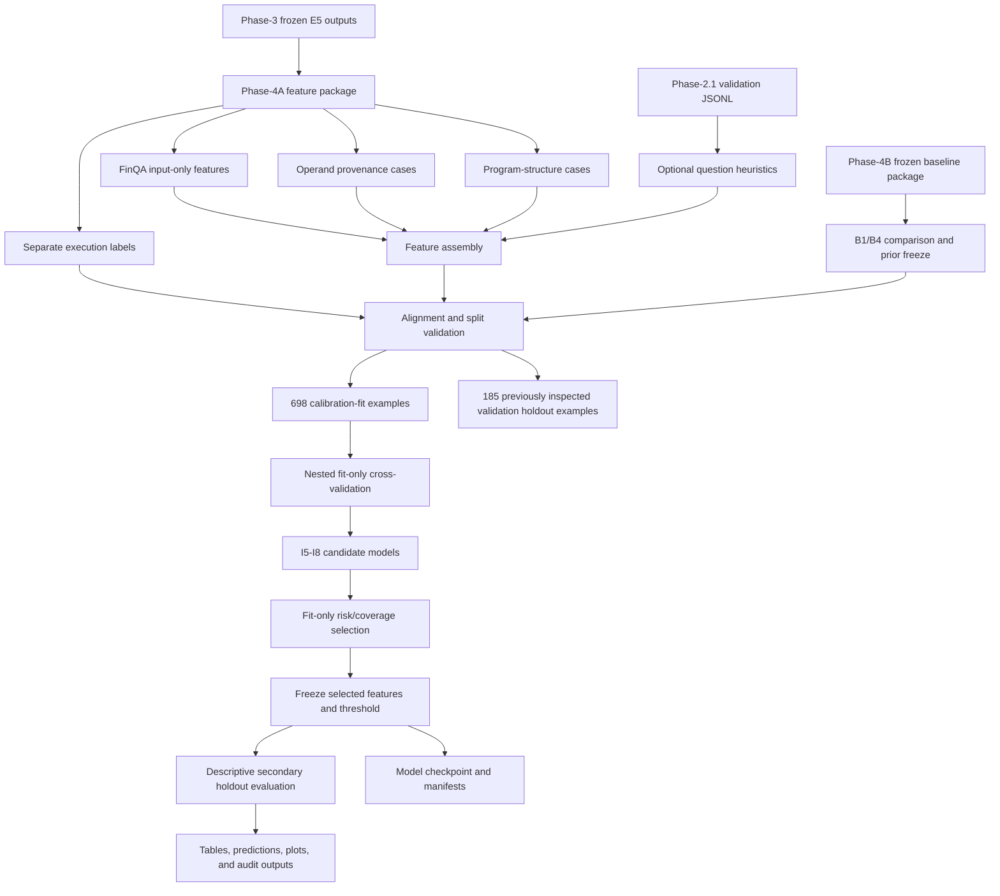

# TrustFin-SLM Phase-4B.1
## Evidence-Grounded, Verifier-Aware Risk Improvement

## 1. Purpose of this document

This document explains the architecture, data flow, experiments, safeguards, outputs, and interpretation of:

[`notebooks/TrustFin_Phase4B1_ReadyToRun_New.ipynb`](../notebooks/TrustFin_Phase4B1_ReadyToRun_New.ipynb)

The notebook is a follow-up development experiment to the original Phase-4B confidence-calibration work. It does **not** fine-tune the language model. Instead, it trains a small CPU-runnable risk estimator that predicts whether an already generated and executable financial program is likely to produce the correct numerical answer.

The central research question is:

> Can inference-time evidence, program-structure, operation, truncation, and likelihood features rank risky executable financial programs better than raw model likelihood alone?

The notebook is designed for research auditability. It separates source artifacts, labels, fitting data, holdout data, model selection, threshold fitting, and final evaluation. It also records when an output is only a development result and is not yet evidence of protected-test generalization.

---

## 2. Research context

The system starts with the frozen E5 TrustFin-SLM model:

- Backbone: Qwen3-1.7B
- Training approach: balanced FinQA + FiQA QLoRA
- Phase-3 model output: generated financial answers and executable programs
- Phase-4A: input-only verification features and separately stored correctness labels
- Original Phase-4B: likelihood, verifier-aware, and grounding-aware risk baselines
- Phase-4B.1: expanded evidence and program-risk feature investigation

The problem is that syntactic executability is not equivalent to semantic correctness. A generated program may parse and execute successfully while still calculating the wrong financial answer. Therefore, the notebook estimates **risk of incorrect execution**, rather than merely checking whether a program is syntactically valid.

The notebook explicitly distinguishes:

1. **Written-answer correctness** — whether the model's written answer is correct.
2. **Execution correctness** — whether the generated program executes to the correct numerical result.
3. **Program validity** — whether the program is officially executable and structurally valid.
4. **Risk estimation** — how likely an executable result is to be incorrect.
5. **Selective prediction** — accepting lower-risk examples and abstaining from higher-risk examples.

---

## 3. High-level architecture



### Architectural layers

| Layer | Responsibility |
|---|---|
| Input layer | Locate and load the Phase-4A and Phase-4B ZIP packages, plus optional Phase-3 and Phase-2.1 files. |
| Contract layer | Validate record IDs, labels, split names, counts, package readiness, and source alignment. |
| Feature layer | Build provenance, relevance, operation, structure, truncation, and question heuristic features. |
| Modeling layer | Fit low-capacity logistic risk models with nested cross-validation and optional sigmoid calibration. |
| Selection layer | Compare candidates using fit-only out-of-fold predictions. |
| Freeze layer | Save the selected feature policy, threshold, checkpoint, hashes, and research status before holdout analysis. |
| Evaluation layer | Produce descriptive holdout results, risk-coverage curves, subgroup checks, and paired bootstrap statistics. |
| Reporting layer | Write CSV tables, JSON manifests, model checkpoints, plots, and an executed notebook. |

---

## 4. Notebook execution design

The notebook has 33 cells:

- Markdown cells explain the research objective, run protocol, limitations, and experiment stages.
- Code cells implement configuration, loading, feature construction, modeling, evaluation, and artifact writing.
- The optional dependency cell is disabled by default (`INSTALL_DEPS = False`).
- The notebook is CPU-compatible and does not require SLM fine-tuning.

### Run modes

The configuration supports two modes:

```python
RUN_MODE = os.environ.get("TRUSTFIN_B1_MODE", "smoke").lower()
```

| Mode | Purpose | Outer folds | Inner folds | Bootstrap samples |
|---|---|---:|---:|---:|
| `smoke` | Pipeline and integrity check | 3 | 2 | 150 |
| `full` | Research run | 5 | 3 | 1200 |

The full run uses:

- Random seed: `42`
- Target coverage: `0.80`
- Risk-coverage points: `0.50`, `0.70`, `0.80`, `0.90`, `1.00`
- Regularization grid: `C = [0.1, 1.0]`

The notebook can receive explicit paths through environment variables. If they are not supplied, its discovery function searches repository-level canonical artifact directories and supports execution from either the repository root or the `notebooks/` directory.

---

## 5. Input architecture

### 5.1 Required Phase-4A package

The Phase-4A package supplies:

```text
phase4b_interface/phase4b_finqa_features.jsonl
labels/phase4b_finqa_labels.jsonl
analysis/A4_operand_evidence_cases.csv
analysis/A3_program_structure_cases.csv
phase4b_interface/phase4b_feature_policy.json
manifests/phase4a_readiness.json
```

The Phase-4A package contains 883 FinQA records. Features and labels are loaded separately so correctness labels cannot accidentally enter the predictor construction path.

### 5.2 Required Phase-4B package

The previous Phase-4B package supplies:

```text
manifests/phase4b_freeze.json
tables/B1_B4_fit_oof_comparison.csv
predictions/B1_B4_finqa_holdout_scores.csv
manifests/phase4b_readiness.json
```

These files provide the frozen likelihood-only baseline, the previous grounding-aware comparison, prior fit-only decisions, and the already-seen validation holdout scores.

### 5.3 Optional inputs

The notebook can also use:

- `Phase3_TrustFin_Deliverable.zip` for additional generated-program context.
- `artifacts/phase2_1/datasets/validation.jsonl` for question-text heuristics.

If the original validation questions are unavailable, the core I1–I9 pipeline still runs, but question-operation semantics remain pending. Even when question text is available, the notebook only creates lexical heuristics; it does not create a semantic financial verifier.

### 5.4 Input integrity assertions

Before feature engineering, the notebook verifies that:

- Phase-4A core readiness is `PASS`.
- Phase-4A full grounding readiness is `PASS`.
- Prior Phase-4B readiness is `PASS_FROZEN`.
- The prior Phase-4B fit winner is `B1_raw`.
- All four FinQA tables contain 883 records.
- Record IDs are unique and aligned across features, labels, operand cases, and operation cases.
- The split names are exactly `calibration_fit` and `calibration_holdout`.
- The split sizes are 698 fit records and 185 holdout records.
- Execution labels are binary.
- Existing holdout baseline scores have 185 records for both B1 and B4.

The notebook writes source fingerprints and SHA-256 hashes so that the inputs used by a run can be reproduced.

---

## 6. Data split and leakage policy

The split is the most important control in this experiment:

| Partition | Records | Role |
|---|---:|---|
| `calibration_fit` | 698 | Feature/model comparison, nested cross-validation, threshold fitting, bootstrap selection evidence |
| `calibration_holdout` | 185 | Secondary descriptive evaluation only; it was already inspected in prior Phase-4B/Phase-4C work |

The 185-record holdout must not be described as a newly untouched test set. It is not used to select:

- Feature groups
- Hyperparameters
- The candidate model
- The coverage policy
- The operational threshold

The only result that can support a final generalization claim is a separate protected FinQA test evaluation performed once after methodology freeze approval.

### Label-leakage controls

The following are excluded from predictors:

- `execution_correct`
- `written_correct`
- `corrected_correct`
- Gold answers
- Gold programs
- Error values
- Holdout labels during model selection

The risk models use input/model-output evidence only. Labels are merged after feature construction for evaluation.

---

## 7. Feature architecture: I1–I4

### I1 — Operand numerical provenance

The notebook parses operand evidence cases and derives input-only provenance features, including:

- Mean number of matched sources per operand
- Fraction of operands with multiple possible sources
- Mean question-local overlap
- Minimum question-local overlap
- Fraction of low-relevance operands
- Indicator for any zero-overlap operand
- Table-literal ratio
- Narrative-literal ratio
- Question-literal ratio
- Total literal count

These features answer questions such as:

- Were numeric literals found in the source evidence?
- Were they found in more than one place?
- Did the matched source overlap with the question?
- Are values concentrated in a table, narrative context, or question text?

They are evidence-quality indicators, not proof that the generated program selected the correct financial value.

### I2 — Question/evidence relevance

The relevance group uses lexical overlap features:

- `max_question_local_overlap`
- `operand_question_overlap_mean`
- `operand_question_overlap_min`
- `operand_low_relevance_fraction`
- `has_zero_question_overlap`
- `table_literal_ratio`
- `narrative_literal_ratio`
- `question_literal_ratio`
- `operand_sources_multi_fraction`

These features test question-local matching, not deep semantic relevance. They should therefore be reported as heuristics rather than as a verified financial reasoning layer.

### I3 — Program-operation consistency proxies

The operation group derives structural counts and indicators:

- Division count
- Subtraction count
- Multiplication count
- Addition count
- Number of unique operations
- Program step count
- Program reference count
- Presence of division
- Presence of table operations
- Presence of comparison operations

The features can identify patterns associated with higher risk, but they do not prove that the operation is mathematically appropriate for the question.

### I4 — Truncation and uncertainty

The truncation group uses generation and prompt signals:

- `prompt_tokens`
- `prompt_truncation_observed`
- `generated_tokens`

These features capture whether the model operated under a long or truncated context and whether the generated program length may indicate uncertainty.

When question text is available, the notebook additionally derives simple lexical indicators:

- Percentage/ratio language
- Difference language
- Total language
- A question-length heuristic

Those indicators are optional and are explicitly marked as non-semantic.

---

## 8. Feature groups and candidate models

The notebook compares a frozen raw-likelihood baseline with candidate risk models built from predeclared feature groups.

The principal feature families are:

| Candidate family | Main content |
|---|---|
| `I0_likelihood` | Raw source likelihood only |
| `I5_combined` | Likelihood plus provenance, relevance, operation, structure, truncation, and question features |
| `I8_no_provenance` | Combined model without provenance features |
| `I8_no_relevance` | Combined model without question/evidence relevance features |
| `I8_no_operation` | Combined model without operation features |
| `I8_no_truncation` | Combined model without truncation features |

The exact selected feature list is written to `phase4b1_fit_only_freeze.json`. In the verified final run, the selected candidate was `I5_combined_sigmoid`, meaning the fit-only selection favored the calibrated combined feature set.

### Model form

The risk estimator is a low-capacity scikit-learn pipeline:

1. Median imputation for missing values.
2. Standardization.
3. Logistic regression.
4. Optional sigmoid calibration for candidates that use the calibrated branch.

The small model is intentional. It keeps the risk estimator inference-available, auditable, and inexpensive compared with retraining the language model.

---

## 9. I5 — Nested fit-only risk estimation

For every candidate feature family except the raw likelihood baseline, the notebook creates out-of-fold predictions using nested cross-validation on the 698-record calibration-fit partition.

The procedure is:

1. Split the fit partition into outer folds.
2. For each outer fold, hold out the validation portion.
3. Run an inner cross-validation loop on the remaining outer-training portion.
4. Select the regularization value from the declared grid.
5. Fit the candidate on the outer-training portion.
6. Produce predictions for the outer-validation portion.
7. Concatenate all outer predictions into fit-only OOF scores.

This prevents a model from evaluating its own training examples and gives a fairer comparison of feature families.

The raw likelihood baseline is evaluated directly from the source likelihood values. It is not refitted as a new model.

---

## 10. I6 — Probability calibration

The notebook compares uncalibrated candidate probabilities with a sigmoid-calibrated version fitted only from the calibration-fit workflow.

Calibration metrics include:

- ROC-AUC: ranking quality
- Brier score: probability error
- Log loss: probabilistic quality
- AURC: area under the risk-coverage curve

Calibration does not make a predictor semantically correct. It only attempts to make the estimated probabilities better aligned with observed fit-partition outcomes.

---

## 11. I7 — Selective prediction and risk-coverage

Selective prediction ranks records by estimated correctness risk and accepts the lower-risk examples until the target coverage is reached. The notebook emphasizes target coverage of 80%.

For a selected set \(S\), selective risk is:

```text
selective risk = number of incorrect accepted examples / number of accepted examples
```

The valid-program gate is applied so that structurally invalid or officially non-executable records are not treated as acceptable successful answers.

Thresholds are derived from fit-only OOF scores. The realized coverage can differ slightly from the target on another partition; this is expected and is documented in the freeze manifest.

The notebook writes:

- Fit risk-coverage tables
- A fit risk-coverage plot
- Accepted-count and coverage values
- The fixed selected-model threshold
- The baseline likelihood threshold

---

## 12. I8 — Ablation study

The ablation stage removes one feature family at a time:

- No provenance
- No relevance
- No operation
- No truncation

The purpose is to determine whether the apparent fit improvement depends on a particular evidence source. Ablation results are interpreted as diagnostic evidence, not as causal proof. With a single 698-record fit partition, ablation differences should be treated as preliminary until tested on the protected set.

---

## 13. I9 — Candidate freeze and statistical checks

The candidate-selection rule is fit-only:

1. Primary criterion: lowest selective error at 80% target coverage with the valid-program gate.
2. Tie-breaker 1: lower fit AURC.
3. Tie-breaker 2: lower fit Brier score.

The notebook also performs paired bootstrap sampling on the fit OOF predictions to estimate uncertainty for the baseline-minus-candidate risk difference.

After selection, it freezes:

- Candidate feature family
- Exact feature list
- Logistic/sigmoid setting
- Selected regularization value
- Fit-only risk threshold
- Baseline threshold
- Source fingerprints
- Model checkpoint hash
- Holdout-use status

Only after writing this freeze does the notebook perform the secondary holdout evaluation.

---

## 14. Secondary holdout evaluation

The 185-record holdout is evaluated after the freeze to provide descriptive evidence. It is not a new independent test and must not be used to revise the candidate.

The notebook reports:

- B1 raw-likelihood scores
- B4 historical grounding-aware scores
- The selected Phase-4B.1 candidate
- Holdout risk and coverage
- Matched comparisons
- Paired bootstrap summaries
- Operational threshold behavior

The holdout results are useful for diagnosing stability, but they do not convert the development experiment into a protected-test result.

---

## 15. Output architecture

All Phase-4B.1 outputs are written under:

```text
artifacts/phase4b_1/
├── manifests/
├── tables/
├── predictions/
├── models/
├── plots/
└── analysis/
```

### Manifests

Important files include:

- `manifests/source_fingerprints.json`
  - Input paths
  - SHA-256 hashes
  - Record counts
  - Split counts
  - Protected-test status
- `manifests/phase4b1_readiness.json`
  - Overall research-audit status
  - Candidate status
  - Holdout status
  - Semantic-verification limitations
- `manifests/phase4b1_fit_only_freeze.json`
  - Exact selected feature list
  - Fit metrics
  - Thresholds
  - Bootstrap interval
  - Checkpoint hash
  - Required next evidence

### Tables

The principal tables are:

- `tables/I5_I8_fit_oof_comparison.csv`
- `tables/I6_calibration_comparison.csv`
- `tables/I7_risk_coverage_fit.csv`
- `tables/I8_feature_ablation.csv`
- `tables/I9_secondary_holdout_comparison.csv`
- `tables/I9_secondary_holdout_risk_coverage.csv`
- `tables/I9_paired_bootstrap.csv` or the corresponding generated paired-statistics table

### Predictions

The prediction outputs preserve record-level scores for:

- Fit OOF predictions
- Selected fit scores
- Secondary holdout scores

### Models

The selected fit-only checkpoint is written as:

```text
models/I9_fit_only_selected.joblib
```

The manifest records its SHA-256 checksum. This checkpoint is a risk estimator, not a replacement for the frozen SLM.

### Plots

Plots include:

- Fit risk-coverage curves
- Calibration or model-comparison figures
- Ablation and subgroup visualizations

### Analysis

Analysis outputs include subgroup audits for the I1–I4 feature families and related diagnostic summaries.

---

## 16. Verified final run

The notebook was executed in full mode using the canonical repository packages:

```text
Phase-4A:
artifacts/phase4a/Phase4A_Review_Package.zip

Phase-4B:
artifacts/phase4b_full/Phase4B_Review_Package.zip

Optional Phase-3:
deliverables/Phase3_TrustFin_Deliverable.zip
```

The final execution completed without notebook cell errors using Python 3.12.3 and scikit-learn 1.9.1. Because model-selection scores can vary across library versions, reproducibility requires recording and reusing the execution environment. The selected candidate and metrics below refer to this verified environment.

### Final readiness status

From `phase4b1_readiness.json`:

| Field | Value |
|---|---|
| Run mode | `full` |
| Status | `PASS_RESEARCH_AUDIT` |
| Fit records | 698 |
| Reserved validation holdout | 185 |
| Selected candidate | `I5_combined_sigmoid` |
| Selected before holdout | `true` |
| Research conclusion | `CANDIDATE_FOR_PROTECTED_TEST` |
| Secondary holdout | Descriptive only; already seen |
| Protected test evaluated | `false` |
| Full semantic financial grounding verified | `false` |
| FinTrust seven-dimension protocol | Pending separate evaluator validation |

### Fit-only comparison

From `phase4b1_fit_only_freeze.json`:

| Metric | Raw likelihood `I0` | Selected candidate |
|---|---:|---:|
| Valid fit records | 696 | 696 |
| ROC-AUC | 0.5845 | 0.6733 |
| Brier score | 0.2646 | 0.2002 |
| AURC | 0.2390 | 0.2170 |
| Selective risk at 80% | 0.2880 | 0.2594 |
| Realized coverage | 0.8009 | 0.8009 |
| Accepted records | 559 | 559 |

The fit-only baseline-minus-candidate selective-risk difference is approximately `0.0286`, with a bootstrap 95% interval of approximately `[0.0072, 0.0537]`.

These are fit-partition development results. They justify advancing the candidate to a protected-test evaluation, but they do not justify a final publication claim of superiority.

---

## 17. Interpretation of the result

The current result supports the following careful statement:

> On the 698-example calibration-fit partition, the selected verifier-aware feature model improved risk ranking and reduced selective error at approximately 80% coverage relative to raw likelihood. The candidate was selected before the previously inspected validation holdout was evaluated and is therefore ready for one protected-test comparison after methodology approval.

The following statements are **not** justified yet:

- The candidate is proven superior on unseen data.
- The model performs semantic financial verification.
- The lexical relevance features understand financial meaning.
- The 185-record holdout is a new independent test set.
- The risk probabilities are guaranteed calibrated in deployment.
- The result proves causal benefit from any individual feature family.

---

## 18. Reproducibility and execution procedure

From the repository root:

```bash
TRUSTFIN_B1_MODE=smoke \
jupyter nbconvert --to notebook --execute --inplace \
  notebooks/TrustFin_Phase4B1_ReadyToRun_New.ipynb
```

After smoke mode passes, run the full experiment:

```bash
TRUSTFIN_B1_MODE=full \
jupyter nbconvert --to notebook --execute --inplace \
  notebooks/TrustFin_Phase4B1_ReadyToRun_New.ipynb
```

The notebook's path discovery supports the repository layout, but explicit environment paths can be supplied when working from another location:

```bash
export TRUSTFIN_INPUT_DIR="/path/to/Research Papers"
export TRUSTFIN_PHASE4A_ZIP="/path/to/Phase4A_Review_Package.zip"
export TRUSTFIN_PHASE4B_ZIP="/path/to/Phase4B_Review_Package.zip"
export TRUSTFIN_PHASE3_ZIP="/path/to/Phase3_TrustFin_Deliverable.zip"
export TRUSTFIN_PHASE2_VALIDATION_JSONL="/path/to/validation.jsonl"
export TRUSTFIN_PHASE4B1_OUTPUT="/path/to/artifacts/phase4b_1"
```

Do not tune the method after examining the secondary holdout. Any further model or threshold change requires a new documented fit-only selection procedure.

---

## 19. Recommended next step

The next research step is a one-time protected FinQA test comparison after independent methodology-freeze approval:

1. Confirm the feature list and threshold in the freeze manifest.
2. Do not change the candidate based on the 185-record holdout.
3. Evaluate the frozen candidate and raw-likelihood baseline on the protected test.
4. Report coverage, selective risk, ROC-AUC, Brier score, and confidence intervals.
5. Update the research paper only with the protected-test evidence.

Until that step is complete, Phase-4B.1 should be described as a fit-validated risk-estimation candidate and not as a final verified improvement.

---

## 20. Related files

- Notebook: [`notebooks/TrustFin_Phase4B1_ReadyToRun_New.ipynb`](../notebooks/TrustFin_Phase4B1_ReadyToRun_New.ipynb)
- Results: [`artifacts/phase4b_1/`](../artifacts/phase4b_1/)
- Phase-4B baseline explanation: [`docs/exp_4(b).md`](./exp_4(b).md)
- Phase-4C explanation: [`docs/exp_4(c).md`](./exp_4(c).md)
- Phase-4 verification guide: [`docs/TrustFin_Phase4B_Phase4C_Verification_and_Student_Research_Guide.docx`](./TrustFin_Phase4B_Phase4C_Verification_and_Student_Research_Guide.docx)
