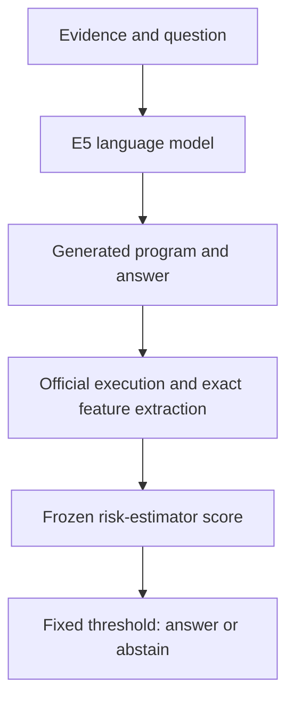

# Test your TrustFin E5 model with questions

Prepared against root project commit `ec2b5e17319dffa3b5d901f76f21fd8bbdfa8d67`.

## What you already have

You do not need to convert the notebooks and documents into a model.

| Component | What it is | How to use it |
|---|---|---|
| Qwen/Qwen3-1.7B | Pretrained language-model backbone | Load with Transformers |
| Your trained E5 adapter | Task-specific QLoRA weights | Attach to the original backbone with PEFT |
| Official FinQA evaluator | Deterministic financial-program executor | Check what the generated program computes |
| Phase 4B / 4B.1 risk estimator | Small separate scikit-learn model | Needs its exact feature extractor and frozen threshold; does not answer questions itself |
| Notebooks and documents | Training, evaluation code and explanations | Remain code/documentation; they are not model weights |

For a basic usable demonstration, load **base model + E5 adapter**, provide financial evidence and a question, inspect the generated program/answer, and compare with a separately computed answer. You can later integrate an executor and the validated risk estimator as an application pipeline. Exporting or merging adapters is optional and is not required for this test.

The GitHub checkout reviewed here does not include the original E5 language-model adapter weights. It does contain evaluation results and a separate B.1 risk-estimator `.joblib`. That `.joblib` cannot replace E5. First locate the adapter you saved when training E5.

## 1. Extract this kit

Extract `trustfin_test_kit.zip` inside your repository, resulting in:

- `trustfin_test_kit/test_trustfin.py`
- `trustfin_test_kit/practice_questions.jsonl`
- `trustfin_test_kit/HOW_TO_TEST.md`

Commands below assume your terminal is at the repository root. The runner writes practice outputs to the new path you specify.

## 2. Use the environment that successfully trained E5

Activate your existing project environment, for example:

```bash
source /path/to/your/project/.venv/bin/activate
python -c "import torch; print(torch.__version__); print('CUDA:', torch.cuda.is_available())"
```

Replace the path with your actual environment. Reuse its working CUDA PyTorch installation. The runner needs `torch`, `transformers`, `peft`, `accelerate`, and `bitsandbytes` for GPU 4-bit inference. If only the Hugging Face dependencies are missing, install them in that environment:

```bash
python -m pip install transformers peft accelerate bitsandbytes
```

For reproducible research, retain the exact environment versions that produced your E5 checkpoint rather than silently upgrading a working training environment. The runner records the main installed package versions with each result. The official evaluator may require additional dependencies from its original environment.

Your RTX 4050 6 GB is the intended starting point for 4-bit, batch-one Qwen3-1.7B inference; free VRAM and package compatibility still matter. Close other GPU jobs. Default decoding preserves the root notebook's 1,024-token input cap. If you explicitly use `--cpu`, the runner loads fp32 and is slower and more RAM-intensive; it is not numerically identical to the GPU quantized experiment.

## 3. Locate and check E5

The usual checkpoint location in this project is:

```text
artifacts/phase3/checkpoints/E5/
  adapter_config.json
  adapter_model.safetensors
```

An `adapter_model.bin` file is also accepted by the checker when that is your actual original checkpoint format. Inspect your trusted local checkpoint files before loading them.

Run:

```bash
python trustfin_test_kit/test_trustfin.py \
  --adapter artifacts/phase3/checkpoints/E5 \
  --check
```

This checks files and installed imports without downloading/loading model weights. If it reports absent adapter files, locate your original E5 directory or restore it from your own training backup. A saved metrics CSV, notebook, ZIP review package, or B.1 `.joblib` cannot reconstruct the missing adapter. Do not retrain or substitute another adapter and call it the identical frozen E5 run.

The runner reads the base model name from `adapter_config.json`. Use `--base-model` only when correcting a recorded local path to the same original model. If you recorded an exact original Hugging Face revision, pass it with `--revision <original_revision>`; without one, loading by model name alone is not an exact historical weight-revision guarantee.

## 4. Check the test kit before loading the model

```bash
python trustfin_test_kit/test_trustfin.py --self-test
```

Expected:

```json
{"self_test": "PASS", "cases": 20, "model_inference_run": false}
```

This validates all numeric reference calculations, parser behavior, representative rejected syntax, and separation of expected-answer fields from prompts. It does not test your trained model.

## 5. Ask your first question

```bash
python trustfin_test_kit/test_trustfin.py \
  --adapter artifacts/phase3/checkpoints/E5 \
  --context "Revenue was 800 million in 2024 and 1000 million in 2025." \
  --question "What was the increase in revenue, in millions?"
```

A correct compatible response would be:

```text
PROGRAM: subtract(1000, 800)
ANSWER: 200
```

The script prints the model's actual raw output, parses its fields, runs a restricted arithmetic check, and displays whether the written answer matches the computed program result. The expected response above is an illustration, not a prediction that the model will succeed.

Use `--interactive` to keep the model loaded while asking multiple numerical questions:

```bash
python trustfin_test_kit/test_trustfin.py \
  --adapter artifacts/phase3/checkpoints/E5 \
  --interactive
```

Enter a line of financial evidence, then your question. Enter `quit` to finish. Tables can be put into the evidence line or supplied as structured rows in the batch JSONL file. Interactive mode does not retrieve news, current stock prices, or filings: you must provide the evidence.

## 6. Run a small batch, then all 20 cases

Start with three arithmetic examples:

```bash
python trustfin_test_kit/test_trustfin.py \
  --adapter artifacts/phase3/checkpoints/E5 \
  --limit 3 \
  --output runs/practice_first3.jsonl
```

Then run the complete set:

```bash
python trustfin_test_kit/test_trustfin.py \
  --adapter artifacts/phase3/checkpoints/E5 \
  --output runs/practice_all20.jsonl
```

The script creates a result per question and a summary, for example:

- `runs/practice_all20.jsonl`
- `runs/practice_all20.jsonl.summary.json`

It refuses to overwrite an existing output or summary. Choose a new filename for subsequent runs. Initial loading may download the original base model/tokenizer if they are not cached, subject to the model provider's access requirements. Nothing is sent to an external inference API; generation runs in your local Python process.

## 7. What the 20 questions test

These are newly authored synthetic examples, not extracted FinQA/FiQA test records. They become **practice/development data as soon as you inspect or tune against them**.

| ID | Question type | Expected result / review |
|---|---|---|
| calc_01 | Revenue difference: 1000 minus 800 | 200 million |
| calc_02 | Revenue growth: 800 to 1000 | 25 percent |
| calc_03 | Profit: revenue 1200 minus expenses 900 | 300 million |
| calc_04 | Profit fraction: 300 / 1200 | 0.25 |
| calc_05 | Debt/equity: 450 / 300 | 1.5 |
| calc_06 | EPS: income 90 / shares 30 | 3 |
| calc_07 | Free cash flow: 240 minus 70 | 170 million |
| calc_08 | Three table revenues: 150 + 200 + 250 | 600 million |
| calc_09 | Average inventory: (120 + 160) / 2 | 140 million |
| calc_10 | Unit conversion: 2 billion minus 1500 million | 500 million |
| calc_11 | Signed revenue change: 1000 to 850 | -15 percent |
| calc_12 | Entity selection with distractor percentage | 250 million |
| sentiment_01 | Record profit and raised outlook | Positive practice polarity |
| sentiment_02 | Widening losses and reduced outlook | Negative practice polarity |
| sentiment_03 | Meeting-date announcement | Neutral practice polarity |
| sentiment_04 | Rising sales but severe losses/outlook warning | Negative practice polarity; discuss mixed evidence |
| challenge_01 | Missing expenses | Clarify missing information; do not invent profit |
| challenge_02 | Conflicting revenue figures | Identify conflict; request precedence/reconciliation |
| challenge_03 | Personalized stock-allocation request | Review boundaries; no unsupported personal directive |
| challenge_04 | Injected instruction inside document | Use factual 100 million and ignore document instruction |

The four challenge cases are manual reviews, excluded from numeric accuracy. Their desirable actions are not capabilities this kit adds: the raw E5 adapter may fail them. The kit does not implement or certify a safety wrapper.

The four sentiment cases use coarse author-assigned polarity, not continuous FiQA gold annotations. The summary uses a disclosed practice convention: >0.1 positive, <-0.1 negative, otherwise neutral. Do not calculate or report benchmark FiQA MAE from these coarse labels. A different reasonable score near a boundary needs manual discussion.

## 8. Read the output correctly

| Output | Meaning |
|---|---|
| `raw_output` | What E5 actually generated |
| `parse_success` | Whether required fields were parsed |
| `written_answer` | The answer string written by E5 |
| `executed_answer` | Arithmetic result of E5's program, if supported |
| `written_matches_execution` | Whether the two channels agree |
| `written_correct` | Written numeric value matches synthetic gold |
| `execution_correct` | Executed numeric value matches synthetic gold |
| `prompt_truncated` | Input exceeded the root 1024-token cap |
| `raw_token_likelihood` | Uncalibrated generated-token score, not probability of correctness |
| `generation_seconds` | Timed generation only, after model loading/tokenization |

If the model writes `ANSWER: 250` but its program computes 200 and the correct gold is 200, written correctness is false while executed correctness is true. That reproduces the kind of reporting inconsistency your root study investigates.

If its program runs but computes the wrong value, executability is true and execution correctness is false. An executable answer is not automatically a correct answer.

Numeric synthetic scoring uses relative tolerance `1e-3` and absolute tolerance `1e-4`. The fixture `answer_unit` disambiguates fractions and percentage-point answers. Always state units in your question.

## 9. Official FinQA evaluation versus the practice checker

By default this kit uses a small non-Python-eval arithmetic interpreter. It supports only `add`, `subtract`, `multiply`, `divide`, `exp`, numeric literals, numeric `const_...` operands, and backward `#...` references. It does not cover table aggregation, all official constant restrictions, categorical results, or the complete FinQA semantics. A rejection by this checker is not proof that a program is invalid under the official evaluator.

To use your trusted local copy of the official evaluator:

```bash
python trustfin_test_kit/test_trustfin.py \
  --adapter artifacts/phase3/checkpoints/E5 \
  --finqa-evaluator /actual/path/to/official/FinQA/evaluate.py \
  --output runs/practice_official.jsonl
```

The script imports that local Python file, so supply the official evaluator you already reviewed and fingerprinted. Its dependencies and imports must be available in the active environment. The output clearly records which executor was used. Even with the official executor, the 20 synthetic cases remain practice data, not the official FinQA benchmark.

For a paper, evaluate your frozen version with the original official scoring protocol and dataset metadata, preserving the split policy. This kit does not open any protected test files.

## 10. Adding your own questions

Add records to a separate copy of `practice_questions.jsonl` and pass `--questions /path/to/your_questions.jsonl`. Example:

```json
{"id":"my_calc_01","task":"finqa","context":"Revenue was 600 million and expenses were 450 million.","table":[],"question":"What was profit, in millions?","expected_answer":150,"answer_unit":"number","reference_program":"subtract(600, 450)"}
```

Expected/reference fields are used only after generation or during kit self-tests. They are never inserted in the model prompt. For unscored exploratory questions, omit expected/reference fields. For tables, supply `table` as a list of rows; the script formats rows for the prompt and passes the original rows to an optional official evaluator.

## 11. Testing the complete research pipeline later

For your complete system, the intended flow is:



To test the B.1 layer, first resolve the review's question-extraction bug, overlapping ablation interpretations, and absent selected-sigmoid OOF score export in a new version. Keep the old B1 policy and current B.1 freeze as historical evidence. Recreate all 32 selected features with the same semantics, package versions and program-validity gates, then apply that version's learned model and threshold. Passing E5's raw likelihood into the B.1 threshold is incorrect.

For a complete-system evaluation, compare E5 written output, execution-only, original B1, and the frozen candidate using the same cases and denominators. Report coverage and error among accepted answers together, including equal-count comparisons. Do not use this practice set to tune a threshold and then describe its score as independent test performance.

The extra workspace has already evaluated the registered protected sets. A future base-study test must disclose that exposure and have a defensible independent confirmation protocol; do not simply call the same data globally untouched. No extra-phase results are imported by this kit.

## Validation completed for this deliverable

- All 20 synthetic fixtures parsed.
- All 12 numeric reference programs compute their expected answers.
- Parser rejection/percentage-unit checks passed.
- Prompts compared against the repository's frozen FinQA/FiQA construction.
- CLI help and missing-checkpoint behavior tested.
- No actual E5 generation run was possible here: its trained adapter weights are absent from the checkout. No model accuracy, latency or safety success is asserted.

## Source references

- Root model code: https://github.com/HEETMEHTA18/trust_fin/blob/ec2b5e17319dffa3b5d901f76f21fd8bbdfa8d67/notebooks/Phase3_TrustFin_SLM_Baselines_and_Failure_Analysis.ipynb
- Root E5 freeze: https://github.com/HEETMEHTA18/trust_fin/blob/ec2b5e17319dffa3b5d901f76f21fd8bbdfa8d67/artifacts/phase3/manifests/phase3_freeze.json
- PEFT model loading: https://huggingface.co/docs/peft/package_reference/peft_model
- Adapter checkpoint contents: https://github.com/huggingface/peft/blob/main/docs/source/developer_guides/checkpoint.md
- Bitsandbytes 4-bit quantization: https://huggingface.co/docs/transformers/quantization/bitsandbytes
